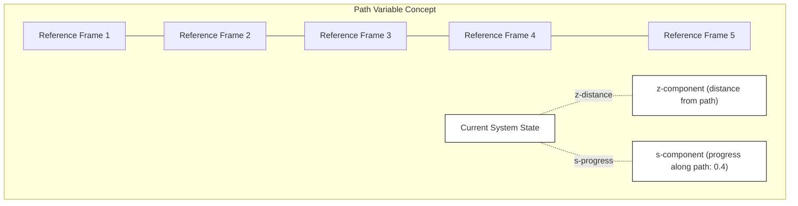
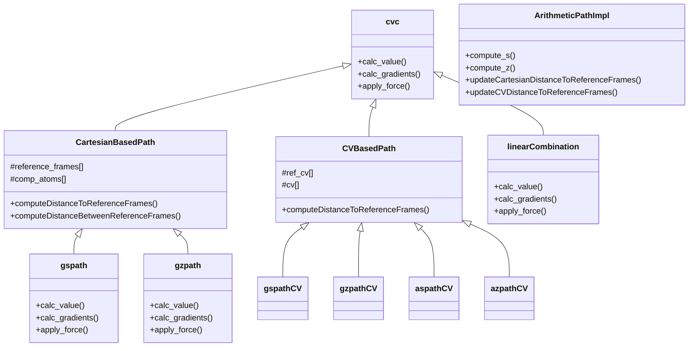
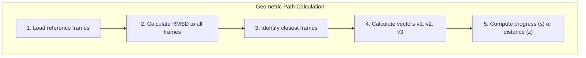
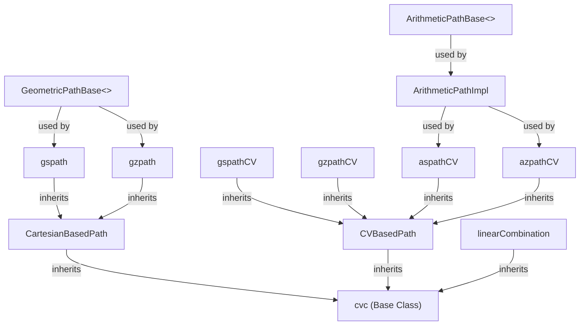
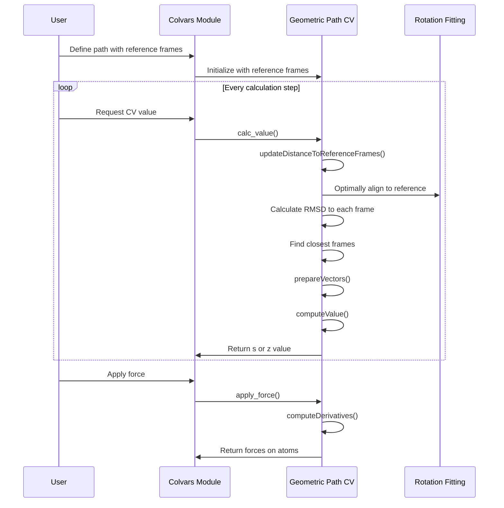

# Path-based Variables

<details>
<summary>Relevant source files</summary>

The following files were used as context for generating this wiki page:

- [README-versions.md](README-versions.md)
- [doc/.gitignore](doc/.gitignore)
- [doc/Makefile](doc/Makefile)
- [doc/colvars-code-refs.bib](doc/colvars-code-refs.bib)
- [doc/colvars-engine-flags.tex](doc/colvars-engine-flags.tex)
- [doc/colvars-refman-gromacs.tex](doc/colvars-refman-gromacs.tex)
- [doc/colvars-refman-lammps.tex](doc/colvars-refman-lammps.tex)
- [doc/colvars-refman-main.tex](doc/colvars-refman-main.tex)
- [doc/colvars-refman-namd.tex](doc/colvars-refman-namd.tex)
- [doc/colvars-refman-tinkerhp.tex](doc/colvars-refman-tinkerhp.tex)
- [doc/colvars-refman-vmd.tex](doc/colvars-refman-vmd.tex)
- [doc/colvars-refman.bib](doc/colvars-refman.bib)
- [doc/colvars-refman.tex](doc/colvars-refman.tex)
- [doc/extract_code_refs.py](doc/extract_code_refs.py)
- [doc/print_engine_versions.sh](doc/print_engine_versions.sh)
- [namd/ug/ug_colvars.tex](namd/ug/ug_colvars.tex)
- [src/colvar_arithmeticpath.h](src/colvar_arithmeticpath.h)
- [src/colvar_geometricpath.h](src/colvar_geometricpath.h)
- [src/colvar_neuralnetworkcompute.cpp](src/colvar_neuralnetworkcompute.cpp)
- [src/colvar_neuralnetworkcompute.h](src/colvar_neuralnetworkcompute.h)
- [src/colvarcomp_alchlambda.cpp](src/colvarcomp_alchlambda.cpp)
- [src/colvarcomp_apath.cpp](src/colvarcomp_apath.cpp)
- [src/colvarcomp_combination.cpp](src/colvarcomp_combination.cpp)
- [src/colvarcomp_gpath.cpp](src/colvarcomp_gpath.cpp)
- [src/colvarcomp_neuralnetwork.cpp](src/colvarcomp_neuralnetwork.cpp)
- [src/colvarmodule_refs.h](src/colvarmodule_refs.h)
- [src/replace_stl_math.sh](src/replace_stl_math.sh)
- [vmd/doc/ug_colvars.tex](vmd/doc/ug_colvars.tex)

</details>


This page documents the path-based collective variables in the Colvars module, which are designed to track progress along predefined transition paths in configurational space. These variables are particularly useful for studying complex conformational changes, reaction coordinates, and multidimensional transitions in molecular systems. For basic collective variables like distances and angles, see [Basic Collective Variables](#3.1). For neural network-based variables, see [Neural Network Variables](#3.3).

## Introduction to Path Variables

Path-based collective variables provide a way to measure progress along a predefined path in configurational space. The path is defined by a series of reference frames (also called "images"), which can be atomic structures or values of other collective variables. Two key quantities are typically calculated:

1. **s-component**: Measures progress along the path (normalized from 0 to 1)
2. **z-component**: Measures deviation from the path (distance to the closest reference point)

Sources: [src/colvarcomp_gpath.cpp:177-457](), [src/colvar_geometricpath.h:19-134]()



Sources: [src/colvarcomp_gpath.cpp:122-166](), [src/colvarcomp_gpath.cpp:372-451]()

## Types of Path Variables

The Colvars module provides several types of path-based variables:

1. **Geometric Path**: Based on RMSD between current configuration and reference frames
   - `gspath`: s-component (progress along path)
   - `gzpath`: z-component (distance from path)

2. **Arithmetic Path**: Uses a softer interpolation between reference frames
   - `aspath`: s-component 
   - `azpath`: z-component

3. **CV-based Path**: Path defined in the space of other collective variables
   - `gspathCV`, `gzpathCV`: Geometric path in CV space
   - `aspathCV`, `azpathCV`: Arithmetic path in CV space



Sources: [src/colvarcomp_gpath.cpp:22-174](), [src/colvarcomp_gpath.cpp:177-474](), [src/colvarcomp_gpath.cpp:477-597](), [src/colvar_arithmeticpath.h:12-135]()

## Geometric Path Variables

Geometric path variables (`gspath` and `gzpath`) calculate progress along a predefined path based on root-mean-square deviation (RMSD) between the current configuration and reference frames.

### gspath (Geometric Path s-component)

The `gspath` component calculates the progress along the path. It:

1. Calculates RMSD to each reference frame
2. Identifies the minimum (closest frame) and second minimum
3. Uses these frames to compute a continuous s-value between 0 and 1

**Configuration options**:
- `atoms`: Set of atoms used for RMSD calculation
- `refPositionsFile<N>`: Separate files containing reference structures (N starting from 1)
- `fittingAtoms`: Optional set of atoms used for optimal structural alignment
- `useSecondClosestFrame`: Whether to use the second closest frame (default: true)
- `useThirdClosestFrame`: Whether to use the third closest frame (default: false)

Sources: [src/colvarcomp_gpath.cpp:177-209](), [src/colvarcomp_gpath.cpp:299-330]()

### gzpath (Geometric Path z-component)

The `gzpath` component calculates the distance from the path. It:

1. Calculates RMSD to each reference frame
2. Identifies the closest reference frame
3. Computes a continuous z-value representing distance from the path

**Configuration options**:
- Same options as `gspath`, plus:
- `useZsquare`: Use squared distance instead of linear distance (default: false)

Sources: [src/colvarcomp_gpath.cpp:333-374](), [src/colvarcomp_gpath.cpp:453-474]()



Sources: [src/colvarcomp_gpath.cpp:122-166](), [src/colvarcomp_gpath.cpp:212-298](), [src/colvarcomp_gpath.cpp:376-451]()

## Arithmetic Path Variables

Arithmetic path variables (`aspath` and `azpath`) offer an alternative mathematical approach to define progress along a path. Unlike geometric paths, which use discrete RMSD calculations, arithmetic paths use a softer interpolation based on weighted exponentials.

### Key features

- Uses a parameter λ (lambda) to control path smoothness
- Weights can be applied to different elements of the structure
- Provides smoother gradients compared to geometric paths

**Configuration example**:
```
aspath {
  atoms {
    atomNumbers 1-100
  }
  refPositionsFile1 ref1.pdb
  refPositionsFile2 ref2.pdb
  refPositionsFile3 ref3.pdb
  weights 1.0 1.0 1.0 # equal weights for all atoms
  lambda 20.0 # smoothness parameter
}
```

Sources: [src/colvar_arithmeticpath.h:16-134](), [src/colvarcomp_apath.cpp:22-105]()

## CV-based Path Variables

CV-based path variables perform calculations in the space of other collective variables, rather than directly in Cartesian space. This allows for defining paths in reduced-dimensional spaces that are specific to your system.

### Key components

- `gspathCV` and `gzpathCV`: Use geometric path calculations on CV values
- `aspathCV` and `azpathCV`: Use arithmetic path calculations on CV values
- Path is defined by giving reference values for each collective variable at each point along the path

**Example configuration for CV-based path**:
```
gspathCV {
  distance {
    group1 { atomNumbers 1 2 3 }
    group2 { atomNumbers 10 11 12 }
  }
  angle {
    group1 { atomNumbers 30 31 }
    group2 { atomNumbers 32 33 }
    group3 { atomNumbers 34 35 }
  }
  pathFile path.txt # Contains reference CV values
}
```

Where `path.txt` contains rows of reference values for each CV:
```
1.5 120.0  # Frame 1: distance=1.5, angle=120.0
2.0 100.0  # Frame 2
2.5  90.0  # Frame 3
...
```

Sources: [src/colvarcomp_gpath.cpp:477-597](), [src/colvarcomp_apath.cpp:107-248]()

## Implementation Details

### Core Classes and Inheritance

Path-based variables are implemented through a hierarchy of classes:



Sources: [src/colvarcomp_gpath.cpp:22-174](), [src/colvar_geometricpath.h:19-134](), [src/colvar_arithmeticpath.h:16-134]()

### Calculation Flow for Geometric Path Variables



Sources: [src/colvarcomp_gpath.cpp:122-166](), [src/colvarcomp_gpath.cpp:299-330](), [src/colvarcomp_gpath.cpp:376-474]()

## Selection Considerations

When choosing which path variable to use:

1. **Geometric Path (gspath/gzpath)**:
   - Good for well-defined transitions with distinct intermediate states
   - Works best when reference frames are relatively close to each other
   - More straightforward interpretation of progress and distance

2. **Arithmetic Path (aspath/azpath)**:
   - Better for smooth transitions where intermediate states might be unknown
   - Provides smoother gradients and continuous interpolation
   - Allows tuning of smoothness through lambda parameter

3. **CV-based Path**:
   - Use when the relevant degrees of freedom can be captured by specific CVs
   - Allows focusing on the most important system coordinates
   - Can reduce dimensionality of the problem

## Technical Implementation Notes

- Path variables implement explicit gradients to accurately propagate forces to atoms
- Geometric path calculations require optimal rotation alignment of structures
- Reference frames are loaded at initialization and stored throughout the simulation
- Custom fitting options allow for focusing alignment on specific regions of the structure

Sources: [src/colvarcomp_gpath.cpp:107-121](), [src/colvarcomp_gpath.cpp:212-298](), [src/colvar_geometricpath.h:136-254]()

---