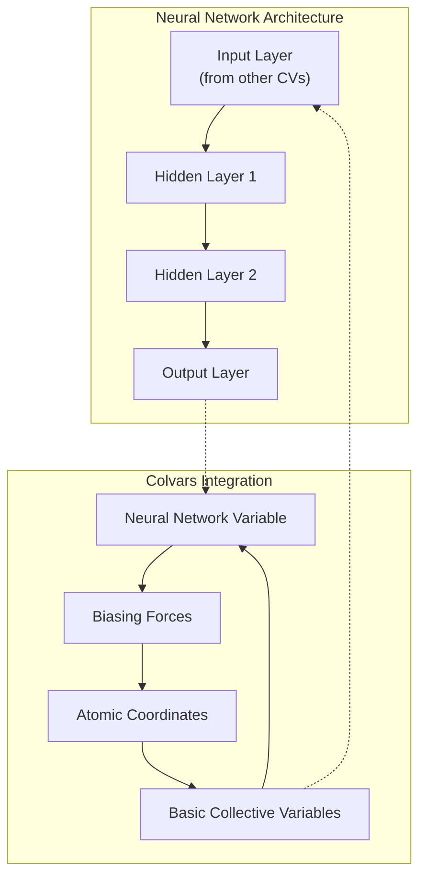
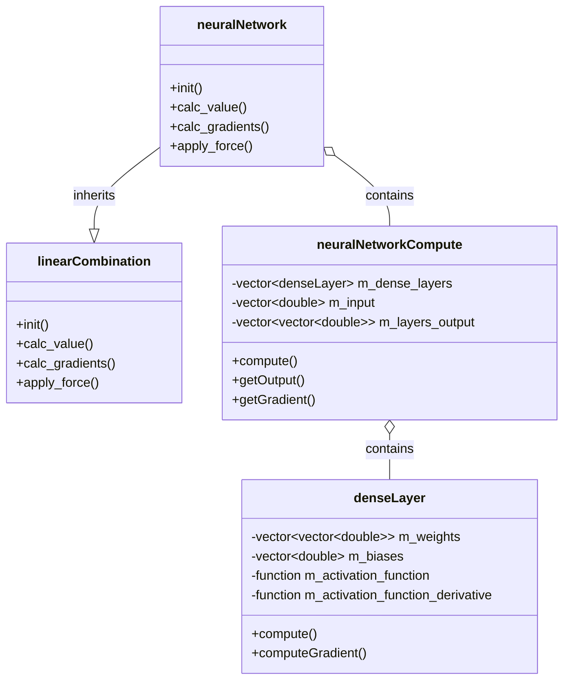
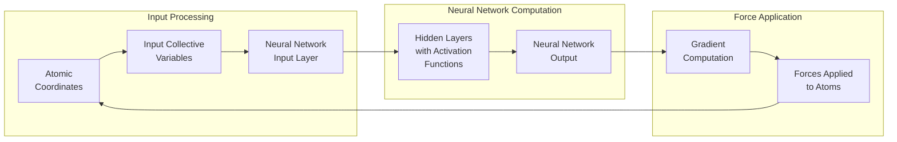
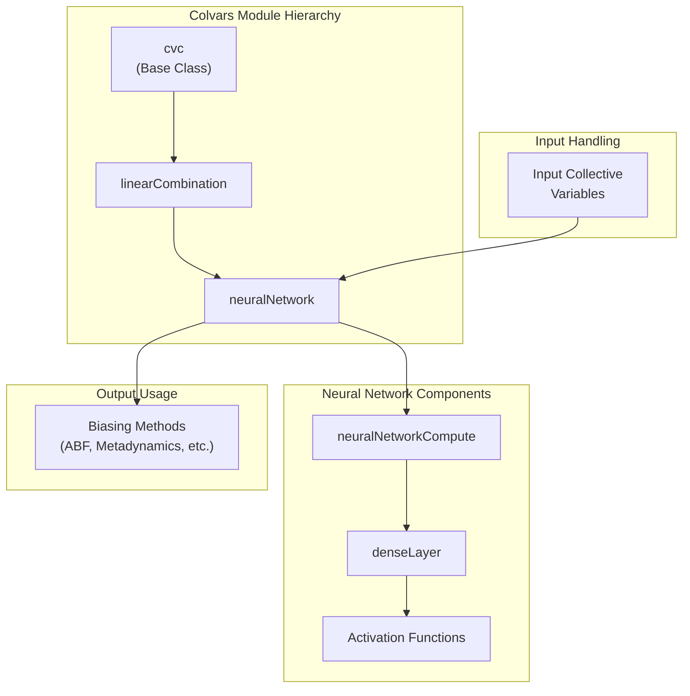

# Neural Network Variables

<details>
<summary>Relevant source files</summary>

The following files were used as context for generating this wiki page:

- [README-versions.md](README-versions.md)
- [doc/.gitignore](doc/.gitignore)
- [doc/Makefile](doc/Makefile)
- [doc/colvars-code-refs.bib](doc/colvars-code-refs.bib)
- [doc/colvars-engine-flags.tex](doc/colvars-engine-flags.tex)
- [doc/colvars-refman-gromacs.tex](doc/colvars-refman-gromacs.tex)
- [doc/colvars-refman-lammps.tex](doc/colvars-refman-lammps.tex)
- [doc/colvars-refman-main.tex](doc/colvars-refman-main.tex)
- [doc/colvars-refman-namd.tex](doc/colvars-refman-namd.tex)
- [doc/colvars-refman-tinkerhp.tex](doc/colvars-refman-tinkerhp.tex)
- [doc/colvars-refman-vmd.tex](doc/colvars-refman-vmd.tex)
- [doc/colvars-refman.bib](doc/colvars-refman.bib)
- [doc/colvars-refman.tex](doc/colvars-refman.tex)
- [doc/extract_code_refs.py](doc/extract_code_refs.py)
- [doc/print_engine_versions.sh](doc/print_engine_versions.sh)
- [namd/ug/ug_colvars.tex](namd/ug/ug_colvars.tex)
- [src/colvar_arithmeticpath.h](src/colvar_arithmeticpath.h)
- [src/colvar_geometricpath.h](src/colvar_geometricpath.h)
- [src/colvar_neuralnetworkcompute.cpp](src/colvar_neuralnetworkcompute.cpp)
- [src/colvar_neuralnetworkcompute.h](src/colvar_neuralnetworkcompute.h)
- [src/colvarcomp_alchlambda.cpp](src/colvarcomp_alchlambda.cpp)
- [src/colvarcomp_apath.cpp](src/colvarcomp_apath.cpp)
- [src/colvarcomp_combination.cpp](src/colvarcomp_combination.cpp)
- [src/colvarcomp_gpath.cpp](src/colvarcomp_gpath.cpp)
- [src/colvarcomp_neuralnetwork.cpp](src/colvarcomp_neuralnetwork.cpp)
- [src/colvarmodule_refs.h](src/colvarmodule_refs.h)
- [src/replace_stl_math.sh](src/replace_stl_math.sh)
- [vmd/doc/ug_colvars.tex](vmd/doc/ug_colvars.tex)

</details>


This document describes the neural network-based collective variables in the Colvars module, which allow users to employ pre-trained neural networks as collective variables for enhanced sampling and biasing of molecular dynamics simulations. Neural network variables enable the use of complex, non-linear functions of atomic coordinates as collective variables, providing a flexible framework for dimensionality reduction and feature extraction in molecular systems.

## Overview

Neural network collective variables (NNs) in Colvars are implemented as a hierarchical composition of components, where a neural network takes inputs from other collective variables and processes them through a series of fully connected (dense) layers to produce output values that can be used for biasing forces. This arrangement allows for capturing complex reaction coordinates that may be difficult to express using traditional collective variables.



Sources: [src/colvarcomp_neuralnetwork.cpp:19-37](), [src/colvar_neuralnetworkcompute.cpp:236-255]()

## Implementation Details

The neural network implementation consists of several key components working together to process inputs, compute outputs, and calculate gradients for force application.



Sources: [src/colvarcomp_neuralnetwork.cpp:19-37](), [src/colvar_neuralnetworkcompute.h:236-272](), [src/colvar_neuralnetworkcompute.cpp:119-226]()

### Key Classes

1. **`colvar::neuralNetwork`** - The main class that interfaces with the Colvars module, inheriting from `linearCombination`. It manages configuration, calculation of values and gradients, and force application.

2. **`neuralnetworkCV::neuralNetworkCompute`** - Responsible for the actual neural network computation. It maintains the network structure and handles forward and backward propagation.

3. **`neuralnetworkCV::denseLayer`** - Represents a fully connected layer in the neural network, containing weights, biases, and activation functions.

4. **`neuralnetworkCV::customActivationFunction`** - (When Lepton is available) Provides support for custom activation functions defined by mathematical expressions.

Sources: [src/colvarcomp_neuralnetwork.cpp:19-228](), [src/colvar_neuralnetworkcompute.h:24-291]()

## Configuration

To use a neural network variable, you need to define a `neuralNetwork` component in your Colvars configuration file. Here's an example structure:

```
colvar {
  name nn_cv
  neuralNetwork {
    # Input collective variables
    distance {
      group1 { atomNumbers 1 2 }
      group2 { atomNumbers 3 4 }
    }
    
    angle {
      group1 { atomNumbers 5 }
      group2 { atomNumbers 6 }
      group3 { atomNumbers 7 }
    }
    
    # Neural network configuration
    layer1_WeightsFile "layer1_weights.dat"
    layer1_BiasesFile "layer1_biases.dat"
    layer1_activation "tanh"
    
    layer2_WeightsFile "layer2_weights.dat"
    layer2_BiasesFile "layer2_biases.dat"
    layer2_activation "linear"
    
    # Which output component to use (for multi-output networks)
    output_component 0
  }
}
```

Sources: [src/colvarcomp_neuralnetwork.cpp:25-149]()

### Configuration Parameters

| Parameter | Description |
|-----------|-------------|
| `layerN_WeightsFile` | File containing weights for the Nth layer |
| `layerN_BiasesFile` | File containing biases for the Nth layer |
| `layerN_activation` | Activation function for the Nth layer |
| `layerN_custom_activation` | Custom activation expression for the Nth layer (requires Lepton) |
| `output_component` | Index of the output component to use (default: 0) |

Sources: [src/colvarcomp_neuralnetwork.cpp:31-66]()

### Weights and Biases Files Format

Weights and biases must be provided in simple text files. For weights, each row corresponds to an output neuron, and each column corresponds to an input neuron. For biases, each row contains a single value for one output neuron.

Example weights file for a layer with 3 inputs and 2 outputs:
```
0.1 0.2 0.3
0.4 0.5 0.6
```

Example biases file for the same layer:
```
0.1
0.2
```

Sources: [src/colvar_neuralnetworkcompute.cpp:134-180]()

## Activation Functions

The Colvars module provides several built-in activation functions and supports custom activation functions when compiled with Lepton support.

### Built-in Activation Functions

| Name | Function | Derivative |
|------|----------|------------|
| `tanh` | tanh(x) | 1 - tanh(x)² |
| `sigmoid` | 1/(1 + e^(-x)) | e^(-x)/((1 + e^(-x))²) |
| `linear` | x | 1 |
| `relu` | max(0, x) | x < 0 ? 0 : 1 |
| `lrelu100` | x < 0 ? 0.01x : x | x < 0 ? 0.01 : 1 |
| `elu` | x < 0 ? e^x - 1 : x | x < 0 ? e^x : 1 |

Sources: [src/colvar_neuralnetworkcompute.cpp:18-32]()

### Custom Activation Functions

When Colvars is compiled with Lepton support, you can define custom activation functions using mathematical expressions. For example:

```
layer1_custom_activation "x^2 * exp(-x)"
```

The variable `x` in the expression refers to the input value to the activation function.

Sources: [src/colvar_neuralnetworkcompute.cpp:34-117]()

## Neural Network Data Flow

This diagram illustrates how data flows through a neural network variable, from input collective variables to output forces:



Sources: [src/colvarcomp_neuralnetwork.cpp:155-170](), [src/colvarcomp_neuralnetwork.cpp:189-205]()

## Calculation Process

The neural network calculation process consists of the following steps:

1. **Value Calculation**:
   - Calculate values of input collective variables
   - Pass these values to the neural network
   - Process through each dense layer sequentially
   - Apply activation functions at each layer
   - Return the output value as the collective variable value

2. **Gradient Calculation**:
   - Calculate gradients of input collective variables
   - Compute the chain of derivatives through the network
   - Combine gradients from input CVs with network gradients
   - Store the resulting gradients for force application

3. **Force Application**:
   - Convert external forces on neural network outputs to forces on input variables
   - Apply these forces to the appropriate atoms

Sources: [src/colvarcomp_neuralnetwork.cpp:155-228](), [src/colvar_neuralnetworkcompute.cpp:236-484]()

## Integration with Colvars Framework

The neural network variable is implemented as a type of collective variable, inheriting from the `linearCombination` class. This integration allows neural network variables to be used in the same way as other collective variables in Colvars, including for biasing forces, free energy calculations, and analysis.



Sources: [src/colvarcomp_neuralnetwork.cpp:19-22](), [src/colvarcomp_combination.cpp:13-132]()

## Performance Considerations

Neural network variables can be computationally intensive compared to simpler collective variables. The computational cost scales with:

1. The number of input collective variables
2. The number of layers in the network
3. The number of neurons in each layer

To optimize performance:

- Use the minimum number of input collective variables necessary
- Keep the network architecture as simple as possible
- Consider using explicit gradient calculations for input variables when available

Sources: [src/colvarcomp_neuralnetwork.cpp:172-187](), [src/colvar_neuralnetworkcompute.cpp:237-256]()

## Relationship to Other Colvars Features

Neural network variables can be used in conjunction with other Colvars features:

- As inputs to another neural network (hierarchical networks)
- As components in a linear combination
- As variables for any of the biasing methods supported by Colvars

Sources: [src/colvarcomp_combination.cpp:13-132](), [src/colvarcomp_neuralnetwork.cpp:25-30]()

## References and Citations

When using neural network variables in your research, please cite the following reference in addition to the general Colvars citation:

- H. Chen, H. Liu, H. Feng, H. Fu, W. Cai, X. Shao, C. Chipot, "MLCV: Bridging Machine-Learning-Based Dimensionality Reduction and Free-Energy Calculation," J. Chem. Inf. Model., 62, 1-8 (2022).

Sources: [src/colvarmodule_refs.h:41-63](), [doc/colvars-code-refs.bib:40-51]()

---