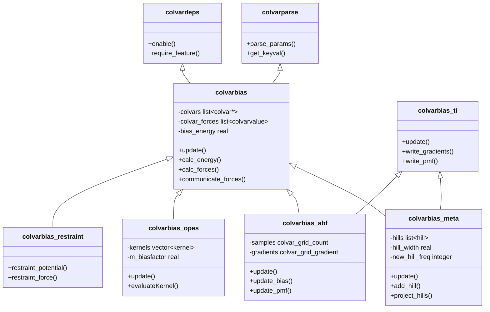
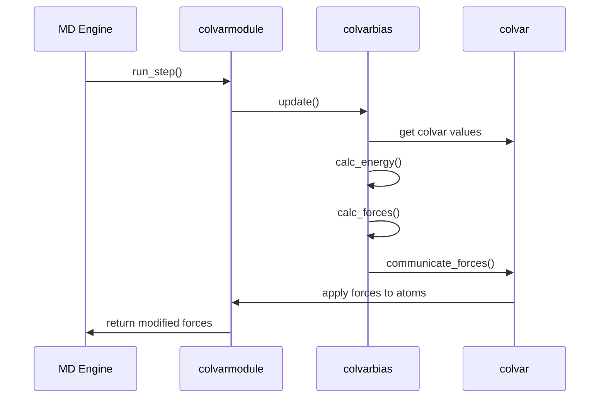
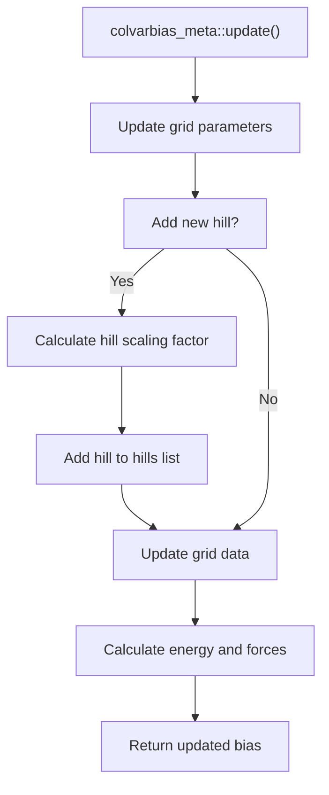
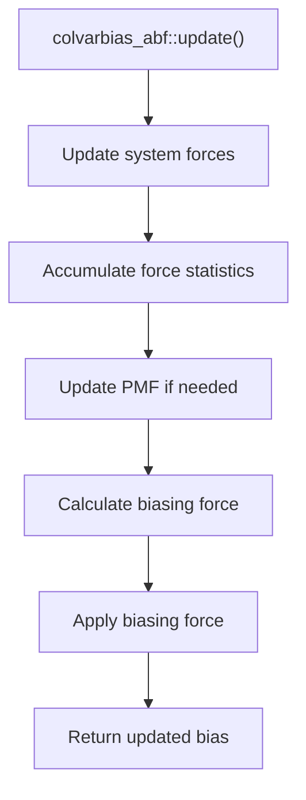
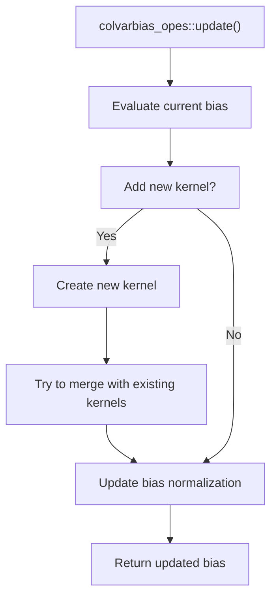
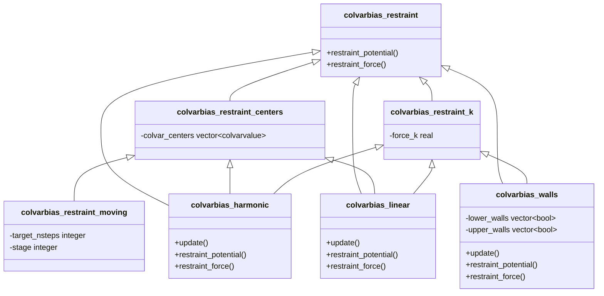
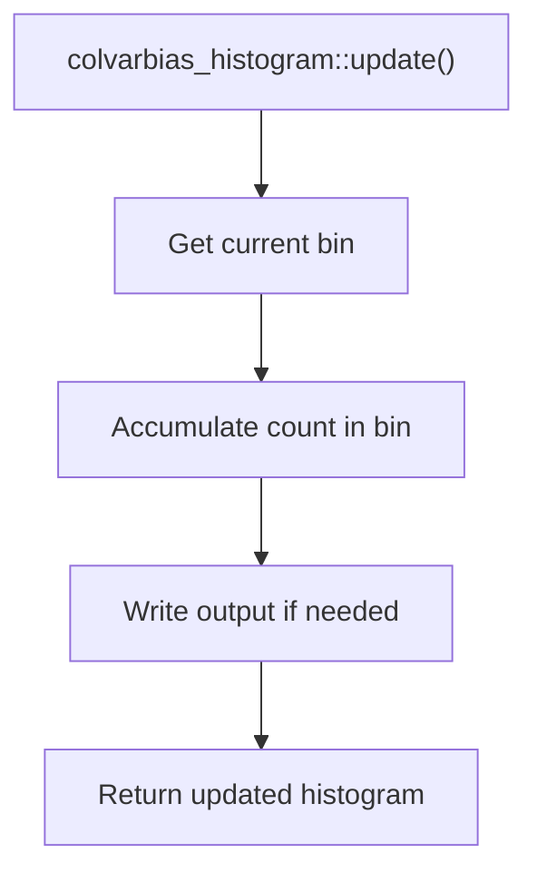
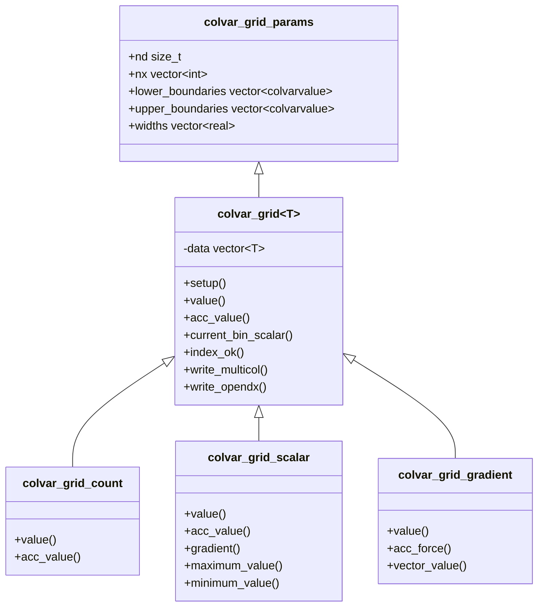
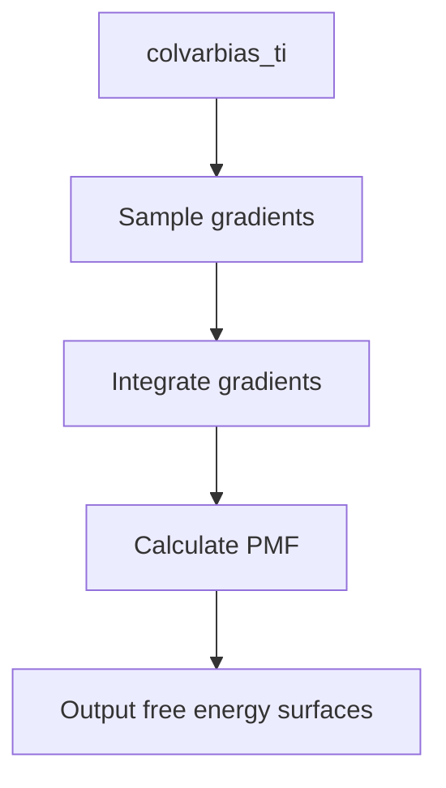

# Biasing Methods

<details>
<summary>Relevant source files</summary>

The following files were used as context for generating this wiki page:

- [README-versions.md](README-versions.md)
- [doc/.gitignore](doc/.gitignore)
- [doc/Makefile](doc/Makefile)
- [doc/colvars-code-refs.bib](doc/colvars-code-refs.bib)
- [doc/colvars-engine-flags.tex](doc/colvars-engine-flags.tex)
- [doc/colvars-refman-gromacs.tex](doc/colvars-refman-gromacs.tex)
- [doc/colvars-refman-lammps.tex](doc/colvars-refman-lammps.tex)
- [doc/colvars-refman-main.tex](doc/colvars-refman-main.tex)
- [doc/colvars-refman-namd.tex](doc/colvars-refman-namd.tex)
- [doc/colvars-refman-tinkerhp.tex](doc/colvars-refman-tinkerhp.tex)
- [doc/colvars-refman-vmd.tex](doc/colvars-refman-vmd.tex)
- [doc/colvars-refman.bib](doc/colvars-refman.bib)
- [doc/colvars-refman.tex](doc/colvars-refman.tex)
- [doc/extract_code_refs.py](doc/extract_code_refs.py)
- [doc/print_engine_versions.sh](doc/print_engine_versions.sh)
- [namd/tests/library/035_opes_metad/opes.in](namd/tests/library/035_opes_metad/opes.in)
- [namd/tests/library/035_opes_metad_change_barrier/AutoDiff/test.colvars.opes_metad1.kernels.dat](namd/tests/library/035_opes_metad_change_barrier/AutoDiff/test.colvars.opes_metad1.kernels.dat)
- [namd/tests/library/035_opes_metad_change_barrier/AutoDiff/test.colvars.out](namd/tests/library/035_opes_metad_change_barrier/AutoDiff/test.colvars.out)
- [namd/tests/library/035_opes_metad_change_barrier/AutoDiff/test.colvars.state.stripped](namd/tests/library/035_opes_metad_change_barrier/AutoDiff/test.colvars.state.stripped)
- [namd/tests/library/035_opes_metad_change_barrier/AutoDiff/test.colvars.traj](namd/tests/library/035_opes_metad_change_barrier/AutoDiff/test.colvars.traj)
- [namd/tests/library/035_opes_metad_change_barrier/AutoDiff/test.restart.colvars.opes_metad1.kernels.dat](namd/tests/library/035_opes_metad_change_barrier/AutoDiff/test.restart.colvars.opes_metad1.kernels.dat)
- [namd/tests/library/035_opes_metad_change_barrier/AutoDiff/test.restart.colvars.out](namd/tests/library/035_opes_metad_change_barrier/AutoDiff/test.restart.colvars.out)
- [namd/tests/library/035_opes_metad_change_barrier/AutoDiff/test.restart.colvars.state.stripped](namd/tests/library/035_opes_metad_change_barrier/AutoDiff/test.restart.colvars.state.stripped)
- [namd/tests/library/035_opes_metad_change_barrier/AutoDiff/test.restart.colvars.traj](namd/tests/library/035_opes_metad_change_barrier/AutoDiff/test.restart.colvars.traj)
- [namd/tests/library/035_opes_metad_change_barrier/namd-version.txt](namd/tests/library/035_opes_metad_change_barrier/namd-version.txt)
- [namd/tests/library/035_opes_metad_change_barrier/opes.in](namd/tests/library/035_opes_metad_change_barrier/opes.in)
- [namd/tests/library/035_opes_metad_change_barrier/opes.restart.in](namd/tests/library/035_opes_metad_change_barrier/opes.restart.in)
- [namd/ug/ug_colvars.tex](namd/ug/ug_colvars.tex)
- [src/colvarbias.cpp](src/colvarbias.cpp)
- [src/colvarbias.h](src/colvarbias.h)
- [src/colvarbias_abf.cpp](src/colvarbias_abf.cpp)
- [src/colvarbias_abf.h](src/colvarbias_abf.h)
- [src/colvarbias_alb.cpp](src/colvarbias_alb.cpp)
- [src/colvarbias_alb.h](src/colvarbias_alb.h)
- [src/colvarbias_histogram.cpp](src/colvarbias_histogram.cpp)
- [src/colvarbias_histogram.h](src/colvarbias_histogram.h)
- [src/colvarbias_histogram_reweight_amd.cpp](src/colvarbias_histogram_reweight_amd.cpp)
- [src/colvarbias_histogram_reweight_amd.h](src/colvarbias_histogram_reweight_amd.h)
- [src/colvarbias_meta.cpp](src/colvarbias_meta.cpp)
- [src/colvarbias_meta.h](src/colvarbias_meta.h)
- [src/colvarbias_opes.cpp](src/colvarbias_opes.cpp)
- [src/colvarbias_opes.h](src/colvarbias_opes.h)
- [src/colvarbias_restraint.cpp](src/colvarbias_restraint.cpp)
- [src/colvarbias_restraint.h](src/colvarbias_restraint.h)
- [src/colvargrid.cpp](src/colvargrid.cpp)
- [src/colvargrid.h](src/colvargrid.h)
- [src/colvargrid_def.h](src/colvargrid_def.h)
- [src/colvarmodule_refs.h](src/colvarmodule_refs.h)
- [src/colvars_memstream.cpp](src/colvars_memstream.cpp)
- [src/colvars_memstream.h](src/colvars_memstream.h)
- [vmd/doc/ug_colvars.tex](vmd/doc/ug_colvars.tex)

</details>


This document provides an overview of the different biasing methods available in the Colvars module. Biasing methods are used to modify the potential energy surface of a molecular system to enhance sampling and compute free energy differences. The biasing methods described here can be applied to any collective variables defined in the Colvars module.

For information about the specific collective variables that can be biased, see [Collective Variables Implementation](#3). For details about integrating Colvars with specific molecular dynamics engines, see [MD Engine Integration](#5).

## Overview of Biasing Methods

The Colvars module implements several biasing methods, each designed for different types of enhanced sampling and free energy calculations:

1. **Metadynamics**: Adds Gaussian "hills" to discourage system from revisiting already explored states
2. **Adaptive Biasing Force (ABF)**: Applies forces that oppose the system's natural free energy gradients
3. **OPES**: Optimizes sampling using a target probability distribution
4. **Restraints**: Applies forces to keep the system near target values
5. **Histograms**: Collects statistics without applying biasing forces

All biasing methods in Colvars share a common architecture and interface, but have different purposes and algorithms.

Sources: [src/colvarbias.h:22-84](), [src/colvarbias.cpp:20-138]()

## Common Architecture

All biasing methods in Colvars are derived from the `colvarbias` base class, which provides common functionality for configuration, force application, and data management.



Sources: [src/colvarbias.h:15-135](), [src/colvarbias.cpp:20-443]()

### Life Cycle of a Bias

Each bias follows a similar life cycle during simulation:



During each step, the bias reads the current values of collective variables, calculates the biasing energy and forces, and then applies those forces back to the collective variables, which ultimately modify the atomic forces in the molecular dynamics simulation.

Sources: [src/colvarbias.cpp:336-400](), [src/colvarbias.h:59-75]()

## Metadynamics

Metadynamics is a popular enhanced sampling method that progressively adds Gaussian-shaped bias potentials ("hills") to discourage the system from revisiting already explored regions of the conformational space.

### Implementation and Key Features



- Uses Gaussian hills characterized by height (`hillWeight`) and width (`hillWidth` or `gaussianSigmas`)
- Hills are deposited at intervals specified by `newHillFrequency`
- Supports well-tempered metadynamics via `wellTempered` and `biasTemperature` parameters
- Can use grid-based implementation for performance via `useGrids`
- Supports multiple replicas with `multipleReplicas` for parallel sampling

Sources: [src/colvarbias_meta.cpp:400-431](), [src/colvarbias_meta.cpp:537-597](), [src/colvarbias_meta.h:25-125]()

### Configuration Example

```
metadynamics {
  colvars        phi psi
  hillWeight     0.5
  hillWidth      1.0
  newHillFrequency 100
  wellTempered   on
  biasTemperature 1000
  useGrids       on
}
```

## Adaptive Biasing Force (ABF)

ABF applies forces that counteract the average thermodynamic force on collective variables, effectively flattening the underlying free energy landscape to enhance sampling.

### Implementation and Key Features



- Adaptively builds an estimate of the free energy gradient
- Uses `fullSamples` to determine when to apply full biasing force
- Supports extended-Lagrangian ABF (eABF) for improved sampling
- Includes CZAR and UI estimators for accurate free energy calculation
- Can share data across multiple replicas with `shared` option
- Integrates free energy gradients to calculate PMF with `integrate`

Sources: [src/colvarbias_abf.cpp:333-430](), [src/colvarbias_abf.cpp:505-538](), [src/colvarbias_abf.h:28-104]()

### Configuration Example

```
abf {
  colvars           phi psi
  fullSamples       500
  outputFreq        5000
  historyFreq       50000
  integrate         yes
}
```

## OPES (Optimized Potential Energy Surface)

OPES is a recent enhanced sampling method that builds an adaptive bias based on a target probability distribution. It provides an alternative to well-tempered metadynamics with potentially faster convergence.

### Implementation and Key Features



- Uses Gaussian kernels similar to metadynamics but with different update strategy
- Configured with expected free energy `barrier` and `biasfactor`
- Implements kernel compression with `compressionThreshold` for efficiency
- Supports neighbor lists for performance optimization
- Calculates on-the-fly free energy estimates

Sources: [src/colvarbias_opes.cpp:685-891](), [src/colvarbias_opes.h:38-105]()

### Configuration Example

```
opes {
  colvars              phi psi
  barrier              8.0
  biasfactor           10.0
  gaussianSigma        0.2 0.2
  kernelCutoff         4.0
  compressionThreshold 1.0
  newHillFrequency     500
}
```

## Restraints

Restraints apply forces to keep collective variables near specified target values. They are useful for free energy calculations and for enforcing structural constraints.

### Types of Restraints



- **Harmonic Restraints**: Apply harmonic potential around target centers
- **Linear Restraints**: Apply linear potential referenced to target centers
- **Wall Restraints**: Prevent variables from exceeding specified boundaries
- **Moving Restraints**: Change target values over time for free energy calculations

Sources: [src/colvarbias_restraint.cpp:20-72](), [src/colvarbias_restraint.h:100-220]()

### Configuration Example

```
harmonic {
  colvars         distance
  centers         5.0
  forceConstant   10.0
  targetCenters   15.0
  targetNumSteps  1000000
}
```

## Histograms

Histograms collect statistics about the distribution of collective variables without applying biasing forces. They are useful for analyzing trajectories and for post-processing.

### Implementation and Key Features



- Uses a grid to collect counts of occurrences in each bin
- Can output histogram in multi-column or OpenDX format
- Supports vector-valued collective variables
- Can use custom grid parameters for histogram resolution

Sources: [src/colvarbias_histogram.cpp:20-109](), [src/colvarbias_histogram.cpp:121-162]()

### Configuration Example

```
histogram {
  colvars         phi psi
  outputFile      phi_psi_histogram.dat
  outputFileDX    phi_psi_histogram.dx
  histogramGrid {
    width         0.1 0.1
    lowerBoundaries -180.0 -180.0
    upperBoundaries  180.0  180.0
  }
}
```

## Common Implementation Components

### Grid System

Many biasing methods use grids to efficiently store and compute data in the space of collective variables:



The grid system handles:
- Discretizing the space of collective variables
- Storing data (counts, free energy values, gradients) at grid points
- Interpolating between grid points for smooth functions
- Input/output of grid data to/from files

Sources: [src/colvargrid.h:22-135](), [src/colvargrid.cpp:20-236]()

### TI (Thermodynamic Integration) Component

Some biasing methods support thermodynamic integration for free energy calculations through the `colvarbias_ti` class:



- Collects samples of free energy gradients
- Integrates gradients to obtain potential of mean force (PMF)
- Provides output of free energy surfaces
- Used by both metadynamics and ABF implementations

Sources: [src/colvarbias.cpp:779-837](), [src/colvarbias.h:314-352]()

## Summary

The Colvars module provides a comprehensive set of biasing methods for enhanced sampling and free energy calculations in molecular dynamics simulations. The methods share a common architecture but are tailored to different types of problems and simulation approaches.

The table below summarizes the key characteristics of each biasing method:

| Method | Primary Purpose | Key Parameters | Output |
|--------|----------------|----------------|--------|
| Metadynamics | Free energy calculation, barrier crossing | `hillWeight`, `hillWidth`, `newHillFrequency` | Free energy surface |
| ABF | Free energy gradients, uniform sampling | `fullSamples`, `inputPrefix` | Gradients, PMF |
| OPES | Efficient enhanced sampling | `barrier`, `biasfactor`, `gaussianSigma` | Free energy surface |
| Restraints | Conformational control, umbrella sampling | `centers`, `forceConstant`, `targetCenters` | N/A |
| Histograms | Analysis of distributions | `outputFile`, `histogramGrid` | Probability distribution |

Each method can be configured in the Colvars input file and can be used with any set of collective variables defined in the same file.

---