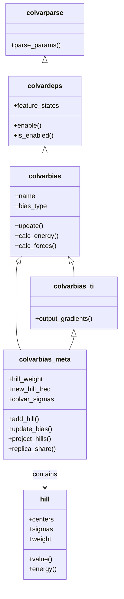
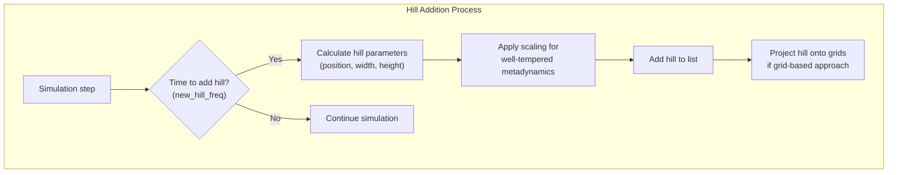
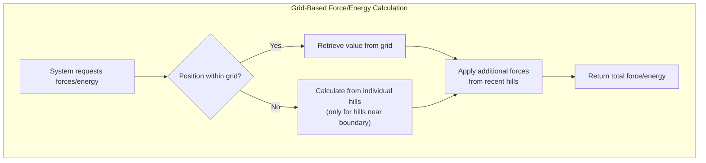
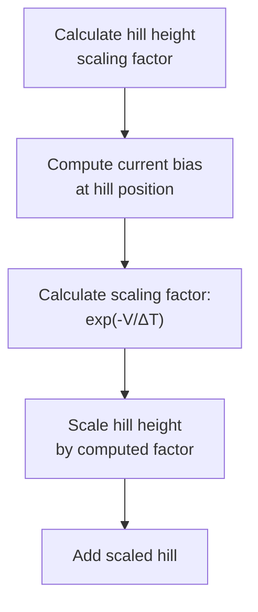
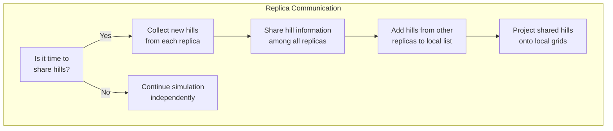

# Metadynamics

<details>
<summary>Relevant source files</summary>

The following files were used as context for generating this wiki page:

- [README-versions.md](README-versions.md)
- [doc/.gitignore](doc/.gitignore)
- [doc/Makefile](doc/Makefile)
- [doc/colvars-code-refs.bib](doc/colvars-code-refs.bib)
- [doc/colvars-engine-flags.tex](doc/colvars-engine-flags.tex)
- [doc/colvars-refman-gromacs.tex](doc/colvars-refman-gromacs.tex)
- [doc/colvars-refman-lammps.tex](doc/colvars-refman-lammps.tex)
- [doc/colvars-refman-main.tex](doc/colvars-refman-main.tex)
- [doc/colvars-refman-namd.tex](doc/colvars-refman-namd.tex)
- [doc/colvars-refman-tinkerhp.tex](doc/colvars-refman-tinkerhp.tex)
- [doc/colvars-refman-vmd.tex](doc/colvars-refman-vmd.tex)
- [doc/colvars-refman.bib](doc/colvars-refman.bib)
- [doc/colvars-refman.tex](doc/colvars-refman.tex)
- [doc/extract_code_refs.py](doc/extract_code_refs.py)
- [doc/print_engine_versions.sh](doc/print_engine_versions.sh)
- [namd/ug/ug_colvars.tex](namd/ug/ug_colvars.tex)
- [src/colvarbias.cpp](src/colvarbias.cpp)
- [src/colvarbias.h](src/colvarbias.h)
- [src/colvarbias_abf.cpp](src/colvarbias_abf.cpp)
- [src/colvarbias_abf.h](src/colvarbias_abf.h)
- [src/colvarbias_alb.cpp](src/colvarbias_alb.cpp)
- [src/colvarbias_alb.h](src/colvarbias_alb.h)
- [src/colvarbias_histogram.cpp](src/colvarbias_histogram.cpp)
- [src/colvarbias_histogram.h](src/colvarbias_histogram.h)
- [src/colvarbias_histogram_reweight_amd.cpp](src/colvarbias_histogram_reweight_amd.cpp)
- [src/colvarbias_histogram_reweight_amd.h](src/colvarbias_histogram_reweight_amd.h)
- [src/colvarbias_meta.cpp](src/colvarbias_meta.cpp)
- [src/colvarbias_meta.h](src/colvarbias_meta.h)
- [src/colvarbias_restraint.cpp](src/colvarbias_restraint.cpp)
- [src/colvarbias_restraint.h](src/colvarbias_restraint.h)
- [src/colvargrid.cpp](src/colvargrid.cpp)
- [src/colvargrid.h](src/colvargrid.h)
- [src/colvargrid_def.h](src/colvargrid_def.h)
- [src/colvarmodule_refs.h](src/colvarmodule_refs.h)
- [vmd/doc/ug_colvars.tex](vmd/doc/ug_colvars.tex)

</details>


This page documents the metadynamics biasing method in the Colvars module. Metadynamics is a powerful enhanced sampling technique that helps systems overcome free energy barriers and efficiently explore the free energy landscape. This document covers the implementation details, parameters, and usage of metadynamics in the Colvars module.

For other biasing methods like Adaptive Biasing Force (ABF), see [Adaptive Biasing Force (ABF)](#4.2), for OPES, see [OPES Method](#4.3), and for restraints, see [Restraints and Other Biases](#4.4).

## Basic Principles of Metadynamics

Metadynamics is an enhanced sampling method that adds history-dependent bias potentials to the underlying free energy landscape. These bias potentials take the form of Gaussian "hills" deposited along the trajectory in the collective variable space. As the simulation progresses, these hills gradually fill energy minima, allowing the system to escape free energy wells and explore the entire landscape.

The key advantages of metadynamics include:
- Efficient exploration of complex free energy landscapes
- The ability to reconstruct the free energy surface (PMF)
- Support for multiple collective variables
- Variants that improve convergence and efficiency

Sources: [src/colvarbias_meta.cpp:21-47](), [src/colvarbias_meta.h:25-40]()

## Implementation Architecture

The metadynamics implementation in Colvars is built on a class hierarchy that provides different functionalities:



The primary class implementing metadynamics is `colvarbias_meta`, which:
- Inherits from both `colvarbias` (for basic bias functionality) and `colvarbias_ti` (for thermodynamic integration)
- Manages a list of hills
- Calculates biasing forces and energies
- Handles hill projection onto grids for efficiency
- Supports multiple replicas and well-tempered variants

Sources: [src/colvarbias_meta.cpp:22-47](), [src/colvarbias_meta.h:25-40]()

## Hill Management

Hills are the fundamental components of metadynamics. Each hill is a Gaussian function with:
1. A set of center positions (one for each collective variable)
2. A set of widths (one for each collective variable)
3. A weight (height/amplitude)



Hills are added periodically based on the `new_hill_freq` parameter. Each hill is created at the current position of the collective variables. The hill's width is determined by the `hillWidth` parameter or individual `gaussianSigmas`, and its height (weight) is set by the `hillWeight` parameter (potentially scaled for well-tempered metadynamics).

The `add_hill()` function adds a new hill to the system, and also determines if it needs to be added to a special list of hills that are partially off the grid.

Sources: [src/colvarbias_meta.cpp:336-366](), [src/colvarbias_meta.cpp:538-598]()

## Grid-Based Implementation

For efficiency, hills are typically projected onto multidimensional grids rather than computed individually for each point in CV space:



The metadynamics implementation uses two types of grids:
1. `hills_energy` - A scalar grid storing the energy contribution at each grid point
2. `hills_energy_gradients` - A gradient grid storing the force components at each grid point

Hills are projected onto these grids by the `project_hills()` function, which loops through the grid points and calculates the contribution of each hill to the energy and forces at that point.

For efficiency, only hills added since the last grid update are kept in memory individually. Older hills are represented by their contribution to the grid.

Sources: [src/colvarbias_meta.cpp:857-923](), [src/colvargrid.h:46-117]()

## Well-Tempered Metadynamics

Well-tempered metadynamics is a variant where the hill height decreases as the simulation progresses, ensuring better convergence:



In well-tempered metadynamics:
- The `wellTempered` parameter enables this feature
- The `biasTemperature` parameter (ΔT) controls the degree of tempering
- Hill heights are scaled by exp(-V/(kB·ΔT)), where V is the current bias at the hill position
- This ensures that hill heights decrease as the bias accumulates, leading to a smoother convergence

As the simulation progresses, the hill height becomes smaller in well-explored regions, allowing for more precise free energy reconstruction.

Sources: [src/colvarbias_meta.cpp:235-249](), [src/colvarbias_meta.cpp:563-571]()

## Multiple-Replica Metadynamics

Multiple-replica metadynamics allows several simulations to share information, enhancing sampling efficiency:



To use multiple-replica metadynamics:
- Enable with the `multipleReplicas` parameter
- Set a `replicaID` for each simulation instance
- Specify a `replicasRegistry` file to track all replicas
- Set `replicaUpdateFrequency` to control how often replicas exchange information

Each replica independently adds hills to its local bias, but periodically shares this information with other replicas. This allows for more efficient exploration of the free energy landscape.

Sources: [src/colvarbias_meta.cpp:169-232](), [src/colvarbias_meta.cpp:106-112]()

## Practical Usage

### Key Configuration Parameters

| Parameter | Description | Default |
|-----------|-------------|---------|
| `hillWeight` | Height (energy) of each Gaussian hill | Required |
| `newHillFrequency` | Frequency (in MD steps) for adding new hills | 1000 |
| `hillWidth` | Width of hills relative to CV width | None |
| `gaussianSigmas` | Width of Gaussian hills for each CV | None (alternative to hillWidth) |
| `useGrids` | Whether to use grids for efficiency | Yes |
| `wellTempered` | Enable well-tempered metadynamics | No |
| `biasTemperature` | Temperature parameter for well-tempered metadynamics | Required if wellTempered=yes |
| `multipleReplicas` | Enable multiple-replica metadynamics | No |
| `writeFreeEnergyFile` | Write PMF to file | Yes |
| `keepHills` | Keep all hills in memory (not recommended for long simulations) | No |

Either `hillWidth` or `gaussianSigmas` must be provided to define the width of the Gaussian hills.

Sources: [src/colvarbias_meta.cpp:62-114](), [src/colvarbias_meta.cpp:140-162]()

### Example Configuration

Here's an example configuration for running metadynamics on a distance collective variable:

```
colvar {
  name distance
  distance {
    group1 { atomNumbers 1 2 3 }
    group2 { atomNumbers 10 11 12 }
  }
}

metadynamics {
  colvars distance
  hillWeight 0.1
  hillWidth 0.2
  newHillFrequency 500
  wellTempered on
  biasTemperature 3000
}
```

This configuration will:
1. Define a distance collective variable between two groups of atoms
2. Apply metadynamics with hills of height 0.1 energy units
3. Set hill width to 0.2 times the CV width
4. Add a new hill every 500 MD steps
5. Use well-tempered metadynamics with a bias temperature of 3000 K

Sources: [doc/colvars-refman-main.tex:59-85]()

## Advanced Features

### Ensemble-Biased Metadynamics (ebMeta)

The Colvars implementation also supports ensemble-biased metadynamics (ebMeta):
- Enabled with the `ebMeta` parameter
- Requires a target distribution file via `targetDistFile`
- Scales hill heights based on the target distribution
- Useful for focusing sampling on regions of interest

Sources: [src/colvarbias_meta.cpp:252-312](), [src/colvarbias_meta.cpp:554-560]()

### Grid Options

Several grid-related options allow fine-tuning of the metadynamics implementation:
- `gridsUpdateFrequency` controls how often hills are projected onto grids
- `rebinGrids` enables grid rebinning for higher accuracy
- `keepFreeEnergyFiles` keeps separate copies of PMF files

Sources: [src/colvarbias_meta.cpp:115-139]()

## Technical Details

### Hill Projection Algorithm

The hill projection process is a critical part of the efficiency of metadynamics:

1. For each grid point:
   - Calculate the distance to each hill center
   - Compute the Gaussian contribution based on distance and hill width
   - Add the contribution to the energy grid
   - Calculate the gradient and add to the force grid

This allows the biasing forces to be computed efficiently by interpolating values from the grid instead of recalculating the contribution of each hill at every step.

Sources: [src/colvarbias_meta.cpp:857-923]()

### Force Calculation

Forces in metadynamics are calculated by:

1. If the current position is within the grid boundaries:
   - Retrieve pre-computed forces from the grid
2. If outside grid boundaries or for recent hills:
   - Calculate forces directly from individual hill contributions
3. Combine these forces to get the total biasing force

Sources: [src/colvarbias_meta.cpp:687-754]()

### Energy Calculation

Similarly, the bias energy is calculated by:

1. If the current position is within the grid:
   - Look up the energy from the energy grid
2. Otherwise:
   - Calculate energy contributions from individual hills
3. Add contributions from recent hills not yet projected to the grid

Sources: [src/colvarbias_meta.cpp:627-683]()

This implementation ensures both efficiency and accuracy in calculating the metadynamics bias.

---