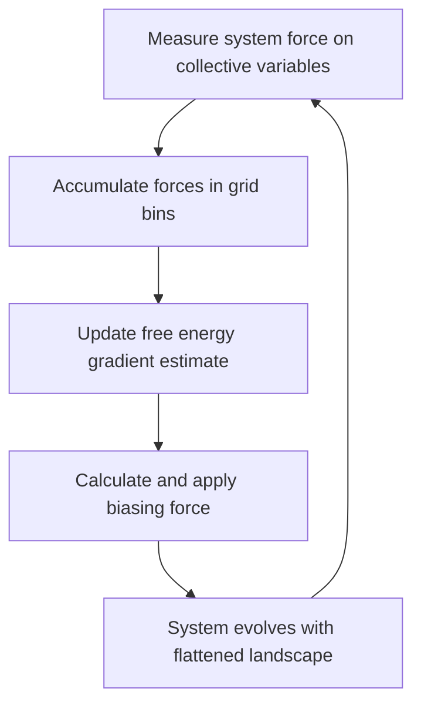
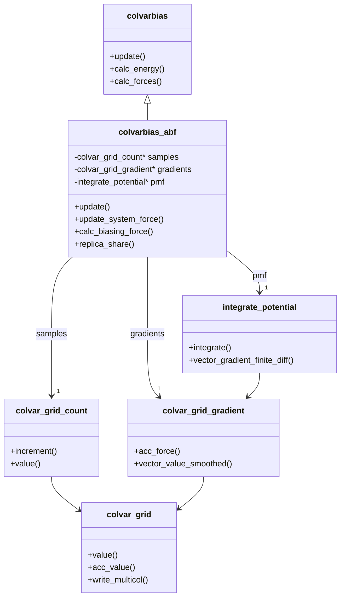
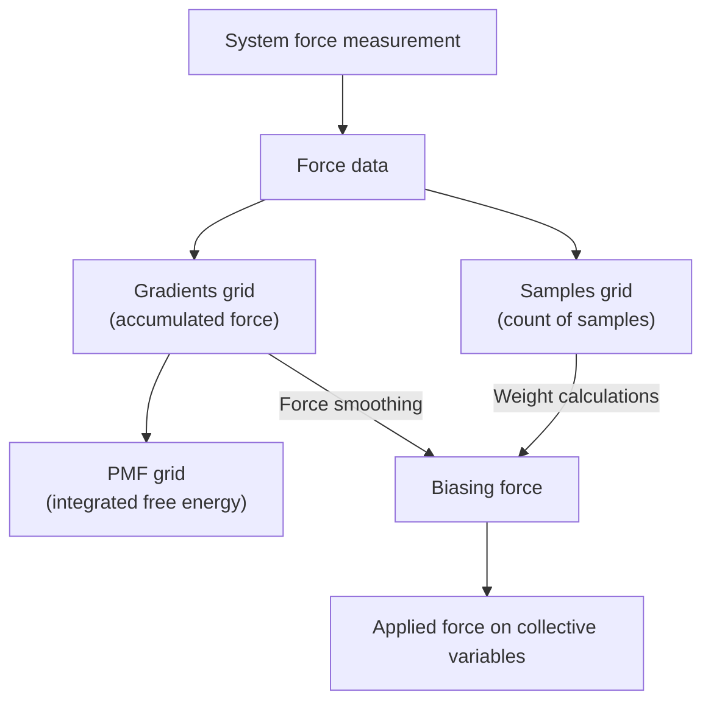
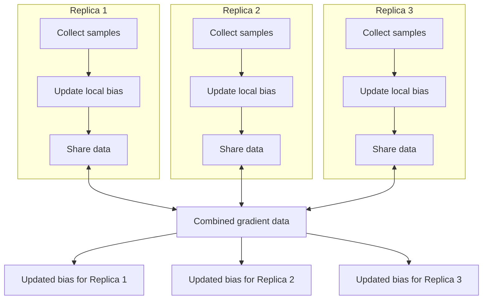
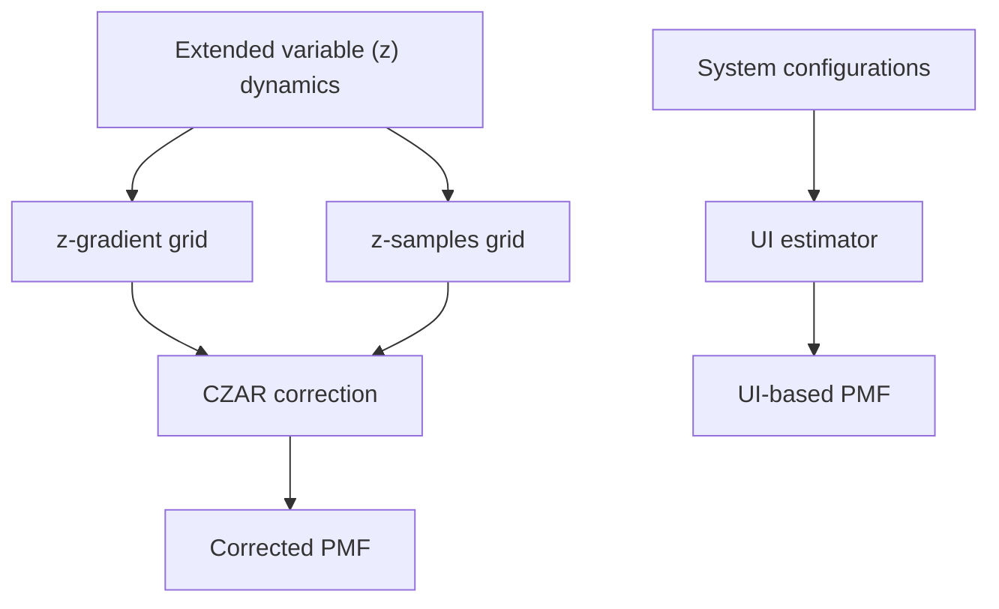
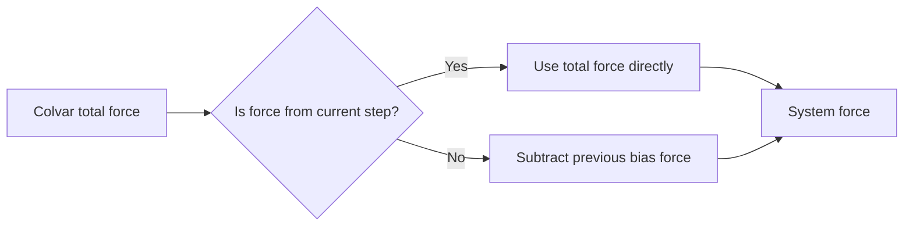
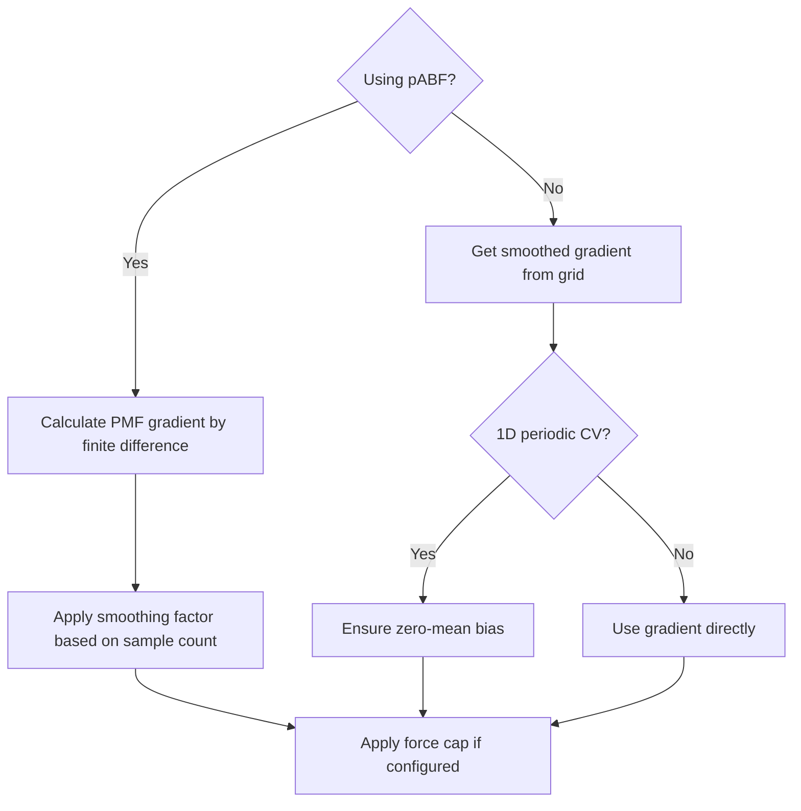
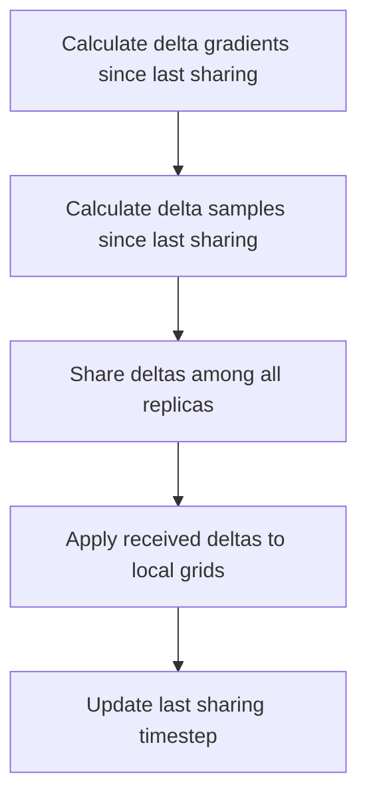

# Adaptive Biasing Force (ABF)

<details>
<summary>Relevant source files</summary>

The following files were used as context for generating this wiki page:

- [README-versions.md](README-versions.md)
- [doc/.gitignore](doc/.gitignore)
- [doc/Makefile](doc/Makefile)
- [doc/colvars-code-refs.bib](doc/colvars-code-refs.bib)
- [doc/colvars-engine-flags.tex](doc/colvars-engine-flags.tex)
- [doc/colvars-refman-gromacs.tex](doc/colvars-refman-gromacs.tex)
- [doc/colvars-refman-lammps.tex](doc/colvars-refman-lammps.tex)
- [doc/colvars-refman-main.tex](doc/colvars-refman-main.tex)
- [doc/colvars-refman-namd.tex](doc/colvars-refman-namd.tex)
- [doc/colvars-refman-tinkerhp.tex](doc/colvars-refman-tinkerhp.tex)
- [doc/colvars-refman-vmd.tex](doc/colvars-refman-vmd.tex)
- [doc/colvars-refman.bib](doc/colvars-refman.bib)
- [doc/colvars-refman.tex](doc/colvars-refman.tex)
- [doc/extract_code_refs.py](doc/extract_code_refs.py)
- [doc/print_engine_versions.sh](doc/print_engine_versions.sh)
- [namd/ug/ug_colvars.tex](namd/ug/ug_colvars.tex)
- [src/colvarbias.cpp](src/colvarbias.cpp)
- [src/colvarbias.h](src/colvarbias.h)
- [src/colvarbias_abf.cpp](src/colvarbias_abf.cpp)
- [src/colvarbias_abf.h](src/colvarbias_abf.h)
- [src/colvarbias_alb.cpp](src/colvarbias_alb.cpp)
- [src/colvarbias_alb.h](src/colvarbias_alb.h)
- [src/colvarbias_histogram.cpp](src/colvarbias_histogram.cpp)
- [src/colvarbias_histogram.h](src/colvarbias_histogram.h)
- [src/colvarbias_histogram_reweight_amd.cpp](src/colvarbias_histogram_reweight_amd.cpp)
- [src/colvarbias_histogram_reweight_amd.h](src/colvarbias_histogram_reweight_amd.h)
- [src/colvarbias_meta.cpp](src/colvarbias_meta.cpp)
- [src/colvarbias_meta.h](src/colvarbias_meta.h)
- [src/colvarbias_restraint.cpp](src/colvarbias_restraint.cpp)
- [src/colvarbias_restraint.h](src/colvarbias_restraint.h)
- [src/colvargrid.cpp](src/colvargrid.cpp)
- [src/colvargrid.h](src/colvargrid.h)
- [src/colvargrid_def.h](src/colvargrid_def.h)
- [src/colvarmodule_refs.h](src/colvarmodule_refs.h)
- [vmd/doc/ug_colvars.tex](vmd/doc/ug_colvars.tex)

</details>


## Introduction

Adaptive Biasing Force (ABF) is a method implemented in the Colvars module for calculating free energy profiles along collective variables and enhancing sampling by overcoming free energy barriers. The ABF method works by estimating the mean force (negative gradient of the free energy) acting on selected collective variables during a molecular dynamics simulation, and applying an equal but opposite biasing force to flatten the underlying free energy landscape.

For information about other biasing methods in Colvars, see [Metadynamics](#4.1), [OPES Method](#4.3), and [Restraints and Other Biases](#4.4).

Sources: [src/colvarbias_abf.cpp:15-36](), [doc/colvars-refman-main.tex:27-31]()

## How ABF Works

ABF operates by directly estimating the mean force acting on selected collective variables and applying a counteracting bias force to enable the system to overcome energy barriers. The method follows these key steps:

1. **System force measurement**: The instantaneous force acting on collective variables is recorded at each timestep
2. **Force accumulation**: Forces are accumulated on a grid in the collective variable space
3. **Bias application**: A biasing force derived from the accumulated samples is applied to help the system overcome barriers
4. **Gradual adaptation**: The applied bias starts small and increases as more samples are collected in each region

As more samples are collected, the bias gradually converges to the negative of the mean force, effectively flattening the free energy landscape and allowing uniform sampling of the collective variable space.



Sources: [src/colvarbias_abf.cpp:333-462]()

## Implementation Architecture

ABF is implemented as a specialized bias derived from the base `colvarbias` class. It maintains a grid representation of the collective variable space and leverages several specialized grid objects for data collection and manipulation.



Sources: [src/colvarbias_abf.cpp:17-25](), [src/colvarbias_abf.h:16-27](), [src/colvarbias_abf.h:99-113]()

## Data Structure and Storage

The ABF method relies on several grid objects to store and process data during a simulation:

1. **Samples grid** (`samples`): Tracks the number of force samples collected in each grid point
2. **Gradients grid** (`gradients`): Stores the accumulated free energy gradients
3. **PMF grid** (`pmf`): Stores the integrated potential of mean force

The relationship between these grids and how data flows between them is illustrated below:



Sources: [src/colvarbias_abf.cpp:191-202](), [src/colvarbias_abf.h:99-113]()

## Configuration Options

Below is a table of the main ABF-specific configuration parameters:

| Parameter | Description | Default |
|-----------|-------------|---------|
| `applyBias` | Whether to apply the calculated biasing force | `true` |
| `updateBias` | Whether to update the bias with new samples | `true` |
| `hideJacobian` | Handle Jacobian (geometric) forces internally | `false` |
| `fullSamples` | Number of samples before applying full force | `200` |
| `minSamples` | Minimum samples before applying scaled force | `100` |
| `maxForce` | Cap the maximum applied force | — |
| `integrate` | Calculate integrated PMF from gradients | `true` for d≤3 |
| `shared` | Enable multiple-walker (shared) ABF | `false` |
| `sharedFreq` | Frequency for sharing between replicas | `outputFreq` |

For extended-system ABF (eABF) specific options:

| Parameter | Description | Default |
|-----------|-------------|---------|
| `CZARestimator` | Use CZAR estimator for eABF | `true` |
| `UIestimator` | Use UI estimator for eABF | `false` |
| `writeCZARwindowFile` | Write CZAR output file for stratified eABF | `false` |

Sources: [src/colvarbias_abf.cpp:45-136](), [src/colvarbias_abf.cpp:210-237](), [src/colvarbias_abf.cpp:285-318]()

## Variants of ABF

The Colvars implementation offers several variants of ABF to address specific needs:

### Standard ABF

The base implementation that applies biasing forces derived from accumulated gradient samples.

### Extended-system ABF (eABF)

Uses an extended-system (or extended-Lagrangian) approach where a harmonic restraint couples the actual CV to a fictitious particle, and the ABF method is applied to the latter.

### Multiple-walker ABF

Allows sharing samples across multiple simulations (replicas) to enhance sampling efficiency.



### Projected ABF (pABF)

A variant that uses on-the-fly integration of the PMF and projects biasing forces from this PMF rather than directly using the accumulated gradients.

Sources: [src/colvarbias_abf.cpp:128-166](), [src/colvarbias_abf.cpp:210-237](), [src/colvarbias_abf.cpp:546-630]()

## Free Energy Estimators

### CZAR Estimator

The Corrected z-Averaged Restraint (CZAR) estimator improves the eABF method by calculating a correction to the PMF based on the relationship between the extended coordinate and the actual CV.

### UI Estimator

The Umbrella Integration (UI) estimator provides an alternative method for computing the PMF from extended-system simulations.



Sources: [src/colvarbias_abf.cpp:210-225](), [src/colvarbias_abf.cpp:285-318](), [src/colvarbias_abf.cpp:444-456]()

## Implementation Details

### Calculation of System Force

The system force is determined as the total force on each collective variable, excluding any previously applied biasing forces.



Sources: [src/colvarbias_abf.cpp:470-488]()

### Biasing Force Calculation

The biasing force is calculated differently depending on the mode (regular ABF vs. pABF):



Sources: [src/colvarbias_abf.cpp:505-539]()

### Sample Sharing in Multiple-Walker ABF

When using multiple replicas (multiple-walker mode), the sharing mechanism works as follows:



This efficiency approach shares only the changes since the last sharing event, not the entire grid.

Sources: [src/colvarbias_abf.cpp:546-630]()

## Integration with Other Colvars Features

ABF works well with the broader Colvars framework, with particular attention to:

1. **Extended Lagrangian**: ABF can be used with extended Lagrangian variables, enabling the eABF method
2. **Multiple time-step**: Careful handling of forces when colvars use different time step factors
3. **Grid system**: Leverages the general grid functionality for storing and manipulating multidimensional data

Sources: [src/colvarbias_abf.cpp:128-148](), [src/colvarbias_abf.h:28-42]()

## Output and Analysis

ABF generates several output files:

- **Gradient files**: Store the accumulated free energy gradients
- **PMF files**: Contain the integrated potential of mean force
- **Count files**: Track the number of samples in each grid bin
- **CZAR files**: For eABF with CZAR estimator, contain corrected PMF

These files can be analyzed to understand the free energy landscape of the system and validate the convergence of the method.

Sources: [src/colvarbias_abf.cpp:415-442]()

## Example Configuration

Here's a minimal example of an ABF configuration in Colvars:

```
colvar {
  name distance
  distance {
    group1 { atomNumbers 1 2 3 }
    group2 { atomNumbers 10 11 12 }
  }
}

abf {
  colvars distance
  fullSamples 500
  outputFreq 1000
}
```

For eABF, additional configuration for the extended Lagrangian part is needed:

```
colvar {
  name distance
  distance {
    group1 { atomNumbers 1 2 3 }
    group2 { atomNumbers 10 11 12 }
  }
  extendedLagrangian yes
  extendedFluctuation 0.1
  extendedTimeConstant 200
}

abf {
  colvars distance
  fullSamples 500
  outputFreq 1000
  CZARestimator yes
}
```

Sources: [doc/colvars-refman-main.tex:27-31]()

---