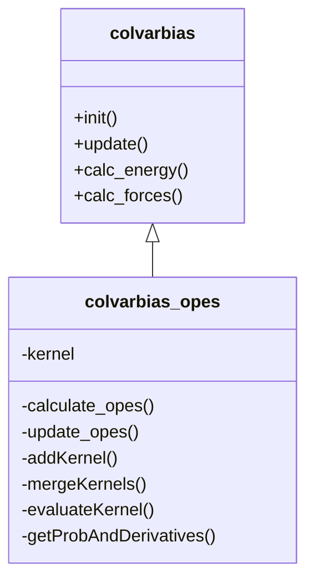
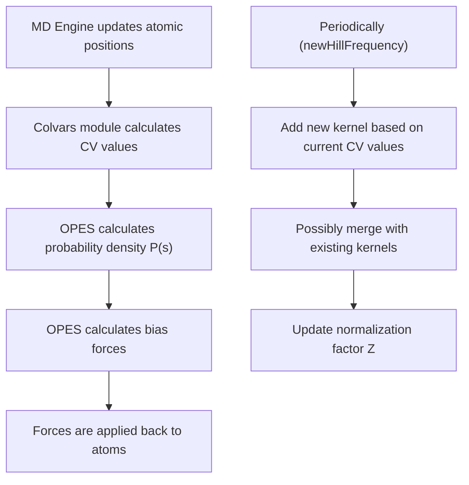
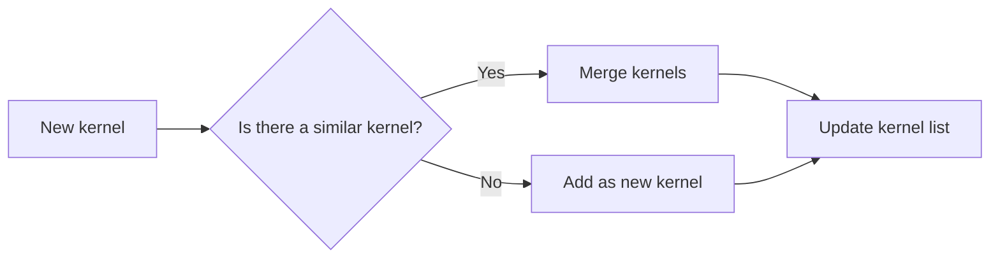
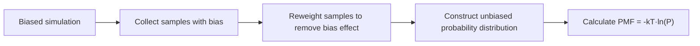
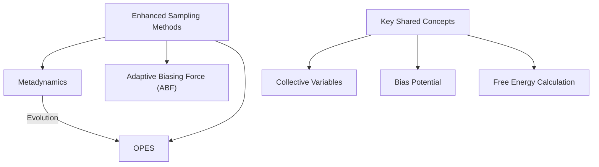

# OPES Method

<details>
<summary>Relevant source files</summary>

The following files were used as context for generating this wiki page:

- [README-versions.md](README-versions.md)
- [doc/.gitignore](doc/.gitignore)
- [doc/Makefile](doc/Makefile)
- [doc/colvars-code-refs.bib](doc/colvars-code-refs.bib)
- [doc/colvars-engine-flags.tex](doc/colvars-engine-flags.tex)
- [doc/colvars-refman-gromacs.tex](doc/colvars-refman-gromacs.tex)
- [doc/colvars-refman-lammps.tex](doc/colvars-refman-lammps.tex)
- [doc/colvars-refman-main.tex](doc/colvars-refman-main.tex)
- [doc/colvars-refman-namd.tex](doc/colvars-refman-namd.tex)
- [doc/colvars-refman-tinkerhp.tex](doc/colvars-refman-tinkerhp.tex)
- [doc/colvars-refman-vmd.tex](doc/colvars-refman-vmd.tex)
- [doc/colvars-refman.bib](doc/colvars-refman.bib)
- [doc/colvars-refman.tex](doc/colvars-refman.tex)
- [doc/extract_code_refs.py](doc/extract_code_refs.py)
- [doc/print_engine_versions.sh](doc/print_engine_versions.sh)
- [namd/tests/library/035_opes_metad/opes.in](namd/tests/library/035_opes_metad/opes.in)
- [namd/tests/library/035_opes_metad_change_barrier/AutoDiff/test.colvars.opes_metad1.kernels.dat](namd/tests/library/035_opes_metad_change_barrier/AutoDiff/test.colvars.opes_metad1.kernels.dat)
- [namd/tests/library/035_opes_metad_change_barrier/AutoDiff/test.colvars.out](namd/tests/library/035_opes_metad_change_barrier/AutoDiff/test.colvars.out)
- [namd/tests/library/035_opes_metad_change_barrier/AutoDiff/test.colvars.state.stripped](namd/tests/library/035_opes_metad_change_barrier/AutoDiff/test.colvars.state.stripped)
- [namd/tests/library/035_opes_metad_change_barrier/AutoDiff/test.colvars.traj](namd/tests/library/035_opes_metad_change_barrier/AutoDiff/test.colvars.traj)
- [namd/tests/library/035_opes_metad_change_barrier/AutoDiff/test.restart.colvars.opes_metad1.kernels.dat](namd/tests/library/035_opes_metad_change_barrier/AutoDiff/test.restart.colvars.opes_metad1.kernels.dat)
- [namd/tests/library/035_opes_metad_change_barrier/AutoDiff/test.restart.colvars.out](namd/tests/library/035_opes_metad_change_barrier/AutoDiff/test.restart.colvars.out)
- [namd/tests/library/035_opes_metad_change_barrier/AutoDiff/test.restart.colvars.state.stripped](namd/tests/library/035_opes_metad_change_barrier/AutoDiff/test.restart.colvars.state.stripped)
- [namd/tests/library/035_opes_metad_change_barrier/AutoDiff/test.restart.colvars.traj](namd/tests/library/035_opes_metad_change_barrier/AutoDiff/test.restart.colvars.traj)
- [namd/tests/library/035_opes_metad_change_barrier/namd-version.txt](namd/tests/library/035_opes_metad_change_barrier/namd-version.txt)
- [namd/tests/library/035_opes_metad_change_barrier/opes.in](namd/tests/library/035_opes_metad_change_barrier/opes.in)
- [namd/tests/library/035_opes_metad_change_barrier/opes.restart.in](namd/tests/library/035_opes_metad_change_barrier/opes.restart.in)
- [namd/ug/ug_colvars.tex](namd/ug/ug_colvars.tex)
- [src/colvarbias_opes.cpp](src/colvarbias_opes.cpp)
- [src/colvarbias_opes.h](src/colvarbias_opes.h)
- [src/colvarmodule_refs.h](src/colvarmodule_refs.h)
- [src/colvars_memstream.cpp](src/colvars_memstream.cpp)
- [src/colvars_memstream.h](src/colvars_memstream.h)
- [vmd/doc/ug_colvars.tex](vmd/doc/ug_colvars.tex)

</details>


This page documents the OPES (Optimized Potential Energy Surface) method available in the Colvars module. OPES is an enhanced sampling technique for molecular dynamics simulations that helps overcome free energy barriers and efficiently explore complex energy landscapes. 

While OPES shares conceptual similarities with Metadynamics ([Metadynamics Method](#4.1)), it differs fundamentally in its approach to constructing the bias potential, offering certain advantages for convergence and efficiency. Unlike traditional Metadynamics which gradually builds bias by depositing small Gaussian hills, OPES directly targets a specific modified energy distribution.

## 1. Theoretical Background

OPES is designed to enhance conformational sampling by applying a bias potential to selected collective variables. The method constructs a bias potential as a function of collective variables to promote exploration of high-energy regions. 

The key conceptual advance in OPES is that it directly targets the computation of the probability density rather than incrementally building a bias as in Metadynamics. The bias is constructed according to:

```
V(s) = -(1-1/γ) kT * ln[P(s)/Z + ε]
```

Where:
- `V(s)` is the bias potential at collective variable value `s`
- `γ` is the bias factor (similar to well-tempered metadynamics)
- `kT` is the thermal energy (Boltzmann constant × temperature)
- `P(s)` is the probability density estimated using Gaussian kernels
- `Z` is a normalization factor
- `ε` is a small regularization constant that ensures numerical stability

Sources: [src/colvarbias_opes.cpp:533-539](), [doc/colvars-refman-main.tex:26-36]()

## 2. Implementation in Colvars

The OPES method is implemented in the Colvars module as the `colvarbias_opes` class, which inherits from the base `colvarbias` class. The code is adapted from the PLUMED OPES module developed by Michele Invernizzi and is distributed under the LGPLv3 license.



The implementation maintains a set of Gaussian kernels that represent the sampled probability distribution in collective variable space. The bias is computed from this distribution and applied to the collective variables.

Sources: [src/colvarbias_opes.h:31-174](), [src/colvarbias_opes.cpp:39-58]()

### 2.1 Core Data Structures

The central data structure in OPES is the `kernel` struct, which represents a Gaussian kernel with a specific height, center, and width (sigma):

```mermaid
classDiagram
    class "kernel" {
        +m_height: real
        +m_center: vector<real>
        +m_sigma: vector<real>
    }
```

These kernels are stored in a vector (`m_kernels`) and are used to compute the probability density function in collective variable space.

Sources: [src/colvarbias_opes.h:33-42](), [src/colvarbias_opes.cpp:277-282]()

### 2.2 Computational Workflow

The OPES calculation follows this general workflow:



At each MD step, OPES:
1. Receives the current collective variable values
2. Calculates the probability density by summing contributions from all stored kernels
3. Computes the bias energy and forces
4. Periodically adds new kernels to represent recently sampled regions

Sources: [src/colvarbias_opes.cpp:510-541](), [src/colvarbias_opes.cpp:543-707]()

## 3. Key Parameters

OPES has several key parameters that control its behavior:

| Parameter | Description | Default | Comments |
|-----------|-------------|---------|----------|
| `barrier` | Expected energy barrier to overcome | Required | In energy units (kcal/mol, kJ/mol) |
| `biasfactor` | Controls the target distribution | Calculated from barrier | Higher values give more exploration |
| `newHillFrequency` | How often to add new kernels | Required | In MD steps |
| `gaussianSigma` | Width of Gaussian kernels | Required | One value per collective variable |
| `adaptiveSigma` | Dynamically adjust kernel width | `off` | Adapts based on CV fluctuations |
| `adaptiveSigmaStride` | How often to update sigmas | `10 * newHillFrequency` | Used only if adaptiveSigma is on |
| `kernelCutoff` | Truncation distance for kernels | Calculated | In CV normalized units |
| `compressionThreshold` | When to merge similar kernels | `1.0` | Set to 0 to disable merging |
| `epsilon` | Regularization parameter | Calculated | Prevents numerical issues |
| `explore` | Exploration mode | `off` | Modified dynamics for broader exploration |

Sources: [src/colvarbias_opes.cpp:73-170](), [doc/colvars-refman-main.tex:27-45]()

## 4. Performance Optimizations

The OPES implementation includes several optimizations to improve computational efficiency:

### 4.1 Kernel Merging

To prevent the number of kernels from growing too large, similar kernels can be merged based on the `compressionThreshold` parameter. This significantly reduces computational cost for long simulations.



Sources: [src/colvarbias_opes.cpp:73-75](), [src/colvarbias_opes.cpp:170-171]()

### 4.2 Neighbor Lists

For systems with many kernels, a neighbor list approach can be enabled to avoid evaluating all kernels at each step. This identifies which kernels have significant contributions at the current CV value.

Sources: [src/colvarbias_opes.cpp:172-199](), [src/colvarbias_opes.cpp:527-530]()

### 4.3 Multithreading

OPES supports multithreaded calculation of the bias. When enabled, multiple threads evaluate different subsets of kernels in parallel.

Sources: [src/colvarbias_opes.cpp:61-65](), [src/colvarbias_opes.cpp:396-446]()

## 5. Advanced Features

### 5.1 Multiple Replicas

OPES supports multiple-replica simulations where information (kernels) is shared between replicas. This can significantly enhance sampling efficiency.

Sources: [src/colvarbias_opes.cpp:209-244](), [src/colvarbias_opes.cpp:563-626]()

### 5.2 PMF Calculation

OPES can calculate the Potential of Mean Force (free energy surface) during the simulation using reweighting techniques:



This is enabled with the `pmf` and `pmfColvars` options.

Sources: [src/colvarbias_opes.cpp:245-275](), [namd/tests/library/035_opes_metad/opes.in:49-51]()

### 5.3 Adaptive Sigma

The width of Gaussian kernels can be automatically adjusted based on the observed fluctuations of the collective variables, enabling optimal resolution in different regions of CV space.

Sources: [src/colvarbias_opes.cpp:113-147](), [src/colvarbias_opes.cpp:544-553]()

## 6. Practical Usage

A typical OPES configuration looks like:

```
opes_metad {
    colvars phi1 phi2 phi3    # Collective variables to bias
    newHillFrequency 5        # Add kernel every 5 steps
    barrier 10.0              # Expected energy barrier
    adaptiveSigma on          # Automatically adjust kernel width
    neighborList on           # Use neighbor list for performance
    pmf on                    # Calculate PMF on-the-fly
    pmfColvars phi2 phi3      # CVs for PMF calculation
}
```

The bias can be monitored during the simulation via the trajectory output, and the PMF can be analyzed afterward.

Sources: [namd/tests/library/035_opes_metad/opes.in:42-52](), [namd/tests/library/035_opes_metad_change_barrier/opes.restart.in:42-52]()

## 7. Relationship to Other Methods

OPES can be seen as an evolution of Metadynamics, particularly well-tempered Metadynamics. Key differences include:

1. OPES directly targets a specific probability distribution rather than building bias incrementally
2. OPES can more easily reach convergence in many cases
3. The bias factor in OPES has a clearer physical interpretation



Sources: [doc/colvars-refman-main.tex:26-31](), [src/colvarbias_opes.cpp:1-20]()

## 8. Citations

When using OPES in scientific publications, please cite:

1. The Colvars module:
   - G. Fiorin, M. L. Klein, and J. Hénin, "Using collective variables to drive molecular dynamics simulations," Mol. Phys., vol. 111, no. 22-23, pp. 3345-3362, 2013.

2. The OPES method:
   - M. Invernizzi and M. Parrinello, "Rethinking Metadynamics: From Bias Potentials to Probability Distributions," J. Phys. Chem. Lett., vol. 11, pp. 2731-2736, 2020.

Sources: [src/colvarmodule_refs.h:377-389](), [src/colvarbias_opes.cpp:350-353]()

---