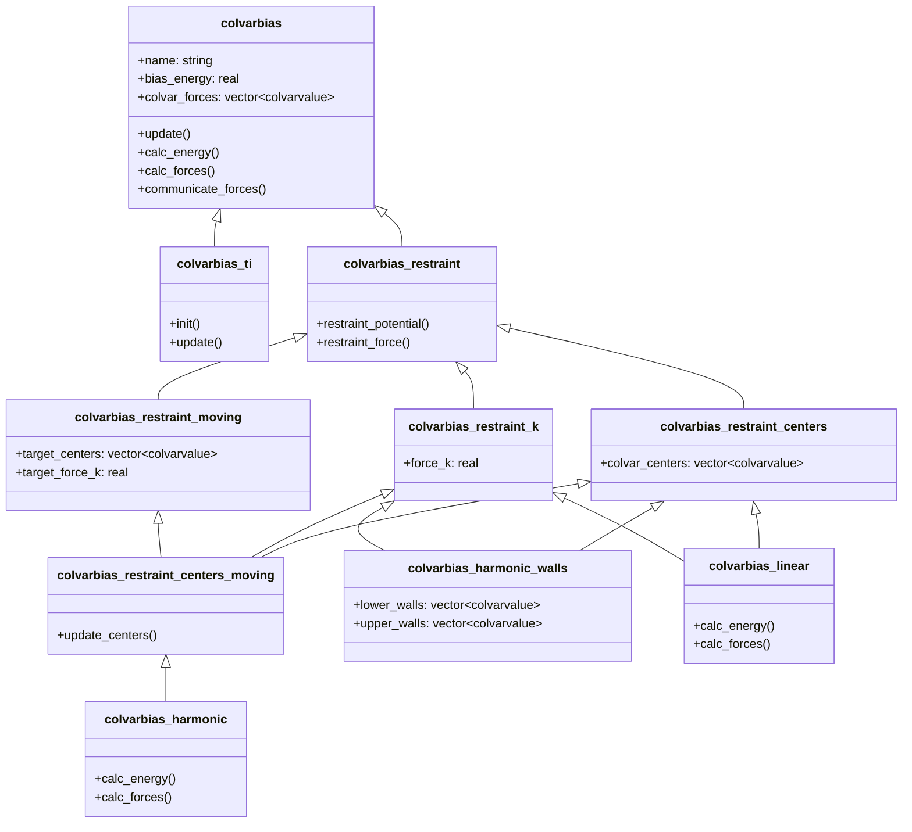
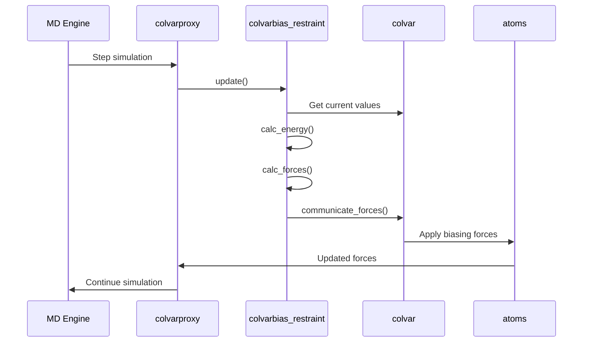
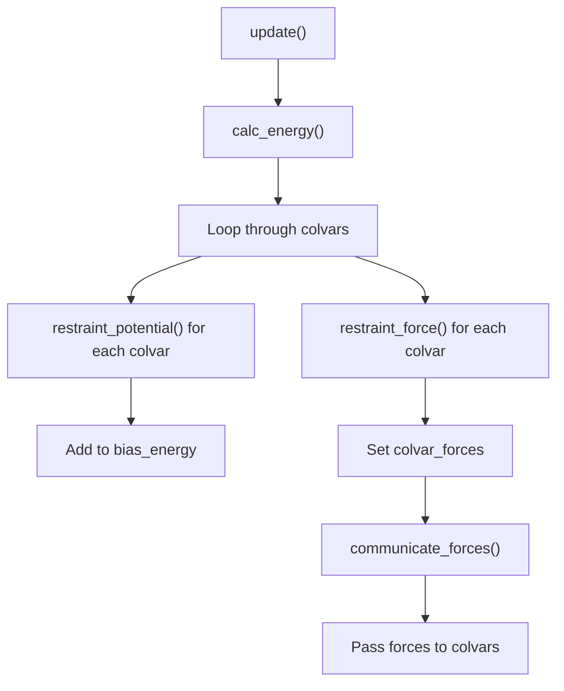

# Restraints and Other Biases

<details>
<summary>Relevant source files</summary>

The following files were used as context for generating this wiki page:

- [README-versions.md](README-versions.md)
- [doc/.gitignore](doc/.gitignore)
- [doc/Makefile](doc/Makefile)
- [doc/colvars-code-refs.bib](doc/colvars-code-refs.bib)
- [doc/colvars-engine-flags.tex](doc/colvars-engine-flags.tex)
- [doc/colvars-refman-gromacs.tex](doc/colvars-refman-gromacs.tex)
- [doc/colvars-refman-lammps.tex](doc/colvars-refman-lammps.tex)
- [doc/colvars-refman-main.tex](doc/colvars-refman-main.tex)
- [doc/colvars-refman-namd.tex](doc/colvars-refman-namd.tex)
- [doc/colvars-refman-tinkerhp.tex](doc/colvars-refman-tinkerhp.tex)
- [doc/colvars-refman-vmd.tex](doc/colvars-refman-vmd.tex)
- [doc/colvars-refman.bib](doc/colvars-refman.bib)
- [doc/colvars-refman.tex](doc/colvars-refman.tex)
- [doc/extract_code_refs.py](doc/extract_code_refs.py)
- [doc/print_engine_versions.sh](doc/print_engine_versions.sh)
- [namd/ug/ug_colvars.tex](namd/ug/ug_colvars.tex)
- [src/colvarbias.cpp](src/colvarbias.cpp)
- [src/colvarbias.h](src/colvarbias.h)
- [src/colvarbias_abf.cpp](src/colvarbias_abf.cpp)
- [src/colvarbias_abf.h](src/colvarbias_abf.h)
- [src/colvarbias_alb.cpp](src/colvarbias_alb.cpp)
- [src/colvarbias_alb.h](src/colvarbias_alb.h)
- [src/colvarbias_histogram.cpp](src/colvarbias_histogram.cpp)
- [src/colvarbias_histogram.h](src/colvarbias_histogram.h)
- [src/colvarbias_histogram_reweight_amd.cpp](src/colvarbias_histogram_reweight_amd.cpp)
- [src/colvarbias_histogram_reweight_amd.h](src/colvarbias_histogram_reweight_amd.h)
- [src/colvarbias_meta.cpp](src/colvarbias_meta.cpp)
- [src/colvarbias_meta.h](src/colvarbias_meta.h)
- [src/colvarbias_restraint.cpp](src/colvarbias_restraint.cpp)
- [src/colvarbias_restraint.h](src/colvarbias_restraint.h)
- [src/colvargrid.cpp](src/colvargrid.cpp)
- [src/colvargrid.h](src/colvargrid.h)
- [src/colvargrid_def.h](src/colvargrid_def.h)
- [src/colvarmodule_refs.h](src/colvarmodule_refs.h)
- [vmd/doc/ug_colvars.tex](vmd/doc/ug_colvars.tex)

</details>


This page explains the restraint-based biasing methods and some additional specialized biases in the Colvars module. Restraints apply forces to collective variables to maintain them near target values or within defined boundaries. Unlike ABF (section [4.2](#4.2)), metadynamics (section [4.1](#4.1)), or OPES (section [4.3](#4.3)) which aim to overcome free energy barriers, restraints are primarily used to confine sampling to specific regions or to implement steering protocols.

## Bias Hierarchy and Basic Concepts

The Colvars module implements various biasing methods through a hierarchy of C++ classes derived from the base `colvarbias` class. Restraints are a major category of biases that apply conservative forces to collective variables.



Sources: [src/colvarbias.h](), [src/colvarbias_restraint.h](), [src/colvarbias_restraint.cpp]()

All biases in Colvars:
1. Calculate an energy contribution (`bias_energy`)
2. Calculate forces on collective variables (`colvar_forces`)
3. Apply these forces to the underlying atoms via the collective variables

The update process of a restraint bias follows this sequence:



Sources: [src/colvarbias.cpp:332-366](), [src/colvarbias_restraint.cpp:45-66]()

## Restraint Types

The Colvars module implements several types of restraints with different functional forms:

### Harmonic Restraints

Harmonic restraints apply a quadratic potential centered at specified values. They are the most commonly used type of restraint and are defined using the `harmonic` keyword.

```
harmonic {
  colvars      colvar1 colvar2 ...
  centers      center1 center2 ...
  forceConstant k
}
```

The potential energy function for a harmonic restraint is:

$$V(x) = \frac{k}{2} \sum_i \left( \frac{x_i - c_i}{w_i} \right)^2$$

Where:
- $x_i$ is the current value of colvar $i$
- $c_i$ is the center value for colvar $i$
- $w_i$ is the width of colvar $i$ (used for normalization)
- $k$ is the force constant

The harmonic restraint applies a force proportional to the displacement from the center.

Sources: [src/colvarbias_restraint.cpp]()

### Harmonic Wall Restraints

Harmonic wall restraints apply a one-sided harmonic potential when a collective variable moves beyond specified boundaries. They can be defined using the `harmonicWalls` keyword.

```
harmonicWalls {
  colvars      colvar1 colvar2 ...
  lowerWalls   lower1 lower2 ...
  upperWalls   upper1 upper2 ...
  forceConstant k
}
```

The potential is zero when the colvar is within the boundaries and increases quadratically outside them:

$$V(x) = \frac{k}{2} \sum_i \left( \max(0, \frac{x_i - u_i}{w_i})^2 + \max(0, \frac{l_i - x_i}{w_i})^2 \right)$$

Where:
- $u_i$ is the upper wall position for colvar $i$
- $l_i$ is the lower wall position for colvar $i$

Sources: [src/colvarbias_restraint.cpp]()

### Linear Restraints

Linear restraints apply a force of constant magnitude when the collective variable is on a specific side of the center value. They are defined using the `linear` keyword.

```
linear {
  colvars      colvar1 colvar2 ...
  centers      center1 center2 ...
  forceConstant k
}
```

The potential energy function is:

$$V(x) = k \sum_i \left| \frac{x_i - c_i}{w_i} \right|$$

Sources: [src/colvarbias_restraint.cpp]()

## Moving Restraints

Moving restraints allow for the center or force constant to change over time, useful for steering simulations or implementing umbrella sampling protocols. This can be done in two ways:

### Staged Movement

The restraint changes in discrete stages, each lasting a specified number of steps.

```
harmonic {
  colvars         colvar1 colvar2 ...
  centers         center1 center2 ...
  targetCenters   target1 target2 ...
  targetNumStages 10
  targetNumSteps  1000
  forceConstant   k
}
```

### Continuous Movement

The restraint changes continuously, with a linear interpolation between initial and target values.

```
harmonic {
  colvars         colvar1 colvar2 ...
  centers         center1 center2 ...
  targetCenters   target1 target2 ...
  targetNumSteps  10000
  forceConstant   k
}
```

The interpolation function for moving centers is:

$$c_i(t) = c_i^{initial} + \lambda(t) \cdot (c_i^{target} - c_i^{initial})$$

Where $\lambda(t)$ varies from 0 to 1 over the specified number of steps.

Sources: [src/colvarbias_restraint.cpp:185-438]()

## Implementation Details

The restraint implementation is based on multiple layers of C++ classes:

1. `colvarbias_restraint`: Base class for all restraints, defines the interface for restraint potentials and forces
2. `colvarbias_restraint_centers`: Adds support for restraint centers
3. `colvarbias_restraint_k`: Adds support for force constants
4. `colvarbias_restraint_moving`: Adds support for changing centers or force constants over time
5. `colvarbias_restraint_centers_moving`: Combines moving restraints with centers

The calculation of restraint forces follows this pattern:



Sources: [src/colvarbias_restraint.cpp:45-66]()

### Key Method Implementations

The core calculations for restraints are implemented in the derived classes. For example, for harmonic restraints:

```cpp
// Calculate harmonic potential
cvm::real colvarbias_harmonic::restraint_potential(size_t i) const
{
  return 0.5 * force_k / (cvm::real) colvars.size() *
    std::pow(colvar_distance(i) / colvars[i]->width, 2);
}

// Calculate harmonic force
colvarvalue colvarbias_harmonic::restraint_force(size_t i) const
{
  return -1.0 * force_k / (cvm::real) colvars.size() *
    (colvar_values[i] - colvar_centers[i]) / 
    (colvars[i]->width * colvars[i]->width);
}
```

Sources: [src/colvarbias_restraint.cpp]()

## Other Specialized Biases

### Histogram Bias

The histogram bias (`histogram`) is not a traditional biasing method but rather a tool to collect statistics on collective variables during a simulation, creating histograms of their distributions.

```
histogram {
  colvars       colvar1 colvar2 ...
  outputFile    histogram.dat
  outputFreq    100
}
```

Sources: [src/colvarbias_histogram.cpp](), [src/colvarbias_histogram.h]()

### Adaptive Linear Bias (ALB)

The ALB bias (`ALB`) implements a self-optimizing linear bias that adapts its force constant to maintain the collective variable near a target value with minimal force.

```
ALB {
  colvars          colvar1 colvar2 ...
  centers          center1 center2 ...
  maxForceConstant maxK1 maxK2 ...
  updateFrequency  100
}
```

Sources: [src/colvarbias_alb.cpp](), [src/colvarbias_alb.h]()

### Histogram Reweighting for aMD

This specialized bias (`histogramReweightAMD`) is used for reweighting histograms from accelerated MD simulations.

Sources: [src/colvarbias_histogram_reweight_amd.cpp]()

## Configuration Parameters for Restraints

The following table summarizes key parameters for configuring restraint biases:

| Parameter | Description | Applicable To |
|-----------|-------------|---------------|
| `colvars` | List of collective variables to restrain | All restraints |
| `centers` | Target values for the collective variables | harmonic, linear |
| `forceConstant` | Spring constant (k) for the restraint | All restraints |
| `lowerWalls` | Lower boundary values | harmonicWalls |
| `upperWalls` | Upper boundary values | harmonicWalls |
| `targetCenters` | Target values for centers in moving restraints | Moving restraints |
| `targetForceConstant` | Target value for force constant in moving restraints | Moving restraints |
| `targetNumSteps` | Number of steps for continuous movement | Moving restraints |
| `targetNumStages` | Number of stages for staged movement | Moving restraints |
| `outputAccumulatedWork` | Whether to output the accumulated work | Moving restraints |

Sources: [src/colvarbias_restraint.cpp:104-173]()

## Practical Example

Here's an example of a configuration for a moving harmonic restraint that pulls a ligand away from a protein:

```
colvar {
  name distance
  distance {
    group1 { atomNumbers 42-55 }  # ligand atoms
    group2 { atomNumbers 100-150 }  # protein binding site
  }
}

harmonic {
  colvars distance
  centers 5.0  # initial distance in Angstroms
  targetCenters 25.0  # final distance
  targetNumSteps 1000000  # pull over 1M steps
  forceConstant 10.0  # force constant in kcal/mol/A^2
}
```

This configuration will gradually move the restraint center from 5 Å to 25 Å over 1 million steps, effectively pulling the ligand away from the protein.

Sources: [doc/colvars-refman-main.tex:56-84]()

---