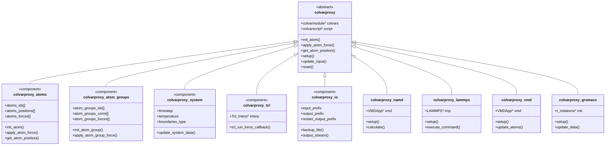
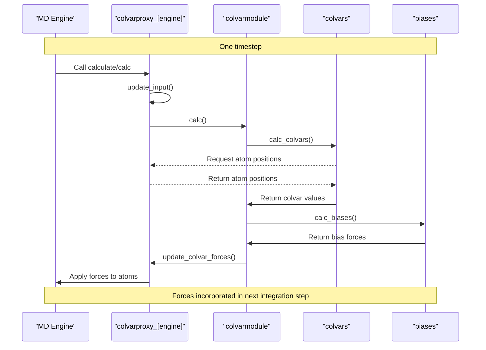
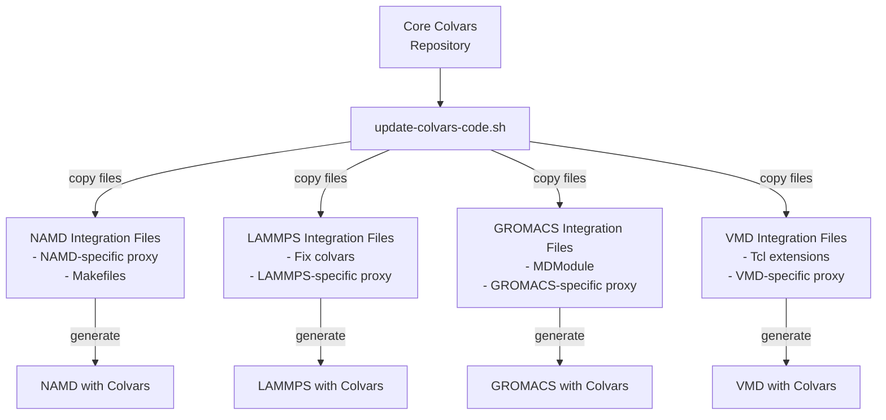

# MD Engine Integration

Relevant source files

The following files were used as context for generating this wiki page:

- [README-versions.md](README-versions.md)
- [devel-tools/compile-gromacs.sh](devel-tools/compile-gromacs.sh)
- [doc/.gitignore](doc/.gitignore)
- [doc/Makefile](doc/Makefile)
- [doc/colvars-code-refs.bib](doc/colvars-code-refs.bib)
- [doc/colvars-engine-flags.tex](doc/colvars-engine-flags.tex)
- [doc/colvars-refman-gromacs.tex](doc/colvars-refman-gromacs.tex)
- [doc/colvars-refman-lammps.tex](doc/colvars-refman-lammps.tex)
- [doc/colvars-refman-main.tex](doc/colvars-refman-main.tex)
- [doc/colvars-refman-namd.tex](doc/colvars-refman-namd.tex)
- [doc/colvars-refman-tinkerhp.tex](doc/colvars-refman-tinkerhp.tex)
- [doc/colvars-refman-vmd.tex](doc/colvars-refman-vmd.tex)
- [doc/colvars-refman.bib](doc/colvars-refman.bib)
- [doc/colvars-refman.tex](doc/colvars-refman.tex)
- [doc/extract_code_refs.py](doc/extract_code_refs.py)
- [doc/print_engine_versions.sh](doc/print_engine_versions.sh)
- [namd/src/colvarproxy_namd.C](namd/src/colvarproxy_namd.C)
- [namd/src/colvarproxy_namd.h](namd/src/colvarproxy_namd.h)
- [namd/ug/ug_colvars.tex](namd/ug/ug_colvars.tex)
- [src/colvarmodule.cpp](src/colvarmodule.cpp)
- [src/colvarmodule.h](src/colvarmodule.h)
- [src/colvarmodule_refs.h](src/colvarmodule_refs.h)
- [src/colvarparse.cpp](src/colvarparse.cpp)
- [src/colvarparse.h](src/colvarparse.h)
- [src/colvarproxy.cpp](src/colvarproxy.cpp)
- [src/colvarproxy.h](src/colvarproxy.h)
- [update-colvars-code.sh](update-colvars-code.sh)
- [vmd/doc/ug_colvars.tex](vmd/doc/ug_colvars.tex)
- [vmd/src/colvarproxy_vmd.C](vmd/src/colvarproxy_vmd.C)
- [vmd/src/colvarproxy_vmd.h](vmd/src/colvarproxy_vmd.h)

This page explains how the Colvars module integrates with various molecular dynamics (MD) engines. It covers the architecture of the integration system, the common proxy interface, engine-specific implementations, and mechanisms for maintaining consistent code across multiple engines. For details about specific usage in each MD engine, see the corresponding pages: [NAMD Integration](#5.1), [LAMMPS Integration](#5.2), [VMD Integration](#5.3), [GROMACS Integration](#5.4), and [Integration Update System](#5.5).

## Proxy Architecture

The Colvars module uses a proxy design pattern to abstract the interactions with different MD engines. This allows the core Colvars functionality to remain engine-independent while providing specialized interfaces for each supported engine.

### Proxy Class Hierarchy

Sources: [src/colvarproxy.h:31-36](), [src/colvarproxy.h:42-60](), [namd/src/colvarproxy_namd.h:39-40](), [vmd/src/colvarproxy_vmd.h:32-33]()

The proxy design uses component classes that handle specific responsibilities through multiple inheritance:

- `colvarproxy_atoms`: Manages individual atoms (positions, forces)
- `colvarproxy_atom_groups`: Handles groups of atoms (centers of mass, forces on groups)
- `colvarproxy_system`: Provides system-level information (timestep, temperature, boundaries)
- `colvarproxy_tcl`: Interfaces with Tcl scripting capabilities
- `colvarproxy_io`: Handles input/output operations
- Engine-specific proxies: Implement the abstract methods for each MD engine

## Data Flow and Communication

The following diagram illustrates how data flows between the MD engine and the Colvars module through the proxy interface:

Sources: [src/colvarmodule.cpp:850-869](), [namd/src/colvarproxy_namd.C:445-585](), [colvarproxy.h:128-131]()

## Engine-Specific Integration

Each MD engine implements the proxy interface differently based on its architecture:

### Engine Integration Methods

| Engine   | Integration Method                | Main Proxy Class         | Force Application                     |
|----------|-----------------------------------|--------------------------|--------------------------------------|
| NAMD     | GlobalMaster class               | colvarproxy_namd         | Through modifyForcedAtoms()           |
| LAMMPS   | Fix colvars command              | colvarproxy_lammps       | Through pack_forces()                 |
| VMD      | Tcl command extension            | colvarproxy_vmd          | For analysis only (no forces applied) |
| GROMACS  | Applied Forces module            | colvarproxy_gromacs      | Through pull-style force application  |
| Tinker-HP| Tcl plugin-based interface       | colvarproxy_tinkerhp     | Through native force application      |

Sources: [namd/src/colvarproxy_namd.h:39-40](), [namd/src/colvarproxy_namd.C:570-575](), [vmd/src/colvarproxy_vmd.C:45-53]()

### Initialization in Different Engines

```mermaid
flowchart TD
    subgraph "NAMD"
        n1["colvars on"] --> n2["colvarsConfig = file.in"]
        n2 --> n3["GlobalMaster creates\ncolvarproxy_namd"]
        n3 --> n4["colvarmodule\nconstructor"]
    end

    subgraph "LAMMPS"
        l1["fix Colvars all colvars file.in"] --> l2["FixColvars creates\ncolvarproxy_lammps"]
        l2 --> l3["colvarmodule\nconstructor"]
    end

    subgraph "GROMACS"
        g1["colvars-active = yes"] --> g2["colvars-configfile = file.in"]
        g2 --> g3["MDModule creates\ncolvarproxy_gromacs"]
        g3 --> g4["colvarmodule\nconstructor"]
    end

    subgraph "VMD"
        v1["cv molid #"] --> v2["Creates\ncolvarproxy_vmd"]
        v2 --> v3["colvarmodule\nconstructor"]
    end
```

Sources: [namd/src/colvarproxy_namd.C:76-140](), [vmd/src/colvarproxy_vmd.C:71-121](), [doc/colvars-refman-main.tex:372-426]()

## Code Organization and Maintenance

### Source Code Structure

The Colvars codebase is organized to facilitate integration with multiple MD engines:

1. **Core code**: Engine-independent code in the `src` directory
2. **Engine-specific code**: Interface code in engine-specific directories 
3. **Update system**: Scripts to keep the code consistent across engines

### Update System

The `update-colvars-code.sh` script is used to maintain the Colvars code across multiple MD engines. This ensures that all supported MD engines can use the latest version of Colvars.

Sources: [update-colvars-code.sh:6-9](), [update-colvars-code.sh:272-340](), [update-colvars-code.sh:345-426](), [update-colvars-code.sh:433-467]()

## Engine-Specific Interfaces

Each MD engine has unique ways of interfacing with the Colvars module:

### NAMD Interface

In NAMD, Colvars is implemented as a GlobalMaster module that interfaces with the simulation at each timestep. Configuration is provided through NAMD's configuration file with specific keywords like `colvars`, `colvarsConfig`, and `colvarsInput`.

Sources: [namd/src/colvarproxy_namd.C:76-140](), [namd/src/colvarproxy_namd.C:345-583](), [doc/colvars-refman-main.tex:413-451]()

### LAMMPS Interface

LAMMPS implements Colvars as a fix command (`fix colvars`) that can be included in the LAMMPS input script. The fix handles the creation of the proxy and the communication with the Colvars module.

Sources: [doc/colvars-refman-main.tex:458-527](), [update-colvars-code.sh:285-303]()

### GROMACS Interface

In GROMACS 2024 and later, Colvars is integrated natively as an Applied Forces module (MDModule). It's configured using MDP parameters such as `colvars-active` and `colvars-configfile`.

Sources: [doc/colvars-refman-main.tex:538-600](), [update-colvars-code.sh:495-520](), [update-colvars-code.sh:520-554]()

### VMD Interface

VMD uses Colvars primarily for analysis through a Tcl interface and the Colvars Dashboard GUI. While it doesn't perform dynamics, it can analyze trajectories and prepare setups for MD simulations.

Sources: [vmd/src/colvarproxy_vmd.C:71-121](), [doc/colvars-refman-main.tex:147-307]()

## Unit Systems

Colvars supports different unit systems depending on the MD engine's native units:

| Engine   | Length Unit | Energy Unit | Default Unit System |
|----------|-------------|-------------|---------------------|
| NAMD     | Å           | kcal/mol    | real                |
| LAMMPS   | Various     | Various     | Matches LAMMPS units |
| GROMACS  | nm          | kJ/mol      | gromacs             |
| VMD      | Å           | kcal/mol    | real                |
| Tinker-HP| Å           | kcal/mol    | real                |

Sources: [src/colvarproxy.cpp:230-260](), [namd/src/colvarproxy_namd.C:64-65](), [vmd/src/colvarproxy_vmd.C:159-191](), [doc/colvars-refman-main.tex:377-411]()

## Common Challenges and Solutions

### Integration Issues

- **Boundary conditions**: Different handling of periodic boundary conditions between engines
- **Units conversion**: Ensuring proper conversion between different unit systems
- **Parallelization**: Adapting to each engine's parallelization scheme

### Best Practices

- Using `update-colvars-code.sh` to propagate changes to all engines
- Implementing engine-specific optimizations while maintaining a common interface
- Thorough testing across all supported engines after making changes

Sources: [namd/src/colvarproxy_namd.C:402-410](), [vmd/src/colvarproxy_vmd.C:242-258](), [update-colvars-code.sh:396-425]()

## Conclusion

The Colvars module uses a robust proxy architecture to integrate with multiple MD engines while maintaining a single core codebase. This design allows Colvars to be used in a variety of simulation environments while providing a consistent interface for users and developers. The integration system is designed to be maintainable, with tools to keep the code synchronized across all supported MD engines.

---