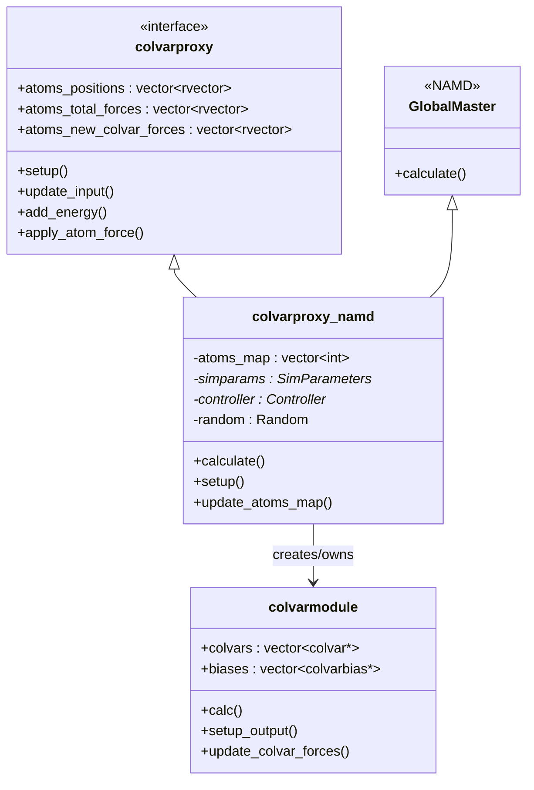
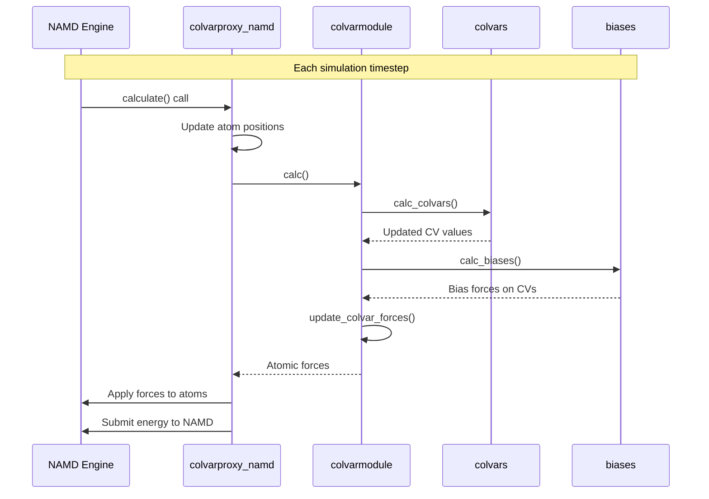
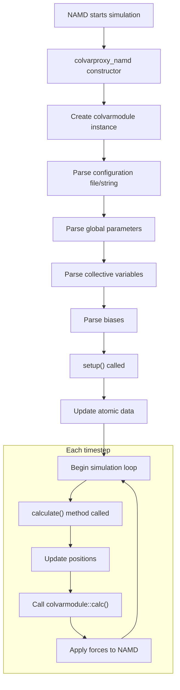
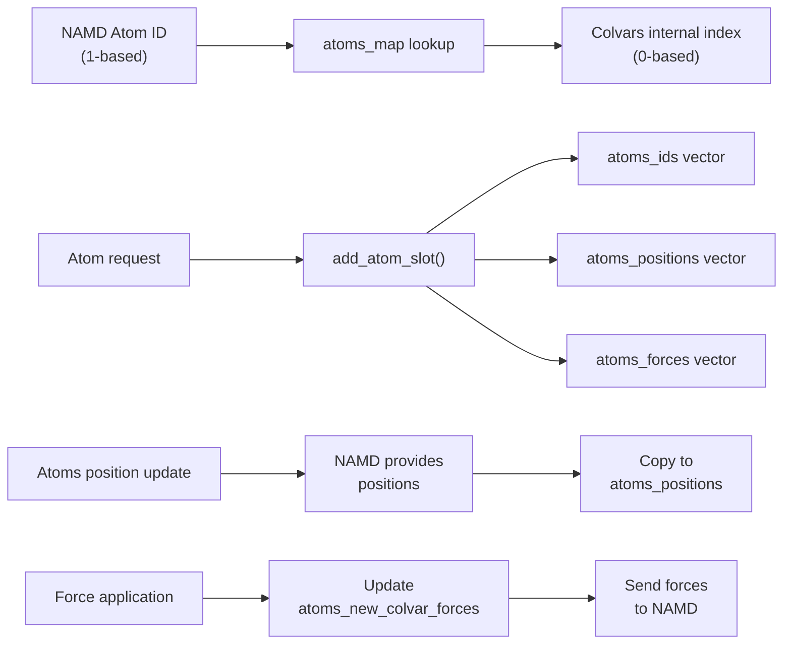
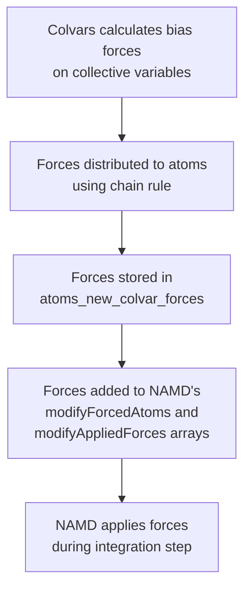
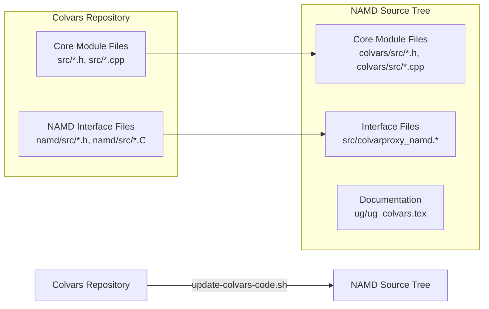

# NAMD Integration

Relevant source files

The following files were used as context for generating this wiki page:

- [README-versions.md](README-versions.md)
- [devel-tools/compile-gromacs.sh](devel-tools/compile-gromacs.sh)
- [doc/.gitignore](doc/.gitignore)
- [doc/Makefile](doc/Makefile)
- [doc/colvars-code-refs.bib](doc/colvars-code-refs.bib)
- [doc/colvars-engine-flags.tex](doc/colvars-engine-flags.tex)
- [doc/colvars-refman-gromacs.tex](doc/colvars-refman-gromacs.tex)
- [doc/colvars-refman-lammps.tex](doc/colvars-refman-lammps.tex)
- [doc/colvars-refman-main.tex](doc/colvars-refman-main.tex)
- [doc/colvars-refman-namd.tex](doc/colvars-refman-namd.tex)
- [doc/colvars-refman-tinkerhp.tex](doc/colvars-refman-tinkerhp.tex)
- [doc/colvars-refman-vmd.tex](doc/colvars-refman-vmd.tex)
- [doc/colvars-refman.bib](doc/colvars-refman.bib)
- [doc/colvars-refman.tex](doc/colvars-refman.tex)
- [doc/extract_code_refs.py](doc/extract_code_refs.py)
- [doc/print_engine_versions.sh](doc/print_engine_versions.sh)
- [namd/src/colvarproxy_namd.C](namd/src/colvarproxy_namd.C)
- [namd/src/colvarproxy_namd.h](namd/src/colvarproxy_namd.h)
- [namd/ug/ug_colvars.tex](namd/ug/ug_colvars.tex)
- [src/colvarmodule.cpp](src/colvarmodule.cpp)
- [src/colvarmodule.h](src/colvarmodule.h)
- [src/colvarmodule_refs.h](src/colvarmodule_refs.h)
- [src/colvarparse.cpp](src/colvarparse.cpp)
- [src/colvarparse.h](src/colvarparse.h)
- [src/colvarproxy.cpp](src/colvarproxy.cpp)
- [src/colvarproxy.h](src/colvarproxy.h)
- [update-colvars-code.sh](update-colvars-code.sh)
- [vmd/doc/ug_colvars.tex](vmd/doc/ug_colvars.tex)
- [vmd/src/colvarproxy_vmd.C](vmd/src/colvarproxy_vmd.C)
- [vmd/src/colvarproxy_vmd.h](vmd/src/colvarproxy_vmd.h)

This document describes how the Colvars module integrates with the NAMD (NAnoscale Molecular Dynamics) simulation engine. It covers the technical implementation details of the interface between Colvars and NAMD, including initialization, data exchange, and force application mechanisms.

## Introduction

The Colvars module is designed with a modular architecture that allows it to interface with multiple molecular dynamics engines. For NAMD, this integration is accomplished through a specialized proxy class that translates between Colvars' internal representation and NAMD's data structures and runtime model.

The NAMD integration takes advantage of NAMD's "GlobalMaster" mechanism, which allows external modules to influence the simulation by applying forces to atoms based on collective variables calculated from atomic positions.

## Architecture Overview

The integration architecture follows a proxy pattern, where a NAMD-specific implementation of the colvarproxy interface handles all communication between the Colvars module and NAMD.

Sources: [src/colvarmodule.h:55-900](), [src/colvarproxy.h:55-244](), [namd/src/colvarproxy_namd.h:39-291]()

## Integration Components

The NAMD integration consists of the following primary components:

1. **colvarproxy_namd**: This class serves as the bridge between NAMD and the Colvars module. It inherits from both NAMD's GlobalMaster class and the Colvars colvarproxy interface.

2. **GlobalMaster mechanism**: NAMD provides this extension point for modules that need to compute forces during simulation.

3. **Atom mapping system**: Maintains a mapping between NAMD atom indices and Colvars' internal representation.

4. **Force communication channels**: NAMD provides mechanisms for modules to apply forces to atoms, which Colvars uses to implement biasing methods.

### The colvarproxy_namd Class

The `colvarproxy_namd` class is the central component of the integration. It must satisfy the requirements of both NAMD's GlobalMaster interface and the Colvars module's proxy interface.

Key responsibilities include:
- Translating atom selections between NAMD and Colvars
- Converting forces from Colvars to NAMD
- Managing I/O operations
- Handling configuration parameters

Sources: [namd/src/colvarproxy_namd.h:39-291](), [namd/src/colvarproxy_namd.C:46-154]()

## Data Flow and Runtime Execution

The diagram below illustrates the data flow between NAMD and the Colvars module during a simulation step:

Sources: [namd/src/colvarproxy_namd.C:345-620](), [src/colvarmodule.cpp:850-905]()

### Key Methods in the Execution Flow

1. **calculate()**: Called by NAMD at each timestep, this method updates atomic positions from NAMD and triggers the Colvars calculation.

2. **update_atoms_map()**: Maintains the mapping between NAMD atoms and Colvars atoms.

3. **calc()**: The main computational method in the Colvars module that calculates variables and biases.

4. **update_colvar_forces()**: Translates forces from collective variables to atomic forces.

Sources: [namd/src/colvarproxy_namd.C:345-620](), [src/colvarmodule.cpp:580-605]()

## Initialization and Configuration

The initialization process follows these steps:

Sources: [namd/src/colvarproxy_namd.C:46-154](), [namd/src/colvarproxy_namd.C:234-310](), [src/colvarmodule.cpp:383-435]()

### Configuration Path

NAMD provides several ways to configure the Colvars module:

1. **colvars** - Flag to enable the Colvars module (in NAMD config file)
2. **colvarsConfig** - Path to Colvars configuration file (in NAMD config file)
3. **colvarsInput** - Path to input state file for restarting (in NAMD config file)
4. **cv config** - Tcl command to provide configuration as a string
5. **cv configfile** - Tcl command to specify configuration file

Sources: [doc/colvars-refman-main.tex:414-451]()

## Atom Selection and Management

The NAMD integration maps between NAMD's atom numbering and Colvars' internal atom indices. This mapping is maintained in the `atoms_map` vector:

Sources: [namd/src/colvarproxy_namd.C:191-223](), [namd/src/colvarproxy_namd.C:452-469](), [namd/src/colvarproxy_namd.C:570-574]()

## Force Application

Colvars calculates biasing forces based on collective variables and applies them to atoms in the simulation. The force application process involves:

1. Calculation of forces on collective variables
2. Distribution of these forces to individual atoms
3. Communication of atomic forces to NAMD

The NAMD proxy implements this by:

Sources: [namd/src/colvarproxy_namd.C:570-600]()

## Special Features in NAMD Integration

### Accelerated MD Support

NAMD's integration specifically supports accelerated molecular dynamics (aMD) with Colvars through the `update_accelMD_info()` method, which retrieves the aMD boost factor from the controller and makes it available to Colvars biases.

Sources: [namd/src/colvarproxy_namd.C:622-625](), [namd/src/colvarproxy_namd.h:68-70]()

### Volumetric Maps Support

In recent versions of NAMD (2.14 and later), the integration supports NAMD's volumetric maps (GridForce) functionality, allowing Colvars to use and manipulate volumetric data.

Sources: [namd/src/colvarproxy_namd.h:224-263]()

### SMP Parallelism

NAMD's Colvars integration supports shared memory parallelism (SMP) through Charm++ when available, enabling parallel calculation of collective variables.

Sources: [namd/src/colvarproxy_namd.h:128-177]()

## Update and Maintenance

The Colvars module in NAMD is updated using the `update-colvars-code.sh` script, which copies files from the Colvars repository to the appropriate locations in the NAMD source tree.

Sources: [update-colvars-code.sh:344-425]()

## Summary

The NAMD integration for Colvars provides a complete interface between the Colvars module and NAMD simulation engine. It leverages NAMD's GlobalMaster mechanism to implement enhanced sampling methods based on collective variables.

The main components are:
1. The `colvarproxy_namd` class that bridges NAMD and Colvars
2. Atom selection and force application mechanisms
3. Configuration and I/O interfaces
4. Special features like accelerated MD and volumetric maps support

This architecture provides a robust and performance-efficient way to use the Colvars module's enhanced sampling methods in NAMD simulations.

---