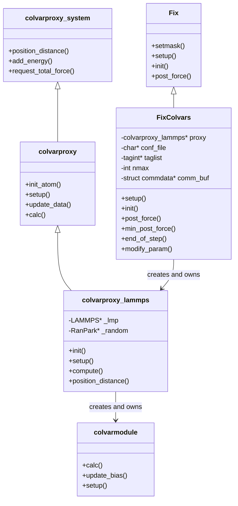
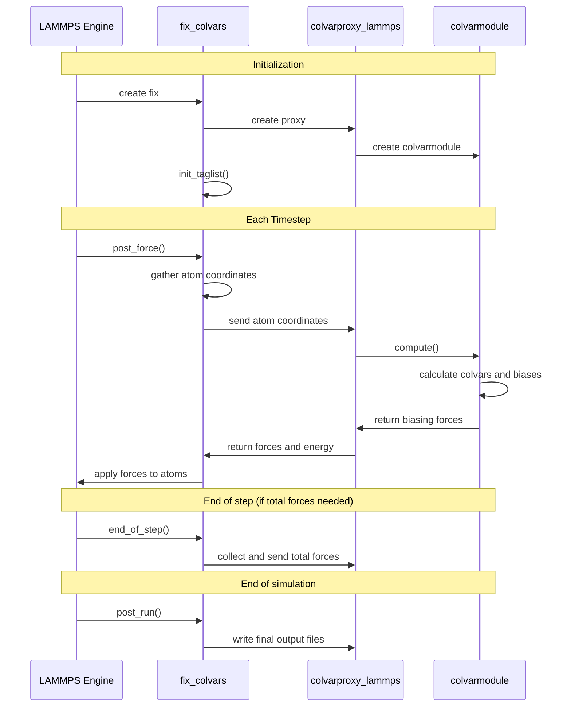
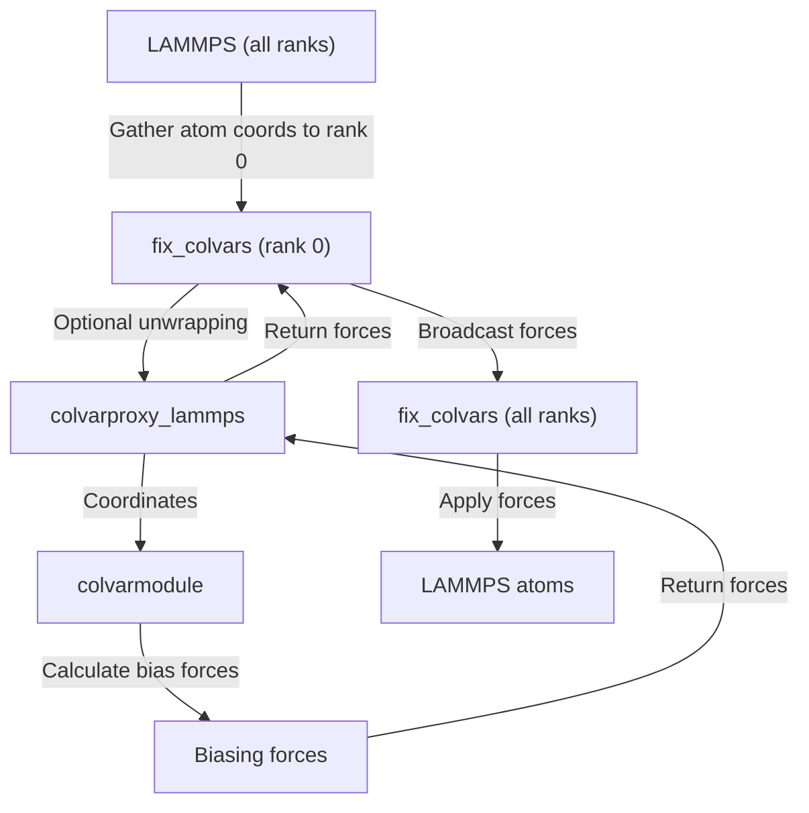
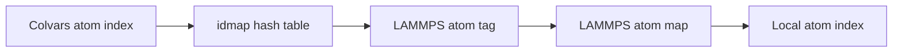
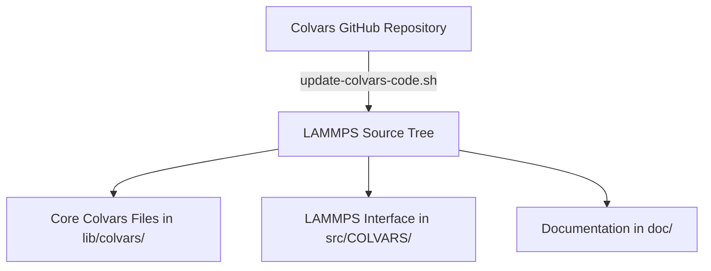

# LAMMPS Integration

<details>
<summary>Relevant source files</summary>

The following files were used as context for generating this wiki page:

- [README-versions.md](README-versions.md)
- [devel-tools/compile-gromacs.sh](devel-tools/compile-gromacs.sh)
- [doc/.gitignore](doc/.gitignore)
- [doc/Makefile](doc/Makefile)
- [doc/colvars-code-refs.bib](doc/colvars-code-refs.bib)
- [doc/colvars-engine-flags.tex](doc/colvars-engine-flags.tex)
- [doc/colvars-refman-gromacs.tex](doc/colvars-refman-gromacs.tex)
- [doc/colvars-refman-lammps.tex](doc/colvars-refman-lammps.tex)
- [doc/colvars-refman-main.tex](doc/colvars-refman-main.tex)
- [doc/colvars-refman-namd.tex](doc/colvars-refman-namd.tex)
- [doc/colvars-refman-tinkerhp.tex](doc/colvars-refman-tinkerhp.tex)
- [doc/colvars-refman-vmd.tex](doc/colvars-refman-vmd.tex)
- [doc/colvars-refman.bib](doc/colvars-refman.bib)
- [doc/colvars-refman.tex](doc/colvars-refman.tex)
- [doc/extract_code_refs.py](doc/extract_code_refs.py)
- [doc/print_engine_versions.sh](doc/print_engine_versions.sh)
- [lammps/doc/src/fix_colvars.rst](lammps/doc/src/fix_colvars.rst)
- [lammps/src/COLVARS/colvarproxy_lammps.cpp](lammps/src/COLVARS/colvarproxy_lammps.cpp)
- [lammps/src/COLVARS/colvarproxy_lammps.h](lammps/src/COLVARS/colvarproxy_lammps.h)
- [lammps/src/COLVARS/fix_colvars.cpp](lammps/src/COLVARS/fix_colvars.cpp)
- [lammps/src/COLVARS/fix_colvars.h](lammps/src/COLVARS/fix_colvars.h)
- [lammps/src/COLVARS/inthash.cpp](lammps/src/COLVARS/inthash.cpp)
- [lammps/src/COLVARS/inthash.h](lammps/src/COLVARS/inthash.h)
- [namd/ug/ug_colvars.tex](namd/ug/ug_colvars.tex)
- [src/colvarmodule_refs.h](src/colvarmodule_refs.h)
- [src/colvarproxy_system.cpp](src/colvarproxy_system.cpp)
- [src/colvarproxy_system.h](src/colvarproxy_system.h)
- [update-colvars-code.sh](update-colvars-code.sh)
- [vmd/doc/ug_colvars.tex](vmd/doc/ug_colvars.tex)

</details>


This page documents how the Colvars module is integrated with the LAMMPS molecular dynamics engine, explaining both the user interface and the internal implementation. The integration allows LAMMPS users to perform enhanced sampling simulations using collective variables through a standard LAMMPS fix command.

For information about other MD engine integrations, see [MD Engine Integration](#5). For GROMACS-specific integration, see [GROMACS Integration](#5.4). For NAMD-specific integration, see [NAMD Integration](#5.1).

## User Interface

LAMMPS users interact with Colvars through the `fix colvars` command, which creates an instance of the Colvars module and manages the exchange of data between LAMMPS and Colvars.

### Command Syntax

```
fix ID group-ID colvars configfile [keyword value ...]
```

Where:
- `ID` is the fix ID (must be "Colvars" as only one instance is supported)
- `group-ID` is the group of atoms to apply the fix to (typically "all")
- `configfile` is the Colvars configuration file (use "none" to provide inline configuration)
- Optional keywords:
  - `output` - prefix for output files (default: "out")
  - `input` - prefix for input state file (default: none)
  - `unwrap` - whether to unwrap coordinates (default: yes)
  - `tstat` - thermostat fix ID for temperature coupling
  - `seed` - random number seed (default: 1966)

Example usage:
```
fix Colvars all colvars config.colvars output simulation1
```

The fix can also be modified on-the-fly using the `fix_modify` command, which can both alter fix parameters and add Colvars script commands:

```
fix_modify Colvars output new_output_prefix
fix_modify Colvars tstat NPT_fix

# Adding a new harmonic restraint during a simulation
fix_modify Colvars config "
harmonic {
  colvars distance
  centers 5.0
  forceConstant 10.0
}"
```

Sources: [lammps/src/COLVARS/fix_colvars.cpp:66-202](), [lammps/doc/src/fix_colvars.rst:1-32]()

### Output Files

When running a simulation with Colvars, several output files are created:
- `<output_prefix>.colvars.state` - restart information for Colvars
- `<output_prefix>.colvars.traj` - trajectory of collective variables
- Method-specific output files (e.g., PMF files for ABF calculations)

The Colvars state is also saved in LAMMPS binary restart files, allowing simulation continuation using the standard LAMMPS restart mechanism.

Sources: [lammps/src/COLVARS/fix_colvars.cpp:425-449]()

## Technical Architecture

The Colvars integration with LAMMPS follows a proxy design pattern, where the `fix_colvars` class provides the LAMMPS interface, and `colvarproxy_lammps` handles the communication between LAMMPS and the Colvars library.

### Class Relationships



Sources: [lammps/src/COLVARS/fix_colvars.h:47-113](), [lammps/src/COLVARS/colvarproxy_lammps.h:31-100](), [src/colvarproxy_system.h:15-338]()

### Data Flow

The following diagram illustrates the flow of data between LAMMPS and Colvars during a simulation:



Sources: [lammps/src/COLVARS/fix_colvars.cpp:624-776](), [lammps/src/COLVARS/colvarproxy_lammps.cpp:101-180]()

## Implementation Details

### Coordinate Communication

The integration uses a specialized communication protocol to exchange atomic coordinates between LAMMPS and Colvars:

1. The fix maintains a list of atom IDs (tags) needed by Colvars
2. During each timestep, it collects coordinates of these atoms
3. For parallel simulations, coordinates are gathered on rank 0
4. Optionally unwraps coordinates to handle periodic boundary conditions
5. Sends coordinates to the proxy, which forwards them to Colvars



Sources: [lammps/src/COLVARS/fix_colvars.cpp:624-776]()

### Communication Buffers

To efficiently handle data exchange in parallel environments, the integration uses specialized communication buffers:

1. `commdata` struct for packed atomic data (tag, type, position, mass, charge)
2. `comm_buf` array for communicating coordinates from all ranks to rank 0
3. `force_buf` array for broadcasting forces back to all ranks

The size of these buffers is dynamically adjusted based on the number of atoms involved in the collective variables.

Sources: [lammps/src/COLVARS/fix_colvars.cpp:51-55](), [lammps/src/COLVARS/fix_colvars.cpp:266-341]()

### Periodic Boundary Conditions

Proper handling of periodic boundary conditions (PBCs) is crucial for Colvars calculations. The integration provides two options:

1. **Unwrapped coordinates** (default): Uses image flags to reconstruct absolute atom positions
2. **Wrapped coordinates**: Uses current local coordinates that are wrapped within the simulation cell

The PBC handling is implemented in two key methods:
- `position_distance()` - calculates distances respecting periodic boundaries
- `setup()` and `post_force()` - handle unwrapping of coordinates

Sources: [lammps/src/COLVARS/colvarproxy_lammps.cpp:183-193](), [lammps/src/COLVARS/fix_colvars.cpp:483-523]()

### Atom Indexing

Since LAMMPS and Colvars use different atom indexing schemes, the integration uses a hash table to map between them:

1. LAMMPS uses global atom IDs (tags) that persist throughout a simulation
2. Colvars needs a consecutive internal index for each atom
3. The integration maintains `taglist` array and `idmap` hash table to convert between them



Sources: [lammps/src/COLVARS/fix_colvars.cpp:307-364](), [lammps/src/COLVARS/inthash.cpp:1-37]()

## Version Management and Updates

The Colvars module in LAMMPS is periodically updated to incorporate new features and bug fixes from the main Colvars repository.

### Updating Mechanism

The `update-colvars-code.sh` script automates the process of updating the Colvars implementation in LAMMPS:

1. Identifies the target LAMMPS source tree
2. Copies core Colvars files from the Colvars repository
3. Updates LAMMPS-specific proxy and fix implementations
4. Updates documentation and example files



Sources: [update-colvars-code.sh:1-577]()

### Version Compatibility

The version of Colvars included in each LAMMPS release is tracked and documented:

| LAMMPS version | Colvars version |
|----------------|-----------------|
| stable_29Aug2024 | 2024-06-04 |
| stable_2Aug2023 | 2023-05-01 |
| stable_23Jun2022 | 2022-05-24 |
| stable_29Sep2021 | 2021-09-13 |
| stable_29Oct2020 | 2020-09-17 |

The Colvars interfaces across different MD engines (LAMMPS, NAMD, GROMACS, etc.) are designed to provide a consistent user experience while accounting for engine-specific requirements.

Sources: [README-versions.md:14-32](), [doc/print_engine_versions.sh:1-84]()

## Key Files

The LAMMPS integration consists of several key files:

| File | Description |
|------|-------------|
| `src/COLVARS/fix_colvars.h` | Header for the LAMMPS fix |
| `src/COLVARS/fix_colvars.cpp` | Implementation of the LAMMPS fix |
| `src/COLVARS/colvarproxy_lammps.h` | Header for LAMMPS-specific proxy class |
| `src/COLVARS/colvarproxy_lammps.cpp` | Implementation of LAMMPS-specific proxy |
| `src/COLVARS/colvarproxy_lammps_version.h` | Version information |
| `src/COLVARS/inthash.h` | Hash table for atom index mapping |
| `src/COLVARS/inthash.cpp` | Hash table implementation |
| `lib/colvars/` | Core Colvars library files |
| `doc/src/fix_colvars.rst` | LAMMPS documentation for fix_colvars |
| `update-colvars-code.sh` | Script to update the Colvars code in LAMMPS |

Sources: [update-colvars-code.sh:272-341]()

---