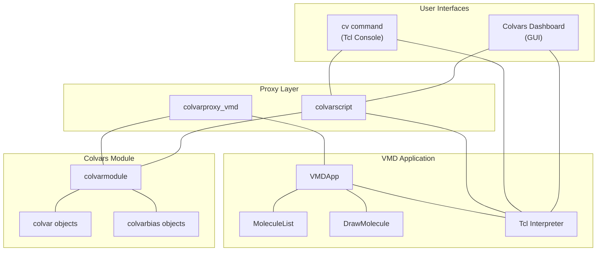
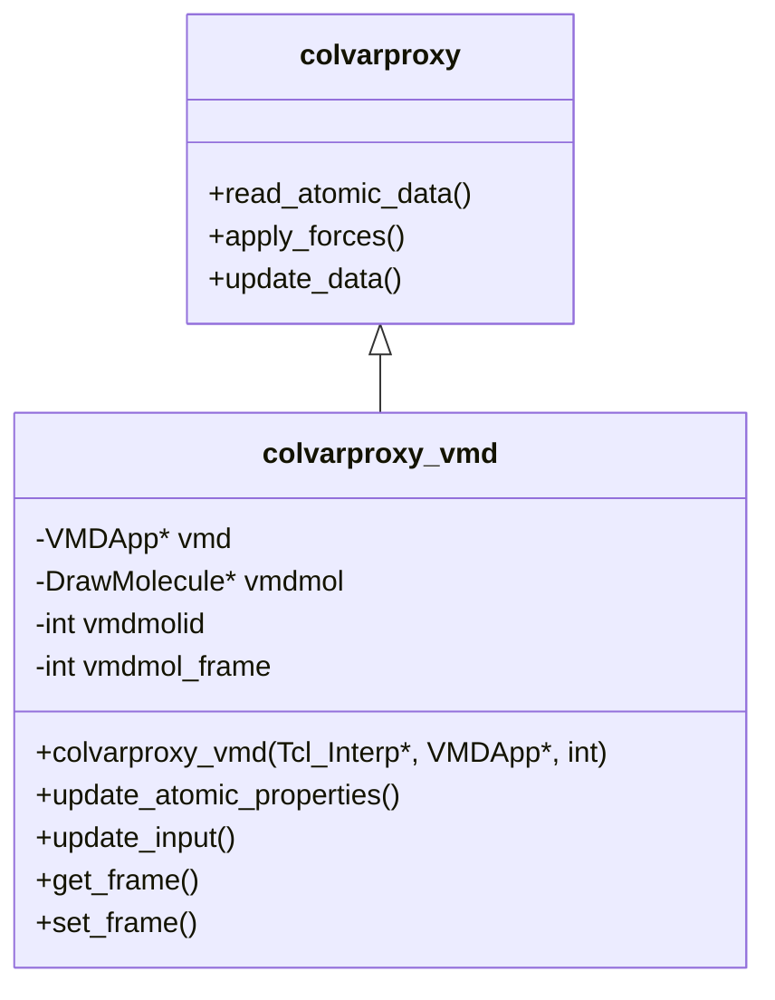
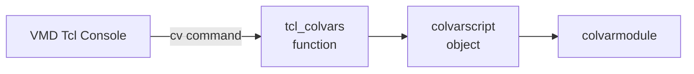
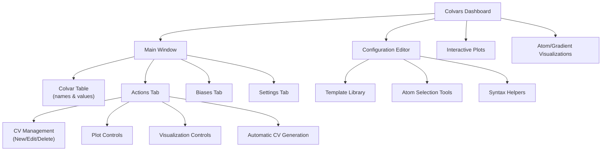
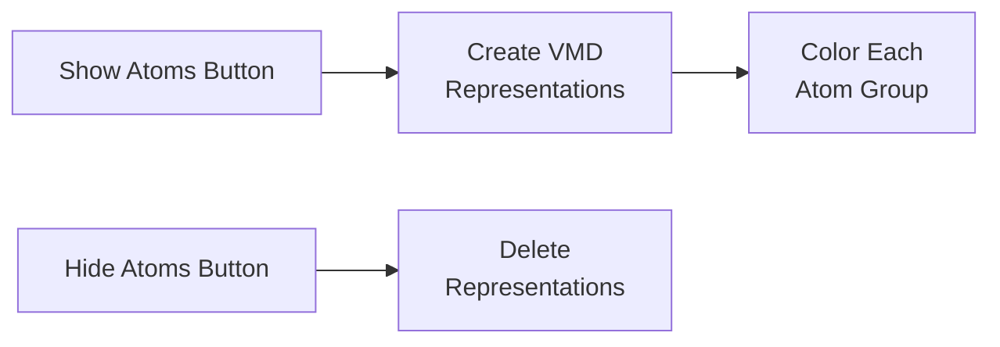
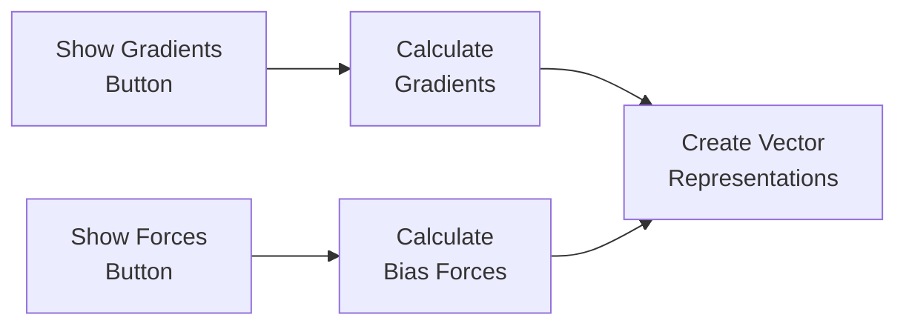
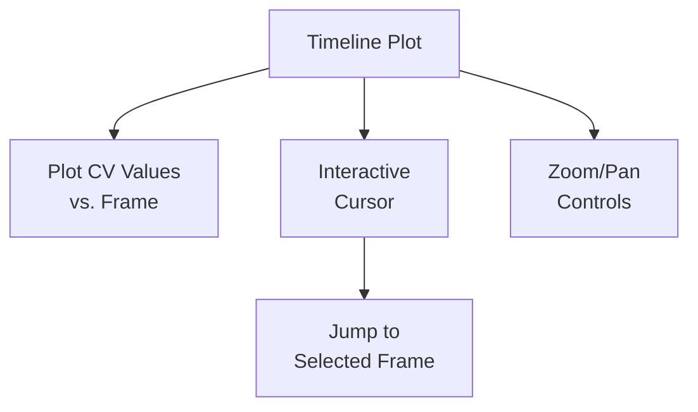
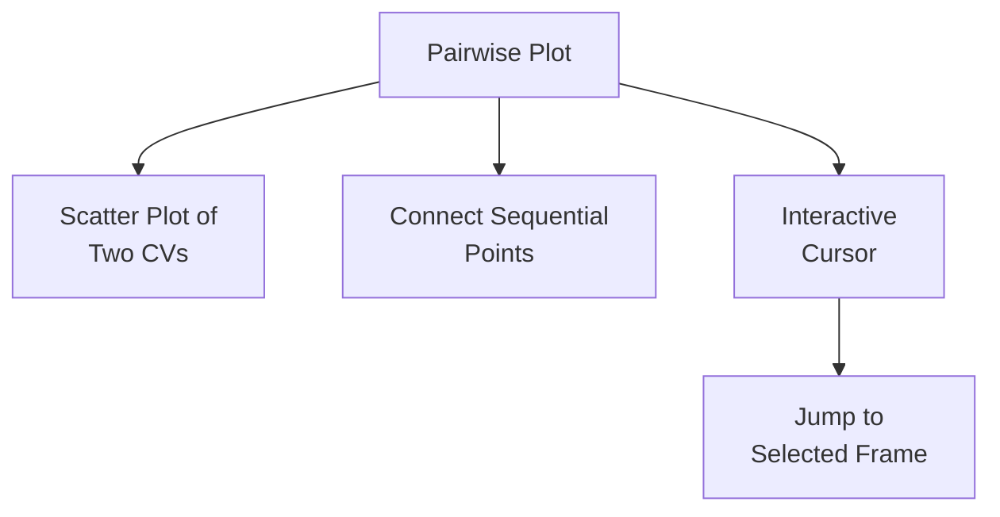
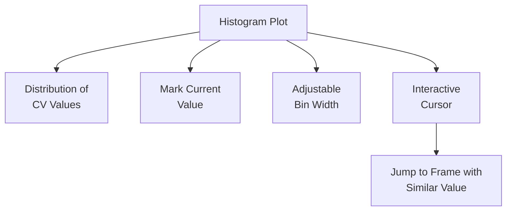

# VMD Integration

Relevant source files

The following files were used as context for generating this wiki page:

- [README-versions.md](README-versions.md)
- [doc/.gitignore](doc/.gitignore)
- [doc/Makefile](doc/Makefile)
- [doc/colvars-code-refs.bib](doc/colvars-code-refs.bib)
- [doc/colvars-engine-flags.tex](doc/colvars-engine-flags.tex)
- [doc/colvars-refman-gromacs.tex](doc/colvars-refman-gromacs.tex)
- [doc/colvars-refman-lammps.tex](doc/colvars-refman-lammps.tex)
- [doc/colvars-refman-main.tex](doc/colvars-refman-main.tex)
- [doc/colvars-refman-namd.tex](doc/colvars-refman-namd.tex)
- [doc/colvars-refman-tinkerhp.tex](doc/colvars-refman-tinkerhp.tex)
- [doc/colvars-refman-vmd.tex](doc/colvars-refman-vmd.tex)
- [doc/colvars-refman.bib](doc/colvars-refman.bib)
- [doc/colvars-refman.tex](doc/colvars-refman.tex)
- [doc/extract_code_refs.py](doc/extract_code_refs.py)
- [doc/print_engine_versions.sh](doc/print_engine_versions.sh)
- [namd/src/colvarproxy_namd.C](namd/src/colvarproxy_namd.C)
- [namd/src/colvarproxy_namd.h](namd/src/colvarproxy_namd.h)
- [namd/tests/library/011_multiple_walker_mtd/common.tcl](namd/tests/library/011_multiple_walker_mtd/common.tcl)
- [namd/ug/ug_colvars.tex](namd/ug/ug_colvars.tex)
- [src/colvarmodule.cpp](src/colvarmodule.cpp)
- [src/colvarmodule.h](src/colvarmodule.h)
- [src/colvarmodule_refs.h](src/colvarmodule_refs.h)
- [src/colvarparse.cpp](src/colvarparse.cpp)
- [src/colvarparse.h](src/colvarparse.h)
- [src/colvarproxy.cpp](src/colvarproxy.cpp)
- [src/colvarproxy.h](src/colvarproxy.h)
- [vmd/cv_dashboard/Makefile](vmd/cv_dashboard/Makefile)
- [vmd/cv_dashboard/Makefile.local](vmd/cv_dashboard/Makefile.local)
- [vmd/cv_dashboard/VERSION](vmd/cv_dashboard/VERSION)
- [vmd/cv_dashboard/cv_dashboard.tcl](vmd/cv_dashboard/cv_dashboard.tcl)
- [vmd/cv_dashboard/cv_dashboard_editor.tcl](vmd/cv_dashboard/cv_dashboard_editor.tcl)
- [vmd/cv_dashboard/cv_dashboard_main.tcl](vmd/cv_dashboard/cv_dashboard_main.tcl)
- [vmd/cv_dashboard/cv_dashboard_plots.tcl](vmd/cv_dashboard/cv_dashboard_plots.tcl)
- [vmd/cv_dashboard/cv_dashboard_settings.tcl](vmd/cv_dashboard/cv_dashboard_settings.tcl)
- [vmd/cv_dashboard/pkgIndex.tcl](vmd/cv_dashboard/pkgIndex.tcl)
- [vmd/doc/ug_colvars.tex](vmd/doc/ug_colvars.tex)
- [vmd/scripts/calc_cv_mass.tcl](vmd/scripts/calc_cv_mass.tcl)
- [vmd/scripts/load_cv_traj.tcl](vmd/scripts/load_cv_traj.tcl)
- [vmd/scripts/load_fepout.tcl](vmd/scripts/load_fepout.tcl)
- [vmd/scripts/mk_native_contacts.tcl](vmd/scripts/mk_native_contacts.tcl)
- [vmd/src/colvarproxy_vmd.C](vmd/src/colvarproxy_vmd.C)
- [vmd/src/colvarproxy_vmd.h](vmd/src/colvarproxy_vmd.h)
- [vmd/tests/interface/004_map_total_internal/test-dashboard.vmd](vmd/tests/interface/004_map_total_internal/test-dashboard.vmd)

The VMD (Visual Molecular Dynamics) integration for the Colvars module provides capabilities for interactive visualization and analysis of collective variables through the VMD software platform. This document explains how Colvars integrates with VMD, the features available through this integration, and how users can interact with the system. For information about specific biasing methods available in Colvars, see [Biasing Methods](#4), and for a general introduction to Colvars, refer to [Overview](#1).

## 1. Architecture Overview

The VMD integration architecture connects the core Colvars functionality to VMD's visualization and analysis capabilities. This integration allows users to define, visualize, and analyze collective variables interactively within VMD's graphical environment.

Sources: [vmd/src/colvarproxy_vmd.h](), [vmd/src/colvarproxy_vmd.C](), [src/colvarmodule.h](), [src/colvarproxy.h]()

## 2. Core Components

### 2.1 colvarproxy_vmd Class

The `colvarproxy_vmd` class serves as the interface between the Colvars module and VMD. It inherits from the generic `colvarproxy` class and implements VMD-specific functionality.

Key responsibilities of `colvarproxy_vmd`:

1. **Atomic Data Access**: Retrieves atom positions, masses, and charges from VMD's molecular structures
2. **Unit Conversion**: Handles conversion between VMD's and Colvars' unit systems
3. **Frame Management**: Controls which trajectory frame is being analyzed
4. **Tcl Interface**: Provides access to VMD's Tcl interpreter for scripting

Sources: [vmd/src/colvarproxy_vmd.h:30-139](), [vmd/src/colvarproxy_vmd.C:71-121]()

### 2.2 Tcl Interface

The Tcl interface allows users to interact with Colvars through VMD's Tcl console and scripts. This is implemented through the `cv` command, which is registered with VMD's Tcl interpreter.

The Tcl command `cv` provides access to all Colvars functionality, including:

- Configuration of collective variables
- Analysis of trajectory data
- Creation and management of biases
- Visualization controls

Sources: [vmd/src/colvarproxy_vmd.C:45-52](), [vmd/src/colvarproxy_vmd.C:60-68]()

## 3. Colvars Dashboard

The Colvars Dashboard is a graphical user interface built with Tcl/Tk that provides intuitive access to Colvars functionality within VMD. It is the primary way most users interact with Colvars in VMD.

### 3.1 Dashboard Features

The Dashboard provides a comprehensive set of features for working with collective variables:

1. **Collective Variable Management**:
   - Create, edit, and delete collective variables
   - View current values in real-time during trajectory playback
   - Save and load configurations

2. **Visualization Tools**:
   - Highlight atoms involved in collective variables
   - Visualize gradients and forces
   - Display specialized representations for rotation and volumetric data

3. **Analysis Tools**:
   - Timeline plots of colvar values
   - Pairwise plots to study correlations between variables
   - Histograms of variable distributions

4. **Automation Features**:
   - Automatic generation of protein/nucleic acid colvars
   - Creation of colvars from VMD's atom selections
   - Import from trajectory files

Sources: [vmd/cv_dashboard/cv_dashboard_main.tcl:8-217](), [vmd/cv_dashboard/cv_dashboard.tcl:35-93](), [doc/colvars-refman-main.tex:139-145]()

### 3.2 Configuration Editor

The Dashboard includes a powerful configuration editor that simplifies the process of creating and modifying collective variables. The editor provides:

- **Templates** for common colvar types
- **Atom selection** tools that integrate with VMD's selection capabilities
- **Syntax assistance** for Colvars configuration options
- **Live preview** of selected atoms

Sources: [vmd/cv_dashboard/cv_dashboard_editor.tcl:13-346](), [doc/colvars-refman-main.tex:224-246]()

## 4. Visualization Capabilities

One of the most powerful aspects of the VMD integration is the ability to visualize collective variables and related concepts directly in the molecular structure.

### 4.1 Atom Group Visualization

The Dashboard can create VMD representations showing the atoms involved in each collective variable, making it easy to verify that the correct atoms are selected.

Sources: [vmd/cv_dashboard/cv_dashboard_main.tcl:128-132](), [vmd/cv_dashboard/cv_dashboard_display.tcl:55-63]()

### 4.2 Gradient and Force Visualization

The Dashboard can visualize the gradients of collective variables and the forces applied by biases. This helps users understand how a collective variable would respond to changes in atomic positions.

For gradient visualization, users can choose between:
- Scaling to a maximum vector norm
- Using a constant scaling factor

Sources: [vmd/cv_dashboard/cv_dashboard_main.tcl:134-139](), [vmd/cv_dashboard/cv_dashboard_display.tcl:251-366](), [doc/colvars-refman-main.tex:270-281]()

## 5. Data Analysis Tools

The Colvars Dashboard provides several tools for analyzing collective variables.

### 5.1 Timeline Plots

Timeline plots show the value of one or more collective variables as a function of time (or frame number), allowing users to track how variables change during a trajectory.

The timeline plots are interactive - clicking on a point in the plot will jump to the corresponding frame in the trajectory.

Sources: [vmd/cv_dashboard/cv_dashboard_main.tcl:114-116](), [vmd/cv_dashboard/cv_dashboard_plots.tcl:6-257](), [doc/colvars-refman-main.tex:252-257]()

### 5.2 Pairwise Plots

Pairwise plots show the relationship between two scalar collective variables, helping to identify correlations and conformational states.

Like timeline plots, pairwise plots allow users to click on points to jump to the corresponding frame.

Sources: [vmd/cv_dashboard/cv_dashboard_main.tcl:115](), [vmd/cv_dashboard/cv_dashboard_plots.tcl:258-396](), [doc/colvars-refman-main.tex:258-262]()

### 5.3 Histograms

Histograms display the distribution of values for a collective variable across the trajectory.

The histogram plot allows users to navigate the trajectory by value rather than by frame number.

Sources: [vmd/cv_dashboard/cv_dashboard_main.tcl:116](), [vmd/cv_dashboard/cv_dashboard_plots.tcl:397-518](), [doc/colvars-refman-main.tex:263-266]()

## 6. Workflow Examples

### 6.1 Basic Analysis Workflow

1. **Load a molecule and trajectory** in VMD
2. **Open the Colvars Dashboard** from the Extensions → Analysis menu
3. **Create collective variables** by clicking "New" or using automatic tools
4. **Animate the trajectory** to see how colvar values change
5. **Create plots** to analyze the behavior of variables
6. **Save the configuration** for future use or for simulation input

Sources: [doc/colvars-refman-main.tex:155-167](), [vmd/cv_dashboard/cv_dashboard.tcl:103-156]()

### 6.2 Using Auto-Generated Colvars

The Dashboard can automatically generate collective variables for common biomolecular analyses:

1. For proteins and nucleic acids: Use the "Protein/NA auto-colvars" button
2. For coordinates defined by VMD's geometric measurements: Create measurements using VMD's tools (bonds, angles, dihedrals) and then use "Colvars from VMD labels"

These automatically generated variables can be used as-is or customized using the configuration editor.

Sources: [vmd/cv_dashboard/cv_dashboard_main.tcl:155-157](), [doc/colvars-refman-main.tex:209-217]()

### 6.3 Custom Variable Creation

For more specialized analyses, the Dashboard allows creating custom variables:

1. **Use scripted functions** to define variables based on external calculations
2. **Pre-compute values** and store them for efficient access
3. **Combine with built-in variables** for comprehensive analysis

This makes it possible to integrate arbitrary measurements with Colvars' built-in analysis capabilities.

Sources: [doc/colvars-refman-main.tex:307-367]()

## 7. Units Handling

The VMD integration supports multiple unit systems to match those used in various simulation engines:

| Unit System | Length Unit | Energy Unit |
|-------------|-------------|-------------|
| real        | Ångström    | kcal/mol    |
| gromacs     | nanometer   | kJ/mol      |
| metal       | Ångström    | eV          |
| electron    | Bohr        | Hartree     |

The unit system can be changed in the Dashboard's general options section, allowing for consistent analysis regardless of which simulation engine was used to generate the data.

Sources: [vmd/cv_dashboard/cv_dashboard_main.tcl:178-185](), [vmd/src/colvarproxy_vmd.C:158-191](), [doc/colvars-refman-main.tex:376-411]()

## 8. Limitations and Notes

- In VMD, no actual biasing forces are applied to atoms during visualization, but biases can be defined for analysis purposes.
- The Colvars Dashboard requires VMD 1.9.4 or later to function properly.
- When using the Dashboard with NAMD output, be cautious about non-periodic simulations which may report unit cell dimensions incorrectly.

Sources: [vmd/cv_dashboard/cv_dashboard.tcl:105-108](), [doc/colvars-refman-main.tex:34]()

---