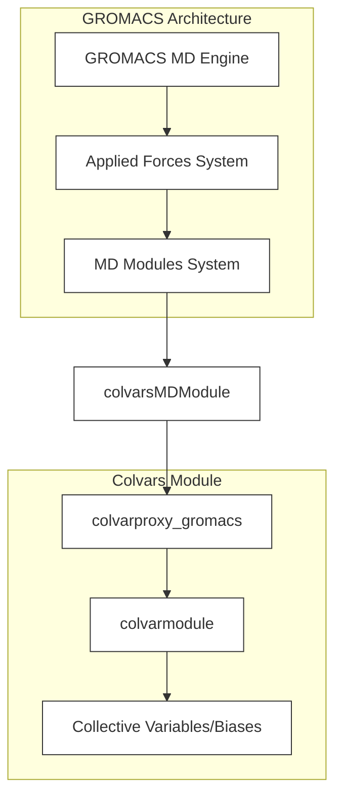
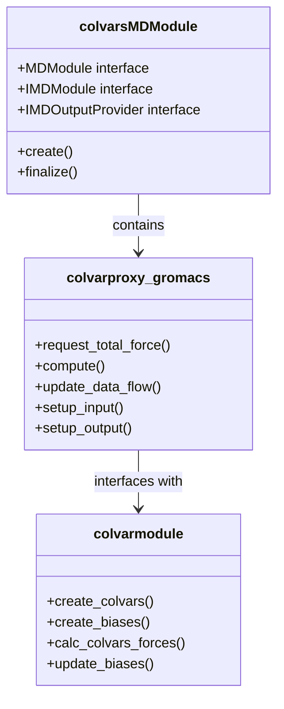
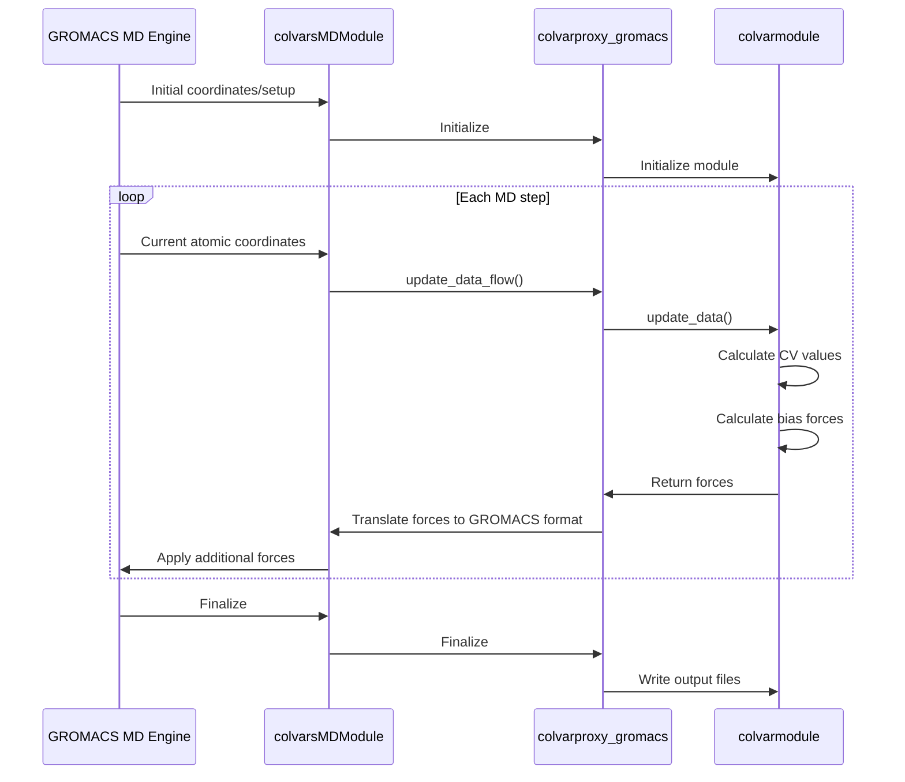

# GROMACS Integration

<details>
<summary>Relevant source files</summary>

The following files were used as context for generating this wiki page:

- [README-versions.md](README-versions.md)
- [devel-tools/compile-gromacs.sh](devel-tools/compile-gromacs.sh)
- [doc/.gitignore](doc/.gitignore)
- [doc/Makefile](doc/Makefile)
- [doc/colvars-code-refs.bib](doc/colvars-code-refs.bib)
- [doc/colvars-engine-flags.tex](doc/colvars-engine-flags.tex)
- [doc/colvars-refman-gromacs.tex](doc/colvars-refman-gromacs.tex)
- [doc/colvars-refman-lammps.tex](doc/colvars-refman-lammps.tex)
- [doc/colvars-refman-main.tex](doc/colvars-refman-main.tex)
- [doc/colvars-refman-namd.tex](doc/colvars-refman-namd.tex)
- [doc/colvars-refman-tinkerhp.tex](doc/colvars-refman-tinkerhp.tex)
- [doc/colvars-refman-vmd.tex](doc/colvars-refman-vmd.tex)
- [doc/colvars-refman.bib](doc/colvars-refman.bib)
- [doc/colvars-refman.tex](doc/colvars-refman.tex)
- [doc/extract_code_refs.py](doc/extract_code_refs.py)
- [doc/print_engine_versions.sh](doc/print_engine_versions.sh)
- [gromacs/gromacs-mdmodules.patch](gromacs/gromacs-mdmodules.patch)
- [namd/ug/ug_colvars.tex](namd/ug/ug_colvars.tex)
- [src/colvarmodule_refs.h](src/colvarmodule_refs.h)
- [update-colvars-code.sh](update-colvars-code.sh)
- [vmd/doc/ug_colvars.tex](vmd/doc/ug_colvars.tex)

</details>


This page documents the integration of the Colvars module with GROMACS molecular dynamics software. It covers how Colvars functionality is implemented within GROMACS, the architecture of the integration, configuration options, and usage details. For information about installing Colvars, see [Installation and Basic Usage](#1.1). For details about Colvars proxy system design across different MD engines, see [Proxy System for MD Integration](#2.2).

## Integration Architecture

The Colvars module is integrated into GROMACS as an "applied force" module that computes additional forces based on collective variables. Since GROMACS 2024, Colvars has been natively supported without requiring patches to the GROMACS source code.

### Integration Overview Diagram



Sources: [update-colvars-code.sh:493-550](), [doc/colvars-refman-main.tex:534-623]()

### Key Components

The GROMACS integration of Colvars consists of the following key components:

1. **colvarsMDModule**: The GROMACS module that implements the interface between GROMACS and Colvars.
2. **colvarproxy_gromacs**: The proxy class that translates between GROMACS and Colvars data structures.
3. **Core Colvars code**: The collection of classes that implement collective variables and biasing methods.



Sources: [update-colvars-code.sh:493-550]()

## File Organization

The Colvars code in GROMACS is organized into two main locations:

1. **Core Colvars Library**: Located in `src/external/colvars/`
   - Contains the platform-independent implementation of collective variables and biasing methods
   - Includes all core header and source files (colvar*.h, colvar*.cpp)

2. **GROMACS-Specific Interface**: Located in `src/gromacs/applied_forces/colvars/`
   - Contains the GROMACS-specific implementation of the proxy class
   - Includes GROMACS module integration files (colvarsMDModule.cpp, colvarproxy_gromacs.h, etc.)

Sources: [update-colvars-code.sh:493-550]()

## Enabling Colvars in GROMACS

Colvars is enabled in GROMACS through parameters in the MDP file (molecular dynamics parameter file). These parameters are processed when generating the TPR file with `gmx grompp`.

### Required MDP Parameters

| Parameter | Description | Default |
|-----------|-------------|---------|
| `colvars-active` | Activate Colvars computation | `no` |
| `colvars-configfile` | Path to Colvars configuration file | (required if active) |
| `colvars-seed` | Random number generator seed | `-1` (generates random seed) |

Example MDP configuration:

```
; MDP file with Colvars enabled
...
colvars-active = yes
colvars-configfile = my_config.colvars
...
(other MDP options)
```

Sources: [doc/colvars-refman-main.tex:537-584]()

## Running Simulations with Colvars

### Basic Workflow

1. Create a Colvars configuration file (e.g., `my_config.colvars`)
2. Add Colvars parameters to your MDP file
3. Generate a TPR file using `gmx grompp`
4. Run the simulation using `gmx mdrun`

```
gmx grompp -f system.mdp -p system.top -c init.gro -o test.tpr
gmx mdrun -s test.tpr
```

When `gmx grompp` is called, the contents of the Colvars configuration file and any referenced files are bundled into the TPR file. This means that during the run, GROMACS does not access the original configuration files.

Sources: [doc/colvars-refman-main.tex:537-597]()

### Continuing a Simulation

To continue a simulation that uses Colvars:

```
gmx convert-tpr -s test.tpr -nsteps ${NUMSTEPS} -o test_restart.tpr
gmx mdrun -s test_restart.tpr -cpi state.cpt
```

The checkpoint file (`state.cpt`) contains the necessary information to restart the Colvars-based calculation, including the last computed step.

Sources: [doc/colvars-refman-main.tex:594-597]()

### Output Files

Colvars output files use the prefix specified with the `-e` flag of `gmx mdrun`. These output files include:

- Trajectory of collective variables: `<prefix>.colvars.traj`
- State file for checkpointing: `<prefix>.colvars.state`
- Output files from specific biasing methods (e.g., PMF files)

Sources: [doc/colvars-refman-main.tex:599]()

## Data Flow and Computation

The Colvars module integrates with GROMACS's computation flow through the MDModules interface. Here's how data flows between GROMACS and Colvars:



Sources: [doc/colvars-refman-main.tex:537-584]()

## Implementation Details

### Key Classes and Files

| Class/File | Purpose |
|------------|---------|
| `colvarsMDModule` | Main interface between GROMACS and Colvars |
| `colvarproxy_gromacs` | Proxy that translates between GROMACS and Colvars |
| `colvarproxy_gromacs_version.h` | Version information for the GROMACS proxy |
| `colvarmodule` | Core Colvars module that manages variables and biases |

### Unit Handling

Since GROMACS uses nanometers and kJ/mol as its internal units, while some other MD engines use Ångstroms and kcal/mol, the GROMACS proxy handles unit conversions for interoperability. This allows Colvars configuration files to be portable across different MD engines, as long as the units are properly specified.

Sources: [doc/colvars-refman-gromacs.tex:19-20]()

## Version Compatibility

Colvars support in GROMACS has two distinct implementation approaches:

1. **Native support (GROMACS 2024 and later)**
   - Colvars is included as a standard module
   - Configured through MDP parameters
   - Version 2023-12-05 of Colvars is included in GROMACS 2024

2. **Legacy support (GROMACS versions until 2023)**
   - Required patched GROMACS source code
   - Enabled through command-line parameters to `gmx mdrun`
   - **This interface is now deprecated**

Users are strongly encouraged to use GROMACS 2024 or later for Colvars calculations.

Sources: [README-versions.md:9-13](), [doc/colvars-refman-main.tex:602-619]()

## Building GROMACS with Colvars

When building GROMACS from source, Colvars is included by default in GROMACS 2024 and later. The update-colvars-code.sh script can be used to update the Colvars module in a GROMACS source tree:

```
sh update-colvars-code.sh /path/to/gromacs/source
```

This script:
1. Copies core Colvars files to `src/external/colvars/`
2. Copies GROMACS-specific interface files to `src/gromacs/applied_forces/colvars/`
3. Applies necessary patches to CMake files

Sources: [update-colvars-code.sh:493-576](), [devel-tools/compile-gromacs.sh:1-131]()

---