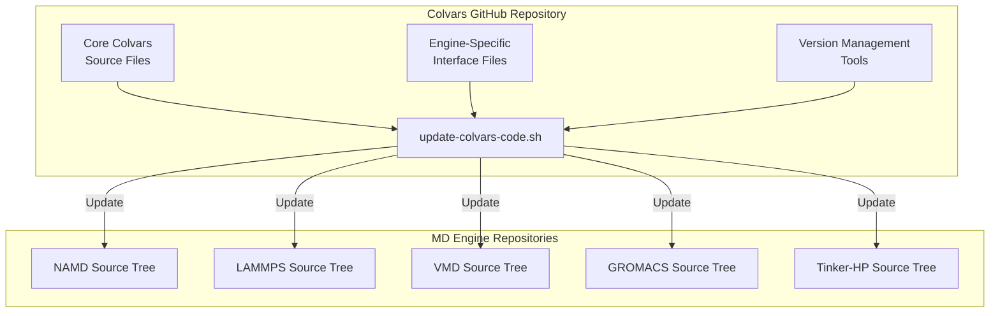
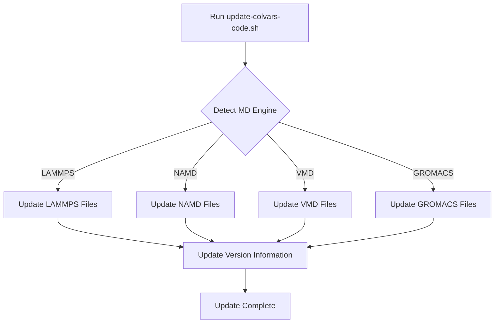
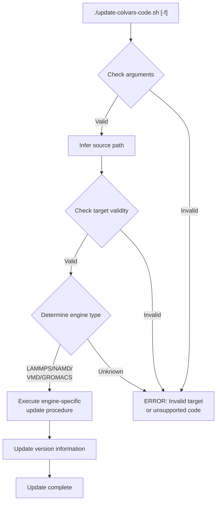
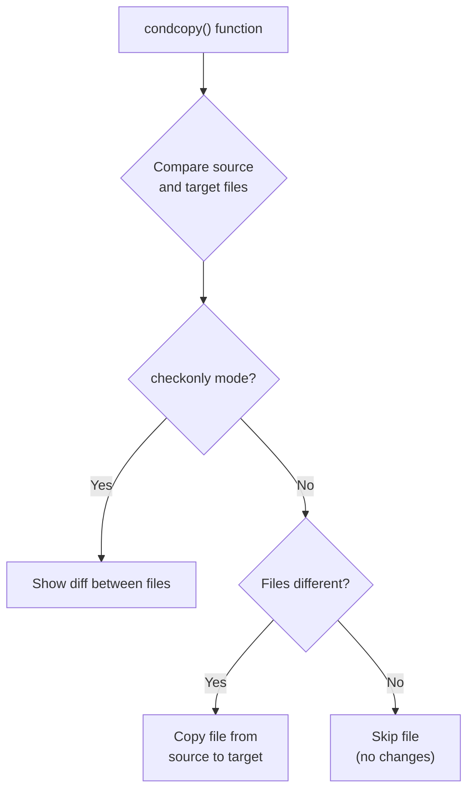
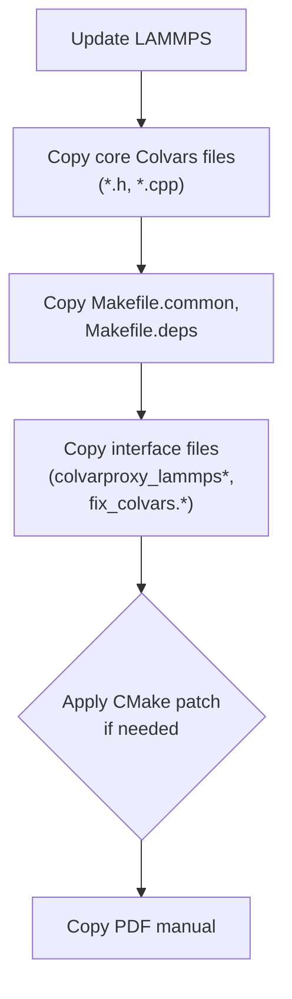
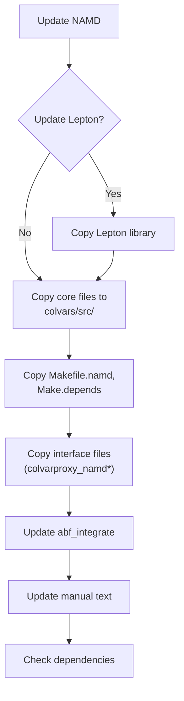
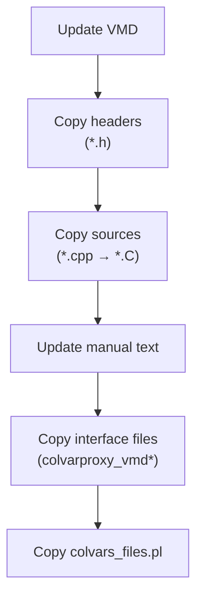
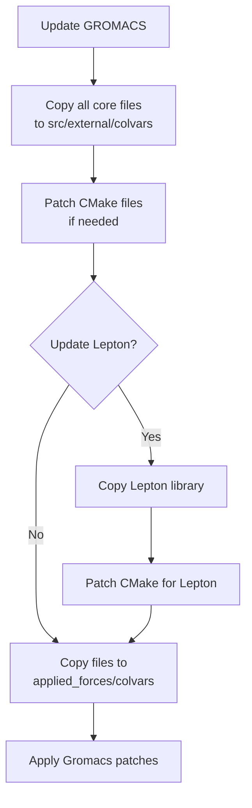
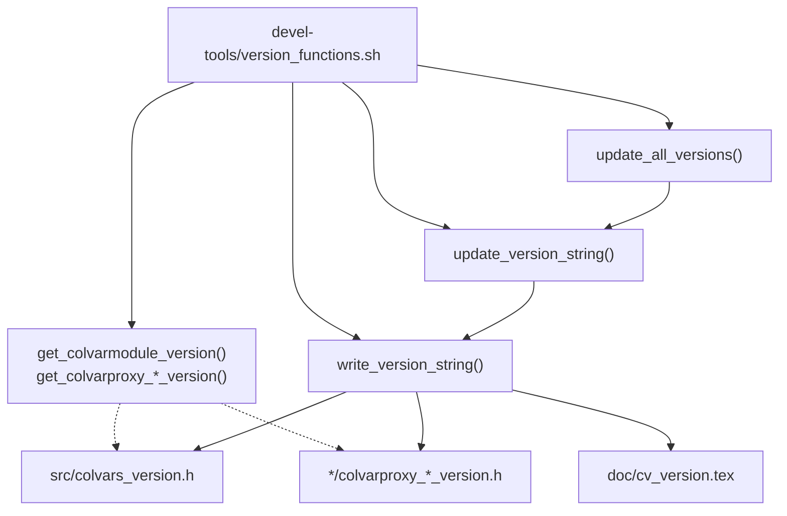
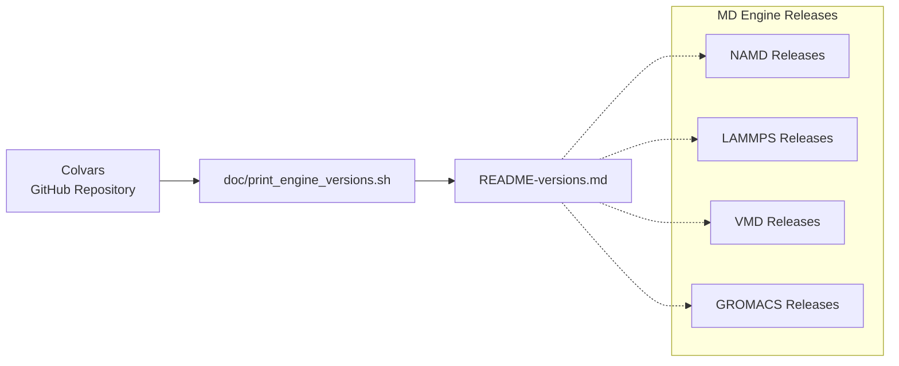

# Integration Update System

<details>
<summary>Relevant source files</summary>

The following files were used as context for generating this wiki page:

- [README-versions.md](README-versions.md)
- [devel-tools/compile-gromacs.sh](devel-tools/compile-gromacs.sh)
- [devel-tools/pre-commit](devel-tools/pre-commit)
- [devel-tools/version_functions.sh](devel-tools/version_functions.sh)
- [doc/.gitignore](doc/.gitignore)
- [doc/Makefile](doc/Makefile)
- [doc/colvars-code-refs.bib](doc/colvars-code-refs.bib)
- [doc/colvars-engine-flags.tex](doc/colvars-engine-flags.tex)
- [doc/colvars-refman-gromacs.tex](doc/colvars-refman-gromacs.tex)
- [doc/colvars-refman-lammps.tex](doc/colvars-refman-lammps.tex)
- [doc/colvars-refman-main.tex](doc/colvars-refman-main.tex)
- [doc/colvars-refman-namd.tex](doc/colvars-refman-namd.tex)
- [doc/colvars-refman-tinkerhp.tex](doc/colvars-refman-tinkerhp.tex)
- [doc/colvars-refman-vmd.tex](doc/colvars-refman-vmd.tex)
- [doc/colvars-refman.bib](doc/colvars-refman.bib)
- [doc/colvars-refman.tex](doc/colvars-refman.tex)
- [doc/cv_version.tex](doc/cv_version.tex)
- [doc/extract_code_refs.py](doc/extract_code_refs.py)
- [doc/print_engine_versions.sh](doc/print_engine_versions.sh)
- [gromacs/src/colvarproxy_gromacs_version.h](gromacs/src/colvarproxy_gromacs_version.h)
- [lammps/src/COLVARS/colvarproxy_lammps_version.h](lammps/src/COLVARS/colvarproxy_lammps_version.h)
- [namd/src/colvarproxy_namd_version.h](namd/src/colvarproxy_namd_version.h)
- [namd/ug/ug_colvars.tex](namd/ug/ug_colvars.tex)
- [src/colvarmodule_refs.h](src/colvarmodule_refs.h)
- [src/colvars_version.h](src/colvars_version.h)
- [update-colvars-code.sh](update-colvars-code.sh)
- [vmd/doc/ug_colvars.tex](vmd/doc/ug_colvars.tex)
- [vmd/src/colvarproxy_vmd_version.h](vmd/src/colvarproxy_vmd_version.h)

</details>


## Purpose and Overview

The Integration Update System is a crucial component of the Colvars infrastructure that enables seamless updating of Colvars code across multiple supported Molecular Dynamics (MD) engines. This system ensures consistent functionality and version management when propagating changes from the central Colvars repository to downstream MD engine codebases including NAMD, LAMMPS, VMD, GROMACS, and Tinker-HP.

This documentation focuses specifically on the mechanisms for updating Colvars code in different MD engine source trees. For information about the various MD engine integrations themselves, see [MD Engine Integration](#5).

## System Architecture

The Integration Update System is primarily built around a shell script that detects the target MD engine and performs the appropriate file copying, patching, and version updating operations.

### High-Level Architecture



Sources: [update-colvars-code.sh:1-577]()

### Core Components

The system consists of several key components:

1. **Update Script**: The main executable that coordinates the update process
2. **Engine Detection Logic**: Identifies the target MD engine based on its source tree structure
3. **Engine-Specific Update Procedures**: Custom update logic for each supported MD engine
4. **Version Management Tools**: Utilities to manage and update version information
5. **Conditional Copy Functions**: Logic to handle file comparison and updating



Sources: [update-colvars-code.sh:1-577](), [devel-tools/version_functions.sh:1-262]()

## Update Workflow

### Main Script Operation

The update process is initiated by running the `update-colvars-code.sh` script with a target directory argument. The script performs these high-level steps:

1. Parse command-line arguments (including `-f` for force-update)
2. Infer the source path (where the script is located)
3. Validate the target path (where the MD engine source is located)
4. Detect the MD engine type from the target directory structure
5. Execute the appropriate update procedure for the detected engine
6. Update version information



Sources: [update-colvars-code.sh:18-116]()

### Conditional File Copying

A key feature of the update system is its ability to intelligently handle file copying based on comparison of source and target files:



Sources: [update-colvars-code.sh:208-236]()

## Engine-Specific Update Procedures

Each supported MD engine has its own specific update procedure to handle the unique structure and requirements of that codebase.

### LAMMPS Update Process



Sources: [update-colvars-code.sh:264-341]()

### NAMD Update Process



Sources: [update-colvars-code.sh:344-428]()

### VMD Update Process



Sources: [update-colvars-code.sh:431-467]()

### GROMACS Update Process



Sources: [update-colvars-code.sh:494-577]()

## Version Management

The Integration Update System includes a robust versioning mechanism to track Colvars versions across different MD engines. This is critical for ensuring compatibility and traceability.

### Version Files and Structure

The system maintains version information in several key files:

| File | Purpose |
|------|---------|
| `src/colvars_version.h` | Core Colvars module version |
| `namd/src/colvarproxy_namd_version.h` | NAMD interface version |
| `lammps/src/COLVARS/colvarproxy_lammps_version.h` | LAMMPS interface version |
| `vmd/src/colvarproxy_vmd_version.h` | VMD interface version |
| `gromacs/src/colvarproxy_gromacs_version.h` | GROMACS interface version |
| `doc/cv_version.tex` | Version for documentation |

The version numbers are typically maintained as date strings (YYYY-MM-DD) in the format:

```
#ifndef COLVARS_VERSION
#define COLVARS_VERSION "2025-04-18"
#endif
```

Sources: [src/colvars_version.h:1-3](), [namd/src/colvarproxy_namd_version.h:1-3](), [vmd/src/colvarproxy_vmd_version.h:1-3](), [lammps/src/COLVARS/colvarproxy_lammps_version.h:1-3](), [gromacs/src/colvarproxy_gromacs_version.h:1-3](), [doc/cv_version.tex:1-2]()

### Version Management Tools

Version management is handled by functions in `devel-tools/version_functions.sh`, which provides utilities for:

1. Getting version strings from various files
2. Writing and updating version strings
3. Handling version strings for specific branches
4. Updating all version files at once



Sources: [devel-tools/version_functions.sh:1-262]()

### Version Tracking Across MD Engines

The relationship between Colvars versions and MD engine versions is documented in `README-versions.md`, which lists which Colvars version is included in each release of the supported MD engines. This is a critical reference for users and developers.



Sources: [README-versions.md:1-57](), [doc/print_engine_versions.sh:1-85]()

## Usage and Examples

### Basic Usage

To update a LAMMPS source tree with the latest Colvars code:

```bash
./update-colvars-code.sh /path/to/lammps
```

To force-update all files (overwriting any conflicting files):

```bash
./update-colvars-code.sh -f /path/to/namd
```

### Handling Conflicts

When conflicts are detected between files in the source and target directories, the system can:

1. Create diff files for manual inspection (default behavior)
2. Force-update the conflicting files (with `-f` flag)

This approach ensures that engine-specific modifications are preserved unless explicitly overwritten.

Sources: [update-colvars-code.sh:18-46](), [update-colvars-code.sh:237-261]()

## Common Challenges and Solutions

| Challenge | Solution |
|-----------|----------|
| Target engine cannot be detected | Check that you're pointing to the correct directory (root of MD engine source tree) |
| Conflicts in makefiles or build files | Use the `-f` flag to force update, or manually merge the changes after reviewing diff files |
| Missing Lepton library | The script will attempt to download it automatically, or you can clone the OpenMM repository and set the `OPENMM_SOURCE` environment variable |
| Missing PDF manual | The script will attempt to download it, or you can generate it manually from the documentation sources |
| Build failures after update | Run `make depends` (for NAMD) or rebuild CMake configuration (for GROMACS) to update dependencies |

Sources: [update-colvars-code.sh:62-116](), [update-colvars-code.sh:139-175](), [update-colvars-code.sh:418-425](), [update-colvars-code.sh:570-574]()

## Summary

The Integration Update System provides a robust and flexible mechanism for keeping Colvars code synchronized across multiple MD engine codebases. By automating the file copying, patching, and version management processes, it significantly reduces the maintenance burden and ensures consistency across implementations.

The system is designed to be:
- MD engine-aware (detects and handles engine-specific requirements)
- Non-destructive (preserves engine-specific modifications by default)
- Version-conscious (maintains consistent version information)
- Flexible (supports various update scenarios with appropriate options)

These characteristics make it an essential tool for maintaining the Colvars module across its various integrations.

---