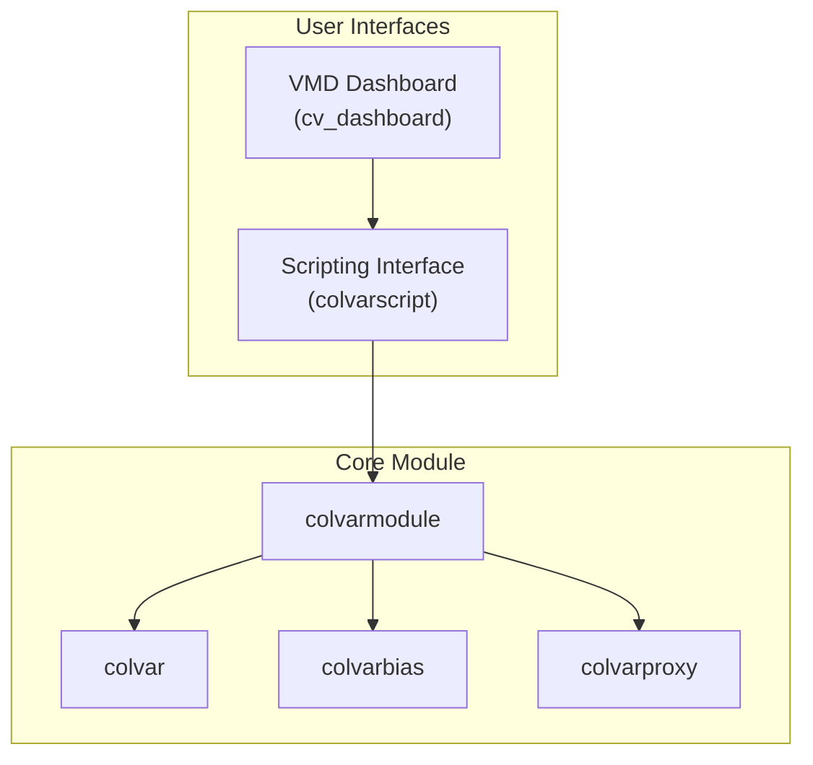
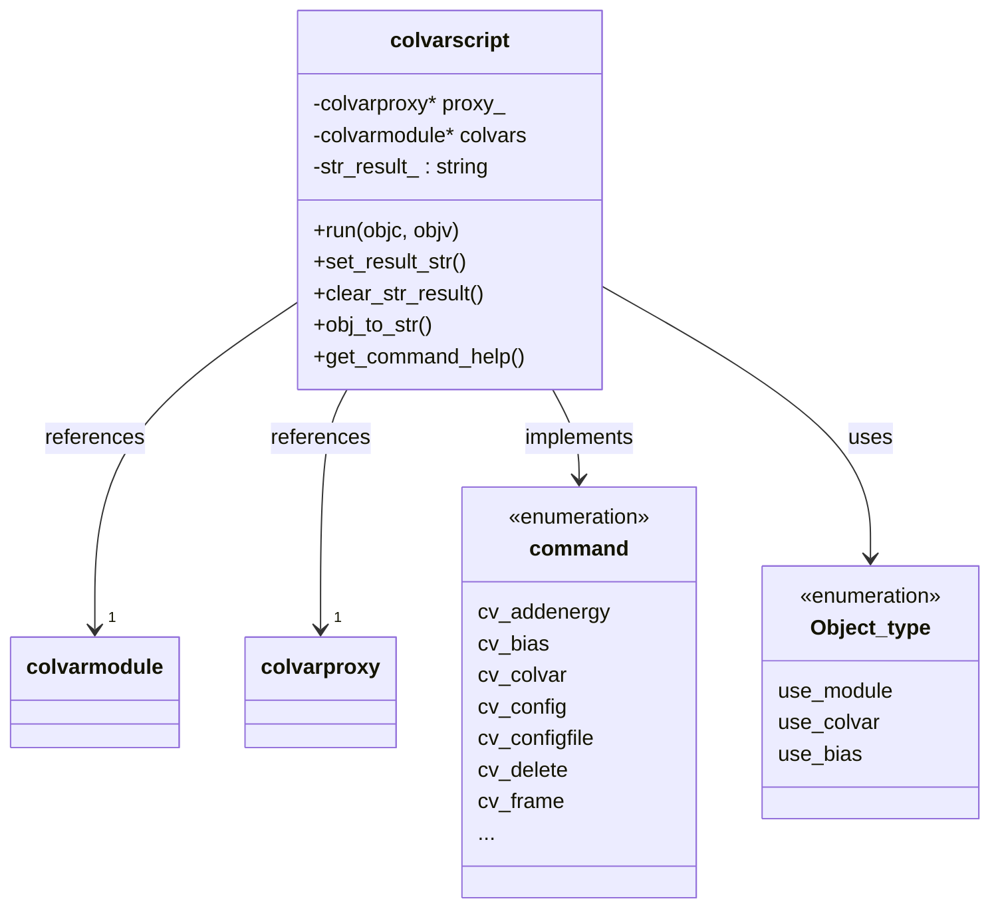
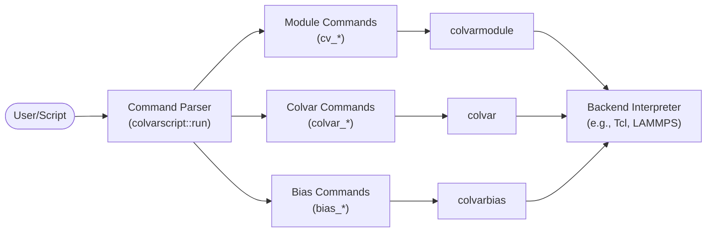
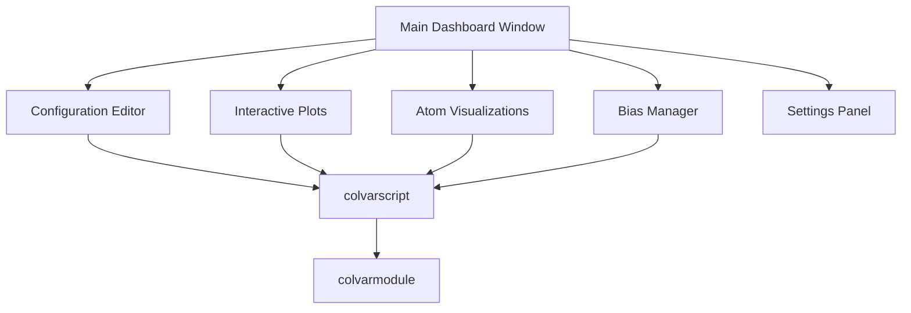
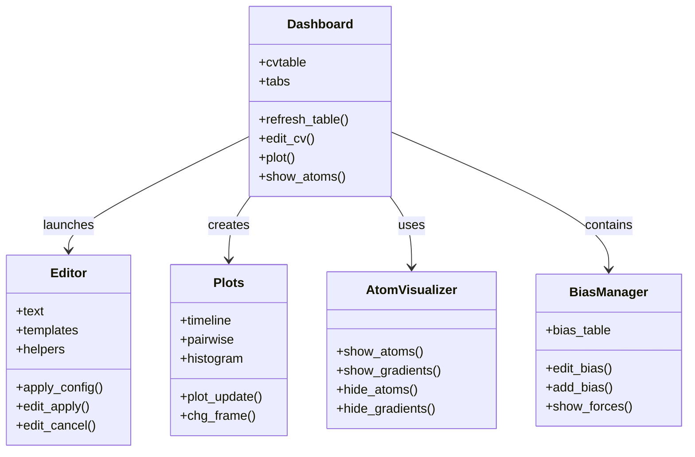
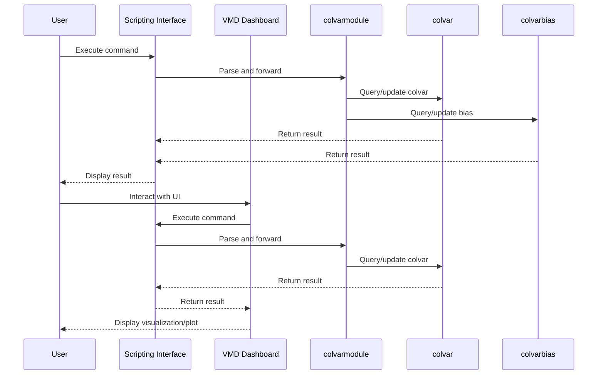

# User Interfaces

Relevant source files

The following files were used as context for generating this wiki page:

- [README-versions.md](README-versions.md)
- [doc/.gitignore](doc/.gitignore)
- [doc/Makefile](doc/Makefile)
- [doc/colvars-code-refs.bib](doc/colvars-code-refs.bib)
- [doc/colvars-engine-flags.tex](doc/colvars-engine-flags.tex)
- [doc/colvars-refman-gromacs.tex](doc/colvars-refman-gromacs.tex)
- [doc/colvars-refman-lammps.tex](doc/colvars-refman-lammps.tex)
- [doc/colvars-refman-main.tex](doc/colvars-refman-main.tex)
- [doc/colvars-refman-namd.tex](doc/colvars-refman-namd.tex)
- [doc/colvars-refman-tinkerhp.tex](doc/colvars-refman-tinkerhp.tex)
- [doc/colvars-refman-vmd.tex](doc/colvars-refman-vmd.tex)
- [doc/colvars-refman.bib](doc/colvars-refman.bib)
- [doc/colvars-refman.tex](doc/colvars-refman.tex)
- [doc/cvscript-fix-modify.tex](doc/cvscript-fix-modify.tex)
- [doc/cvscript-tcl.tex](doc/cvscript-tcl.tex)
- [doc/extract_code_refs.py](doc/extract_code_refs.py)
- [doc/gen_cvscript_doc.tcl](doc/gen_cvscript_doc.tcl)
- [doc/print_engine_versions.sh](doc/print_engine_versions.sh)
- [namd/tests/library/011_multiple_walker_mtd/common.tcl](namd/tests/library/011_multiple_walker_mtd/common.tcl)
- [namd/ug/ug_colvars.tex](namd/ug/ug_colvars.tex)
- [src/colvarmodule_refs.h](src/colvarmodule_refs.h)
- [src/colvarscript.cpp](src/colvarscript.cpp)
- [src/colvarscript.h](src/colvarscript.h)
- [src/colvarscript_commands.cpp](src/colvarscript_commands.cpp)
- [src/colvarscript_commands.h](src/colvarscript_commands.h)
- [src/colvarscript_commands_bias.cpp](src/colvarscript_commands_bias.cpp)
- [src/colvarscript_commands_bias.h](src/colvarscript_commands_bias.h)
- [src/colvarscript_commands_colvar.cpp](src/colvarscript_commands_colvar.cpp)
- [src/colvarscript_commands_colvar.h](src/colvarscript_commands_colvar.h)
- [vmd/cv_dashboard/Makefile](vmd/cv_dashboard/Makefile)
- [vmd/cv_dashboard/Makefile.local](vmd/cv_dashboard/Makefile.local)
- [vmd/cv_dashboard/VERSION](vmd/cv_dashboard/VERSION)
- [vmd/cv_dashboard/cv_dashboard.tcl](vmd/cv_dashboard/cv_dashboard.tcl)
- [vmd/cv_dashboard/cv_dashboard_editor.tcl](vmd/cv_dashboard/cv_dashboard_editor.tcl)
- [vmd/cv_dashboard/cv_dashboard_main.tcl](vmd/cv_dashboard/cv_dashboard_main.tcl)
- [vmd/cv_dashboard/cv_dashboard_plots.tcl](vmd/cv_dashboard/cv_dashboard_plots.tcl)
- [vmd/cv_dashboard/cv_dashboard_settings.tcl](vmd/cv_dashboard/cv_dashboard_settings.tcl)
- [vmd/cv_dashboard/pkgIndex.tcl](vmd/cv_dashboard/pkgIndex.tcl)
- [vmd/doc/ug_colvars.tex](vmd/doc/ug_colvars.tex)
- [vmd/scripts/calc_cv_mass.tcl](vmd/scripts/calc_cv_mass.tcl)
- [vmd/scripts/load_cv_traj.tcl](vmd/scripts/load_cv_traj.tcl)
- [vmd/scripts/load_fepout.tcl](vmd/scripts/load_fepout.tcl)
- [vmd/scripts/mk_native_contacts.tcl](vmd/scripts/mk_native_contacts.tcl)
- [vmd/tests/interface/004_map_total_internal/test-dashboard.vmd](vmd/tests/interface/004_map_total_internal/test-dashboard.vmd)

The Colvars module provides several interfaces for users to interact with collective variables during setup, simulation, and analysis of molecular systems. This page describes the architectural design and functionality of these interfaces. For detailed usage information about specific commands, see [Scripting Interface](#6.1). For detailed information about the VMD graphical interface, see [VMD Dashboard](#6.2).

## Overview of User Interfaces

The Colvars module implements two main types of user interfaces:

1. **Command-line and Scripting Interfaces** - Text-based interfaces that allow users to control Colvars through commands in various environments
2. **Graphical User Interface** - Visual interface implemented as the "Colvars Dashboard" in VMD

These interfaces provide access to the core functionality of the module while abstracting implementation details.

**Diagram: High-level view of Colvars user interfaces and their relation to the core module**

Sources: 
- [src/colvarscript.cpp:32-53]()
- [vmd/cv_dashboard/cv_dashboard.tcl:1-35]()
- [doc/colvars-refman-main.tex:39-46]()

## Scripting Interface Architecture

The scripting interface, referred to as "colvarscript", provides a command-based API for interacting with the Colvars module from various environments. It allows users to query and manipulate collective variables and biases, as well as control the module itself.

**Diagram: The colvarscript class structure and its relationships**

Sources:
- [src/colvarscript.h:29-247]()
- [src/colvarscript.cpp:32-53]()
- [src/colvarscript_commands.h:11-626]()

### Command Structure

The scripting interface follows a hierarchical command structure:

1. **Module-level commands** - Operations on the Colvars module as a whole (e.g., `cv config`, `cv list`)
2. **Colvar-level commands** - Operations on specific collective variables (e.g., `cv colvar name value`)
3. **Bias-level commands** - Operations on specific biases (e.g., `cv bias name update`)

**Diagram: Command flow in the scripting interface**

Sources:
- [src/colvarscript.cpp:347-449]()
- [src/colvarscript_commands.h:100-626]()
- [src/colvarscript_commands_colvar.h:11-25]()
- [src/colvarscript_commands_bias.h:11-27]()

### Integration with Host Environments

The scripting interface is designed to work with multiple host environments through different integration points:

| Environment | Integration Method | Key Features |
|-------------|-------------------|--------------|
| NAMD       | Tcl commands       | Direct access during simulations |
| LAMMPS     | LAMMPS fix commands | Integration with LAMMPS scripting |
| VMD        | Tcl commands       | Analysis and visualization |
| Gromacs    | Native API calls   | Integration with Gromacs mdrun |
| Python     | Python module      | Programmatic access for analysis |

Sources:
- [src/colvarscript.cpp:639-760]()
- [doc/colvars-refman-main.tex:372-430]()

## VMD Dashboard Interface

The Colvars Dashboard is a graphical user interface implemented as a VMD extension that provides an intuitive way to define, visualize, and analyze collective variables.

**Diagram: VMD Dashboard components and their relationships**

Sources:
- [vmd/cv_dashboard/cv_dashboard_main.tcl:8-217]()
- [vmd/cv_dashboard/cv_dashboard.tcl:35-93]()
- [doc/colvars-refman-main.tex:147-307]()

### Dashboard Components

The VMD Dashboard consists of several key components that work together to provide a comprehensive interface:

**Diagram: Class relationships in the VMD Dashboard**

Sources:
- [vmd/cv_dashboard/cv_dashboard_main.tcl:9-217]()
- [vmd/cv_dashboard/cv_dashboard_editor.tcl:7-173]()
- [vmd/cv_dashboard/cv_dashboard_plots.tcl:7-55]()
- [vmd/cv_dashboard/cv_dashboard_settings.tcl:3-47]()
- [vmd/cv_dashboard/cv_dashboard_main.tcl:219-296]() (Biases tab)

### Dashboard Features

The VMD Dashboard provides several key features:

1. **Configuration Editor** - A text editor with syntax helpers for creating and editing Colvars configurations
2. **Interactive Visualization** - Tools to display atoms involved in collective variables, gradients, and forces
3. **Real-time Plotting** - Timeline, pairwise, and histogram plots of collective variable values
4. **Bias Management** - Interface for creating and monitoring biasing methods
5. **Automatic Templates** - Pre-defined templates for common collective variables and components

| Feature | Description | Key Functions |
|---------|-------------|--------------|
| Colvar Management | List, add, edit, and delete collective variables | `refresh_table()`, `edit_cv()`, `add_cv()` |
| Atom Visualization | Display atoms involved in collective variables | `show_atoms()`, `show_gradients()` |
| Interactive Plots | Visualize colvar values over trajectory | `plot()`, `chg_frame()` |
| Bias Management | Create and monitor biasing methods | `add_bias()`, `edit_bias()` |
| Configuration Editor | Editor with templates and helpers | `edit_apply()`, `insert_template()` |

Sources:
- [vmd/cv_dashboard/cv_dashboard_main.tcl:110-217]()
- [vmd/cv_dashboard/cv_dashboard_editor.tcl:17-216]()
- [vmd/cv_dashboard/cv_dashboard_plots.tcl:7-55]()
- [doc/colvars-refman-main.tex:147-307]()

## Data Flow Between Interfaces and Core Module

The following diagram illustrates how data flows between the user interfaces and the core Colvars module:

**Diagram: Data flow between interfaces and core module**

Sources:
- [src/colvarscript.cpp:347-449]()
- [vmd/cv_dashboard/cv_dashboard.tcl:166-202]()
- [vmd/cv_dashboard/cv_dashboard_main.tcl:544-625]()

## Engine-Specific Interface Considerations

Different MD engines have specific considerations for the Colvars interfaces:

| Engine | Integration Method | Configuration | Special Features |
|--------|-------------------|---------------|------------------|
| NAMD | Built-in Tcl | `colvars on` in config file | Direct integration with NAMD's scripting |
| LAMMPS | Fix command | `fix ID all colvars configfile` | Ability to modify via `fix_modify` |
| GROMACS | Native support | MDP parameter `colvars-active` | Configuration bundled in TPR file |
| VMD | Tcl extension | `cv_dashboard` command | Full graphical interface |
| Tinker-HP | Native support | Command-line flag | Configuration file specified at runtime |

Sources:
- [doc/colvars-refman-main.tex:414-461]() (NAMD)
- [doc/colvars-refman-main.tex:461-526]() (LAMMPS)
- [doc/colvars-refman-main.tex:535-623]() (GROMACS)
- [doc/colvars-refman-main.tex:147-307]() (VMD)

## Summary

The Colvars module provides a comprehensive set of user interfaces that enable flexible control and analysis of collective variables in molecular simulations. The scripting interface provides a command-based API accessible from various environments, while the VMD Dashboard offers a user-friendly graphical interface for visualization and analysis. These interfaces are designed to be consistent across different MD engines while accommodating engine-specific requirements.

Sources:
- [doc/colvars-refman-main.tex:9-46]()
- [src/colvarscript.h:29-67]()
- [vmd/cv_dashboard/cv_dashboard.tcl:1-35]()

---