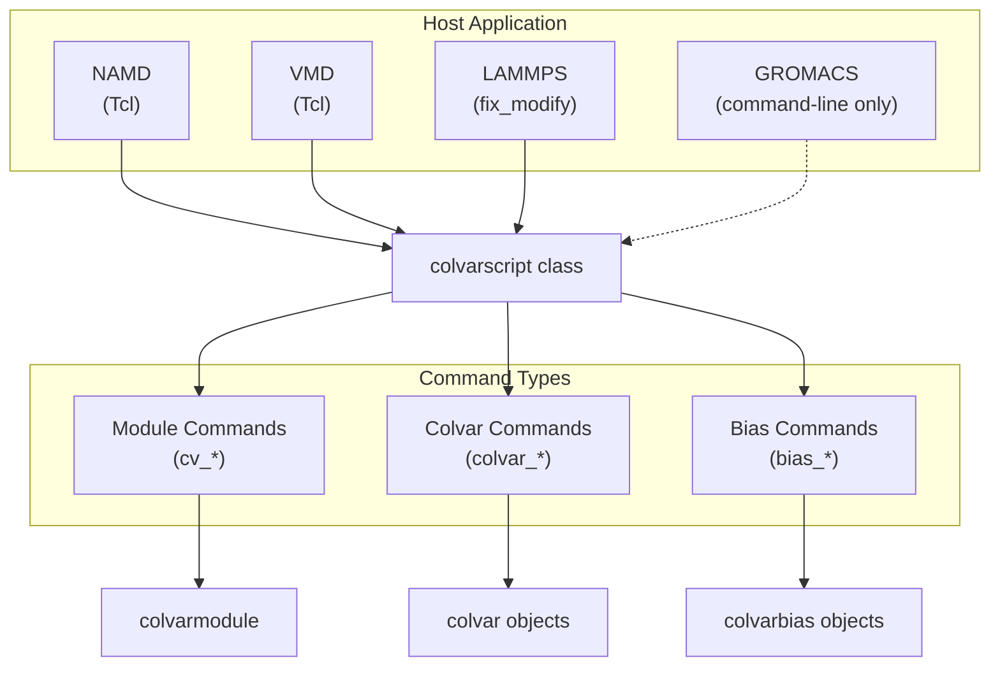
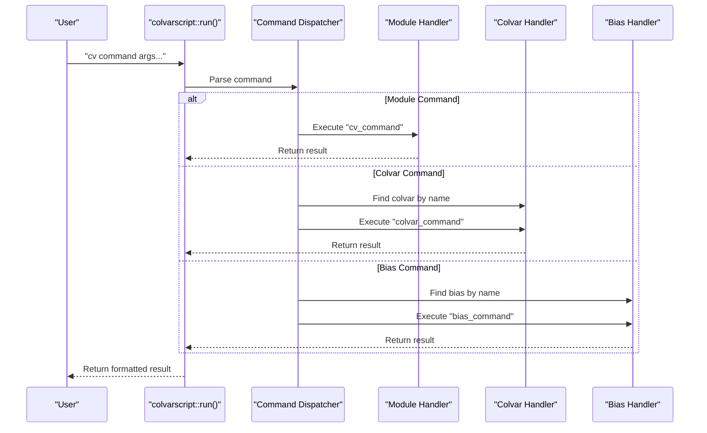

# Scripting Interface

<details>
<summary>Relevant source files</summary>

The following files were used as context for generating this wiki page:

- [README-versions.md](README-versions.md)
- [doc/.gitignore](doc/.gitignore)
- [doc/Makefile](doc/Makefile)
- [doc/colvars-code-refs.bib](doc/colvars-code-refs.bib)
- [doc/colvars-engine-flags.tex](doc/colvars-engine-flags.tex)
- [doc/colvars-refman-gromacs.tex](doc/colvars-refman-gromacs.tex)
- [doc/colvars-refman-lammps.tex](doc/colvars-refman-lammps.tex)
- [doc/colvars-refman-main.tex](doc/colvars-refman-main.tex)
- [doc/colvars-refman-namd.tex](doc/colvars-refman-namd.tex)
- [doc/colvars-refman-tinkerhp.tex](doc/colvars-refman-tinkerhp.tex)
- [doc/colvars-refman-vmd.tex](doc/colvars-refman-vmd.tex)
- [doc/colvars-refman.bib](doc/colvars-refman.bib)
- [doc/colvars-refman.tex](doc/colvars-refman.tex)
- [doc/cvscript-fix-modify.tex](doc/cvscript-fix-modify.tex)
- [doc/cvscript-tcl.tex](doc/cvscript-tcl.tex)
- [doc/extract_code_refs.py](doc/extract_code_refs.py)
- [doc/gen_cvscript_doc.tcl](doc/gen_cvscript_doc.tcl)
- [doc/print_engine_versions.sh](doc/print_engine_versions.sh)
- [namd/ug/ug_colvars.tex](namd/ug/ug_colvars.tex)
- [src/colvarmodule_refs.h](src/colvarmodule_refs.h)
- [src/colvarscript.cpp](src/colvarscript.cpp)
- [src/colvarscript.h](src/colvarscript.h)
- [src/colvarscript_commands.cpp](src/colvarscript_commands.cpp)
- [src/colvarscript_commands.h](src/colvarscript_commands.h)
- [src/colvarscript_commands_bias.cpp](src/colvarscript_commands_bias.cpp)
- [src/colvarscript_commands_bias.h](src/colvarscript_commands_bias.h)
- [src/colvarscript_commands_colvar.cpp](src/colvarscript_commands_colvar.cpp)
- [src/colvarscript_commands_colvar.h](src/colvarscript_commands_colvar.h)
- [vmd/doc/ug_colvars.tex](vmd/doc/ug_colvars.tex)

</details>


The Colvars scripting interface provides programmatic access to the Collective Variables module, allowing users to interact with collective variables and biases during simulations or analysis. This page documents the structure and usage of the scripting interface across different MD engines (NAMD, LAMMPS, GROMACS, VMD). For information on setting up the Colvars module itself, see [Enabling and controlling the Colvars module](#3.7).

## Architecture Overview

The scripting interface is implemented by the `colvarscript` class, which serves as the command interpreter for interacting with the Colvars module. Commands are organized in a hierarchical structure, with different interfaces depending on the hosting MD engine.



Sources: [src/colvarscript.h](), [src/colvarscript.cpp:30-52](https://github.com/Colvars/colvars/blob/master/src/colvarscript.cpp#L30-L52)

## Command Hierarchy and Processing

Commands in the scripting interface are organized in three levels:

1. **Module level**: Commands that affect the entire Colvars module (prefixed with `cv_`)
2. **Colvar level**: Commands that operate on specific collective variables (prefixed with `colvar_`)
3. **Bias level**: Commands that operate on specific biases (prefixed with `bias_`)



Sources: [src/colvarscript.cpp:347-449](https://github.com/Colvars/colvars/blob/master/src/colvarscript.cpp#L347-L449)

## Command Syntax and Examples

The syntax of Colvars commands varies slightly depending on the MD engine, but follows the same hierarchical pattern:

| Level | NAMD/VMD (Tcl) | LAMMPS (fix_modify) |
|-------|----------------|---------------------|
| Module | `cv command [args]` | `fix_modify Colvars command [args]` |
| Colvar | `cv colvar name command [args]` | `fix_modify Colvars colvar name command [args]` |
| Bias | `cv bias name command [args]` | `fix_modify Colvars bias name command [args]` |

In GROMACS, the scripting interface functionality is more limited and primarily supports configuration through MDP options rather than interactive scripting.

### Common Command Examples

#### Module-level commands:

```tcl
# Configure from string (NAMD/VMD)
cv config "colvar { name dist; distance { group1 { atomNumbers 1 2 } group2 { atomNumbers 5 6 } } }"

# Configure from file (NAMD/VMD)
cv configfile "system.colvars.conf"

# List all colvars (NAMD/VMD)
set colvar_list [cv list]

# Get current energy (NAMD/VMD)
set energy [cv getenergy]

# Save state (NAMD/VMD)
cv save "output"
```

#### Colvar-level commands:

```tcl
# Get current value (NAMD/VMD)
set value [cv colvar dist value]

# Apply force (NAMD/VMD)
cv colvar dist addforce 10.0

# Get configuration (NAMD/VMD)
set config [cv colvar dist getconfig]

# Get gradient (NAMD/VMD)
set grad [cv colvar dist getgradients]
```

#### Bias-level commands:

```tcl
# Get bias energy (NAMD/VMD)
set energy [cv bias harm energy]

# Get configuration (NAMD/VMD)
set config [cv bias harm getconfig]

# Update the bias (NAMD/VMD)
cv bias harm update
```

Sources: [doc/cvscript-tcl.tex](), [doc/cvscript-fix-modify.tex]()

## Implementation Details

The scripting interface is implemented through a sophisticated command registration and dispatch system:

```mermaid
classDiagram
    class colvarscript {
        -colvarproxy* proxy_
        -colvarmodule* colvars
        -std::string str_result_
        +run(int objc, unsigned char* const objv[])
        +init_commands()
        +init_command()
        +get_cmd_prefix()
        +proc_features()
        +set_result_str()
        +set_result_real()
        +set_result_int()
        +set_result_colvarvalue()
    }
    
    class command_registry {
        -std::map<std::string, command> cmd_str_map
        -char const** cmd_names
        -std::vector<std::string> cmd_help
        -std::vector<std::string> cmd_rethelp
        -std::vector<size_t> cmd_n_args_min
        -std::vector<size_t> cmd_n_args_max
        -std::vector<std::vector<std::string>> cmd_arghelp
        -std::vector<int (*)(void*, int, unsigned char* const*)> cmd_fns
    }
    
    colvarscript "1" *-- "1" command_registry : contains
```

Each command is registered using the `CVSCRIPT` macro, which specifies:
- Command identifier
- Help string
- Minimum and maximum number of arguments
- Argument help text
- Implementation function

The `colvarscript::run` method parses the command and arguments, identifies the appropriate handler function, and executes it with the provided arguments. Results are returned in string format with automatic type conversion for different data types.

Sources: [src/colvarscript.cpp:65-167](https://github.com/Colvars/colvars/blob/master/src/colvarscript.cpp#L65-L167), [src/colvarscript_commands.h:10-42](https://github.com/Colvars/colvars/blob/master/src/colvarscript_commands.h#L10-L42)

## Available Commands

### Module-level Commands (NAMD/VMD syntax)

| Command | Description |
|---------|-------------|
| `cv addenergy` | Add energy to MD engine |
| `cv config` | Read configuration from string |
| `cv configfile` | Read configuration from file |
| `cv delete` | Delete Colvars module instance |
| `cv list` | List all variables or biases |
| `cv load` | Load state from file |
| `cv save` | Save state to file |
| `cv update` | Recalculate all colvars and biases |
| `cv version` | Get Colvars version |
| `cv help` | Get help on commands |

### Colvar-level Commands (NAMD/VMD syntax)

| Command | Description |
|---------|-------------|
| `cv colvar name value` | Get colvar value |
| `cv colvar name update` | Recalculate colvar |
| `cv colvar name addforce` | Apply force to colvar |
| `cv colvar name getconfig` | Get colvar configuration |
| `cv colvar name getatomids` | Get atom IDs used by colvar |
| `cv colvar name gettotalforce` | Get total force on colvar |
| `cv colvar name delete` | Delete colvar |

### Bias-level Commands (NAMD/VMD syntax)

| Command | Description |
|---------|-------------|
| `cv bias name energy` | Get bias energy |
| `cv bias name update` | Update bias |
| `cv bias name getconfig` | Get bias configuration |
| `cv bias name bin` | Get current grid bin |
| `cv bias name delete` | Delete bias |

Sources: [src/colvarscript_commands.h:100-642](https://github.com/Colvars/colvars/blob/master/src/colvarscript_commands.h#L100-L642), [src/colvarscript_commands_colvar.h](https://github.com/Colvars/colvars/blob/master/src/colvarscript_commands_colvar.h), [src/colvarscript_commands_bias.h](https://github.com/Colvars/colvars/blob/master/src/colvarscript_commands_bias.h)

## Engine-Specific Usage

### NAMD and VMD (Tcl Interface)

In NAMD and VMD, the scripting interface is accessed directly via Tcl commands:

```tcl
# Load module in VMD (not needed in NAMD)
cv molid top

# Configure from file
cv configfile "system.colvars.conf"

# Perform calculations at a specific frame in VMD
cv frame 10
cv update

# Get value and apply force
set value [cv colvar dist value]
cv colvar dist addforce 5.0

# Delete when done (VMD only)
cv delete
```

Sources: [doc/colvars-refman-main.tex:371-420](https://github.com/Colvars/colvars/blob/master/doc/colvars-refman-main.tex#L371-L420)

### LAMMPS (fix_modify Interface)

In LAMMPS, the scripting interface is accessed through the `fix_modify` command:

```
# Create fix first
fix Colvars all colvars configfile system.colvars.conf

# Configure from string
fix_modify Colvars config "colvar { name dist; distance { group1 { atomNumbers 1 2 } group2 { atomNumbers 5 6 } } }"

# Get value (into LAMMPS variable)
fix_modify Colvars colvar dist value v_colvar_value

# Apply force
fix_modify Colvars colvar dist addforce 5.0
```

Sources: [doc/colvars-refman-main.tex:457-529](https://github.com/Colvars/colvars/blob/master/doc/colvars-refman-main.tex#L457-L529)

## Getting Help on Commands

The scripting interface includes a built-in help system:

```tcl
# Get list of all commands (NAMD/VMD)
cv help

# Get help on a specific command (NAMD/VMD)
cv help update

# Get list of all colvar commands (NAMD/VMD)
cv help colvar 

# Get help on a specific colvar command (NAMD/VMD)
cv colvar name help value
```

The help system provides detailed information about command syntax, arguments, and return values.

Sources: [src/colvarscript.cpp:368-394](https://github.com/Colvars/colvars/blob/master/src/colvarscript.cpp#L368-L394)

## Advanced Scripting Techniques

### Saving and Loading State

```tcl
# Save state to string (NAMD/VMD)
set state_str [cv savetostring]

# Load state from string (NAMD/VMD)
cv loadfromstring $state_str

# Save state to file with custom prefix (NAMD/VMD)
cv save "trajectory_analysis"

# Load state from file (NAMD/VMD)
cv load "trajectory_analysis"
```

### Accessing Atomic Data

```tcl
# Get atom IDs used by Colvars (NAMD/VMD)
set atom_ids [cv getatomids]

# Get atom positions (NAMD/VMD)
set positions [cv getatompositions]

# Get forces applied to atoms (NAMD/VMD)
set forces [cv getatomappliedforces]
```

### Working with Trajectory Analysis

```tcl
# VMD example: analyze multiple frames
for {set fr 0} {$fr < [molinfo top get numframes]} {incr fr} {
    cv frame $fr
    cv update
    lappend dist_values [cv colvar dist value]
}
```

Sources: [src/colvarscript_commands.h:272-368](https://github.com/Colvars/colvars/blob/master/src/colvarscript_commands.h#L272-L368)

---