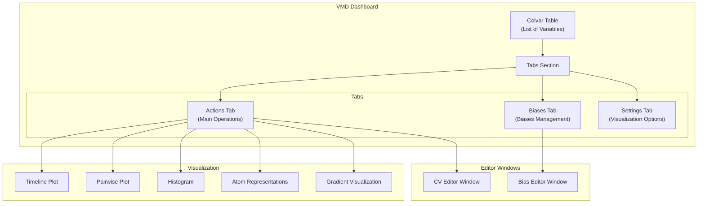
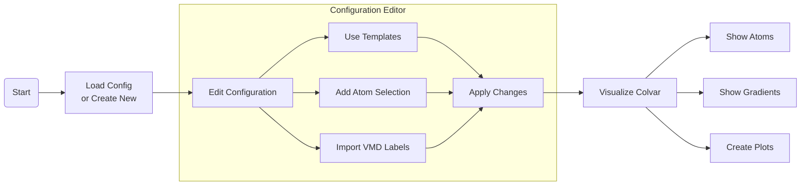
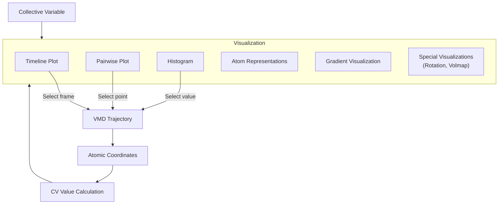
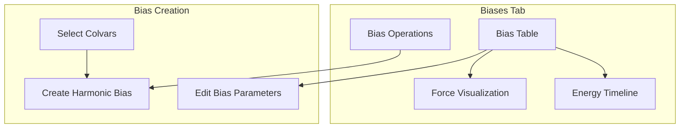
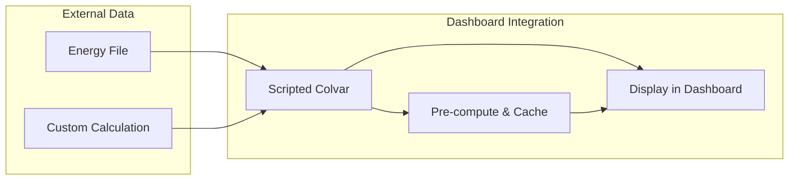
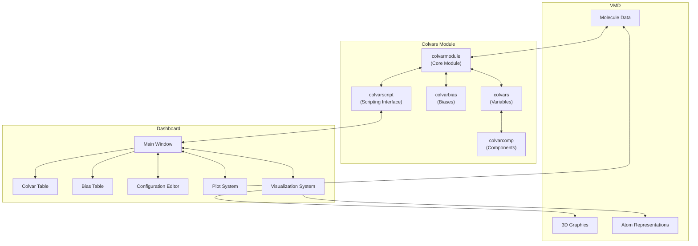

# VMD Dashboard

<details>
<summary>Relevant source files</summary>

The following files were used as context for generating this wiki page:

- [README-versions.md](README-versions.md)
- [doc/.gitignore](doc/.gitignore)
- [doc/Makefile](doc/Makefile)
- [doc/colvars-code-refs.bib](doc/colvars-code-refs.bib)
- [doc/colvars-engine-flags.tex](doc/colvars-engine-flags.tex)
- [doc/colvars-refman-gromacs.tex](doc/colvars-refman-gromacs.tex)
- [doc/colvars-refman-lammps.tex](doc/colvars-refman-lammps.tex)
- [doc/colvars-refman-main.tex](doc/colvars-refman-main.tex)
- [doc/colvars-refman-namd.tex](doc/colvars-refman-namd.tex)
- [doc/colvars-refman-tinkerhp.tex](doc/colvars-refman-tinkerhp.tex)
- [doc/colvars-refman-vmd.tex](doc/colvars-refman-vmd.tex)
- [doc/colvars-refman.bib](doc/colvars-refman.bib)
- [doc/colvars-refman.tex](doc/colvars-refman.tex)
- [doc/extract_code_refs.py](doc/extract_code_refs.py)
- [doc/print_engine_versions.sh](doc/print_engine_versions.sh)
- [namd/tests/library/011_multiple_walker_mtd/common.tcl](namd/tests/library/011_multiple_walker_mtd/common.tcl)
- [namd/ug/ug_colvars.tex](namd/ug/ug_colvars.tex)
- [src/colvarmodule_refs.h](src/colvarmodule_refs.h)
- [vmd/cv_dashboard/Makefile](vmd/cv_dashboard/Makefile)
- [vmd/cv_dashboard/Makefile.local](vmd/cv_dashboard/Makefile.local)
- [vmd/cv_dashboard/VERSION](vmd/cv_dashboard/VERSION)
- [vmd/cv_dashboard/cv_dashboard.tcl](vmd/cv_dashboard/cv_dashboard.tcl)
- [vmd/cv_dashboard/cv_dashboard_editor.tcl](vmd/cv_dashboard/cv_dashboard_editor.tcl)
- [vmd/cv_dashboard/cv_dashboard_main.tcl](vmd/cv_dashboard/cv_dashboard_main.tcl)
- [vmd/cv_dashboard/cv_dashboard_plots.tcl](vmd/cv_dashboard/cv_dashboard_plots.tcl)
- [vmd/cv_dashboard/cv_dashboard_settings.tcl](vmd/cv_dashboard/cv_dashboard_settings.tcl)
- [vmd/cv_dashboard/pkgIndex.tcl](vmd/cv_dashboard/pkgIndex.tcl)
- [vmd/doc/ug_colvars.tex](vmd/doc/ug_colvars.tex)
- [vmd/scripts/calc_cv_mass.tcl](vmd/scripts/calc_cv_mass.tcl)
- [vmd/scripts/load_cv_traj.tcl](vmd/scripts/load_cv_traj.tcl)
- [vmd/scripts/load_fepout.tcl](vmd/scripts/load_fepout.tcl)
- [vmd/scripts/mk_native_contacts.tcl](vmd/scripts/mk_native_contacts.tcl)
- [vmd/tests/interface/004_map_total_internal/test-dashboard.vmd](vmd/tests/interface/004_map_total_internal/test-dashboard.vmd)

</details>


The VMD Dashboard is a graphical user interface (GUI) for the Colvars module in VMD, providing an intuitive way to create, visualize, and analyze collective variables during molecular visualization and analysis. This page describes the Dashboard interface, its functionality, and how to use it effectively for collective variable-based analysis in VMD.

For information about the scripting interface to the Colvars module, see [Scripting Interface](#6.1). For a broader overview of the Colvars module, see [Overview](#1).

## Purpose and Scope

The VMD Dashboard simplifies working with collective variables by:
- Providing a graphical interface to create and edit collective variables without writing configuration files
- Offering interactive visualization of collective variables in the context of molecular structures
- Enabling real-time calculation and visualization of collective variables across trajectory frames
- Supporting automatic creation of common collective variables for protein/nucleic acid systems
- Visualizing gradients and forces associated with collective variables

The Dashboard is designed primarily for creating and analyzing collective variables, although it also provides limited support for managing biases.

Sources:
[doc/colvars-refman-main.tex:39-45]()
[vmd/cv_dashboard/cv_dashboard.tcl:9-14]()

## Main Dashboard Interface

The Dashboard consists of several main sections that work together to provide a complete interface for collective variable analysis:



**Dashboard Organization Diagram**

Sources:
[vmd/cv_dashboard/cv_dashboard_main.tcl:9-217]()
[vmd/cv_dashboard/cv_dashboard.tcl:103-157]()

### Accessing the Dashboard

The Dashboard is accessed through VMD's main menu: **Extensions → Analysis → Colvars Dashboard**. Alternatively, it can be loaded programmatically using:

```tcl
package require cv_dashboard
cv_dashboard
```

Sources:
[doc/colvars-refman-main.tex:147-148]()
[vmd/cv_dashboard/cv_dashboard.tcl:103-157]()

### Main Window Components

The Dashboard's main window includes:

1. **Top Toolbar** - Contains buttons for loading/saving Colvars configurations and resetting the module
2. **Colvar Table** - Displays all defined collective variables and their current values
3. **Tabs Section** - Contains three tabs:
   - **Actions** - Primary interface for creating, editing, and visualizing colvars
   - **Biases** - Interface for managing bias functions
   - **Settings** - Options for customizing visualizations

Sources:
[vmd/cv_dashboard/cv_dashboard_main.tcl:21-202]()

## Creating and Editing Collective Variables

The Dashboard provides a user-friendly interface for creating and modifying collective variables without writing configuration files manually.



**Colvar Creation and Visualization Flow**

Sources:
[vmd/cv_dashboard/cv_dashboard_editor.tcl:7-216]()
[vmd/cv_dashboard/cv_dashboard_main.tcl:85-107]()

### Configuration Editor

The editor window provides several features to assist with creating collective variables:

1. **Templates** - Predefined templates for common colvar types
2. **Atom Selection** - Tools to select atoms through:
   - VMD selection text
   - Existing graphical representations
   - VMD atom labels
3. **Documentation Links** - Quick access to online documentation

The editor supports auto-updating atom selections, which means atom groups can be defined via VMD selection text and will automatically update when:
- The configuration is edited
- A configuration file is loaded
- The VMD molecule linked to Colvars is changed

This allows configurations to be portable across systems with different atom numberings.

Sources:
[vmd/cv_dashboard/cv_dashboard_editor.tcl:66-167]()
[vmd/cv_dashboard/cv_dashboard_editor.tcl:228-316]()
[doc/colvars-refman-main.tex:234-246]()

### Automatic Colvar Generation

The Dashboard includes tools to automatically generate collective variables:

1. **Protein/NA Auto-colvars** - Creates variables for common protein/nucleic acid structural properties
2. **Colvars from VMD Labels** - Generates variables based on VMD atom labels (bonds, angles, dihedrals)
3. **Colvars from Trajectory Files** - Imports pre-computed values from trajectory files

These features significantly reduce the time needed to set up complex analysis systems.

Sources:
[vmd/cv_dashboard/cv_dashboard_main.tcl:154-157]()
[doc/colvars-refman-main.tex:209-217]()

## Visualization and Analysis

The Dashboard provides multiple ways to visualize and analyze collective variables:



**Dashboard Visualization and Analysis Flow**

Sources:
[vmd/cv_dashboard/cv_dashboard_plots.tcl:6-128]()
[vmd/cv_dashboard/cv_dashboard_display.tcl]()
[doc/colvars-refman-main.tex:252-263]()

### Plot Types

The Dashboard offers three primary plot types:

1. **Timeline Plot** - Shows CV values across trajectory frames
2. **Pairwise Plot** - Scatter plot of two scalar variables
3. **Histogram** - Distribution of a scalar variable over the trajectory

These plots are interactive - clicking on a specific point will navigate to the corresponding frame in the VMD trajectory.

Sources:
[vmd/cv_dashboard/cv_dashboard_plots.tcl:74-128]()
[doc/colvars-refman-main.tex:252-257]()

### Atom and Gradient Visualization

The Dashboard can create atom representations to visualize the atoms involved in collective variables:

- **Show atoms** - Creates color-coded representations of atom groups
- **Show gradients** - Visualizes atomic gradients to show how the CV would change in response to atomic movements

Gradient visualization options can be customized in the Settings tab, with two scaling methods:
- Maximum vector norm - Scales to ensure the largest gradient has a specified length
- Scaling factor - Uses a fixed scaling factor (divided by the colvar's width)

Sources:
[vmd/cv_dashboard/cv_dashboard_main.tcl:130-139]()
[vmd/cv_dashboard/cv_dashboard_settings.tcl:41-68]()
[doc/colvars-refman-main.tex:270-281]()

### Special Visualizations

For specific types of collective variables, the Dashboard offers specialized visualizations:

1. **Rotation Visualization** - For orientation-based variables (unit quaternions)
2. **Volumetric Map Visualization** - For variables based on volumetric maps

These can be accessed through the context menu by right-clicking on the variable in the colvar table.

Sources:
[vmd/cv_dashboard/cv_dashboard_main.tcl:384-401]()
[doc/colvars-refman-main.tex:282-288]()

## Working with Biases

While the Dashboard's primary focus is on collective variables, it also provides functionality to create and manage biases through the Biases tab.



**Bias Management Workflow**

Sources:
[vmd/cv_dashboard/cv_dashboard_main.tcl:219-297]()
[vmd/cv_dashboard/cv_dashboard_editor.tcl:518-644]()

### Creating and Managing Biases

Biases can be created in two ways:
1. By selecting colvars and using the context menu to add a harmonic bias
2. By using the "New bias" button in the Biases tab

The bias editor provides a simple interface to configure bias parameters like force constants and centers.

Note that for advanced biases like metadynamics or ABF, the Dashboard's support is limited to visualization - these must typically be configured through the scripting interface.

Sources:
[vmd/cv_dashboard/cv_dashboard_main.tcl:447-450]()
[vmd/cv_dashboard/cv_dashboard_editor.tcl:518-575]()

### Visualizing Bias Energies and Forces

The Biases tab allows visualization of:
- Bias energies through timeline plots
- Bias forces as vectors on atoms

This helps in understanding how biases would affect a molecular dynamics simulation.

Sources:
[vmd/cv_dashboard/cv_dashboard_main.tcl:276-288]()
[doc/colvars-refman-main.tex:295-305]()

## Custom Colvar Visualization

The Dashboard supports visualization of custom trajectory data through scripted colvars, making it possible to integrate external data with the molecular trajectory:



**Custom Data Integration Workflow**

Sources:
[doc/colvars-refman-main.tex:308-367]()

### Scripted Functions for Custom Variables

Custom variables can be created using Tcl procedures that calculate values on demand:

```tcl
proc calc_user_colvar { x } {
  # Follow current Colvars frame
  $::sasa_sel frame [cv frame]
  return [measure sasa 1 $::sasa_sel]
}
```

This technique allows integration of VMD's built-in analysis functions (like SASA calculations) or any external data into the Dashboard's visualization framework.

Sources:
[doc/colvars-refman-main.tex:319-341]()

## Dashboard Architecture

The VMD Dashboard is built on the Colvars Module architecture, serving as a GUI layer on top of the core Colvars functionality:



**VMD Dashboard Architecture**

Sources:
[vmd/cv_dashboard/cv_dashboard.tcl:36-93]()
[vmd/cv_dashboard/cv_dashboard_main.tcl:9-217]()

### Component Organization

The Dashboard implementation consists of several Tcl files that handle different aspects of functionality:

| File | Purpose |
|------|---------|
| `cv_dashboard.tcl` | Main module, namespace definition, initialization |
| `cv_dashboard_main.tcl` | Main window creation and management |
| `cv_dashboard_editor.tcl` | Configuration editor interface |
| `cv_dashboard_plots.tcl` | Timeline, pairwise, histogram plots |
| `cv_dashboard_display.tcl` | Atom and gradient visualization |
| `cv_dashboard_settings.tcl` | Settings interface |

Sources:
[vmd/cv_dashboard/cv_dashboard.tcl:96-101]()

### Integration with VMD and Colvars Module

The Dashboard integrates with VMD and the Colvars module through:

1. **Trajectory monitoring** - Tracking frame changes to update variables
2. **Command proxying** - Sending commands to the Colvars module via the `cv` interface
3. **Graphics creation** - Using VMD's graphics capabilities for visualization
4. **Representation management** - Creating and managing atom representations

Sources:
[vmd/cv_dashboard/cv_dashboard.tcl:165-185]()
[vmd/cv_dashboard/cv_dashboard_main.tcl:559-595]()

## Keyboard Shortcuts and Navigation

The Dashboard provides various keyboard shortcuts for efficient operation:

| Key | Function |
|-----|----------|
| F5 | Refresh variables and values |
| Ctrl+E | Edit selected variable |
| Ctrl+N | Create new variable |
| Ctrl+Delete | Delete selected variable |
| Right/Left | Navigate frames forward/backward |
| Shift+Right/Left | Navigate 10 frames forward/backward |
| Ctrl+Right/Left | Navigate 50 frames forward/backward |
| Home/End | Go to first/last frame |

Sources:
[vmd/cv_dashboard/cv_dashboard_main.tcl:470-502]()

## A Mini-Tutorial

The Dashboard documentation includes a brief tutorial to get started:

1. Load an MD trajectory into VMD
2. Open the Dashboard
3. Click "New" to create a new collective variable
4. In the Editor window, click "Apply" to accept the default template (a distance)
5. Click "Show atoms" to display the two atom groups involved
6. Click "Timeline plot" to see how the value changes over the trajectory
7. Click anywhere in the timeline plot to navigate in the trajectory

Alternatively, use the Automatic colvars features in the Actions tab to quickly generate useful variables.

Sources:
[doc/colvars-refman-main.tex:155-172]()

## Conclusion

The VMD Dashboard provides a powerful graphical interface to the Colvars module, making it much easier to create, visualize, and analyze collective variables in VMD without writing configuration files manually. Its integration with VMD's visualization capabilities and trajectory navigation makes it an invaluable tool for exploring molecular systems through collective variables.

Sources:
[doc/colvars-refman-main.tex:147-173]()
[vmd/cv_dashboard/cv_dashboard.tcl:9-14]()

---