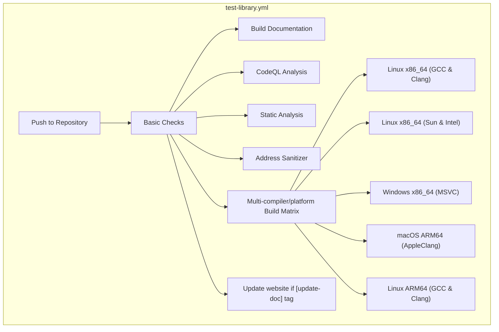
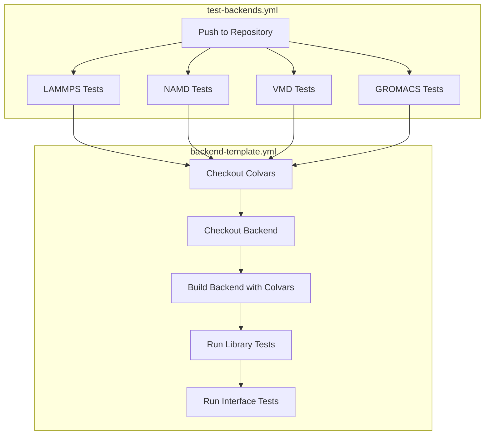
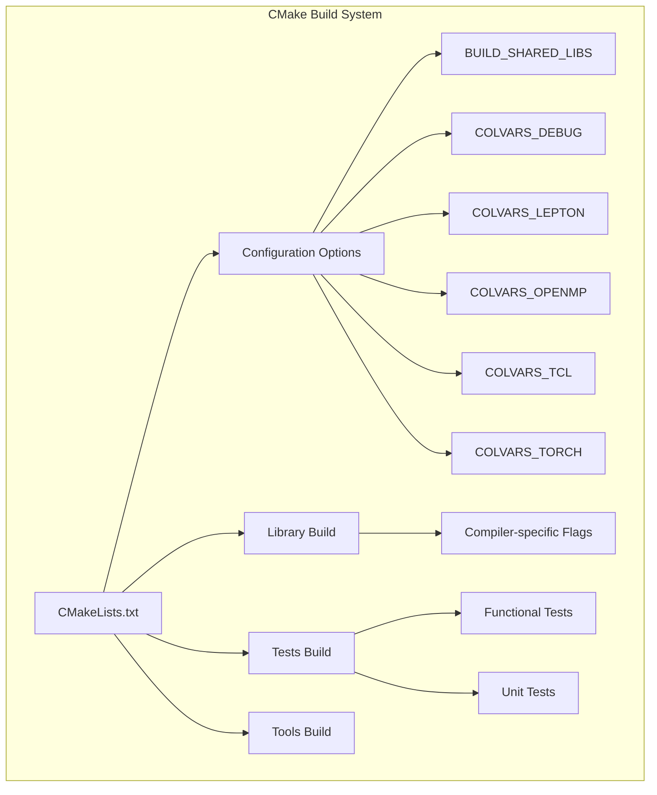
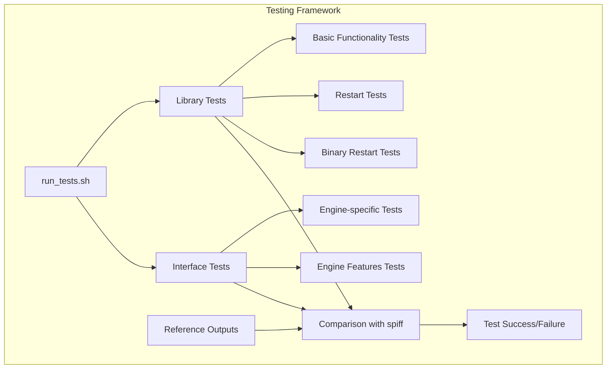
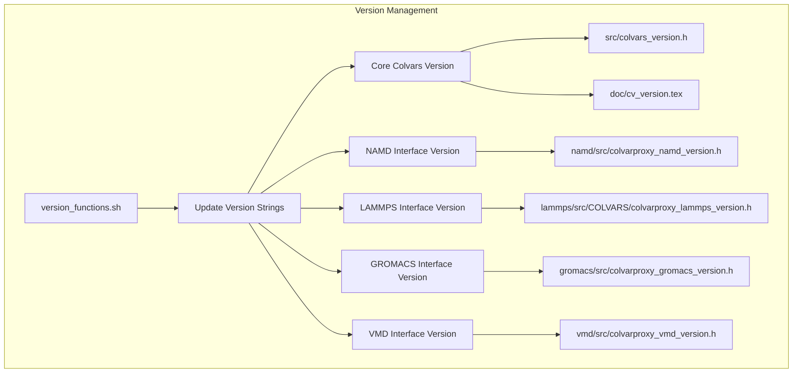
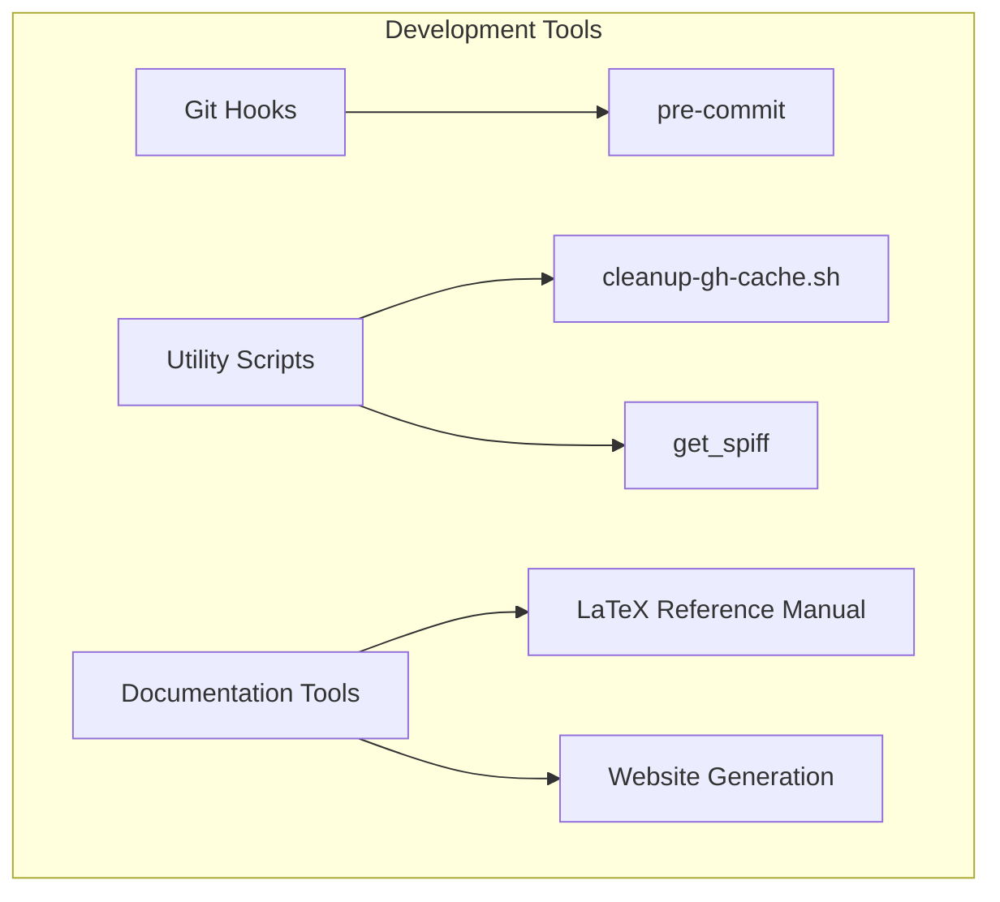

# Development Infrastructure

Relevant source files

The following files were used as context for generating this wiki page:

- [.github/workflows/backend-template.yml](.github/workflows/backend-template.yml)
- [.github/workflows/test-backends.yml](.github/workflows/test-backends.yml)
- [.github/workflows/test-library.yml](.github/workflows/test-library.yml)
- [cmake/CMakeLists.txt](cmake/CMakeLists.txt)
- [cmake/buildColvarsLepton.cmake](cmake/buildColvarsLepton.cmake)
- [cmake/buildColvarsTests.cmake](cmake/buildColvarsTests.cmake)
- [devel-tools/build_test_library.cmake](devel-tools/build_test_library.cmake)
- [devel-tools/cleanup-gh-cache.sh](devel-tools/cleanup-gh-cache.sh)
- [devel-tools/containers/CentOS7-devel.def](devel-tools/containers/CentOS7-devel.def)
- [devel-tools/containers/CentOS9-devel.def](devel-tools/containers/CentOS9-devel.def)
- [devel-tools/containers/README.md](devel-tools/containers/README.md)
- [devel-tools/pre-commit](devel-tools/pre-commit)
- [devel-tools/version_functions.sh](devel-tools/version_functions.sh)
- [doc/cv_version.tex](doc/cv_version.tex)
- [gromacs/src/colvarproxy_gromacs_version.h](gromacs/src/colvarproxy_gromacs_version.h)
- [gromacs/tests/library/000_torchann/AutoDiff/test.colvars.out](gromacs/tests/library/000_torchann/AutoDiff/test.colvars.out)
- [gromacs/tests/library/000_torchann/AutoDiff/test.colvars.state.stripped](gromacs/tests/library/000_torchann/AutoDiff/test.colvars.state.stripped)
- [gromacs/tests/library/000_torchann/AutoDiff/test.colvars.traj](gromacs/tests/library/000_torchann/AutoDiff/test.colvars.traj)
- [gromacs/tests/library/000_torchann/AutoDiff/test.pmf](gromacs/tests/library/000_torchann/AutoDiff/test.pmf)
- [gromacs/tests/library/run_tests.sh](gromacs/tests/library/run_tests.sh)
- [lammps/src/COLVARS/colvarproxy_lammps_version.h](lammps/src/COLVARS/colvarproxy_lammps_version.h)
- [lammps/tests/interface/001_fix_modify/test.lmp.in](lammps/tests/interface/001_fix_modify/test.lmp.in)
- [lammps/tests/library/common/test.lmp.in](lammps/tests/library/common/test.lmp.in)
- [lammps/tests/library/common/test.restart.lmp.in](lammps/tests/library/common/test.restart.lmp.in)
- [lammps/tests/library/run_tests.sh](lammps/tests/library/run_tests.sh)
- [namd/src/colvarproxy_namd_version.h](namd/src/colvarproxy_namd_version.h)
- [namd/tests/library/Common/common.namd](namd/tests/library/Common/common.namd)
- [namd/tests/library/Common/da.coor.pdb](namd/tests/library/Common/da.coor.pdb)
- [namd/tests/library/Common/da.vel.pdb](namd/tests/library/Common/da.vel.pdb)
- [namd/tests/library/Common/gen_da_snapshot.namd](namd/tests/library/Common/gen_da_snapshot.namd)
- [namd/tests/library/Common/test.namd](namd/tests/library/Common/test.namd)
- [namd/tests/library/Common/test.restart.namd](namd/tests/library/Common/test.restart.namd)
- [namd/tests/library/README.md](namd/tests/library/README.md)
- [namd/tests/library/run_tests.sh](namd/tests/library/run_tests.sh)
- [src/colvarproxy_tcl.cpp](src/colvarproxy_tcl.cpp)
- [src/colvarproxy_tcl.h](src/colvarproxy_tcl.h)
- [src/colvars_version.h](src/colvars_version.h)
- [tests/input_files/heavy_atoms_refpos.xyz](tests/input_files/heavy_atoms_refpos.xyz)
- [tests/input_files/rmsd_atoms_random.xyz](tests/input_files/rmsd_atoms_random.xyz)
- [tests/input_files/rmsd_atoms_refpos.xyz](tests/input_files/rmsd_atoms_refpos.xyz)
- [tests/input_files/trajectory.xyz](tests/input_files/trajectory.xyz)
- [vmd/src/colvarproxy_vmd_version.h](vmd/src/colvarproxy_vmd_version.h)

This page documents the infrastructure that supports the development of the Colvars library. It covers the continuous integration/continuous deployment (CI/CD) pipeline, testing framework, version management system, and build system that ensure the quality and reliability of the codebase across multiple molecular dynamics engines.

For information about the core architecture of Colvars, see [Core Architecture](#2). For details about MD engine integration, see [MD Engine Integration](#5).

## CI/CD Pipeline

The Colvars project uses GitHub Actions for continuous integration and continuous deployment. The CI/CD pipeline ensures that code changes are automatically tested across multiple platforms, compilers, and build configurations before they are merged into the codebase.

### Library Testing Workflow

The library testing workflow runs various checks and tests on the core Colvars library code.

Sources: [.github/workflows/test-library.yml:1-686]()

The library testing workflow includes:

1. **Basic checks**:
   - Build recipe validation
   - Code references update
   - Documentation verification

2. **Static analysis and security checks**:
   - CodeQL analysis for security vulnerabilities
   - Clang static analyzer
   - Address sanitizer for memory errors

3. **Multi-platform builds**:
   - Testing on multiple operating systems: Linux (x86_64 and ARM64), Windows, macOS
   - Testing with multiple compilers: GCC (4.8-13), Clang (3.4-16), Intel oneAPI, Sun Studio, and MSVC
   - Testing with various C++ standards (C++11, C++14, C++17, C++20)

### Backend Testing Workflow

The backend testing workflow ensures that Colvars integrates correctly with different molecular dynamics engines (backends).

Sources: [.github/workflows/test-backends.yml:1-103](), [.github/workflows/backend-template.yml:1-211]()

The backend testing workflow:

1. Checks out the Colvars code
2. Checks out the specific backend (NAMD, LAMMPS, VMD, or GROMACS)
3. Updates the backend with the current Colvars code
4. Builds the backend with Colvars integration
5. Runs two types of tests:
   - Library tests: Testing the core Colvars functionality
   - Interface tests: Testing the specific interface between Colvars and the backend

## Build System

The Colvars build system is based on CMake, which provides a platform-independent way to configure and build the library.

Sources: [cmake/CMakeLists.txt:1-189](), [devel-tools/build_test_library.cmake:1-164](), [cmake/buildColvarsLepton.cmake:1-27](), [cmake/buildColvarsTests.cmake:1-54]()

### Key Features

1. **Configuration Options**:
   - `BUILD_SHARED_LIBS`: Build as a shared library (default: OFF)
   - `COLVARS_DEBUG`: Enable debugging code (default: OFF)
   - `COLVARS_LEPTON`: Build with Lepton expression library (default: ON if available)
   - `COLVARS_OPENMP`: Enable OpenMP parallelization (default: ON)
   - `COLVARS_TCL`: Link against Tcl for scripting support (default: OFF)
   - `COLVARS_TORCH`: Link against PyTorch for neural network support (default: OFF)
   - `CMAKE_CXX_STANDARD`: C++ standard to use (11, 14, 17, 20)

2. **Cross-Platform Support**:
   - Compiler-specific flags for GCC, Clang, Intel, Sun, and MSVC
   - Platform-specific adaptations for Linux, macOS, and Windows

3. **Development Containers**:
   - Apptainer/Singularity containers for reproducible build environments
   - Containers for different platforms and compiler combinations

### Integration with MD Engines

The Colvars library can be integrated into multiple molecular dynamics engines using the `update-colvars-code.sh` script, which copies the Colvars code into the engine's source tree.

Sources: [devel-tools/containers/CentOS9-devel.def:1-80](), [devel-tools/containers/CentOS7-devel.def:1-69](), [devel-tools/containers/README.md:1-23]()

## Testing Framework

The Colvars testing framework includes regression tests for the core library and for the integration with each supported molecular dynamics engine.

Sources: [namd/tests/library/run_tests.sh:1-368](), [lammps/tests/library/run_tests.sh:1-307](), [gromacs/tests/library/run_tests.sh:1-359](), [namd/tests/library/README.md:1-35]()

### Key Components

1. **Test Scripts**:
   - `run_tests.sh`: Main script for running tests in each backend
   - Backend-specific test scripts and input files

2. **Test Types**:
   - Library tests: Test core Colvars functionality
   - Interface tests: Test backend-specific features
   - Restart tests: Test state saving and loading

3. **Test Process**:
   - Run simulation with test input files
   - Compare outputs with reference results using `spiff` tool
   - Check for differences within numerical tolerances
   - Report success or failure

4. **Test Organization**:
   - Tests are numbered (e.g., `001_`, `002_`) and grouped by functionality
   - Common test files are shared across backends
   - Backend-specific tests target interface features

## Version Management

The Colvars project maintains consistent version tracking across the core library and all of its integrations with molecular dynamics engines.

Sources: [devel-tools/version_functions.sh:1-262](), [src/colvars_version.h:1-4](), [namd/src/colvarproxy_namd_version.h:1-4](), [vmd/src/colvarproxy_vmd_version.h:1-4](), [lammps/src/COLVARS/colvarproxy_lammps_version.h:1-4](), [gromacs/src/colvarproxy_gromacs_version.h:1-4](), [doc/cv_version.tex:1-2]()

### Key Features

1. **Version String Generation**:
   - Based on date format: `YYYY-MM-DD`
   - Automatically updated when changes are detected in relevant files
   - Consistent across all components

2. **Version Files**:
   - Core version: `src/colvars_version.h`
   - Interface versions: `*/src/colvarproxy_*_version.h`
   - Documentation version: `doc/cv_version.tex`

3. **Update Process**:
   - Triggered by Git hooks or manual commands
   - Updates all version files simultaneously
   - Can be branched for development versions

## Development Tools and Utilities

The Colvars project includes several utilities to support development.

Sources: [devel-tools/pre-commit:1-16](), [devel-tools/cleanup-gh-cache.sh:1-24]()

### Key Utilities

1. **Git Hooks**:
   - `pre-commit`: Removes trailing whitespace, verifies build recipes

2. **Containers**:
   - Apptainer/Singularity container definitions for reproducible environments
   - Containers for different OS versions and compiler combinations

3. **Utility Scripts**:
   - `cleanup-gh-cache.sh`: Cleans up GitHub Actions caches
   - `update-colvars-code.sh`: Updates Colvars code in backends

4. **Documentation Tools**:
   - LaTeX-based reference manual
   - Automated documentation updates in CI/CD pipeline

## Summary

The Colvars development infrastructure provides a robust foundation for maintaining and improving the library. Through a comprehensive CI/CD pipeline, automated testing, version management, and build system, the project ensures consistency and quality across multiple platforms and integrations.

This infrastructure allows the Colvars module to be seamlessly integrated into multiple molecular dynamics engines while maintaining a consistent codebase and ensuring reliability through automated testing.

---