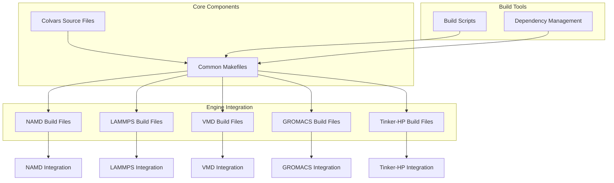
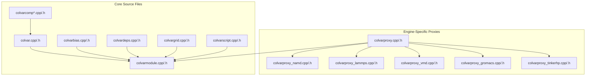
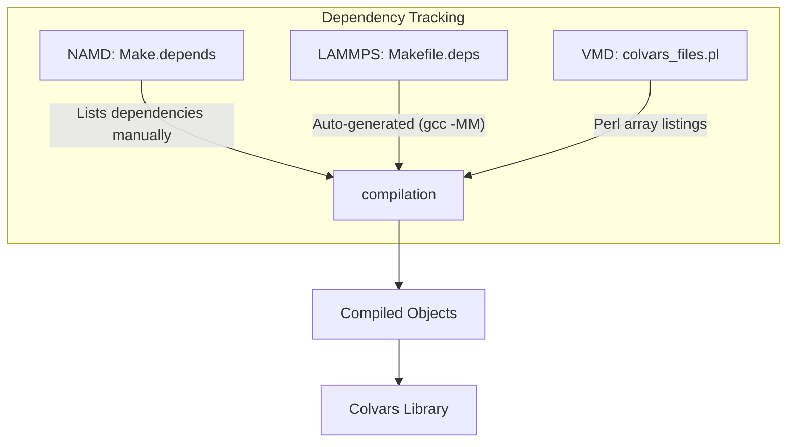
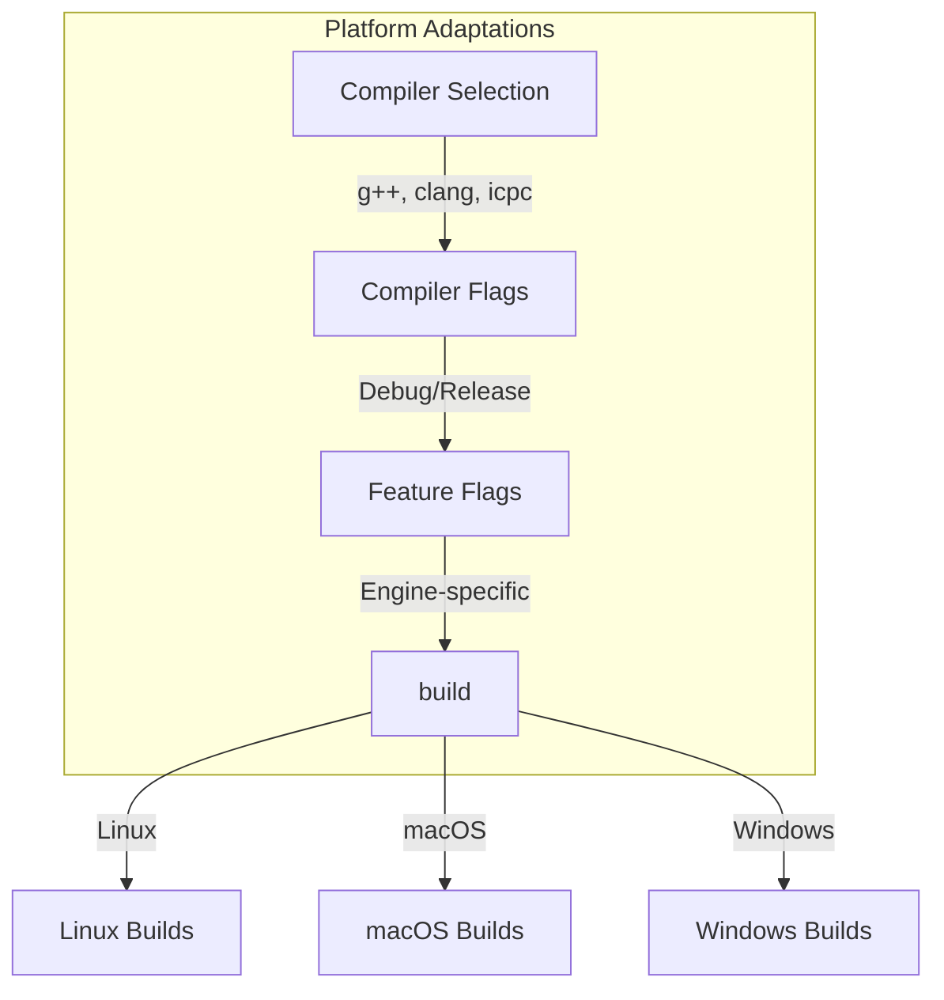

# Build System

<details>
<summary>Relevant source files</summary>

The following files were used as context for generating this wiki page:

- [README-versions.md](README-versions.md)
- [devel-tools/check_build_recipes](devel-tools/check_build_recipes)
- [devel-tools/compile-lammps.sh](devel-tools/compile-lammps.sh)
- [devel-tools/compile-namd.sh](devel-tools/compile-namd.sh)
- [devel-tools/compile-vmd.sh](devel-tools/compile-vmd.sh)
- [devel-tools/get_spiff](devel-tools/get_spiff)
- [devel-tools/load-openmpi.sh](devel-tools/load-openmpi.sh)
- [devel-tools/load-recent-gcc.sh](devel-tools/load-recent-gcc.sh)
- [devel-tools/load-recent-git.sh](devel-tools/load-recent-git.sh)
- [devel-tools/set-ccache.sh](devel-tools/set-ccache.sh)
- [doc/.gitignore](doc/.gitignore)
- [doc/Makefile](doc/Makefile)
- [doc/colvars-code-refs.bib](doc/colvars-code-refs.bib)
- [doc/colvars-engine-flags.tex](doc/colvars-engine-flags.tex)
- [doc/colvars-refman-gromacs.tex](doc/colvars-refman-gromacs.tex)
- [doc/colvars-refman-lammps.tex](doc/colvars-refman-lammps.tex)
- [doc/colvars-refman-main.tex](doc/colvars-refman-main.tex)
- [doc/colvars-refman-namd.tex](doc/colvars-refman-namd.tex)
- [doc/colvars-refman-tinkerhp.tex](doc/colvars-refman-tinkerhp.tex)
- [doc/colvars-refman-vmd.tex](doc/colvars-refman-vmd.tex)
- [doc/colvars-refman.bib](doc/colvars-refman.bib)
- [doc/colvars-refman.tex](doc/colvars-refman.tex)
- [doc/extract_code_refs.py](doc/extract_code_refs.py)
- [doc/print_engine_versions.sh](doc/print_engine_versions.sh)
- [lammps/lib/colvars/Makefile.common](lammps/lib/colvars/Makefile.common)
- [lammps/lib/colvars/Makefile.deps](lammps/lib/colvars/Makefile.deps)
- [namd/colvars/Make.depends](namd/colvars/Make.depends)
- [namd/colvars/src/Makefile.namd](namd/colvars/src/Makefile.namd)
- [namd/ug/ug_colvars.tex](namd/ug/ug_colvars.tex)
- [src/colvarmodule_refs.h](src/colvarmodule_refs.h)
- [vmd/doc/ug_colvars.tex](vmd/doc/ug_colvars.tex)
- [vmd/src/colvars_files.pl](vmd/src/colvars_files.pl)

</details>


This document describes the build system for the Colvars module, explaining how it compiles and integrates with multiple molecular dynamics (MD) engines. For information about running tests against the built code, see [Testing Framework](#7.2). For details on version management across different integrations, see [Version Management](#7.3).

## Overview

The Colvars module uses a flexible build system designed to compile the same core codebase for integration with multiple MD engines (NAMD, LAMMPS, GROMACS, VMD, and Tinker-HP). Each engine requires specific adaptation due to differences in build tools, compiler flags, dependencies, and integration methods.



Sources: [lammps/lib/colvars/Makefile.common](), [namd/colvars/src/Makefile.namd](), [vmd/src/colvars_files.pl]()

## Source Organization

The codebase follows a modular structure with core components and engine-specific adaptations. All engines use the same core source files, while engine-specific code resides in proxy implementations.



Sources: [lammps/lib/colvars/Makefile.deps](), [namd/colvars/Make.depends]()

## Common Build Workflow

While specific details vary by engine, the general build process follows these steps:

```mermaid
sequenceDiagram
    participant Source as "Source Files"
    participant Config as "Configure"
    participant Deps as "Resolve Dependencies"
    participant Compile as "Compile"
    participant Link as "Link"
    participant Install as "Install"
    
    Source->>Config: Engine-specific configuration
    Config->>Deps: Identify dependencies
    Deps->>Compile: Compile objects
    Compile->>Link: Create library
    Link->>Install: Install with engine
    
    Note over Config,Deps: Engine-specific flags
    Note over Compile,Link: Common compilation units
```

Sources: [devel-tools/compile-namd.sh](), [devel-tools/compile-lammps.sh](), [devel-tools/compile-vmd.sh]()

## Engine-Specific Build Mechanisms

### NAMD Integration

NAMD uses a dependency file and makefile to build Colvars as part of its compilation process.

| File | Purpose |
|------|---------|
| `namd/colvars/Make.depends` | Lists all dependencies for Colvars objects |
| `namd/colvars/src/Makefile.namd` | Defines the Colvars library components |
| `devel-tools/compile-namd.sh` | Script to build NAMD with Colvars |

The NAMD build system uses a recursive make approach where Colvars is compiled as part of the main NAMD build.

Sources: [namd/colvars/Make.depends](), [namd/colvars/src/Makefile.namd](), [devel-tools/compile-namd.sh]()

### LAMMPS Integration

LAMMPS treats Colvars as an external library with its own build system that integrates into the LAMMPS compilation process.

| File | Purpose |
|------|---------|
| `lammps/lib/colvars/Makefile.common` | Defines common source files and compilation rules |
| `lammps/lib/colvars/Makefile.deps` | Auto-generated file tracking file dependencies |
| `devel-tools/compile-lammps.sh` | Script to build LAMMPS with Colvars support |

The LAMMPS build system supports both traditional Makefiles and CMake, with options for enabling Colvars via `-DPKG_COLVARS=on` in CMake or including the package in the traditional build.

Sources: [lammps/lib/colvars/Makefile.common](), [lammps/lib/colvars/Makefile.deps](), [devel-tools/compile-lammps.sh]()

### VMD Integration

VMD uses a Perl script to define the Colvars files that need to be compiled as part of the VMD build process.

| File | Purpose |
|------|---------|
| `vmd/src/colvars_files.pl` | Lists all Colvars source files to include in VMD |
| `devel-tools/compile-vmd.sh` | Script to build VMD with Colvars support |

VMD compilation is unique in that it uses different file extensions (`.C` instead of `.cpp`) and requires specific adaptations to integrate with its Tcl/Tk interface system.

Sources: [vmd/src/colvars_files.pl](), [devel-tools/compile-vmd.sh]()

### GROMACS Integration

GROMACS uses a CMake-based build system where Colvars is integrated as a component. Starting with GROMACS 2024, Colvars is officially supported and integrated natively.

Sources: [doc/colvars-refman-main.tex:534-623]()

### Tinker-HP Integration

Tinker-HP has its own integration mechanism for Colvars, adapted to fit its specific compilation environment.

## Dependency Management

Dependencies between source files are tracked using several approaches:



For LAMMPS, dependencies are automatically generated at build time:

```makefile
Makefile.deps: $(COLVARS_SRCS)
	@echo > $@
	@for src in $^ ; do \
	  obj=`basename $$src .cpp`.o ; \
	  $(CXX) $(CXXFLAGS) -MM $(COLVARS_INCFLAGS) $(LEPTON_INCFLAGS) \
	    -MT '$$(COLVARS_OBJ_DIR)'$$obj $$src >> $@ ; \
	  done
```

Sources: [lammps/lib/colvars/Makefile.common:92-99](), [namd/colvars/Make.depends](), [vmd/src/colvars_files.pl]()

## Documentation Build

The documentation system is separate from the code build, using a LaTeX-based build process that creates both HTML and PDF documentation for each supported engine.

| Target | Command | Output |
|--------|---------|--------|
| PDF | `make pdf` | Engine-specific PDFs |
| HTML | `make html` | Engine-specific HTML |
| Website | `make install` | Files for colvars.github.io |

The build process uses conditionals in the LaTeX source to generate appropriate documentation for each engine while maintaining a single source.

Sources: [doc/Makefile](), [doc/colvars-refman.tex](), [doc/colvars-refman-namd.tex](), [doc/colvars-refman-lammps.tex](), [doc/colvars-refman-vmd.tex](), [doc/colvars-refman-gromacs.tex](), [doc/colvars-refman-tinkerhp.tex]()

## Development Tools

Several scripts in the `devel-tools` directory facilitate building and testing with different engines:

| Script | Purpose |
|--------|---------|
| `compile-namd.sh` | Build NAMD with Colvars |
| `compile-lammps.sh` | Build LAMMPS with Colvars |
| `compile-vmd.sh` | Build VMD with Colvars |
| `check_build_recipes` | Verify build files are in sync |
| `set-ccache.sh` | Configure compiler caching for faster builds |
| `load-openmpi.sh` | Load MPI environment for parallel builds |

Additionally, there are tools to check consistency between different build recipes, ensuring all files are properly included in each engine's build specifications.

Sources: [devel-tools/compile-namd.sh](), [devel-tools/compile-lammps.sh](), [devel-tools/compile-vmd.sh](), [devel-tools/check_build_recipes](), [devel-tools/set-ccache.sh](), [devel-tools/load-openmpi.sh]()

## Cross-Platform Considerations

The build system accommodates various platforms and environments:

1. **Compiler support**: Typically requires C++11 support
2. **Dependencies**: Manages external libraries like Lepton (optional)
3. **Debug builds**: Supports debug flags via `COLVARS_DEBUG=on`
4. **Compiler cache**: Optional ccache integration for faster rebuilds



Sources: [devel-tools/compile-namd.sh:64-74](), [lammps/lib/colvars/Makefile.common:12-16]()

## Ongoing Maintenance

The build system requires maintenance to ensure compatibility across engines and platforms:

1. Adding new files to all engine-specific build recipes
2. Checking consistency with `check_build_recipes` script
3. Updating engine-specific configuration for new versions
4. Maintaining version compatibility information

When adding new files, developers must update multiple build files to ensure consistent integration across engines.

Sources: [devel-tools/check_build_recipes](), [README-versions.md]()

---