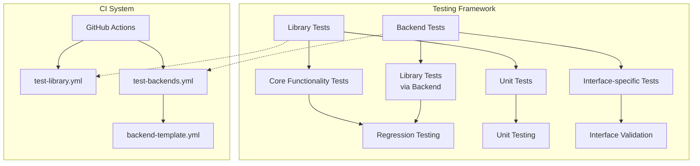
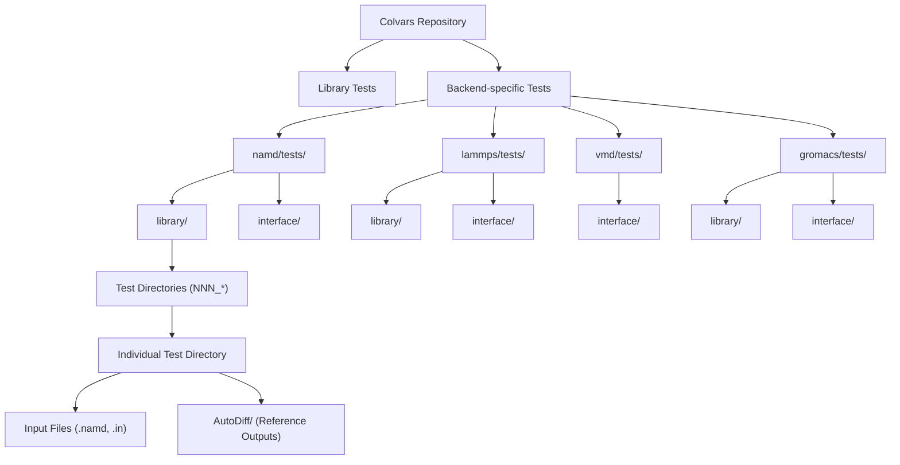
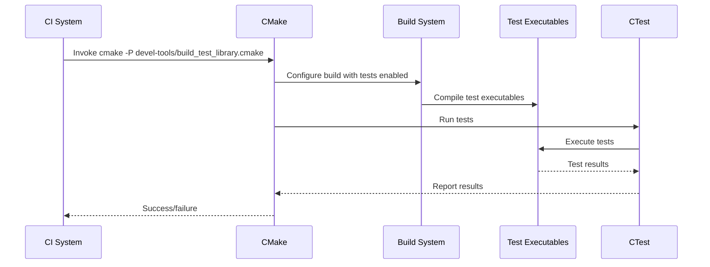
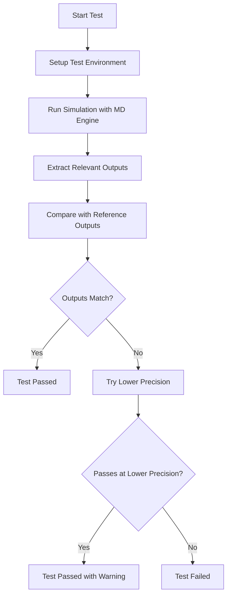
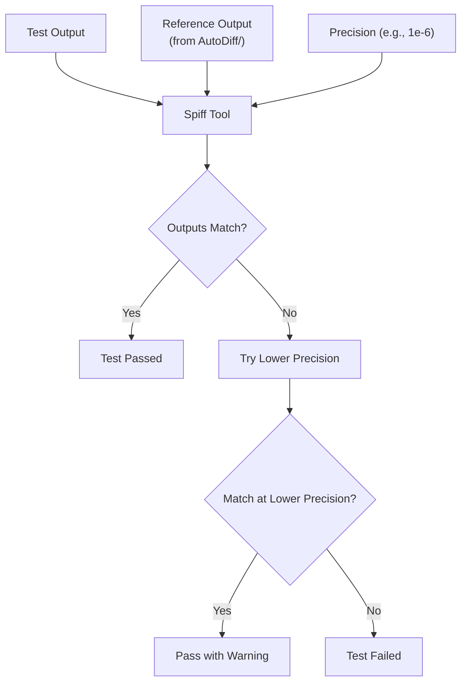

# Testing Framework

Relevant source files

The following files were used as context for generating this wiki page:

- [.github/workflows/backend-template.yml](.github/workflows/backend-template.yml)
- [.github/workflows/test-backends.yml](.github/workflows/test-backends.yml)
- [.github/workflows/test-library.yml](.github/workflows/test-library.yml)
- [README-versions.md](README-versions.md)
- [cmake/CMakeLists.txt](cmake/CMakeLists.txt)
- [cmake/buildColvarsLepton.cmake](cmake/buildColvarsLepton.cmake)
- [cmake/buildColvarsTests.cmake](cmake/buildColvarsTests.cmake)
- [devel-tools/build_test_library.cmake](devel-tools/build_test_library.cmake)
- [devel-tools/cleanup-gh-cache.sh](devel-tools/cleanup-gh-cache.sh)
- [devel-tools/containers/CentOS7-devel.def](devel-tools/containers/CentOS7-devel.def)
- [devel-tools/containers/CentOS9-devel.def](devel-tools/containers/CentOS9-devel.def)
- [devel-tools/containers/README.md](devel-tools/containers/README.md)
- [doc/.gitignore](doc/.gitignore)
- [doc/Makefile](doc/Makefile)
- [doc/colvars-code-refs.bib](doc/colvars-code-refs.bib)
- [doc/colvars-engine-flags.tex](doc/colvars-engine-flags.tex)
- [doc/colvars-refman-gromacs.tex](doc/colvars-refman-gromacs.tex)
- [doc/colvars-refman-lammps.tex](doc/colvars-refman-lammps.tex)
- [doc/colvars-refman-main.tex](doc/colvars-refman-main.tex)
- [doc/colvars-refman-namd.tex](doc/colvars-refman-namd.tex)
- [doc/colvars-refman-tinkerhp.tex](doc/colvars-refman-tinkerhp.tex)
- [doc/colvars-refman-vmd.tex](doc/colvars-refman-vmd.tex)
- [doc/colvars-refman.bib](doc/colvars-refman.bib)
- [doc/colvars-refman.tex](doc/colvars-refman.tex)
- [doc/extract_code_refs.py](doc/extract_code_refs.py)
- [doc/print_engine_versions.sh](doc/print_engine_versions.sh)
- [gromacs/tests/library/000_torchann/AutoDiff/test.colvars.out](gromacs/tests/library/000_torchann/AutoDiff/test.colvars.out)
- [gromacs/tests/library/000_torchann/AutoDiff/test.colvars.state.stripped](gromacs/tests/library/000_torchann/AutoDiff/test.colvars.state.stripped)
- [gromacs/tests/library/000_torchann/AutoDiff/test.colvars.traj](gromacs/tests/library/000_torchann/AutoDiff/test.colvars.traj)
- [gromacs/tests/library/000_torchann/AutoDiff/test.pmf](gromacs/tests/library/000_torchann/AutoDiff/test.pmf)
- [gromacs/tests/library/run_tests.sh](gromacs/tests/library/run_tests.sh)
- [lammps/tests/interface/001_fix_modify/test.lmp.in](lammps/tests/interface/001_fix_modify/test.lmp.in)
- [lammps/tests/library/common/test.lmp.in](lammps/tests/library/common/test.lmp.in)
- [lammps/tests/library/common/test.restart.lmp.in](lammps/tests/library/common/test.restart.lmp.in)
- [lammps/tests/library/run_tests.sh](lammps/tests/library/run_tests.sh)
- [namd/tests/library/Common/common.namd](namd/tests/library/Common/common.namd)
- [namd/tests/library/Common/da.coor.pdb](namd/tests/library/Common/da.coor.pdb)
- [namd/tests/library/Common/da.vel.pdb](namd/tests/library/Common/da.vel.pdb)
- [namd/tests/library/Common/gen_da_snapshot.namd](namd/tests/library/Common/gen_da_snapshot.namd)
- [namd/tests/library/Common/test.namd](namd/tests/library/Common/test.namd)
- [namd/tests/library/Common/test.restart.namd](namd/tests/library/Common/test.restart.namd)
- [namd/tests/library/README.md](namd/tests/library/README.md)
- [namd/tests/library/run_tests.sh](namd/tests/library/run_tests.sh)
- [namd/ug/ug_colvars.tex](namd/ug/ug_colvars.tex)
- [src/colvarmodule_refs.h](src/colvarmodule_refs.h)
- [src/colvarproxy_tcl.cpp](src/colvarproxy_tcl.cpp)
- [src/colvarproxy_tcl.h](src/colvarproxy_tcl.h)
- [tests/input_files/heavy_atoms_refpos.xyz](tests/input_files/heavy_atoms_refpos.xyz)
- [tests/input_files/rmsd_atoms_random.xyz](tests/input_files/rmsd_atoms_random.xyz)
- [tests/input_files/rmsd_atoms_refpos.xyz](tests/input_files/rmsd_atoms_refpos.xyz)
- [tests/input_files/trajectory.xyz](tests/input_files/trajectory.xyz)
- [vmd/doc/ug_colvars.tex](vmd/doc/ug_colvars.tex)

## Purpose and Scope

This document describes the testing framework used to validate the functionality of the Colvars module. The testing system ensures both the core library's correctness and its proper integration with supported molecular dynamics engines. For information about the CI/CD pipeline that utilizes this testing framework, see [CI/CD Pipeline](#7.4).

## Overview of the Testing System

The Colvars testing framework consists of two primary components:

1. **Library tests**: Validate the core Colvars library functionality
2. **Backend tests**: Verify the integration with various MD engines (NAMD, LAMMPS, VMD, GROMACS, Tinker-HP)

Sources: [.github/workflows/test-library.yml:1-686](), [.github/workflows/test-backends.yml:1-104](), [.github/workflows/backend-template.yml:1-221]()

## Test Directory Structure

The testing system is organized into a hierarchical directory structure:

Sources: [namd/tests/library/run_tests.sh:1-368](), [lammps/tests/library/run_tests.sh:1-307](), [gromacs/tests/library/run_tests.sh:1-306]()

## Library Tests

The library tests focus on validating the core functionality of the Colvars library, independent of any specific MD engine interface. These tests are built and run through CMake.

### Building and Running Library Tests

Library tests are constructed and executed automatically during the CMake build process:

Sources: [devel-tools/build_test_library.cmake:1-164](), [cmake/buildColvarsTests.cmake:1-3]()

### Test Configuration and Execution

The library tests are configured through the `cmake/buildColvarsTests.cmake` file and executed via the `devel-tools/build_test_library.cmake` script. The tests are run automatically as part of the CI pipeline but can also be run locally.

## Backend Tests

Backend tests verify the integration of Colvars with various MD engines. Each backend has specific test directories for both library and interface testing.

### Test Structure

Each backend test directory contains:
- Input files for the MD engine
- Configuration files for Colvars
- Reference outputs in an `AutoDiff` subdirectory for regression testing

### Test Execution Process

The backend tests follow this general process:

Sources: [namd/tests/library/run_tests.sh:77-368](), [lammps/tests/library/run_tests.sh:54-307](), [gromacs/tests/library/run_tests.sh:54-306]()

### Run Scripts

Each backend has a specific run script (`run_tests.sh`) that handles:
1. Running the MD engine with the correct inputs
2. Extracting relevant outputs (trajectory files, state files, etc.)
3. Comparing outputs with reference files using the `spiff` tool
4. Reporting success or failure

The run scripts accept the following common parameters:
- Path to the MD engine executable
- List of test directories to run (defaults to all directories matching the pattern `[0-9][0-9][0-9]_*`)
- `-g` flag to generate reference outputs instead of comparing them

Table showing script locations for different backends:

| Backend | Run Script Path |
|---------|----------------|
| NAMD    | `namd/tests/library/run_tests.sh` |
| LAMMPS  | `lammps/tests/library/run_tests.sh` |
| GROMACS | `gromacs/tests/library/run_tests.sh` |
| VMD     | `vmd/tests/interface/run_tests.sh` (not shown in provided files) |

Sources: [namd/tests/library/run_tests.sh:1-368](), [lammps/tests/library/run_tests.sh:1-307](), [gromacs/tests/library/run_tests.sh:1-306]()

## Comparison Tool: Spiff

The `spiff` tool is a central component of the testing framework, used to compare output files with reference files. It allows for numerical comparison with a specified precision, which is important for simulation outputs where small numerical differences may be acceptable.

Sources: [namd/tests/library/run_tests.sh:95-102](), [lammps/tests/library/run_tests.sh:58-65](), [gromacs/tests/library/run_tests.sh:40-48]()

## Continuous Integration

The testing framework is integrated into a CI/CD pipeline using GitHub Actions workflows:

1. `test-library.yml`: Builds and tests the core library with different compilers, platforms, and configurations
2. `test-backends.yml`: Tests integration with various MD engines
3. `backend-template.yml`: Template workflow used by `test-backends.yml` for each backend

These workflows ensure that all changes to the codebase are thoroughly tested across multiple environments before being merged.

Table of CI Jobs:

| Workflow | Job | Purpose |
|----------|-----|---------|
| test-library.yml | basicchecks | Run basic sanity checks |
| test-library.yml | build-doc | Build documentation |
| test-library.yml | codeql | Run CodeQL static analysis |
| test-library.yml | static-analyser | Run Clang static analyzer |
| test-library.yml | address-sanitizer | Run tests with address sanitizer |
| test-library.yml | build-linux-x86_64-many | Test with multiple compilers/standards |
| test-backends.yml | lammps-develop | Test with LAMMPS |
| test-backends.yml | namd-main | Test with NAMD |
| test-backends.yml | vmd-cvs | Test with VMD |
| test-backends.yml | gromacs-main | Test with GROMACS |

Sources: [.github/workflows/test-library.yml:9-686](), [.github/workflows/test-backends.yml:23-103](), [.github/workflows/backend-template.yml:67-221]()

## Adding New Tests

### Adding Library Tests

New library tests are added through the CMake build system. The process typically involves:

1. Creating a new test file
2. Adding it to the `cmake/buildColvarsTests.cmake` file
3. Ensuring it's properly integrated with the build system

### Adding Backend Tests

To add new backend tests:

1. Create a new test directory with a name following the pattern `NNN_descriptive_name`
2. Add input files for the MD engine and Colvars configuration
3. Generate reference outputs using the `-g` option of the run script
4. Verify that the test passes with the reference outputs

### Guidelines for Tests

When creating tests:

1. Focus on testing one feature or functionality per test
2. Ensure tests are deterministic and reproducible
3. Keep tests small and fast when possible
4. Include meaningful descriptions in the test directory name and input files
5. If a test is temporarily disabled, create a `disabled` file in the test directory

Sources: [namd/tests/library/run_tests.sh:126-142](), [lammps/tests/library/run_tests.sh:114-116](), [gromacs/tests/library/run_tests.sh:114-116]()

## Special Considerations

### Binary Restart Files

The testing framework handles binary restart files specially, as they may not be directly comparable between runs or platforms. When testing with binary restart files, the environment variable `COLVARS_BINARY_RESTART=1` is set, and certain comparisons are skipped.

### Platform-Specific Testing

The CI workflows include tests on multiple platforms (Linux x86_64, Windows x86_64, macOS ARM64, Linux ARM64) and with various compilers (GCC, Clang, MSVC, Intel) to ensure cross-platform compatibility.

Sources: [namd/tests/library/run_tests.sh:195-201](), [.github/workflows/test-library.yml:297-443](), [.github/workflows/test-library.yml:602-686]()

---