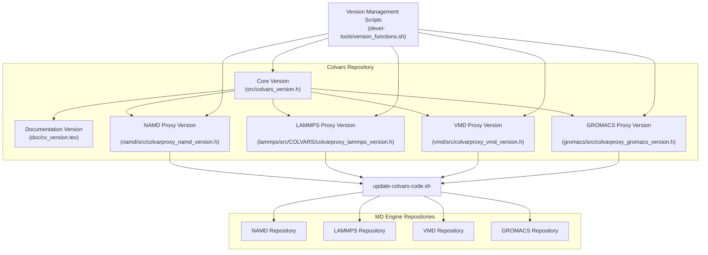
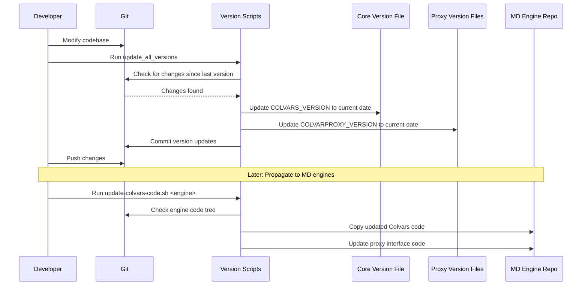
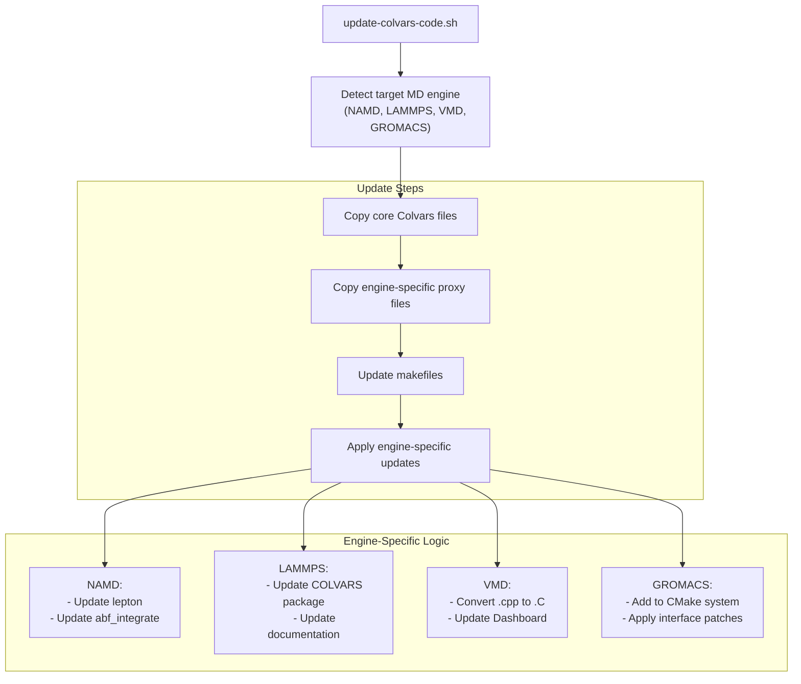
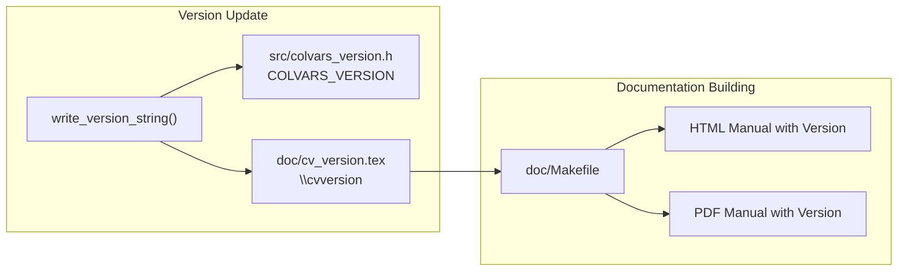

# Version Management

<details>
<summary>Relevant source files</summary>

The following files were used as context for generating this wiki page:

- [README-versions.md](README-versions.md)
- [devel-tools/compile-gromacs.sh](devel-tools/compile-gromacs.sh)
- [devel-tools/pre-commit](devel-tools/pre-commit)
- [devel-tools/version_functions.sh](devel-tools/version_functions.sh)
- [doc/.gitignore](doc/.gitignore)
- [doc/Makefile](doc/Makefile)
- [doc/colvars-code-refs.bib](doc/colvars-code-refs.bib)
- [doc/colvars-engine-flags.tex](doc/colvars-engine-flags.tex)
- [doc/colvars-refman-gromacs.tex](doc/colvars-refman-gromacs.tex)
- [doc/colvars-refman-lammps.tex](doc/colvars-refman-lammps.tex)
- [doc/colvars-refman-main.tex](doc/colvars-refman-main.tex)
- [doc/colvars-refman-namd.tex](doc/colvars-refman-namd.tex)
- [doc/colvars-refman-tinkerhp.tex](doc/colvars-refman-tinkerhp.tex)
- [doc/colvars-refman-vmd.tex](doc/colvars-refman-vmd.tex)
- [doc/colvars-refman.bib](doc/colvars-refman.bib)
- [doc/colvars-refman.tex](doc/colvars-refman.tex)
- [doc/cv_version.tex](doc/cv_version.tex)
- [doc/extract_code_refs.py](doc/extract_code_refs.py)
- [doc/print_engine_versions.sh](doc/print_engine_versions.sh)
- [gromacs/src/colvarproxy_gromacs_version.h](gromacs/src/colvarproxy_gromacs_version.h)
- [lammps/src/COLVARS/colvarproxy_lammps_version.h](lammps/src/COLVARS/colvarproxy_lammps_version.h)
- [namd/src/colvarproxy_namd_version.h](namd/src/colvarproxy_namd_version.h)
- [namd/ug/ug_colvars.tex](namd/ug/ug_colvars.tex)
- [src/colvarmodule_refs.h](src/colvarmodule_refs.h)
- [src/colvars_version.h](src/colvars_version.h)
- [update-colvars-code.sh](update-colvars-code.sh)
- [vmd/doc/ug_colvars.tex](vmd/doc/ug_colvars.tex)
- [vmd/src/colvarproxy_vmd_version.h](vmd/src/colvarproxy_vmd_version.h)

</details>


This page documents how version numbers are managed in the Colvars module across multiple molecular dynamics (MD) engines. It covers version string formats, version update workflows, and how version information is tracked across different integrations.

For information about continuous integration and testing processes, see [CI/CD Pipeline](#7.4).

## 1. Version String Structure and Locations

Colvars uses date-based versioning for both the core module and the engine-specific proxies. The primary version string format is `YYYY-MM-DD`, which represents the date when the code was last modified.

### Version Definition Files

Version strings are defined in several key files:

| Component | Version Definition File | Version Macro |
|-----------|-------------------------|---------------|
| Core Colvars Module | src/colvars_version.h | COLVARS_VERSION |
| NAMD Interface | namd/src/colvarproxy_namd_version.h | COLVARPROXY_VERSION |
| LAMMPS Interface | lammps/src/COLVARS/colvarproxy_lammps_version.h | COLVARPROXY_VERSION |
| VMD Interface | vmd/src/colvarproxy_vmd_version.h | COLVARPROXY_VERSION |
| GROMACS Interface | gromacs/src/colvarproxy_gromacs_version.h | COLVARPROXY_VERSION |
| LaTeX Documentation | doc/cv_version.tex | \cvversion |

Each version file contains a simple definition. For example, the core Colvars version:

```
#ifndef COLVARS_VERSION
#define COLVARS_VERSION "2025-04-18"
#endif
```

Sources: [src/colvars_version.h](), [doc/cv_version.tex](), [namd/src/colvarproxy_namd_version.h](), [vmd/src/colvarproxy_vmd_version.h](), [gromacs/src/colvarproxy_gromacs_version.h](), [lammps/src/COLVARS/colvarproxy_lammps_version.h]()

## 2. Version Management System

### Version Information Flow



Sources: [devel-tools/version_functions.sh](), [update-colvars-code.sh]()

### Version Update Workflow



Sources: [devel-tools/version_functions.sh](), [update-colvars-code.sh]()

## 3. Version Update Tools

The Colvars repository includes several scripts for managing versions:

### Version Function Script

The `devel-tools/version_functions.sh` script provides functions for:

1. **Reading versions**:
   - `get_colvarmodule_version`: Extracts the core Colvars version
   - `get_colvarproxy_<engine>_version`: Extracts a specific engine proxy version

2. **Updating versions**:
   - `update_version_string`: Updates a specific version string based on recent changes
   - `update_all_versions`: Updates all version strings at once
   - `write_version_string`: Writes a new version string to a file

3. **Branch management**:
   - `write_all_versions_branch`: Tags versions with branch information
   - `get_branch_name`: Gets the current Git branch name

Example usage in a pre-commit hook or development workflow:

```bash
# Update all version strings based on current changes
source devel-tools/version_functions.sh
update_all_versions
```

Sources: [devel-tools/version_functions.sh:5-261]()

### Update Process

When changes are made to the codebase:

1. The version functions detect if files in specific directories have changed
2. If changes are detected, the version string is updated to the current date
3. The new version strings are committed

The `update_version_string` function handles this logic:

```bash
update_version_string "Colvars" \
                      '^src/colvar' \
                      get_colvarmodule_version \
                      COLVARS_VERSION \
                      src/colvars_version.h
```

This checks for changes matching the pattern `^src/colvar`, and if found, updates the version in `src/colvars_version.h`.

Sources: [devel-tools/version_functions.sh:139-171]()

## 4. Propagating Code to MD Engines

The `update-colvars-code.sh` script is responsible for updating Colvars code in the different MD engine source trees:

### Engine Detection and Code Update

The script:

1. Detects the target MD engine based on source tree structure
2. Copies the appropriate files to the engine's source tree
3. Updates engine-specific files and makefiles
4. Handles engine-specific customizations



Sources: [update-colvars-code.sh:1-577]()

### Conditional File Copying

The script uses a `condcopy` function that:
1. Compares source and destination files
2. Only copies files that have changed
3. Can operate in reverse mode to update the Colvars repository from a downstream engine

For example, when updating LAMMPS:

```bash
# Update code-independent headers and sources
for src in ${source}/src/colvar*.h ${source}/src/colvar*.cpp
do \
  tgt=$(basename ${src})
  condcopy "${src}" "${target}/lib/colvars/${tgt}"
done
```

Sources: [update-colvars-code.sh:208-236](), [update-colvars-code.sh:272-276]()

## 5. Version Tracking

Colvars maintains a record of which version is included in each release of the supported MD engines:

### Version Tracking File

The `README-versions.md` file contains tables listing:
- MD engine versions
- The corresponding Colvars version included
- Links to the specific release tags

For example:
```
### Versions included in LAMMPS
LAMMPS version | Colvars version
-------------- | ---------------
stable_29Aug2024 | 2024-06-04
stable_2Aug2023 | 2023-05-01
...
```

This file is generated by the `doc/print_engine_versions.sh` script, which extracts version information from Git tags and branches.

Sources: [README-versions.md:1-56](), [doc/print_engine_versions.sh:1-85]()

### Version Generation

The script:
1. Gets version information from Git tags and branches
2. Formats it into markdown tables
3. Orders versions chronologically

Version information is extracted using the same functions from `version_functions.sh` that are used for updating versions.

Sources: [doc/print_engine_versions.sh:12-85](), [devel-tools/version_functions.sh:5-95]()

## 6. Documentation Version Management

Documentation version strings are also maintained:

1. When `src/colvars_version.h` is updated, `doc/cv_version.tex` is also updated with the same version string
2. This ensures that documentation and code versions are synchronized
3. The documentation build system adds release information to URLs



Sources: [doc/cv_version.tex](), [devel-tools/version_functions.sh:103-120](), [doc/Makefile:1-151](), [doc/colvars-refman.tex:129-148]()

## 7. Summary

The Colvars version management system serves to:

1. **Track Changes**: Date-based version strings indicate when code was last modified
2. **Maintain Consistency**: Core and proxy versions are updated together
3. **Support Integration**: The updating system makes it easy to propagate changes to MD engines
4. **Document Compatibility**: The version tracking system helps users understand which versions work together

This system ensures that:
- Developers can easily update code across multiple repositories
- Users can identify which version of Colvars they're using
- Documentation and code versions remain synchronized
- The history of Colvars integration with MD engines is preserved

Sources: [devel-tools/version_functions.sh](), [update-colvars-code.sh](), [README-versions.md]()

---