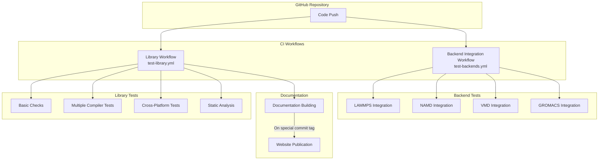
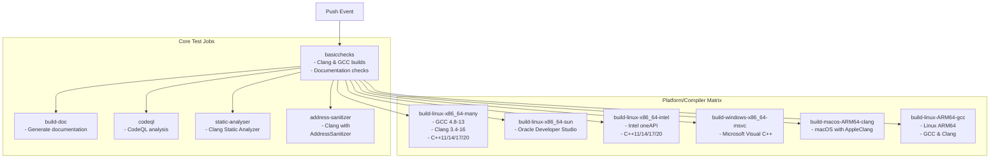
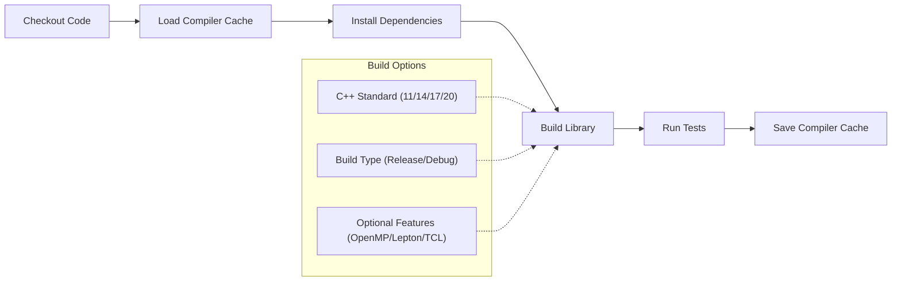
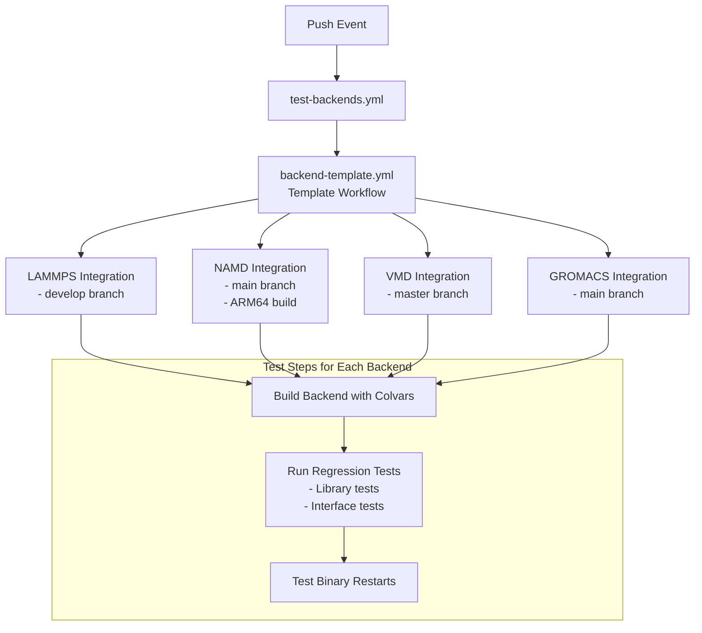

# CI/CD Pipeline

Relevant source files

The following files were used as context for generating this wiki page:

- [.github/workflows/backend-template.yml](.github/workflows/backend-template.yml)
- [.github/workflows/test-backends.yml](.github/workflows/test-backends.yml)
- [.github/workflows/test-library.yml](.github/workflows/test-library.yml)
- [README-versions.md](README-versions.md)
- [cmake/CMakeLists.txt](cmake/CMakeLists.txt)
- [cmake/buildColvarsLepton.cmake](cmake/buildColvarsLepton.cmake)
- [cmake/buildColvarsTests.cmake](cmake/buildColvarsTests.cmake)
- [devel-tools/build_test_library.cmake](devel-tools/build_test_library.cmake)
- [devel-tools/check_build_recipes](devel-tools/check_build_recipes)
- [devel-tools/cleanup-gh-cache.sh](devel-tools/cleanup-gh-cache.sh)
- [devel-tools/compile-lammps.sh](devel-tools/compile-lammps.sh)
- [devel-tools/compile-namd.sh](devel-tools/compile-namd.sh)
- [devel-tools/compile-vmd.sh](devel-tools/compile-vmd.sh)
- [devel-tools/containers/CentOS7-devel.def](devel-tools/containers/CentOS7-devel.def)
- [devel-tools/containers/CentOS9-devel.def](devel-tools/containers/CentOS9-devel.def)
- [devel-tools/containers/README.md](devel-tools/containers/README.md)
- [devel-tools/get_spiff](devel-tools/get_spiff)
- [devel-tools/load-openmpi.sh](devel-tools/load-openmpi.sh)
- [devel-tools/load-recent-gcc.sh](devel-tools/load-recent-gcc.sh)
- [devel-tools/load-recent-git.sh](devel-tools/load-recent-git.sh)
- [devel-tools/set-ccache.sh](devel-tools/set-ccache.sh)
- [doc/.gitignore](doc/.gitignore)
- [doc/Makefile](doc/Makefile)
- [doc/colvars-code-refs.bib](doc/colvars-code-refs.bib)
- [doc/colvars-engine-flags.tex](doc/colvars-engine-flags.tex)
- [doc/colvars-refman-gromacs.tex](doc/colvars-refman-gromacs.tex)
- [doc/colvars-refman-lammps.tex](doc/colvars-refman-lammps.tex)
- [doc/colvars-refman-main.tex](doc/colvars-refman-main.tex)
- [doc/colvars-refman-namd.tex](doc/colvars-refman-namd.tex)
- [doc/colvars-refman-tinkerhp.tex](doc/colvars-refman-tinkerhp.tex)
- [doc/colvars-refman-vmd.tex](doc/colvars-refman-vmd.tex)
- [doc/colvars-refman.bib](doc/colvars-refman.bib)
- [doc/colvars-refman.tex](doc/colvars-refman.tex)
- [doc/extract_code_refs.py](doc/extract_code_refs.py)
- [doc/print_engine_versions.sh](doc/print_engine_versions.sh)
- [gromacs/tests/library/000_torchann/AutoDiff/test.colvars.out](gromacs/tests/library/000_torchann/AutoDiff/test.colvars.out)
- [gromacs/tests/library/000_torchann/AutoDiff/test.colvars.state.stripped](gromacs/tests/library/000_torchann/AutoDiff/test.colvars.state.stripped)
- [gromacs/tests/library/000_torchann/AutoDiff/test.colvars.traj](gromacs/tests/library/000_torchann/AutoDiff/test.colvars.traj)
- [gromacs/tests/library/000_torchann/AutoDiff/test.pmf](gromacs/tests/library/000_torchann/AutoDiff/test.pmf)
- [namd/ug/ug_colvars.tex](namd/ug/ug_colvars.tex)
- [src/colvarmodule_refs.h](src/colvarmodule_refs.h)
- [src/colvarproxy_tcl.cpp](src/colvarproxy_tcl.cpp)
- [src/colvarproxy_tcl.h](src/colvarproxy_tcl.h)
- [tests/input_files/heavy_atoms_refpos.xyz](tests/input_files/heavy_atoms_refpos.xyz)
- [tests/input_files/rmsd_atoms_random.xyz](tests/input_files/rmsd_atoms_random.xyz)
- [tests/input_files/rmsd_atoms_refpos.xyz](tests/input_files/rmsd_atoms_refpos.xyz)
- [tests/input_files/trajectory.xyz](tests/input_files/trajectory.xyz)
- [vmd/doc/ug_colvars.tex](vmd/doc/ug_colvars.tex)

This page documents the Continuous Integration and Continuous Delivery (CI/CD) pipeline for the Colvars library. It covers the workflows used to test the library functionality, integration with backend systems, static analysis, and documentation building.

For information about the build system used to compile the library, see [Build System](#7.1).

## Overview of CI/CD Architecture

The Colvars project uses GitHub Actions as its primary CI/CD platform. The pipeline consists of two main workflows:

1. **Library Testing Workflow**: Tests the core Colvars library with various compilers and platforms
2. **Backend Testing Workflow**: Tests integration with molecular dynamics engines (NAMD, LAMMPS, GROMACS, VMD)

These workflows are triggered on each push to the repository, ensuring that code changes are continuously validated.

### Overall CI/CD Architecture Diagram

Sources: [.github/workflows/test-library.yml](), [.github/workflows/test-backends.yml]()

## Library Testing Workflow

The library testing workflow is defined in `test-library.yml` and runs a comprehensive set of tests on the core Colvars library.

### Library Workflow Jobs

Sources: [.github/workflows/test-library.yml:9-683]()

### Basic Checks Job Details

The `basicchecks` job is the entry point for most of the testing workflow. It performs several key tasks:

1. Checking build recipes to ensure all source files are included in build systems
2. Converting BibTeX references to code citations
3. Building and testing the library with Clang
4. Validating documentation of command-line scripting interface
5. Building and testing the library with GCC
6. Building the library with debug code enabled

Sources: [.github/workflows/test-library.yml:9-96]()

### Documentation Building

The `build-doc` job builds the Colvars documentation using LaTeX and optionally deploys it to the project website:

1. Uses Apptainer (formerly Singularity) with a TeXLive container
2. Builds documentation for the current branch
3. If the commit message contains `[update-doc]`, pushes the updated documentation to the website repository

Sources: [.github/workflows/test-library.yml:99-153]()

### Static Analysis Tools

The workflow uses several static analysis tools:

1. **CodeQL**: Performs security and quality analysis
2. **Clang Static Analyzer**: Detects bugs and code issues
3. **Address Sanitizer**: Finds memory errors at runtime

Sources: [.github/workflows/test-library.yml:155-287]()

## Compiler and Platform Matrix

The Colvars CI pipeline tests with an extensive matrix of compilers, C++ standards, and platforms:

| Job | Platforms | Compilers | C++ Standards |
|-----|-----------|-----------|---------------|
| build-linux-x86_64-many | CentOS 7/9 | GCC 4.8-13, Clang 3.4-16 | 11, 14, 17, 20 |
| build-linux-x86_64-sun | CentOS 7 | Oracle Developer Studio | 11 |
| build-linux-x86_64-intel | CentOS 9 | Intel oneAPI 2024.2 | 11, 14, 17, 20 |
| build-windows-x86_64-msvc | Windows | MSVC | Default |
| build-macos-ARM64-clang | macOS | AppleClang | Default |
| build-linux-ARM64-gcc | CentOS 9 | GCC 11, Clang 16 | 20 |

Sources: [.github/workflows/test-library.yml:297-685]()

### Testing Process Diagram

Sources: [devel-tools/build_test_library.cmake](), [cmake/CMakeLists.txt]()

## Backend Testing Workflow

The backend testing workflow checks integration with various molecular dynamics engines. It uses a reusable workflow template defined in `backend-template.yml`.

### Backend Testing Architecture

Sources: [.github/workflows/test-backends.yml](), [.github/workflows/backend-template.yml]()

### Backend Testing Process

For each backend, the workflow performs these steps:

1. Checkout Colvars code
2. Checkout the backend's source code (using private keys for restricted repositories)
3. Update the backend's Colvars code with the current version
4. Build the backend with Colvars integration
5. Run library regression tests
6. Run interface-specific tests
7. Test binary restart functionality

The tests run inside Apptainer containers with all necessary dependencies.

Sources: [.github/workflows/backend-template.yml:67-221]()

## Container-Based Testing Environment

The Colvars CI/CD pipeline uses Apptainer (formerly Singularity) containers to ensure consistent testing environments:

| Container | Purpose | Key Contents |
|-----------|---------|-------------|
| CentOS7-devel | Legacy testing | GCC 4.8-10, Clang 3.4/7, CMake 3, Charm++ |
| CentOS9-devel | Modern testing | GCC 11-13, Clang 16, CMake, Charm++ |
| CentOS9-oneAPI | Intel compiler | Intel oneAPI 2024.2 |
| CentOS9-devel-arm64 | ARM64 testing | GCC 11, Clang 16 for ARM64 |
| texlive | Documentation | TeXLive for document building |

Sources: [devel-tools/containers/CentOS9-devel.def](), [devel-tools/containers/CentOS7-devel.def]()

## Documentation Deployment

When a commit with the tag `[update-doc]` is pushed, the CI pipeline:

1. Builds the documentation for all supported engines (GROMACS, LAMMPS, NAMD, Tinker-HP, VMD)
2. Generates both PDF and HTML versions
3. Pushes the built documentation to the `colvars.github.io` repository
4. For master branch, also updates the Doxygen API documentation

Sources: [doc/Makefile:110-150](), [.github/workflows/test-library.yml:99-153]()

## Caching Strategy

The CI/CD pipeline uses GitHub Actions caching to improve performance:

1. Compiler cache (ccache) is used to speed up builds
2. Each job has its own cache based on runner OS and job name
3. Only one previous cache is kept per branch to avoid excessive storage usage
4. Cache is shared between runs on the same branch, but gets a new key on each commit

Sources: [.github/workflows/test-library.yml:23-29](), [devel-tools/cleanup-gh-cache.sh]()

## Build Testing Tool Chain

The build testing infrastructure uses several tools:

1. **CMake**: Primary build system
2. **Ninja**: Fast build tool used on Linux/macOS
3. **ccache**: Compiler cache to speed up builds
4. **spiff**: Diff tool for regression testing
5. **Apptainer/Singularity**: Container runtime for consistent environments

Each backend has a dedicated compile script (e.g., `compile-namd.sh`, `compile-lammps.sh`) that builds the backend with the current Colvars code.

Sources: [devel-tools/build_test_library.cmake](), [devel-tools/compile-namd.sh](), [devel-tools/compile-lammps.sh](), [devel-tools/compile-vmd.sh](), [devel-tools/get_spiff]()