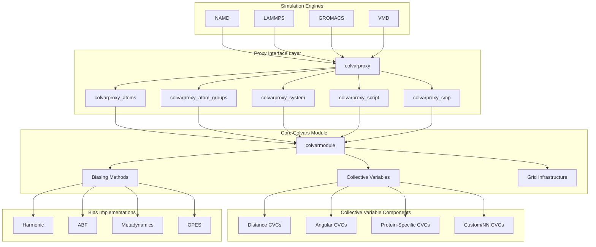

The Collective Variables Module (Colvars) is a high-performance software library designed for molecular simulation and analysis that provides a sophisticated implementation of sampling algorithms operating on a reduced space of continuously differentiable functions known as collective variables. First released in 2008 as part of NAMD version 2.7b1, Colvars has evolved into a mature, widely-adopted library integrated into major molecular dynamics packages including NAMD, LAMMPS, VMD, GROMACS, and Tinker-HP.


Sources: [README.md](README.md#L1-L13)

## What Are Collective Variables?

Collective variables (CVs) are mathematical functions that describe complex structural and dynamical properties of molecular systems in a reduced-dimensional space. Unlike individual atomic coordinates, which can number in the thousands or millions for realistic biomolecular systems, CVs capture essential features such as distances between molecular centers of mass, dihedral angles, coordination numbers, root-mean-square deviations, and many other geometric or physical properties. This reduction enables efficient exploration of free energy landscapes and enhanced sampling techniques that would be computationally prohibitive in full-dimensional space.

The library provides a comprehensive framework for defining these variables through a flexible configuration language, applying various biasing potentials to drive sampling along chosen collective dimensions, and analyzing the resulting data to extract thermodynamic and kinetic information. The functionality includes free-energy estimators based on thermodynamic forces, non-equilibrium work calculations, and probability distribution analysis.

Sources: [README.md](README.md#L1-L9)

## Supported Simulation Engines

Colvars achieves engine independence through a well-designed proxy interface that abstracts the details of each molecular dynamics code. This architecture allows the same Colvars configuration files to work across different simulation packages with minimal modification, ensuring portability of research workflows.

| Engine | Integration Status | Configuration Method | Documentation |
|--------|-------------------|---------------------|---------------|
| **GROMACS** | Full support (2024+) | MDP file parameters | [GROMACS Manual](https://manual.gromacs.org/) |
| **LAMMPS** | Full support | Fix colvars command | [LAMMPS Download](https://lammps.sandia.gov/download.html) |
| **NAMD** | Native (original) | Config file directives | [NAMD Website](https://www.ks.uiuc.edu/Research/namd/) |
| **Tinker-HP** | Full support | `.colvars` file | [Tinker-HP Website](https://tinker-hp.org/) |
| **VMD** | Full support | Tcl scripting | [VMD Website](https://www.ks.uiuc.edu/Research/vmd/) |

Sources: [README.md](README.md#L15-L24)

## Core Capabilities

The Colvars library provides three fundamental categories of functionality that work together to enable advanced molecular simulations and analyses:

### Collective Variable Definitions

The library supports an extensive catalog of variable types covering common structural descriptors. These range from simple geometric quantities to complex protein-specific metrics and even custom neural network functions. The modular design allows combining multiple components into composite variables using arithmetic operations, enabling researchers to construct precisely the degrees of freedom needed for their specific scientific questions.

### Biasing and Sampling Methods

Building on the foundation of collective variables, Colvars implements numerous enhanced sampling algorithms. These include harmonic restraints and walls for simple confinement, Adaptive Biasing Force (ABF) for free energy surface reconstruction, various metadynamics variants for exploring rare events, umbrella integration techniques, and advanced methods like OPES (On-the-fly Probability Enhanced Sampling). Each method is implemented with careful attention to computational efficiency and numerical accuracy.

### Grid-Based Analysis

For methods that accumulate statistical information across collective variable space, Colvars provides robust grid infrastructure. This includes configurable grids with automatic handling of periodic and non-periodic boundaries, efficient algorithms for free energy surface integration from force data, and tools for custom multi-dimensional operations. The grid system supports both in-memory storage and efficient disk I/O for large-scale calculations.

Sources: [README.md](README.md#L5-L9), [colvarbias.h](src/colvarbias.h#L22-L329), [colvargrid.h](src/colvargrid.h#L51-L995)

## Architecture Overview

The Colvars architecture follows a modular, object-oriented design that separates concerns into distinct layers with well-defined interfaces. This design facilitates maintenance, extensibility, and the integration with multiple simulation engines.



The architecture centers around the `colvarmodule` class ([src/colvarmodule.h](src/colvarmodule.h#L76-L960)), which serves as the main controller managing all Colvars components. The `colvarproxy` interface ([src/colvarproxy.h](src/colvarproxy.h#L549-L718)) abstracts communication with host simulation programs, handling tasks such as reading atomic coordinates, applying forces, and managing system parameters. Multiple specialized proxy subclasses handle specific concerns: atom management ([colvarproxy_atoms](src/colvarproxy.h#L44-L303)), atom group operations ([colvarproxy_atom_groups](src/colvarproxy.h#L305-L449)), parallel processing ([colvarproxy_smp](src/colvarproxy.h#L460-L510)), and scripting interfaces ([colvarproxy_script](src/colvarproxy.h#L514-L543)).

Collective variables are implemented through the `colvar` class ([src/colvar.h](src/colvar.h#L53-L722)), which aggregates one or more collective variable components (CVCs). Each CVC implements a specific mathematical function, such as distance or angle calculations, and provides derivatives with respect to atomic coordinates. This modular component system allows researchers to combine simple elements into complex collective variables.

Biasing methods derive from the base `colvarbias` class ([src/colvarbias.h](src/colvarbias.h#L22-L329)) and implement specific algorithms for applying forces to collective variables. Many biases use grids ([src/colvargrid.h](src/colvargrid.h#L51-L995)) to accumulate statistics, compute free energies, or store bias potentials. The grid system provides efficient multi-dimensional array operations with automatic handling of boundary conditions and periodic wrapping.

Sources: [colvarmodule.h](src/colvarmodule.h#L76-L960), [colvarproxy.h](src/colvarproxy.h#L549-L718), [colvar.h](src/colvar.h#L53-L722)

## Project Structure

The Colvars repository is organized into logical directories containing source code, integration files for supported engines, documentation, examples, and testing infrastructure.

```
colvars/
├── src/                    # Core library source code
│   ├── colvarmodule.*      # Main controller class
│   ├── colvar.*            # Collective variable implementation
│   ├── colvarbias.*        # Base biasing class and derivatives
│   ├── colvarcomp.*        # Collective variable components
│   ├── colvargrid.*        # Grid infrastructure
│   ├── colvarproxy.*       # Proxy interface classes
│   └── colvarscript.*      # Scripting interface
├── namd/                   # NAMD-specific integration
├── lammps/                 # LAMMPS-specific integration
├── gromacs/                # GROMACS-specific integration
├── vmd/                    # VMD-specific integration
├── examples/               # Configuration examples
├── tests/                  # Test suites
├── doc/                    # Documentation files
└── devel-tools/            # Development utilities
```

The source directory contains the complete library implementation with clear separation between core functionality and engine-specific code. The integration directories contain patches and interface code required to incorporate Colvars into each supported simulation package. Examples and tests provide practical guidance and ensure numerical accuracy through continuous validation.

Sources: [Repository root structure](.), [src directory](src)

## Example Configuration

A basic Colvars configuration demonstrates the simplicity of the system. The following example defines a distance variable between two groups of atoms and applies a harmonic restraint:

```
colvar {                                    # Define a new variable
  name d                                    # Must give a name
  width 0.2                                  # Estimated fluctuation amplitude
  distance {                                 # Distance between COMs
    group1 { atomNumbers 1 2 3 }            # First atom group
    group2 { atomNumbers 4 5 6 }            # Second atom group
  }
}

harmonic {                                  # Define harmonic potential
  colvars d                                 # Apply to variable "d"
  centers 5.0                               # Center position
  forceConstant 10.0                        # Force constant
}
```

This configuration demonstrates key concepts: variable definition with naming and physical parameters, atom group specification, component selection, and bias application. The same syntax works across all supported simulation engines, promoting reproducibility and portability.

Sources: [README.md](README.md#L52-L67)

## Key Features

The library provides numerous features designed for both usability and computational efficiency:

**Flexible Variable Definition**: Support for atomic groups defined by atom numbers, residue numbers, and atom names enables precise control over which atoms participate in collective variables. Named atom groups can be reused across multiple variables, reducing configuration complexity.

**Extended Lagrangian Dynamics**: For variables with rough energy landscapes, the library implements an extended Lagrangian formalism where the collective variable becomes a dynamic degree of freedom with its own effective mass and friction. This can significantly improve sampling efficiency and numerical stability.

**Parallel Computing**: Through the `colvarproxy_smp` interface, the library supports multi-threaded parallel execution. Different parallelization strategies are available, including distributing collective variable component calculations across threads and parallelizing bias evaluations.

**State Management**: Complete simulation state can be saved and restored through restart files, enabling long simulations to be interrupted and resumed without loss of information. State files include all variables, biases, grids, and internal counters.

**Output and Analysis**: The library produces comprehensive trajectory files with configurable output frequency, allowing detailed analysis of variable evolution. Additional analysis capabilities include autocorrelation functions, running averages, and probability distribution calculations.

**Scripting Interface**: For advanced control, scripting interfaces (particularly Tcl) allow real-time modification of bias parameters, custom force calculations, and complex workflow automation beyond what's possible through configuration files alone.

Sources: [colvarmodule.h](src/colvarmodule.h#L85-L960), [colvarproxy.h](src/colvarproxy.h#L460-L543)

## Installation and Integration

Colvars can be obtained through multiple channels. The simplest approach is to use the version bundled with your preferred simulation engine. For access to the latest features and bug fixes, the library can be updated independently using the provided `update-colvars-code.sh` script.

To update Colvars in an existing simulation package source tree:
```bash
git clone https://github.com/Colvars/colvars.git
cd colvars
./update-colvars-code.sh /path/to/simulation/engine
```

This script copies the current Colvars source code into the target directory, preserving integration patches. After updating, recompile the simulation engine following its standard build procedure.

Sources: [README.md](README.md#L92-L108)

## Learning Path

For developers and users new to Colvars, the recommended progression through the documentation ensures a solid foundation before tackling advanced topics:

1. **[Quick Start](2-quick-start)**: Get up and running with a simple example configuration
2. **[Installation and Integration](3-installation-and-integration)**: Detailed setup instructions for each supported engine
3. **[Basic Configuration Syntax](4-basic-configuration-syntax)**: Understanding the Colvars configuration language

After mastering the basics, dive into specialized areas:

- **Collective Variable Components**: Learn about distance variables, angular measures, coordination numbers, protein-specific variables, and custom neural network functions
- **Biasing Methods**: Explore harmonic restraints, ABF, metadynamics, umbrella integration, and OPES
- **Grid Operations**: Understand grid configuration, free energy integration, and multi-dimensional operations
- **Advanced Topics**: Proxy interfaces, atom group management, extended Lagrangian dynamics, parallel computing, and scripting

The modular nature of the documentation allows you to focus on the techniques most relevant to your research while developing a comprehensive understanding of the library's capabilities.

Sources: [README.md](README.md#L28-L33)

## Citation and Acknowledgement

When using Colvars in published research, please cite the foundational papers:

> G. Fiorin, M. L. Klein, and J. Hénin, "Using collective variables to drive molecular dynamics simulations," *Molecular Physics* **111** (22-23), 3345-3362 (2013). https://doi.org/10.1080/00268976.2013.813594

> G. Fiorin, F. Marinelli, L. R. Forrest, H. Chen, C. Chipot, A. Kohlmeyer, H. Santuz, J. Hénin, "New capabilities in the Colvars module: parallel replica simulations, integration of non-Gaussian and time-series biases, and visualization tools," *J. Phys. Chem. B* **128** (45), 11108-11123 (2024). https://doi.org/10.1021/acs.jpcb.4c05604

The library automatically prints citation information for specific features at runtime. A comprehensive BibTeX file containing all feature-specific references is available in the [doc/colvars-code-refs.bib](doc/colvars-code-refs.bib) file.
