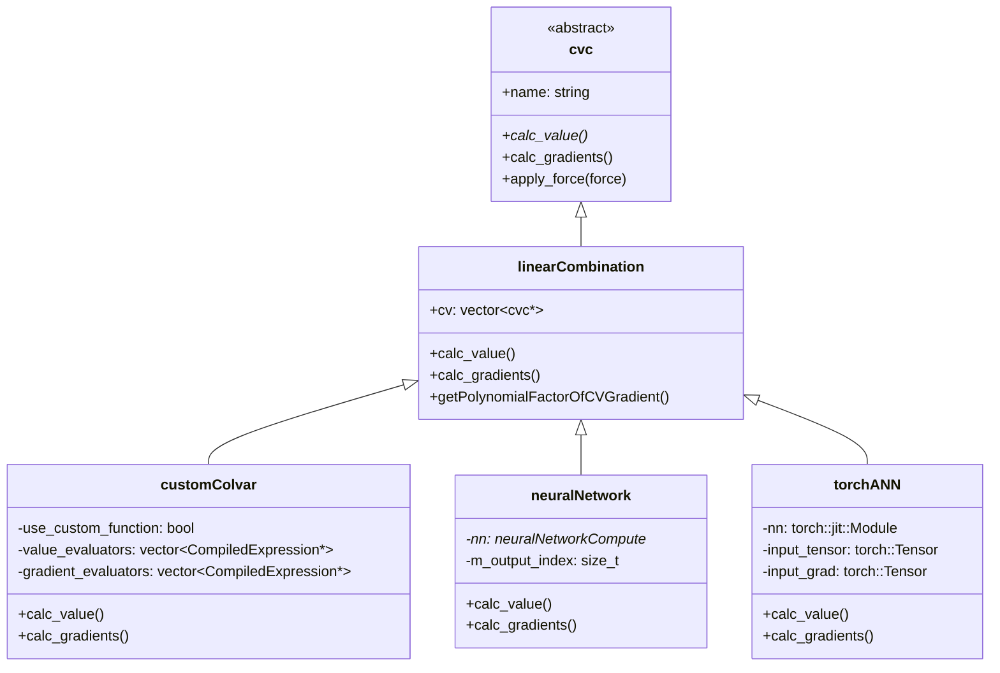

This page explores advanced collective variable components that enable mathematical custom functions and neural network-based transformations of collective variables. These capabilities extend Colvars beyond built-in CV types, allowing researchers to define complex reaction coordinates and machine learning-enhanced collective variables for specialized enhanced sampling applications.

## Architectural Overview

The custom function and neural network implementations follow a hierarchical design pattern rooted in the `linearCombination` base class, which itself inherits from the fundamental `cvc` (collective variable component) interface. This architecture enables modular composition of existing CVs through mathematical operations or neural network transformations.



The inheritance hierarchy demonstrates that both custom functions and neural networks share the core capability of combining multiple sub-CVs through mathematical operations, differing primarily in their transformation logic and external dependencies.

Sources: [colvarcomp.h](src/colvarcomp.h#L69-L303), [colvarcomp_combination.cpp](src/colvarcomp_combination.cpp#L13-L165)

## Custom Functions with Lepton

Custom functions leverage the Lepton expression parser library to enable arbitrary mathematical expressions combining multiple collective variables. This feature allows researchers to define reaction coordinates through mathematical formulas without writing custom C++ code.

The `customColvar` class extends `linearCombination` and parses user-provided expressions through the `customFunction` configuration keyword. During initialization, it compiles both the value expressions and their analytical derivatives using Lepton's parsing and compilation capabilities [src/colvarcomp_combination.cpp#L172-L261](src/colvarcomp_combination.cpp#L172-L261). The implementation maintains separate evaluators for function values and gradients, ensuring that force calculations remain analytically correct through automatic differentiation.

### Expression Parsing and Variable Binding

Variable binding occurs dynamically during initialization, where each sub-CV component is assigned a named reference. The naming convention follows the pattern `{cv_name}` for scalar CVs and `{cv_name}{index}` for vector-valued CVs, enabling unambiguous referencing within expressions [src/colvarcomp_combination.cpp#L213-L224](src/colvarcomp_combination.cpp#L213-L224). The system validates expression completeness by checking that all referenced variables correspond to defined sub-CVs, issuing warnings for unused variables and returning errors for undefined references.

> [!TIP]
> When using custom functions with polynomial combinations, the system automatically applies coefficients and exponents from sub-CV `sup_coeff` and `sup_np` parameters before evaluating the expression. This enables seamless integration with existing CV parameterization schemes without requiring manual coefficient multiplication in expressions.

### Gradient Computation Strategy

Gradient computation employs a sophisticated multi-level approach: first computing gradients of sub-CVs with respect to atomic coordinates, then combining them through the chain rule using Lepton-compiled derivative expressions [src/colvarcomp_combination.cpp#L303-L343](src/colvarcomp_combination.cpp#L303-L343). For each output component and input variable combination, the system pre-compiles partial derivatives, enabling efficient runtime evaluation without repeated parsing overhead.

### Configuration Requirements

Custom functions require compilation with Lepton library support. The `customFunction` keyword accepts one or more mathematical expressions, with multiple expressions generating vector-valued outputs. Polynomial transformations can be applied through the standard `sup_coeff` and `sup_np` parameters on individual sub-CVs.

Sources: [colvarcomp_combination.cpp](src/colvarcomp_combination.cpp#L172-L261), [colvarcomp_combination.cpp](src/colvarcomp_combination.cpp#L272-L343)

## Native Neural Network Implementation

The native `neuralNetwork` CVC implements feedforward neural networks using a custom lightweight computation engine. This implementation loads pre-trained network weights and biases from external files, supporting custom activation functions through the Lepton library when available.

### Network Architecture and Layer Definition

Network architecture is defined through sequential layer specifications, with each layer requiring three configuration components: weight matrices (`layer{N}_WeightsFile`), bias vectors (`layer{N}_BiasesFile`), and activation functions (`layer{N}_activation` or `layer{N}_custom_activation`) [src/colvarcomp_neuralnetwork.cpp#L26-L103](src/colvarcomp_neuralnetwork.cpp#L26-L103). The system validates consistency across layer definitions, ensuring matching counts for weights, biases, and activation specifications before network construction.

Built-in activation functions include standard nonlinearities such as sigmoid, tanh, and ReLU. When compiled with Lepton support, custom activation functions can be specified as mathematical expressions, enabling experimentation with novel activation functions without modifying source code.

### Computation Flow and Gradient Propagation

The computational pipeline follows a forward pass followed by automatic gradient computation. During value calculation, the system transforms input CV values through the network's layers, applying polynomial scaling from sub-CV coefficients and exponents before the first layer [src/colvarcomp_neuralnetwork.cpp#L166-L176](src/colvarcomp_neuralnetwork.cpp#L166-L176). The `output_component` parameter selects which network output dimension serves as the collective variable value, enabling multi-output networks.

Gradient propagation leverages reverse-mode automatic differentiation, with the `neuralNetworkCompute` class storing intermediate activations during forward passes for efficient backpropagation [src/colvarcomp_neuralnetwork.cpp#L178-L191](src/colvarcomp_neuralnetwork.cpp#L178-L191). The chain rule combines network gradients with respect to inputs with atomic gradients of input CVs, ensuring forces propagate correctly through the nonlinear transformation.

### Multi-dimensional Output Handling

Networks producing multiple outputs can be accessed through the `output_component` parameter (zero-indexed), allowing construction of multiple collective variables from a single network definition. This capability is particularly useful for constructing low-dimensional projections of high-dimensional conformational spaces while maintaining physical interpretability through force decomposition.

Sources: [colvarcomp_neuralnetwork.cpp](src/colvarcomp_neuralnetwork.cpp#L26-L147), [colvarcomp_neuralnetwork.cpp](src/colvarcomp_neuralnetwork.cpp#L166-L191)

## PyTorch Integration with torchANN

The `torchANN` component provides integration with the PyTorch deep learning framework through libtorch, enabling deployment of complex neural network architectures trained in modern ML frameworks directly within Colvars simulations.

### Model Loading and Tensor Management

Models are loaded from TorchScript serialized files using `torch::jit::load()`, supporting models exported from PyTorch through the tracing or scripting interfaces [src/colvarcomp_torchann.cpp#L30-L116](src/colvarcomp_torchann.cpp#L30-L116). The initialization process validates model compatibility by performing a forward pass with zero-valued inputs, catching dimensionality mismatches and runtime errors before simulation begins.

Tensor dtype configuration offers flexibility between single-precision (`Float32`) and double-precision (`Float64`) computation through the `doubleInputTensor` parameter. The system automatically configures tensor shapes based on concatenated input CV dimensions, with multi-dimensional CVs expanding into sequential tensor positions [src/colvarcomp_torchann.cpp#L54-L101](src/colvarcomp_torchann.cpp#L54-L101).

### Automatic Differentiation Integration

Unlike the native implementation, `torchANN` leverages PyTorch's built-in automatic differentiation engine through `torch::autograd::grad()`. During value computation, input tensors are constructed with `requires_grad=true` to enable gradient tracking [src/colvarcomp_torchann.cpp#L119-L165](src/colvarcomp_torchann.cpp#L119-L165). The forward pass computes the output value, and reverse-mode autodifferentiation computes gradients with respect to all inputs in a single operation.

This approach provides exact analytical gradients for arbitrary network architectures, including complex structures like residual connections, attention mechanisms, and custom layer types that would be difficult to implement manually.

### Computational Efficiency Considerations

The PyTorch integration involves additional overhead compared to the native implementation due to tensor allocations and autodifferentiation bookkeeping. For production simulations with simple feedforward networks, the native implementation may offer better performance. However, the flexibility to use state-of-the-art architectures justifies the overhead for research requiring advanced network types.

> [!TIP]
> GPU support is available in the source code but currently commented out due to cross-platform compatibility considerations. Enabling GPU acceleration requires ensuring that all tensor operations remain on the same device and handling potential synchronization points between CPU-based MD engines and GPU-based neural network computations.

Sources: [colvarcomp_torchann.cpp](src/colvarcomp_torchann.cpp#L30-L165), [colvarcomp_torchann.cpp](src/colvarcomp_torchann.cpp#L167-L211)

## Implementation Comparison

| Feature | customColvar | neuralNetwork | torchANN |
|---------|--------------|---------------|----------|
| **Dependency** | Lepton library | None (optional Lepton) | libtorch |
| **Use Case** | Mathematical expressions | Simple feedforward networks | Complex PyTorch models |
| **Activation Functions** | N/A | Built-in + custom (Lepton) | Full PyTorch ecosystem |
| **Gradient Computation** | Analytical via Lepton | Backpropagation in C++ | PyTorch autograd |
| **Performance** | High | High | Moderate (tensor overhead) |
| **Model Format** | Expressions in config | Weight/bias text files | TorchScript serialized |
| **Compilation Flag** | `LEPTON` | None required | `COLVARS_TORCH` |

## Practical Configuration Examples

### Custom Function for Reaction Coordinate

```colvar
colvar {
  name rxn_coord
  customColvar {
    distance {
      group1 { atomNumbers 1 2 }
      group2 { atomNumbers 10 11 }
    }
    angle {
      group1 { atomNumbers 1 }
      group2 { atomNumbers 5 }
      group3 { atomNumbers 10 }
    }
    customFunction "0.6 * distance + 0.4 * cos(angle)"
  }
}
```

This example constructs a linear combination of a distance and angle CV with custom weighting, demonstrating how mathematical functions can encode domain knowledge about reaction mechanisms.

Sources: [colvarcomp_combination.cpp](src/colvarcomp_combination.cpp#L172-L261)

### Native Neural Network CV

```colvar
colvar {
  name nn_projection
  neuralNetwork {
    cv1 {
      distance { 
        group1 { atomNumbers 1 2 3 }
        group2 { atomNumbers 50 51 52 }
      }
    }
    cv2 {
      rmsd {
        atoms { atomNumbers 1 2 3 4 5 }
        refPositionsFile reference.pdb
      }
    }
    output_component 0
    layer1_WeightsFile layer1_weights.dat
    layer1_BiasesFile layer1_biases.dat
    layer1_activation "tanh"
    layer2_WeightsFile layer2_weights.dat
    layer2_BiasesFile layer2_biases.dat
    layer2_activation "sigmoid"
  }
}
```

This configuration projects two CVs (distance and RMSD) through a two-layer neural network, with the first output dimension serving as the collective variable. Weight and bias files contain space-separated numeric values representing trained network parameters.

Sources: [colvarcomp_neuralnetwork.cpp](src/colvarcomp_neuralnetwork.cpp#L26-L147)

### PyTorch Model Integration

```colvar
colvar {
  name torch_cv
  torchANN {
    cv1 {
      distanceZ {
        main { atomNumbers 1 2 3 }
        ref1 { atomNumbers 100 }
      }
    }
    cv2 {
      orientation {
        atoms { atomNumbers 10 11 12 }
        refPositionsFile ref_coords.pdb
      }
    }
    modelFile pretrained_model.pt
    output_component 0
    doubleInputTensor on
  }
}
```

This example loads a pre-trained PyTorch model (exported via `torch.jit.save()`) and applies it to a distance and orientation CV. The model receives concatenated CV values as input and produces a scalar output for biased sampling.

Sources: [colvarcomp_torchann.cpp](src/colvarcomp_torchann.cpp#L30-L116)

## Force Application Mechanics

The force application mechanism follows a consistent pattern across all three implementations, leveraging the explicit gradient capability of sub-CVs when available. The key insight is that forces must propagate through the mathematical transformation while respecting the chain rule.

### Explicit Gradient Pathway

When sub-CVs provide explicit atomic gradients (the `f_cvc_explicit_gradient` feature), force application bypasses intermediate calculations and directly multiplies stored gradients by the transformation factor [src/colvarcomp_combination.cpp#L124-L134](src/colvarcomp_combination.cpp#L124-L134). This optimization eliminates redundant gradient calculations and improves numerical accuracy.

For neural network implementations, the transformation factor combines two components: the polynomial scaling factor from sub-CV coefficients/exponents and the network's partial derivative with respect to the input [src/colvarcomp_neuralnetwork.cpp#L178-L191](src/colvarcomp_neuralnetwork.cpp#L178-L191). This dual multiplication ensures that both the mathematical transformation and the neural network's sensitivity are accounted for in force propagation.

### Implicit Gradient Fallback

When explicit gradients are unavailable, the system computes CV-level forces by multiplying the total bias force by the transformation factors and applies these to sub-CVs through their `apply_force()` methods [src/colvarcomp_combination.cpp](src/colvarcomp_combination.cpp#L124-L141). This fallback approach enables compatibility with older CV implementations that may not support explicit gradient computation.

Sources: [colvarcomp_combination.cpp](src/colvarcomp_combination.cpp#L124-L141), [colvarcomp_neuralnetwork.cpp](src/colvarcomp_neuralnetwork.cpp#L193-L207)

## Compilation Requirements

### Lepton Library

Custom functions require the Lepton mathematical expression parser library. Compilation should enable the `LEPTON` preprocessor flag and link against the Lepton library. The library provides parsing, compilation, and evaluation of mathematical expressions with support for automatic differentiation.

### libtorch Integration

PyTorch integration requires `COLVARS_TORCH` compilation flag and linking against libtorch (the C++ distribution of PyTorch). Key considerations include matching Python and C++ PyTorch versions for model compatibility, ensuring proper C++ standard version (C++14 or later), and handling static/dynamic linking requirements for TorchScript.

> [!TIP]
> Both Lepton and libtorch are optional dependencies. When these libraries are unavailable, the corresponding CV types will return descriptive error messages during initialization rather than causing compilation failures, enabling graceful degradation in production environments.

Sources: [colvarcomp_combination.cpp](src/colvarcomp_combination.cpp#L252-L260), [colvarcomp_torchann.cpp](src/colvarcomp_torchann.cpp#L223-L230)

## Advanced Usage Patterns

### Polynomial Combinations with Custom Functions

The interaction between sub-CV polynomial parameters and custom function expressions provides powerful compositional capabilities. When a scalar CV has `sup_np > 1`, the system automatically raises the CV value to the specified power before passing it to the custom function, enabling compact representation of polynomial transformations [src/colvarcomp_combination.cpp#L92-L108](src/colvarcomp_combination.cpp#L92-L108).

### Multi-output Neural Networks

Both neural network implementations support extracting specific output dimensions through the `output_component` parameter. This enables constructing multiple correlated collective variables from a single network evaluation, which is useful for sampling low-dimensional manifolds while preserving correlations between collective variables [src/colvarcomp_neuralnetwork.cpp#L26-L30](src/colvarcomp_neuralnetwork.cpp#L26-L30).

### Custom Activation Functions

When compiled with Lepton support, the native neural network implementation allows specifying activation functions as arbitrary mathematical expressions. This enables experimentation with novel nonlinearities without C++ modifications [src/colvarcomp_neuralnetwork.cpp#L81-L103](src/colvarcomp_neuralnetwork.cpp#L81-L103). Example activation functions could include Gaussian radial basis functions, Fourier series, or domain-specific nonlinearities derived from physical principles.

## Next Steps

For enhanced sampling applications using custom functions and neural network variables, consider exploring:

- **Biasing Methods**: [Harmonic Restraints and Walls](11-harmonic-restraints-and-walls) for simple potential applications
- **Advanced Sampling**: [Adaptive Biasing Force (ABF)](12-adaptive-biasing-force-abf) for free energy surface reconstruction along neural network-defined CVs
- **Grid Integration**: [Grid Configuration and Parameters](16-grid-configuration-and-parameters) for histogram-based analysis of neural network projections
- **State Management**: [State Management and Restart Files](23-state-management-and-restart-files) for handling neural network parameters in simulation restarts

Understanding force propagation through these complex transformations requires familiarity with [Core Architecture and Design Patterns](5-core-architecture-and-design-patterns), particularly the dependency management system that ensures correct evaluation order when using nested CVs.