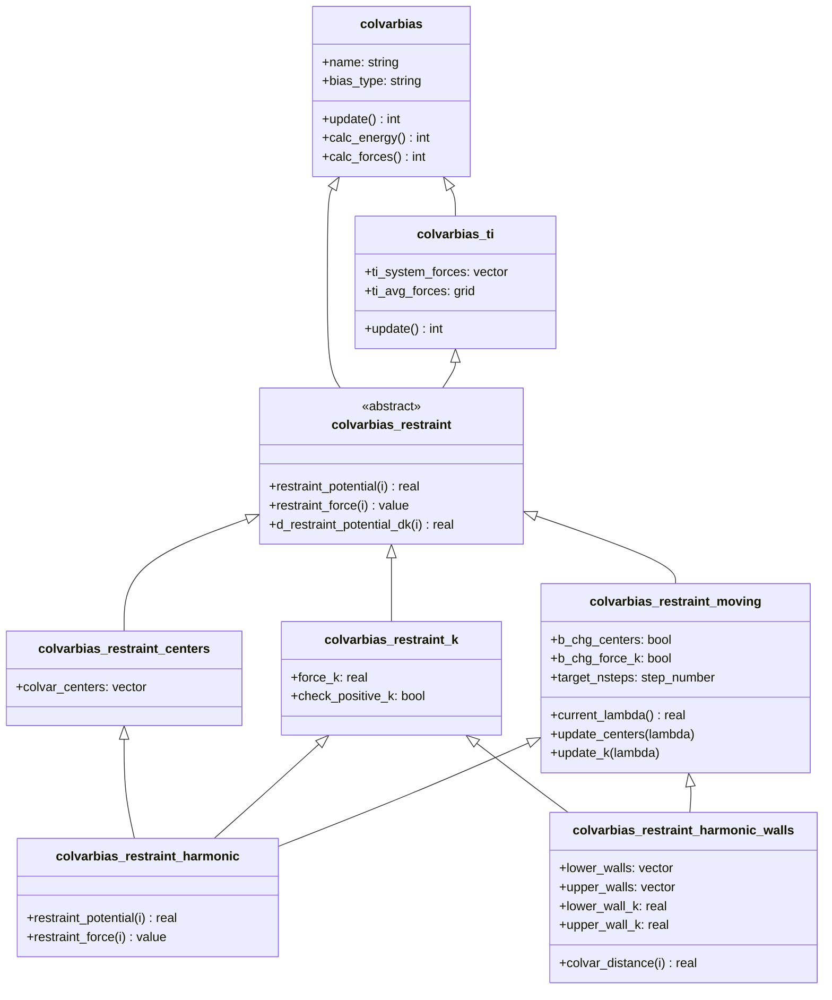
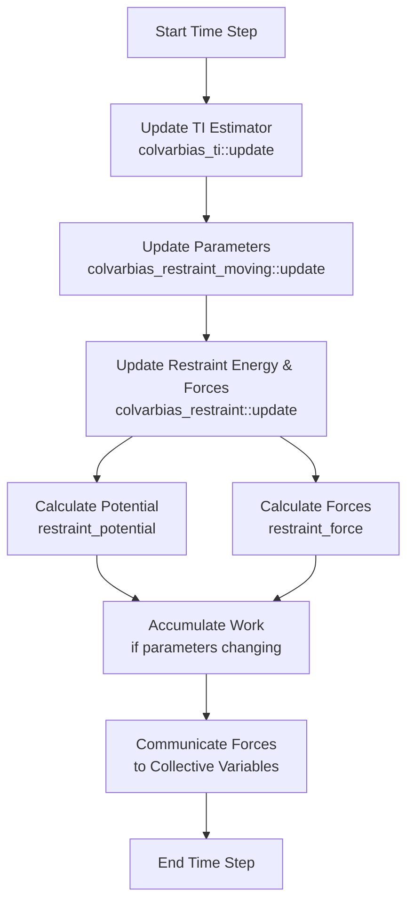
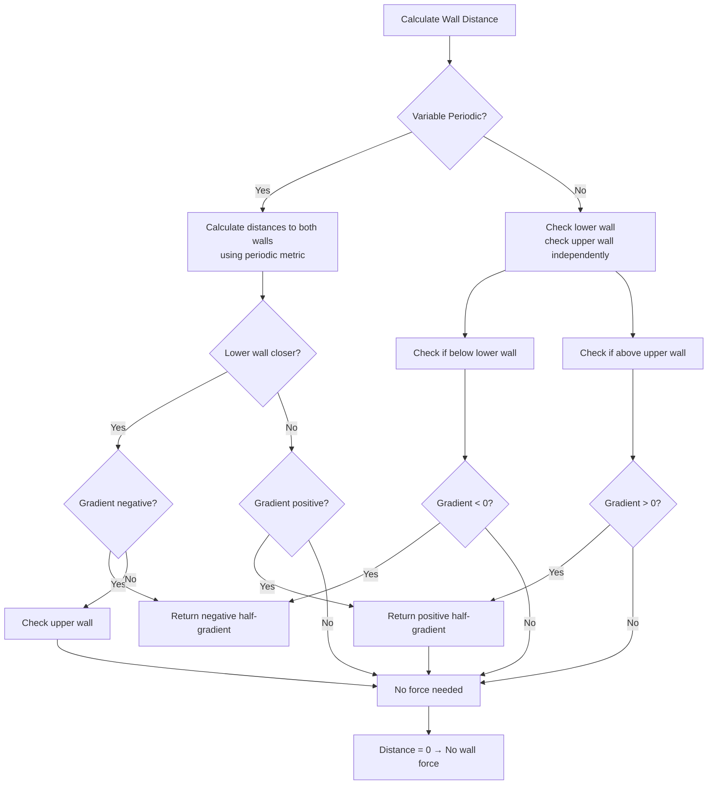

This page explores the architecture and implementation of harmonic restraint potentials in Colvars, focusing on how these forces are applied to collective variables to guide molecular dynamics simulations. Harmonic restraints provide the fundamental mechanism for biasing simulation trajectories toward target configurations, while harmonic walls establish boundaries that confine collective variables within specified ranges.

## Architectural Foundation

The harmonic restraint system employs a sophisticated multiple inheritance hierarchy that separates concerns between static and dynamic restraint properties. The design enables modularity where components dealing with centers, force constants, and temporal evolution can be composed independently.

Sources: [colvarbias_restraint.h](src/colvarbias_restraint.h#L23-L61)

The inheritance architecture organizes restraint functionality through several key abstractions:



This architectural design enables the composition of complex restraint behaviors from simple building blocks. The `colvarbias_restraint` base class defines the pure virtual interface for computing potentials and forces, while intermediate classes manage specific aspects like center positions, force constants, and time-dependent behavior.

Sources: [colvarbias_restraint.h](src/colvarbias_restraint.h#L65-L98)

## Harmonic Restraint Implementation

The harmonic restraint is the most fundamental biasing potential in Colvars, implementing a quadratic potential energy surface that restrains collective variables around specified centers. The mathematical formulation accounts for the dimensionality and characteristic scales of different collective variable types through the width parameter.

### Mathematical Formulation

The harmonic potential energy for the i-th collective variable is computed as:

```
U_i = 0.5 × k / (width_i × width_i) × distance²(x_i, center_i)
```

Where `k` is the force constant, `width_i` is the characteristic scale of the collective variable, and `distance²` represents the squared distance between the current value and the center in the collective variable's metric space.

Sources: [colvarbias_restraint.cpp](src/colvarbias_restraint.cpp#L748-L756)

The corresponding force is the negative gradient of this potential:

```
F_i = -0.5 × k / (width_i × width_i) × ∇distance²(x_i, center_i)
```

The implementation leverages the collective variable's built-in distance and gradient functions to handle different coordinate systems (Cartesian distances, angular differences, RMSD, etc.) uniformly through the same interface.

Sources: [colvarbias_restraint.cpp](src/colvarbias_restraint.cpp#L755-L761)

### Width Scaling and Dimensionality

A critical design aspect is the automatic rescaling of force constants based on collective variable widths. This ensures consistent behavior across different variable types that may have vastly different natural scales. During initialization, the system logs the rescaled force constant for each variable:

Sources: [colvarbias_restraint.cpp](src/colvarbias_restraint.cpp#L706-L727)

> [!TIP]
> The width-based rescaling is essential for creating dimensionally consistent restraints. For a distance variable with width=1.0 Å, a force constant of 10 kcal/mol becomes 10 kcal/mol/Ų, while for an orientation variable with width=0.1 (unitless), the same force constant becomes 1000 kcal/mol in the quaternion metric space.

### Update Cycle and Force Application

The harmonic restraint update cycle follows a carefully orchestrated sequence that integrates with the broader Colvars framework:



This pipeline ensures that moving restraints properly account for accumulated work, which is essential for free energy calculations using thermodynamic integration or umbrella sampling methods.

Sources: [colvarbias_restraint.cpp](src/colvarbias_restraint.cpp#L727-L747)

## Harmonic Walls Implementation

Harmonic walls provide boundary restraints that activate only when collective variables approach specified limits, creating a one-sided harmonic potential that confines sampling within a defined region. Unlike harmonic restraints that pull variables toward centers, walls exert forces only when the variable crosses the boundary threshold.

### Wall Configuration and Types

Harmonic walls support both lower and upper boundaries, which can be configured independently or together:

- **Lower walls**: Activate when the collective variable falls below the specified threshold, pushing it upward
- **Upper walls**: Activate when the collective variable exceeds the specified threshold, pushing it downward
- **Dual walls**: Both boundaries can be defined simultaneously, creating a confined sampling region

For periodic collective variables (such as angles), both walls must be specified to properly handle periodic boundary conditions.

Sources: [colvarbias_restraint.cpp](src/colvarbias_restraint.cpp#L852-L950)

### Distance Calculation with Periodic Boundaries

The wall implementation includes sophisticated logic for calculating distances to boundaries, particularly important for periodic collective variables. The `colvar_distance` function determines which wall (if any) should exert a force based on the current variable value:



This logic ensures that periodic variables experience forces from the closer wall in periodic distance space, avoiding discontinuities at boundary wrapping points.

Sources: [colvarbias_restraint.cpp](src/colvarbias_restraint.cpp#L1196-L1230)

### Wall Potential and Force Formulation

When a wall is activated, the harmonic potential takes the form:

```
U_wall = 0.5 × k × scale / (width × width) × distance²
```

Where `scale` is `lower_wall_k` or `upper_wall_k` depending on which wall is being approached, and `distance` is the signed distance from the variable to the wall boundary.

Sources: [colvarbias_restraint.cpp](src/colvarbias_restraint.cpp#L1232-L1242)

The corresponding force is always directed back toward the allowed region:

```
F_wall = -k × scale / (width × width) × distance
```

The signed distance calculation (positive for upper wall violations, negative for lower wall violations) ensures the force direction correctly opposes the violation regardless of which wall is active.

Sources: [colvarbias_restraint.cpp](src/colvarbias_restraint.cpp#L1241-L1250)

## Configuration Parameters and Usage

### Harmonic Restraint Configuration

The following table summarizes the key configuration parameters for harmonic restraints:

| Parameter | Type | Default | Description |
|-----------|------|---------|-------------|
| `colvars` | list | required | Collective variables to restrain |
| `centers` | list | required | Target center values for each variable |
| `forceConstant` | real | required | Base force constant (kcal/mol/width²) |
| `targetCenters` | list | optional | Final center values for moving restraints |
| `targetForceConstant` | real | optional | Final force constant for moving restraints |
| `targetNsteps` | integer | optional | Steps over which to change parameters |
| `outputAccumulatedWork` | boolean | false | Write accumulated work to trajectory |

> [!TIP]
> When using moving restraints with `targetNsteps`, the system automatically interpolates between initial and target parameters, computing accumulated work for free energy analysis. This is particularly useful for umbrella sampling and thermodynamic integration calculations.

### Harmonic Walls Configuration

Harmonic walls configuration includes additional parameters specific to boundary handling:

| Parameter | Type | Default | Description |
|-----------|------|---------|-------------|
| `colvars` | list | required | Collective variables to bound |
| `lowerWalls` | list | optional | Lower boundary values |
| `upperWalls` | list | optional | Upper boundary values |
| `forceConstant` | real | required | Base force constant |
| `lowerWallConstant` | real | forceConstant | Force constant for lower walls |
| `upperWallConstant` | real | forceConstant | Force constant for upper walls |
| `targetLowerWalls` | list | optional | Final lower wall positions |
| `targetUpperWalls` | list | optional | Final upper wall positions |

For periodic variables, both `lowerWalls` and `upperWalls` must be specified to properly handle periodic wrapping.

Sources: [colvarbias_restraint.cpp](src/colvarbias_restraint.cpp#L852-L950)

## Practical Example

The following example demonstrates a harmonic restraint applied to three different collective variables simultaneously, as shown in the geometric restraints example configuration:

Sources: [04_geometric_restraints.colvars.in](examples/04_geometric_restraints.colvars.in#L1-L70)

```
harmonic {                # Define a moving harmonic restraint
  colvars d RMSD Orient   # acting on 3 colvars
  
  centers 0 0 (1, 0, 0, 0)  # centered around zero displacement, 
                            # zero RMSD, and no rotation
  forceConstant 1.          # unit is kcal/mol/[width]^2
  # where the width parameter is adapted to the dimension of each colvar
}
```

This configuration restrains a molecular system to maintain zero displacement (`d`), zero root-mean-square deviation (`RMSD`), and the reference orientation (`Orient`). Each collective variable uses its own width parameter (defined in the colvar blocks) to scale the force constant appropriately.

Sources: [04_geometric_restraints.colvars.in](examples/04_geometric_restraints.colvars.in#L45-L52)

## Thermodynamic Integration Support

Both harmonic restraints and walls support thermodynamic integration for free energy calculations. The implementation tracks the derivative of the potential energy with respect to the force constant:

```
∂U/∂k = 0.5 / (width × width) × distance²
```

This derivative is essential for computing free energy differences when gradually turning restraints on or off, or when varying force constants between initial and target values in alchemical transformations.

Sources: [colvarbias_restraint.cpp](src/colvarbias_restraint.cpp#L762-L768)

The system accumulates these derivatives over the simulation trajectory, enabling post-processing to compute free energy differences via the thermodynamic integration formula:

```
ΔA = ∫ ⟨∂U/∂λ⟩_λ dλ
```

Where λ represents the coupling parameter (force constant, center position, or wall position) being varied.

## Integration with Broader Framework

Harmonic restraints and walls integrate seamlessly with other Colvars capabilities:

- **Multiple Time Stepping**: Restraints can be updated less frequently than the molecular dynamics timestep for computational efficiency
- **Replica Exchange**: Restraint parameters can be communicated between replicas for replica exchange simulations
- **Extended Lagrangian**: Restraints can be applied to extended Lagrangian variables for enhanced sampling
- **Grid-based Analysis**: Restraint forces can be scaled by spatial grids for position-dependent biasing

The modular architecture allows these features to be combined in powerful ways, enabling sophisticated sampling protocols that build upon the fundamental harmonic restraint mechanism.

## Next Steps

For enhanced sampling beyond simple harmonic restraints, explore:
- **[Adaptive Biasing Force (ABF)](12-adaptive-biasing-force-abf)** for computing free energy surfaces adaptively
- **[Metadynamics and Well-Tempered Variants](13-metadynamics-and-well-tempered-variants)** for exploring rare events
- **[Umbrella Integration and Thermodynamic Integration](14-umbrella-integration-and-thermodynamic-integration)** for free energy calculations using restraint potentials

For understanding the collective variables that restraints operate on, review:
- **[Distance-Based Variables](6-distance-based-variables)** for spatial restraints
- **[Angular and Dihedral Variables](7-angular-and-dihedral-variables)** for orientational restraints
- **[Protein-Specific Variables (RMSD, Gyration)](9-protein-specific-variables-rmsd-gyration)** for conformational restraints