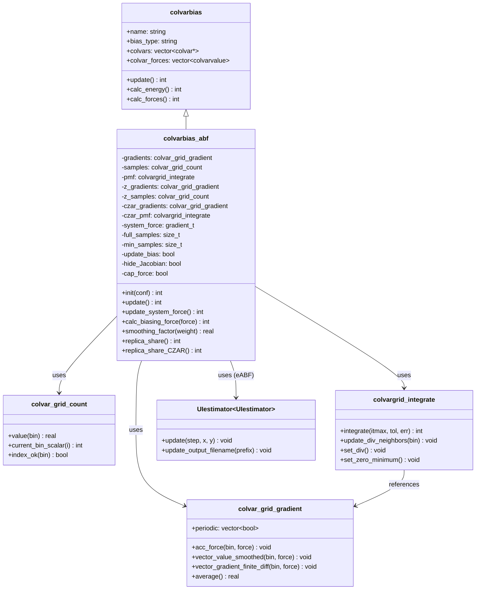
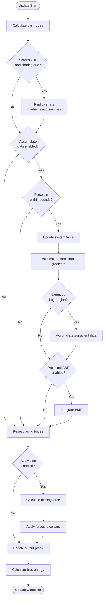

The Adaptive Biasing Force method implements an enhanced sampling technique that adaptively estimates and applies forces to flatten free energy landscapes along collective variable dimensions. ABF works by accumulating instantaneous forces from the system, averaging them across visits to each bin in the collective variable space, and applying the negated average as a biasing force that counteracts the underlying free energy gradient.

## Core Architecture

The ABF implementation centers on the `colvarbias_abf` class which extends the base `colvarbias` class. The architecture separates force estimation, bias application, and data management into distinct operational phases. ABF maintains multi-dimensional grids to track free energy gradients, sample counts, and potential of mean force (PMF) estimates. The system supports standard ABF for direct collective variables, extended ABF (eABF) for extended Lagrangian dynamics, and multiple-walker ABF for parallel simulations where multiple replicas share accumulated data.

The per-timestep `update()` method executes in two sequential phases. Phase I updates the free energy gradient estimate by accumulating system forces and sample counts. Phase II calculates and applies the biasing force to the collective variables. This separation enables data accumulation and bias application to be controlled independently through configuration options.

Sources: [src/colvarbias_abf.h](src/colvarbias_abf.h#L29-L41), [src/colvarbias_abf.cpp](src/colvarbias_abf.cpp#L320-L449)

## Grid-Based Data Management

ABF organizes accumulated sampling data across multiple grid types. The primary grid `gradients` stores averaged free energy gradients as `colvar_grid_gradient` objects, while `samples` tracks visitation counts as `colvar_grid_count` objects. These grids share dimensional structure defined by the collective variables. When free energy integration is enabled, the `pmf` grid maintains the potential of mean force computed via conjugate gradient methods that solve the linear system relating gradients to potentials. The integration process operates through the `colvargrid_integrate` class which applies divergence constraints and boundary conditions during PMF reconstruction.

Extended ABF introduces additional grid sets for handling the relationship between actual collective variable values and extended coordinates. The `z_gradients` and `z_samples` grids accumulate forces and counts at actual coordinate values when extended Lagrangian dynamics are active. The CZAR estimator combines these with the standard gradient data to produce corrected free energy estimates through `czar_gradients` and `czar_pmf` grids. Multiple-walker ABF duplicates this grid structure to maintain local replica data separate from globally shared accumulations.

Sources: [src/colvarbias_abf.h](src/colvarbias_abf.h#L100-L113), [src/colvarbias_abf.cpp](src/colvarbias_abf.cpp#L184-L224)

## Configuration Parameters

ABF behavior is controlled through configuration parameters that tune sampling requirements, force application, and output behavior. The sampling thresholds `fullSamples` and `minSamples` determine when accumulated statistics are considered sufficient to apply full or partial biasing forces. These implement the smoothing factor that gradually introduces biasing forces as data accumulates, preventing early application of poorly-estimated forces. The `maxForce` parameter caps the magnitude of applied forces to prevent instabilities during early sampling or high-gradient regions.

> [!TIP]
> The sample smoothing mechanism prevents artifacts from applying forces derived from insufficient sampling. Below `minSamples`, no biasing force is applied. Between `minSamples` and `fullSamples`, forces are linearly scaled. Above `fullSamples`, forces are applied at full strength.

| Parameter | Type | Default | Description |
|-----------|------|---------|-------------|
| `applyBias` | boolean | true | Enable or disable application of biasing forces |
| `fullSamples` | integer | 200 | Samples per bin required for full force application |
| `minSamples` | integer | 100 | Samples per bin required for scaled force application |
| `maxForce` | real vector | none | Maximum force magnitude per collective variable |
| `hideJacobian` | boolean | false | Handle geometric Jacobian forces internally |
| `updateBias` | boolean | true | Continuously update biasing forces during simulation |
| `integrate` | boolean | true (if dim ≤ 3) | Integrate gradients to PMF during simulation |
| `shared` | boolean | false | Enable multiple-walker ABF |
| `sharedFreq` | integer | outputFreq | Frequency for replica data sharing |

Sources: [src/colvarbias_abf.cpp](src/colvarbias_abf.cpp#L46-L84), [src/colvarbias_abf.cpp](src/colvarbias_abf.cpp#L155-L168)

## Bias Update Algorithm

The per-timestep update cycle follows a structured sequence that handles data accumulation, replica communication, and bias application. At each timestep, the current bin indices are calculated for both the sample grid and force grid. The force bin may differ when collective variables provide forces from the previous timestep rather than the current timestep. The algorithm first processes any required replica data sharing for multiple-walker ABF before accumulating new force samples. This ordering ensures that shared data reflects the complete accumulation from all replicas before local updates.

During force accumulation, the system retrieves the total force acting on each collective variable and subtracts any previously applied biasing forces to isolate the unbiased component. This corrected force is accumulated into the gradient grid at the current bin. Simultaneously, the sample count for that bin is incremented. When extended Lagrangian dynamics are active, forces are also accumulated at the actual coordinate values for later use by CZAR estimators. If projected ABF is enabled, the PMF integration runs periodically to update the potential from gradient estimates.

> [!TIP]
> Multiple-walker ABF requires careful timing of replica sharing relative to local data accumulation. The implementation stores the post-sharing grid state and only shares new data accumulated after the previous sharing event, preventing double-counting across communication cycles.

Sources: [src/colvarbias_abf.cpp](src/colvarbias_abf.cpp#L336-L387), [src/colvarbias_abf.cpp](src/colvarbias_abf.cpp#L457-L475)

## Biasing Force Calculation

The biasing force calculation operates differently depending on whether standard ABF or projected ABF mode is active. In standard ABF mode, the force is retrieved directly from the accumulated gradient average at the current bin using the `vector_value_smoothed` method, which applies neighbor-based smoothing when sample counts are low. For one-dimensional periodic coordinates, the force is adjusted to have zero mean to enforce periodicity of the biasing potential. In projected ABF mode, the force is computed as the negative gradient of the integrated PMF using finite differences, which can provide smoother forces in regions with sparse sampling.

The smoothing factor modulates force application based on local sample counts. The `smoothing_factor` function returns a value between 0 and 1 based on how the current sample count compares to `min_samples` and `full_samples` thresholds. Forces are multiplied by this factor before application. Additionally, when `maxForce` is configured, each force component is clipped to the specified maximum magnitude to prevent excessive forces in poorly sampled regions. This capping applies after smoothing to ensure that even well-sampled forces do not exceed safety limits.

Sources: [src/colvarbias_abf.cpp](src/colvarbias_abf.cpp#L492-L526), [src/colvarbias_abf.cpp](src/colvarbias_abf.cpp#L478-L489)

## Extended ABF and CZAR Estimator

Extended ABF extends the standard approach to collective variables simulated with extended Lagrangian dynamics. In this configuration, the collective variable's actual coordinate is coupled to an extended coordinate through a harmonic restraint. The extended coordinate experiences the full biasing force, while the actual coordinate experiences only the harmonic restraint. This decoupling allows the system to more thoroughly sample the free energy landscape along the collective variable dimension, particularly useful when the underlying molecular dynamics are slow to explore barrier regions.

The CZAR estimator provides a post-processing method to recover the free energy profile along the actual coordinate from extended ABF simulations. It operates by combining the accumulated forces at actual coordinate values (stored in `z_gradients`) with the distribution of extended coordinates around each actual coordinate. The estimator uses the relationship between the extended coordinate distribution and the underlying free energy gradient to produce corrected gradients that can be integrated to obtain the true PMF along the actual coordinate. When multiple-walker ABF is combined with eABF, separate CZAR data structures track local replica data and globally accumulated data for output on the master replica.

Sources: [src/colvarbias_abf.cpp](src/colvarbias_abf.cpp#L196-L212), [src/colvarbias_abf.cpp](src/colvarbias_abf.h#L62-L70)

## Umbrella Integration Estimator

The Umbrella Integration estimator provides an alternative method for extracting free energy profiles from extended ABF simulations. Unlike CZAR, which operates on accumulated force averages, UI estimator analyzes the probability distribution of extended coordinates around each actual coordinate to compute free energy gradients. The estimator maintains a distribution matrix `n_matrix` that stores counts of extended coordinate values conditioned on actual coordinate values. This matrix is updated at each timestep by incrementing the count corresponding to the current actual and extended coordinate values.

The UI estimator implementation requires knowledge of the harmonic restraint force constants coupling extended coordinates to actual coordinates, the temperature, and the grid boundaries and widths. It outputs estimated free energy gradients and integrated PMF at specified intervals. Unlike CZAR, the UI estimator is not compatible with multiple-walker ABF due to the complexity of combining distribution matrices across replicas. The estimator is initialized through the `UIestimator` namespace which handles the mathematical operations for computing free energy from the observed distributions.

Sources: [src/colvarbias_abf.cpp](src/colvarbias_abf.cpp#L272-L305), [src/colvar_UIestimator.h](src/colvar_UIestimator.h#L26-L100)

## PMF Integration and Output

Free energy integration converts accumulated gradient estimates into a potential of mean force through solving a linear system. The `colvargrid_integrate` class implements this functionality using conjugate gradient methods that enforce divergence constraints and boundary conditions. The integration process constructs a sparse matrix representing the relationship between gradient values and potential differences, then solves for the potential that minimizes residuals while satisfying consistency constraints. For periodic boundaries, the potential is constrained to be periodic across the boundary. For non-periodic boundaries, Neumann boundary conditions specify that the gradient at the boundary is consistent with the interior gradient.

The integration can occur on-the-fly during simulation when `integrate` is enabled and dimensions are three or fewer. The `pabf_freq` parameter controls how often the PMF is re-integrated during projected ABF simulations. Convergence is monitored through tolerance parameters `integrateTol` and `pabf_integrateTol`, with iteration limits `integrateMaxIterations` and `pABFintegrateMaxIterations` preventing infinite loops. After integration, the potential is shifted so its minimum value is zero for convenient interpretation and comparison with other methods.

Output files include gradient data, sample counts, and PMF estimates. Multiple-walker ABF outputs both local replica data and global combined data. The history files provide time-resolved tracking of PMF evolution when `historyFreq` is configured, enabling analysis of convergence behavior over the course of the simulation.

Sources: [src/colvargrid_integrate.h](src/colvargrid_integrate.h#L24-L42), [src/colvarbias_abf.cpp](src/colvarbias_abf.cpp#L214-L235)

## Implementation Notes

The ABF implementation enforces several important constraints for correct operation. Collective variables must be of scalar type, as multidimensional variables like orientation quaternions are not supported. The system should include a thermostat, as ABF is not designed to run at zero Kelvin or without thermal fluctuations. Multiple-time-stepping with `timeStepFactor` greater than 1 requires that all collective variables provide total force estimates for the current timestep, otherwise synchronization errors can occur.

The implementation carefully handles force subtraction when retrieving system forces. If collective variables provide forces from the current timestep, they do not contain previous ABF biases and can be used directly. Otherwise, the previous timestep's biasing force must be subtracted from the total force to obtain the unbiased component for accumulation. This distinction is handled automatically through the `update_system_force` method which checks the `f_cv_total_force_current_step` and `f_cv_subtract_applied_force` flags on each collective variable.

> [!TIP]
> When configuring ABF for high-dimensional collective variable spaces (greater than 3 dimensions), automatic PMF integration is disabled to prevent excessive computational cost. Gradient data is still accumulated and output, but PMF computation must be performed separately using the output gradient files.

Sources: [src/colvarbias_abf.cpp](src/colvarbias_abf.cpp#L40-L42), [src/colvarbias_abf.cpp](src/colvarbias_abf.cpp#L111-L139)

## Recommended Reading Path

For a complete understanding of ABF and its place within the Colvars framework, consult these related documentation pages in sequence: [Harmonic Restraints and Walls](11-harmonic-restraints-and-walls) provides context on force application and restraint mechanisms, while [Extended Lagrangian Dynamics](22-extended-lagrangian-dynamics) explains the extended variable formalism used by eABF. The [Grid Configuration and Parameters](16-grid-configuration-and-parameters) page details grid construction and management used throughout ABF, and [Free Energy Surface Integration](17-free-energy-surface-integration) provides deeper mathematical background on PMF reconstruction. For parallel implementation details, see [Multiple Replica Communication](25-multiple-replica-communication) and for state management, refer to [State Management and Restart Files](23-state-management-and-restart-files).