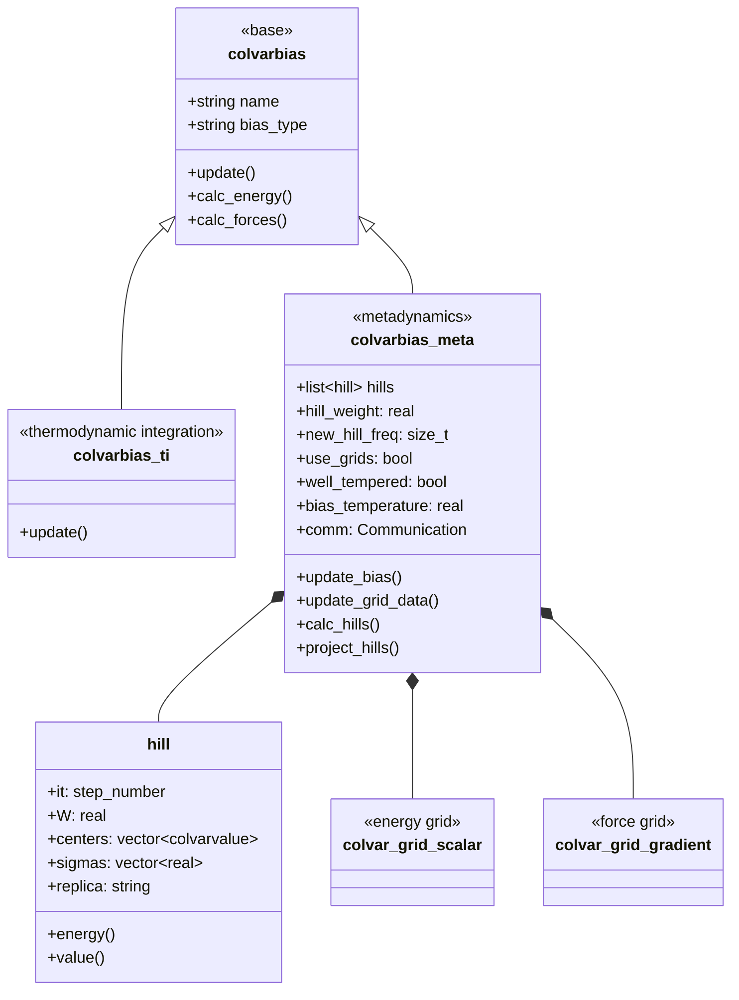
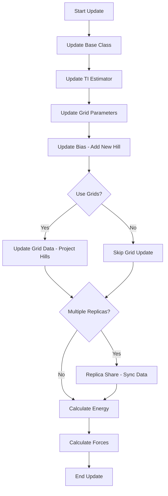
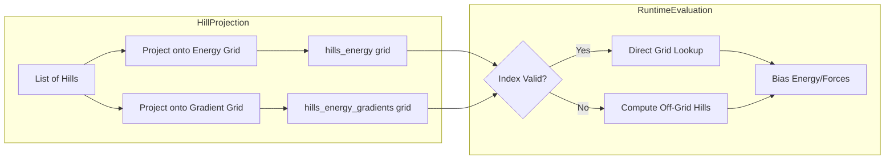
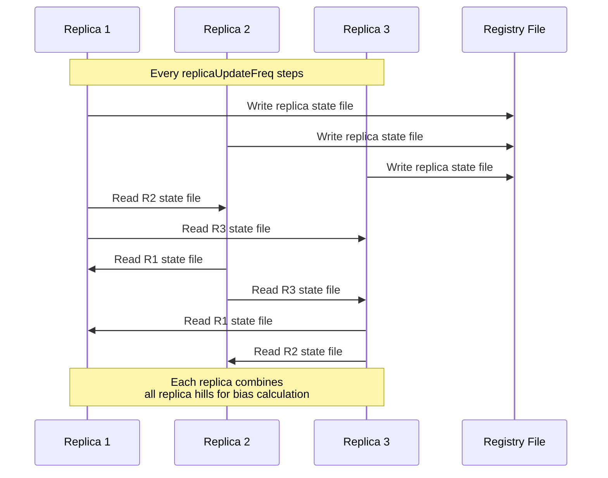

This documentation covers the implementation of metadynamics biasing methods in Colvars, including standard metadynamics, well-tempered metadynamics, ensemble-biased metadynamics (EBMetaD), and multiple-walker (multiple-replica) variants. These methods enhance sampling of collective variable space by adaptively adding bias potentials that discourage revisiting already-explored regions.

Sources: [colvarbias_meta.h](src/colvarbias_meta.h#L26-L440), [colvarbias_meta.cpp](src/colvarbias_meta.cpp#L49-L180)

## Core Architecture and Design Patterns

The metadynamics implementation extends the base `colvarbias` class through the `colvarbias_meta` class, which inherits from both `colvarbias` and `colvarbias_ti` (thermodynamic integration support). This architecture follows a hierarchical design pattern where biasing methods share common functionality while implementing specialized behavior for specific sampling algorithms.



The system supports both single-replica and multiple-replica communication modes, enabling parallel exploration of collective variable space through the `Communication` enum. The architecture separates concerns between hill management, grid-based computation, and force calculation, allowing flexible optimization strategies.

Sources: [colvarbias_meta.h](src/colvarbias_meta.h#L34-L43), [colvarbias_meta.h](src/colvarbias_meta.h#L92-L128)

## Hill Representation and Gaussian Functions

At the core of metadynamics lies the hill object, which represents individual Gaussian bias potentials added to the collective variable space. Each hill encodes its addition time, height (energy weight), centers in CV space, and half-widths (sigmas).

The hill class implements efficient evaluation of Gaussian functions with early termination for negligible contributions. When computing the Gaussian exponent, hills with values exceeding the cutoff threshold (exponent < -23.0) are skipped to optimize performance.

```cpp
// Hill energy calculation
inline cvm::real energy() {
    return W * sW * hill_value;
}
```

Gaussian computation follows the standard form:

**V(ξ) = W × exp(-½ × Σ[(ξi - ξi,center)² / σi²])**

Where W is the hill weight, ξ represents collective variable values, ξ_center denotes the hill center, and σ represents the half-width parameters. The implementation supports various collective variable types including scalars, 3-vectors, unit vectors, and quaternions, with distance metrics adapted to each type's manifold structure.

Sources: [colvarbias_meta.h](src/colvarbias_meta.h#L304-L358), [colvarbias_meta.cpp](src/colvarbias_meta.cpp#L800-L835)

## Bias Update Cycle

The metadynamics update cycle follows a precise sequence executed at each simulation step:



The update cycle begins with base class updates, followed by grid parameter adjustments if boundary expansion is enabled. At the specified hill frequency (controlled by `newHillFrequency`), a new hill is added at the current collective variable position. When grid-based optimization is enabled, hills are projected onto energy and gradient grids at the `gridsUpdateFrequency` interval.

Sources: [colvarbias_meta.cpp](src/colvarbias_meta.cpp#L424-L560), [colvarbias_meta.cpp](src/colvarbias_meta.cpp#L645-L668)

## Grid-Based Optimization

For improved computational efficiency, metadynamics supports grid-based evaluation of the bias potential. Instead of calculating contributions from all hills analytically, the system projects hills onto discrete grids at regular intervals, enabling O(1) lookup instead of O(N) computation.

The grid optimization strategy employs two grid structures:
- **hills_energy**: A scalar grid storing the cumulative bias potential at each grid point
- **hills_energy_gradients**: A gradient grid storing the negative bias forces at each grid point



When collective variable positions fall within grid boundaries, energy and forces are retrieved via direct grid lookup. Off-grid positions trigger analytical computation of only boundary hills (those within 3×hillWidth of grid edges), stored in the `hills_off_grid` list. New hills added since the last grid projection are always computed analytically.

> [!TIP]
> The grid projection frequency (`gridsUpdateFrequency`) trades off between computational overhead and sampling accuracy. More frequent projections reduce the number of hills requiring analytical computation but increase projection cost.

Sources: [colvarbias_meta.cpp](src/colvarbias_meta.cpp#L905-L990), [colvarbias_meta.cpp](src/colvarbias_meta.cpp#L669-L800)

## Well-Tempered Metadynamics

Well-tempered metadynamics addresses the issue of uncontrolled hill growth in standard metadynamics by modulating hill height based on the accumulated bias potential. This ensures the bias converges to a finite value while still enhancing sampling.

The well-tempered modification follows the scaling law:

**W(t) = W₀ × exp[-V(ξ,t) / (ΔT × k_B)]**

Where W₀ is the base hill weight, V(ξ,t) is the cumulative bias potential at the current CV position, ΔT is the bias temperature, and k_B is Boltzmann's constant. This exponential scaling reduces hill height as the bias grows, preventing divergence.

```cpp
// Well-tempered hill scaling implementation (L580-L595)
if (well_tempered) {
    cvm::real hills_energy_sum_here = 0.0;
    if (use_grids) {
        std::vector<int> curr_bin = hills_energy->get_colvars_index();
        const bool index_ok = hills_energy->index_ok(curr_bin);
        if (index_ok) {
            hills_energy_sum_here = hills_energy->value(curr_bin);
        } else {
            calc_hills(hills_off_grid.begin(), hills_off_grid.end(),
                      hills_energy_sum_here, &colvar_values);
        }
    } else {
        calc_hills(new_hills_begin, hills.end(), hills_energy_sum_here, NULL);
    }
    hills_scale *= cvm::exp(-1.0*hills_energy_sum_here/(bias_temperature*proxy->boltzmann()));
}
```

The bias temperature parameter controls the aggressiveness of scaling. Higher values approach standard metadynamics behavior, while lower values produce stronger modulation and faster convergence.

Sources: [colvarbias_meta.cpp](src/colvarbias_meta.cpp#L257-L273), [colvarbias_meta.cpp](src/colvarbias_meta.cpp#L580-L595)

## Ensemble-Biased Metadynamics (EBMetaD)

Ensemble-biased metadynamics extends standard metadynamics by incorporating a target distribution over collective variables. This method is particularly useful for biasing simulations toward known distributions or implementing reweighting schemes.

EBMetaD scales hill weights inversely proportional to the target distribution at the current CV position:

**W(t) = W₀ × [1/P_target(ξ(t))]**

Where P_target is the target probability density. During an equilibration phase (specified by `ebMetaEquilSteps`), the scaling factor is linearly interpolated from 1.0 to the full target distribution inverse, preventing abrupt initial bias.

```cpp
// EBMetaD scaling implementation (L569-L579)
if (ebmeta) {
    hills_scale *= 1.0/target_dist->value(target_dist->get_colvars_index());
    if(cvm::step_absolute() <= ebmeta_equil_steps) {
        cvm::real const hills_lambda =
          (cvm::real(ebmeta_equil_steps - cvm::step_absolute())) /
          (cvm::real(ebmeta_equil_steps));
        hills_scale = hills_lambda + (1-hills_lambda)*hills_scale;
    }
}
```

The target distribution is read from a file specified by `targetDistFile` and must be a non-negative grid over the collective variable space. The implementation supports filtering small values via `targetDistMinVal` to avoid numerical instability.

Sources: [colvarbias_meta.cpp](src/colvarbias_meta.cpp#L274-L335), [colvarbias_meta.cpp](src/colvarbias_meta.cpp#L569-L579)

## Multiple-Replica (Multiple-Walker) Metadynamics

Multiple-replica metadynamics enables parallel exploration of collective variable space by having multiple simulation instances (walkers) share hill information. This approach dramatically accelerates sampling by dividing the exploration task among concurrent simulations.

The communication mechanism follows a registry-based pattern where each replica publishes its state files to a shared registry. Other replicas read these files and incorporate the published hills into their own bias calculations.



Each replica maintains "mirror" bias objects representing other replicas' hills, enabling efficient energy and force computation. Hill objects carry replica identifiers, allowing tracking of which walker contributed each hill. The system supports both direct state file sharing and incremental hill list communication for scalability.

Sources: [colvarbias_meta.h](src/colvarbias_meta.h#L240-L297), [colvarbias_meta.cpp](src/colvarbias_meta.cpp#L1003-L1295)

## Free Energy Surface Calculation

The metadynamics implementation provides automatic calculation and output of free energy surfaces (potential of mean force, PMF). The bias potential V(ξ,t) converges to the negative free energy F(ξ) at long simulation times:

**F(ξ) = -lim[t→∞] V(ξ,t) + C**

Where C is an arbitrary constant. The implementation outputs PMF files in the COLVAR format with energy values scaled to the reference temperature.

```cpp
// Well-tempered PMF scaling correction (L1968-L1972)
if (well_tempered) {
    cvm::real const well_temper_scale = (bias_temperature + proxy->target_temperature()) / bias_temperature;
    pmf->multiply_constant(well_temper_scale);
}
```

For well-tempered metadynamics, an additional scaling factor corrects for the bias temperature difference, ensuring proper free energy estimation:

**F(ξ) = -V(ξ,t) × (T + ΔT)/ΔT**

Where T is the physical temperature and ΔT is the bias temperature. This correction accounts for the modified sampling distribution induced by the well-tempered scaling.

Sources: [colvarbias_meta.cpp](src/colvarbias_meta.cpp#L1943-L2030)

## Configuration Parameters

| Parameter | Type | Default | Description |
|-----------|------|---------|-------------|
| `hillWeight` | real | required | Base height of Gaussian hills (energy units) |
| `newHillFrequency` | integer | required | Steps between hill additions |
| `gaussianSigmas` | array of real | required | Half-widths (σ) of Gaussian hills for each CV |
| `hillWidth` | real | 0.0 | Alternative width specification in CV units |
| `useGrids` | boolean | true | Enable grid-based optimization |
| `gridsUpdateFrequency` | integer | newHillFrequency | Steps between grid projections |
| `rebinGrids` | boolean | false | Rebin grids on restart |
| `writeHillsTrajectory` | boolean | false | Write hill trajectory file |
| `keepHills` | boolean | false | Keep hill list in state files |
| `writeFreeEnergyFile` | boolean | true | Write PMF output files |
| `wellTempered` | boolean | false | Enable well-tempered scaling |
| `biasTemperature` | real | -1.0 | Bias temperature for well-tempered (required if wellTempered=true) |
| `multipleReplicas` | boolean | false | Enable multiple-walker mode |
| `ebMeta` | boolean | false | Enable ensemble-biased metadynamics |
| `targetDistFile` | string | - | Target distribution file for EBMetaD |

The `hillWidth` and `gaussianSigmas` parameters are mutually exclusive. When `hillWidth` is specified, the system automatically calculates σ values as half the CV width multiplied by the hillWidth factor.

Sources: [colvarbias_meta.cpp](src/colvarbias_meta.cpp#L49-L180)

## Mathematical Implementation Details

The force calculation for metadynamics derives from the gradient of the bias potential:

**F_i(ξ) = -∂V/∂ξ_i = Σ W_j × exp(-½×Δξ_j²) × (Δξ_j/σ_i²)**

Where Δξ_j represents the vector distance from the current CV position to hill j's center. The implementation computes forces efficiently using type-specific distance gradients that respect the manifold structure of different collective variables.

> [!TIP]
> Performance optimization includes early skipping of hills with negligible contribution (exponent < -23.0) and grid-based caching for positions within defined boundaries. For large-scale systems, grid-based evaluation provides O(1) lookup versus O(N) analytical computation.

Sources: [colvarbias_meta.cpp](src/colvarbias_meta.cpp#L830-L900)

## Boundary Handling and Grid Expansion

Metadynamics simulations may encounter collective variable values outside the initially defined grid boundaries. The implementation supports two strategies:

1. **Analytical off-grid computation**: Hills near grid edges are tracked separately and computed analytically
2. **Grid expansion**: Boundaries automatically expand when CVs approach grid limits

The boundary expansion logic detects when the current position comes within a minimum buffer distance (default: 3×hillWidth + 1 grid points) of the grid edge. When triggered, the grid is expanded in the appropriate direction, and existing data is mapped onto the new grid structure.

```cpp
// Boundary expansion check (L496-L504)
if (!variables(i)->is_enabled(f_cv_hard_lower_boundary))
    if (curr_bin[i] < min_buffer) {
        int const extra_points = (min_buffer - curr_bin[i]);
        new_lb -= extra_points * variables(i)->width;
        new_size += extra_points;
        curr_bin[i] += extra_points;
        changed_lb = true;
    }
```

Sources: [colvarbias_meta.cpp](src/colvarbias_meta.cpp#L457-L560), [colvarbias_meta.cpp](src/colvarbias_meta.cpp#L983-L1002)

## State Management and Restart

The metadynamics bias maintains comprehensive state information for restart capability. State files contain:

- Hill list (if `keepHills=true`)
- Grid energy and gradient data
- Replica registry information (for multiple-replica mode)
- Bias parameters and configuration

The rebinning capability allows restarting with modified grid boundaries. When `rebinGrids=true` and grid parameters change on restart, hills are reprojected onto the new grid, enabling adaptive refinement of the collective variable space discretization.

Sources: [colvarbias_meta.cpp](src/colvarbias_meta.cpp#L1296-L1480), [colvarbias_meta.h](src/colvarbias_meta.h#L65-L86)

## Integration with Other Colvars Components

The metadynamics bias integrates seamlessly with the broader Colvars framework through several key interfaces:

- **Colvar access**: Uses base class methods to retrieve CV values and apply forces
- **Thermodynamic integration**: Inherits `colvarbias_ti` for TI estimator support
- **Dependency management**: Implements `colvardeps` for dependency tracking
- **State persistence**: Overrides serialization methods for restart files
- **Proxy communication**: Uses `colvarproxy` for file I/O and replica communication

This integration allows metadynamics to be combined with other biasing methods and collective variables, enabling complex multi-scale sampling strategies.

Sources: [colvarbias.h](src/colvarbias.h#L1-L100), [colvarbias_meta.h](src/colvarbias_meta.h#L26-L29)

## Performance Considerations

Several implementation choices impact metadynamics performance:

**Hill Management**: The hill list grows linearly with simulation time in standard metadynamics. Well-tempered variants and grid-based optimization mitigate but do not eliminate this growth. The `keepHills=false` option removes hills after grid projection to control memory usage.

**Grid resolution**: Finer grids provide more accurate bias interpolation but increase projection cost and memory requirements. The rule of thumb is to use 2-3 grid points per hill width for adequate sampling.

**Replica communication frequency**: The `replicaUpdateFreq` parameter controls how often replicas exchange state information. Less frequent communication reduces I/O overhead but increases the lag between walker synchronization.

**Off-grid computation**: CVs frequently outside grid boundaries trigger expensive analytical calculations. Proper boundary estimation and `expandBoundaries` usage minimize this overhead.

## Next Steps

For practical implementation guidance, see [Basic Configuration Syntax](4-basic-configuration-syntax) for parameter syntax and [Grid Configuration and Parameters](16-grid-configuration-and-parameters) for detailed grid setup. To understand how metadynamics compares with other biasing methods, refer to [Adaptive Biasing Force (ABF)](12-adaptive-biasing-force-abf) for a gradient-based alternative and [Harmonic Restraints and Walls](11-harmonic-restraints-and-walls) for static bias potentials. For advanced sampling techniques, see [OPES and Enhanced Sampling Methods](15-opes-and-enhanced-sampling-methods).