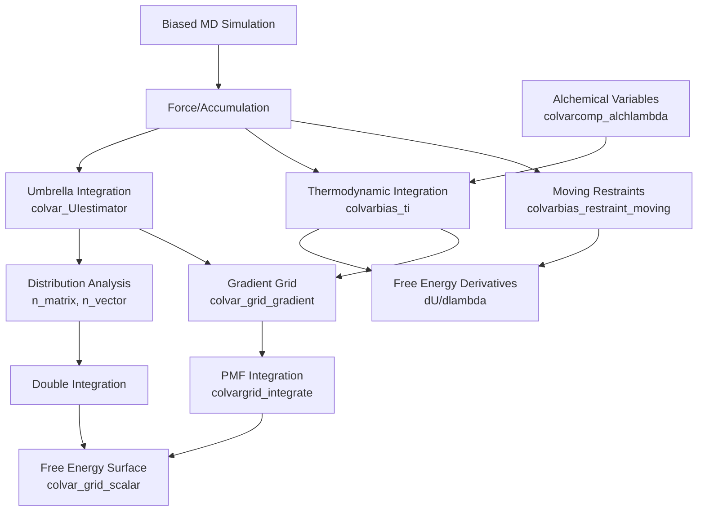
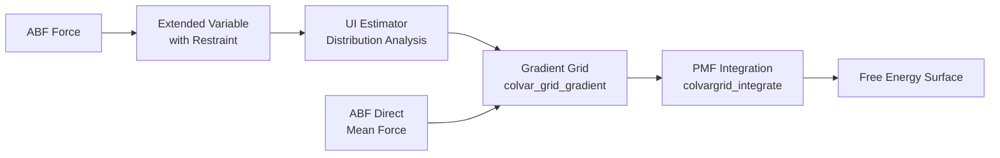

Advanced free energy calculation methods in Colvars that transform biased simulation data into thermodynamic properties through rigorous statistical mechanical frameworks. These methods enable precise determination of free energy surfaces, potential of mean force (PMF) profiles, and alchemical free energy differences.

## Architectural Overview

The Umbrella Integration (UI) and Thermodynamic Integration (TI) subsystems form a sophisticated framework for post-processing biased simulations and computing free energy derivatives. The architecture integrates gradient sampling, distribution analysis, and numerical integration techniques within a unified computational workflow.



The modular design allows these components to operate independently or in combination, with each specialized for particular free energy calculation scenarios. The system supports both 1D and multi-dimensional collective variable spaces, with appropriate numerical methods for each dimensionality.

Sources: [colvar_UIestimator.h](src/colvar_UIestimator.h#L1-L100), [colvarbias.h](src/colvarbias.h#L336-L376), [colvargrid_integrate.h](src/colvargrid_integrate.h#L8-L26)

## Thermodynamic Integration Fundamentals

Thermodynamic Integration in Colvars computes free energy differences by integrating derivatives of the Hamiltonian with respect to a coupling parameter λ. The framework extends classical TI to collective variable restraints through the `colvarbias_ti` base class, which provides infrastructure for accumulating system forces and computing free energy gradients.

The TI implementation inherits from `colvarbias` and adds specialized data structures for force averaging:

```cpp
class colvarbias_ti : public virtual colvarbias {
protected:
  /// Forces exerted from the system to the associated variables
  std::vector<colvarvalue> ti_system_forces;
  
  /// Averaged system forces
  std::shared_ptr<colvar_grid_gradient> ti_avg_forces;
  
  /// Histogram of sampled data
  std::shared_ptr<colvar_grid_count> ti_count;
};
```

This design enables TI calculations on collective variable spaces by storing the average forces exerted by the system on the restrained CVs at each λ state. The free energy derivative is computed as the ensemble average of the generalized force:

$$\frac{dA}{d\lambda} = \left\langle \frac{\partial U}{\partial \lambda} \right\rangle_\lambda$$

Sources: [colvarbias.h](src/colvarbias.h#L336-L376), [colvarbias_restraint.h](src/colvarbias_restraint.h#L23-L27)

### Moving Restraints for TI

The `colvarbias_restraint_moving` class implements TI through time-varying restraint parameters, enabling continuous transformation between restraint states. This approach computes free energy differences while systematically changing force constants, centers, or wall positions.

The core TI derivative calculations are implemented through specialized methods:

| Derivative Type | Method | Physical Meaning |
|-----------------|--------|------------------|
| Force constant change | `dU_dlambda_k()` | ∂U/∂k × dk/dλ |
| Center movement | `dU_dlambda_centers()` | F × (ξ_target - ξ_initial) |
| Wall translation | `dU_dlambda_walls()` | Force on moving boundary |

The lambda parameterization supports multiple transformation schemes:

```cpp
/// Get lambda value for the current stage
cvm::real current_lambda() const;

/// Update the force constant by interpolating between initial and target
virtual void update_k(cvm::real /* lambda */);

/// Update the centers by interpolating between initial and target  
virtual void update_centers(cvm::real /* lambda */);
```

Lambda evolution can follow linear schedules, exponential scaling (via `lambdaExp`), or custom schedules specified through `lambdaSchedule`. The system accumulates the free energy derivative over the transformation:

$$\Delta A = \int_0^1 \frac{dA}{d\lambda} d\lambda$$

Sources: [colvarbias_restraint.h](src/colvarbias_restraint.h#L130-L171), [colvarbias_restraint.cpp](src/colvarbias_restraint.cpp#L550-L620)

### Staged and Continuous Transformations

Colvars supports both discrete staging and continuous transformation modes. In staged mode, the transformation proceeds through `targetNumStages` discrete λ points, each sampling for `targetNsteps` after `targetEquilSteps` equilibration. Continuous mode performs a smooth transformation without explicit staging.

The staging logic:

```cpp
/// Update the stage number based on the current step
inline void update_stage() {
  stage = (cvm::step_absolute() - first_step) / target_nsteps;
  if (stage > target_nstages) {
    stage = target_nstages;
  }
}
```

> [!TIP]
> Staged transformations are generally preferred for high-precision TI calculations as each λ state can be properly equilibrated and sampled independently. Continuous transformations are computationally efficient but may suffer from hysteresis if the transformation is too rapid.

Sources: [colvarbias_restraint.h](src/colvarbias_restraint.h#L145-L155), [colvarbias_restraint.h](src/colvarbias_restraint.h#L160-L165)

## Umbrella Integration Implementation

The Umbrella Integration estimator (`colvar_UIestimator`) provides a sophisticated framework for analyzing extended ABF (eABF) simulations and umbrella sampling data. Unlike classical WHAM analysis, UI directly computes the free energy gradient from local distributions without iterative histogram reweighting.

### Core Data Structures

The UI estimator employs specialized container classes for efficient multi-dimensional distribution analysis:

```cpp
/// Stores the joint distribution n(x,y)
class n_matrix {
  std::vector<std::vector<int>> matrix;
  
  void increase_value(const std::vector<double> &x, 
                     const std::vector<double> &y, int value);
};

/// Stores 1D quantities at y positions
template <typename T>
class n_vector {
  std::vector<T> vector;
  
  T& get_value(const std::vector<double> &x);
  void increase_value(const std::vector<double> &x, T value);
};
```

The `n_matrix` class tracks the joint distribution of extended variable y (with restraint force) and primary variable x, while `n_vector` quantities store accumulated sums (x, x²) and statistics (mean, variance) within local neighborhoods.

Sources: [colvar_UIestimator.h](src/colvar_UIestimator.h#L30-L130)

### Extended Variable Formalism

UI extends the ABF method by applying a harmonic restraint force to the extended variable, defined in an extended coordinate space:

```cpp
const int Y_SIZE = 21;  // Extended variable range size
const int HALF_Y_SIZE = 10;
```

When x=10, width=1, Y_SIZE=21, the extended coordinate eCV spans [0-20]. This extended sampling enables more robust gradient estimation by examining local fluctuations around each point.

The update method accumulates statistics at each MD step:

```cpp
bool update(cvm::step_number step, std::vector<double> x, std::vector<double> y) {
  for (i = 0; i < dimension; i++) {
    sum_x[i].increase_value(y, x[i]);
    sum_x_square[i].increase_value(y, x[i] * x[i]);
  }
  count_y.increase_value(y, 1);
  distribution_x_y.increase_value(x, y, 1);
  return true;
}
```

Sources: [colvar_UIestimator.h](src/colvarbias_restraint.h#L14-L20), [colvar_UIestimator.h](src/colvar_UIestimator.h#L300-L325)

### Double Integration Algorithm

The UI gradient calculation employs a double integration scheme that accounts for the coupling between extended and primary variables:

```cpp
void calc_pmf() {
  // Compute local averages and variances
  for (j = 0; j < dimension; j++) {
    x_av[j].set_value(loop_flag, sum_x[j].get_value(loop_flag) / norm);
    sigma_square[j].set_value(loop_flag, 
      sum_x_square[j].get_value(loop_flag) / norm - 
      x_av[j].get_value(loop_flag) * x_av[j].get_value(loop_flag));
  }
  
  // Double integration: couple x-y distributions
  av[k] += distribution_x_y.get_value(loop_flag_x, loop_flag_y) * 
           ((loop_flag_x[k] + 0.5 * width[k]) - x_av[k].get_value(loop_flag_y)) / 
           sigma_square[k].get_value(loop_flag_y);
}
```

The final gradient combines thermodynamic and mechanical contributions:

$$\frac{\partial A}{\partial x} = k_B T \frac{\langle (x - \langle x \rangle_y) \rangle}{\sigma^2} - k_{restr} \langle x - y \rangle$$

This expression separates the entropic term (dependent on temperature and fluctuations) from the enthalpic restraint term.

Sources: [colvar_UIestimator.h](src/colvar_UIestimator.h#L330-L430)

### Output and Analysis

The UI estimator generates comprehensive output files:

| File Extension | Content | Purpose |
|----------------|---------|---------|
| `.UI.grad` | Free energy gradients at each grid point | Primary UI output |
| `.UI.count` | Sample counts per bin | Convergence assessment |
| `.UI.pmf` | 1D free energy profile (1D cases only) | Direct PMF visualization |

The estimator supports restart capabilities, allowing accumulation of statistics across multiple simulation runs:

```cpp
if (restart == true) {
  input_grad = n_vector<std::vector<double>>(...);
  input_count = n_vector<int>(...);
  read_inputfiles(input_filename);
}
```

During output, gradients from current and previous runs are combined using weighted averaging based on sample counts.

Sources: [colvar_UIestimator.h](src/colvar_UIestimator.h#L600-L750), [colvar_UIestimator.h](src/colvar_UIestimator.h#L180-L220)

## Grid Integration Methods

The `colvargrid_integrate` class provides numerical integration of gradient fields to produce free energy surfaces, supporting both 1D cumulative integration and multi-dimensional Poisson equation solving.

### 1D Integration

For 1D collective variable spaces, the integration uses direct cumulative summation with optional periodic correction:

```cpp
cvm::real sum = 0.0;
cvm::real corr;
if (periodic[0]) {
  corr = gradients->average(); // Enforce PBC by subtracting average gradient
} else {
  corr = 0.0;
}

for (ix = new_index(); gradients->index_ok(ix); incr(ix)) {
  set_value(ix, sum);
  cvm::real val = gradients->value_output_smoothed(ix, b_smoothed);
  sum += (val - corr) * widths[0];
}
```

The periodic correction enforces the boundary condition A(x_max) = A(x_min) by subtracting the mean gradient before integration.

Sources: [colvargrid_integrate.cpp](src/colvargrid_integrate.cpp#L35-L60)

### Multi-Dimensional Integration (2D/3D)

For 2D and 3D systems, the PMF is obtained by solving the Poisson equation:

$$\nabla^2 A(\mathbf{x}) = \nabla \cdot \mathbf{g}(\mathbf{x})$$

where g(x) is the mean force gradient. The implementation uses a conjugate gradient solver (`nr_linbcg_sym`) optimized for symmetric matrices:

```cpp
int integrate(const int itmax, const cvm::real &tol, cvm::real &err, bool verbose) {
  if (nd == 1) {
    // Direct cumulative integration
  } else if (nd <= 3) {
    nr_linbcg_sym(divergence, data, tol, itmax, iter, err);
  } else {
    cvm::error("Cannot integrate PMF in dimension > 3\n");
  }
  return iter;
}
```

The divergence computation uses modified Neumann boundary conditions for non-periodic dimensions, ensuring physically meaningful solutions at grid boundaries.

Sources: [colvargrid_integrate.cpp](src/colvargrid_integrate.cpp#L15-L40), [colvargrid_integrate.h](src/colvargrid_integrate.h#L24-L33)

### Divergence Calculation

The divergence of the gradient field is computed with careful handling of periodic boundary conditions:

```cpp
void update_div_local(const std::vector<int> &ix) {
  // Compute divergence using finite differences
  // Apply Neumann BCs for non-periodic dimensions
  // Handle PBC wrapping appropriately
}

void set_div() {
  // Initialize divergence matrix from complete gradient grid
  // Called before Poisson solve
}
```

The system supports smoothing of input gradients via the `b_smoothed` flag, which can improve convergence in noisy gradient fields.

Sources: [colvargrid_integrate.h](src/colvargrid_integrate.h#L27-L37), [colvargrid_integrate.h](src/colvargrid_integrate.h#L59-L76)

## Alchemical Variables Integration

Thermodynamic integration in Colvars supports alchemical transformations through specialized collective variable types implemented in `colvarcomp_alchlambda.cpp`:

### Lambda Variable

The `alch_lambda` collective variable represents the coupling parameter for alchemical transformations:

```cpp
class colvar::alch_lambda : public colvar {
  void calc_value();
  void apply_force(colvarvalue const &force);
};
```

This variable typically couples to external MD engine lambda parameters and enables free energy calculations alongside collective variable restraints.

Sources: [colvarcomp_alchlambda.cpp](src/colvarcomp_alchlambda.cpp#L19-L55)

### Force Lambda Variable

The `alch_Flambda` variable tracks the derivative of the system energy with respect to lambda, which is directly the TI integrand:

```cpp
class colvar::alch_Flambda : public colvar {
  void calc_value();
  void calc_gradients();
  void apply_force(colvarvalue const &force);
};
```

When combined with a TI bias, this enables measurement and integration of free energy derivatives during alchemical transformations.

Sources: [colvarcomp_alchlambda.cpp](src/colvarcomp_alchlambda.cpp#L88-L130)

## Configuration Examples

### Basic TI with Moving Harmonic Restraint

```
harmonic {
  name ti_restraint
  colvars xi
  forceConstant 10.0
  centers 0.0
  
  # TI configuration
  targetCenters 5.0
  targetNsteps 1000000
  targetEquilSteps 100000
  targetNumStages 10
  
  outputAccumulatedWork yes
  outputEnergy yes
}
```

This configuration performs a TI calculation by moving a harmonic restraint from ξ=0 to ξ=5.0 over 10 stages, accumulating the free energy derivative.

Sources: [colvarbias_restraint.h](src/colvarbias_restraint.h#L145-L186)

### Force Constant Transformation with Decoupling

```
harmonic {
  name decouple_restraint
  colvars distance
  
  # Initial restraint
  forceConstant 50.0
  centers 2.0
  
  # Decouple the restraint
  decoupling on
  targetNsteps 500000
  targetEquilSteps 50000
  lambdaExponent 2.0
  
  outputAccumulatedWork yes
}
```

This performs decoupling by reducing the force constant from 50.0 to 0.0, with exponential scaling controlled by `lambdaExponent`.

Sources: [colvarbias_restraint.cpp](src/colvarbias_restraint.cpp#L560-L590)

### Umbrella Integration Estimator Configuration

The UI estimator is typically used with extended ABF:

```
abf {
  name eabf
  colvars xi
  
  # Extended ABF parameters
  extendedFluctuation 0.5
  fullSamples 200
  
  # UI estimator integration
  UIestimator on
  UIestimatorGrid {
    lowerBoundary -5.0
    upperBoundary 5.0
    width 0.1
  }
  UIestimatorOutputFreq 1000
}
```

This enables UI analysis of eABF simulations, producing `.UI.grad` files with free energy gradients.

Sources: [colvar_UIestimator.h](src/colvar_UIestimator.h#L170-L230)

### Multi-Dimensional Grid Integration

Post-processing gradient files to produce PMF:

```
# In colvars config
abf {
  name abf_2d
  colvars xi1 xi2
  fullSamples 500
}

# Post-processing (external analysis)
colvars-config-file.pmf:
  colvar 1: xi1
  colvar 2: xi2
  integrateGradient on
  integrateMethod linear  # or poisson for 2D/3D
```

The `colvargrid_integrate` system will integrate the accumulated gradients from `.grad` files using the specified method.

Sources: [colvargrid_integrate.h](src/colvargrid_integrate.h#L18-L26), [colvargrid_integrate.cpp](src/colvargrid_integrate.cpp#L15-L40)

## Output Files and Analysis

### TI Output Files

Moving restraint biases generate trajectory output including:

- `restraint.work` - Accumulated work W = ∫dU·dλ
- `restraint.dA_dlambda` - Free energy derivative at current λ
- `centers` - Current restraint center positions (if moving)

The trajectory file format includes labels specified by:

```cpp
std::ostream &write_traj_label(std::ostream &os) {
  if (b_chg_centers && is_enabled(f_cvb_output_acc_work)) {
    os << " W_" << cvm::wrap_string(this->name, cvm::en_width-2);
  }
  return os;
}
```

Sources: [colvarbias_restraint.cpp](src/colvarbias_restraint.cpp#L475-L495), [colvarbias_restrain.cpp](src/colvarbias_restraint.cpp#L650-L680)

### UI Output Files

The Umbrella Integration estimator produces:

- `<prefix>.UI.grad` - Free energy gradients at grid points
- `<prefix>.UI.count` - Sample counts per bin
- `<prefix>.UI.pmf` - 1D PMF (for 1D CVs)

The gradient file format includes:
- Header with dimensionality and grid parameters
- Data columns: position coordinates + gradient components

Sources: [colvar_UIestimator.h](src/colvar_UIestimator.h#L600-L750)

### Grid Integration Output

PMF integration generates:

- `<prefix>.pmf` - Free energy surface values
- Optional `.count` files showing sampling distribution

The integrated PMF can be visualized using tools like VMD's PMF viewer or external plotting software.

Sources: [colvargrid_integrate.cpp](src/colvargrid_integrate.cpp#L35-L70)

## Advanced Topics

### Accumulated Work vs. Free Energy

The system tracks both accumulated work and free energy derivatives:

```cpp
/// Accumulated work (computed when outputAccumulatedWork == true)
cvm::real acc_work = 0.0;

/// Accumulating restraint FE derivative wrt lambda
cvm::real dA_dlambda = 0.0;
```

Accumulated work measures the actual work performed during the transformation, while `dA_dlambda` accumulates the ensemble-averaged derivative. For reversible transformations, these quantities converge to the same free energy difference.

Sources: [colvarbias_restraint.h](src/colvarbias_restraint.h#L157-L158), [colvarbias_restraint.h](src/colvarbias_restraint.h#L180-L186)

### Convergence Assessment

Several metrics indicate convergence of TI calculations:

1. **Plateau of dA/dlambda** - Free energy derivative should stabilize within each λ window
2. **Consistency between forward and reverse transformations** - Hysteresis indicates insufficient sampling
3. **Sample counts in UI estimator** - Minimum thresholds ensure statistical significance

For UI, the local variance `σ²` provides an internal convergence metric - low variance in regions of interest indicates adequate sampling.

Sources: [colvar_UIestimator.h](src/colvar_UIestimator.h#L380-L410)

### Error Estimation

Free energy errors can be estimated from:

1. **Block averaging** of dA/dlambda across simulation segments
2. **Bootstrap resampling** of UI gradient distributions  
3. **Finite-difference comparisons** between adjacent λ states

The `colvarbias_ti` infrastructure stores per-bin statistics enabling post-hoc error analysis.

Sources: [colvarbias.h](src/colvarbias.h#L367-L376)

> [!TIP]
> For production-quality free energy calculations, perform error analysis using multiple independent replicates. The variance between replicates provides a robust estimate of statistical uncertainty that accounts for correlation and finite-sampling effects.

## Integration with Other Methods

### ABF + Umbrella Integration

Extended ABF naturally integrates with UI through the shared gradient infrastructure:



ABF provides mean forces that complement UI-derived gradients, with each method excelling in different regions of collective variable space.

Sources: [colvarbias_abf.h](src/colvarbias_abf.h#L1-L50), [colvar_UIestimator.h](src/colvar_UIestimator.h#L170-L230)

### Metadynamics + TI

Metadynamics bias can be combined with TI by:

1. Using metadynamics to enhance barrier crossing
2. Applying TI restraints on the metadynamics collective variables
3. Computing free energy differences between biased states

The decoupling approach is particularly useful for removing metadynamics bias while computing free energy profiles.

Sources: [colvarbias_meta.h](src/colvarbias_meta.h#L1-L50), [colvarbias_restraint.h](src/colvarbias_restraint.h#L144-L146)

### Multi-Replica Integration

The replica communication infrastructure enables parallel TI calculations:

```
multipleReplicas on
replicaID 0
replicaNumStages 10
```

Each replica samples a different λ state, with periodic communication for convergence assessment and potential replica exchange strategies.

Sources: [colvarproxy_replicas.cpp](src/colvarproxy_replicas.cpp#L1-L50), [colvarbias.h](src/colvarbias.h#L100-L105)

## Performance Considerations

### Computational Efficiency

- **UI estimator**: O(N×Y_SIZE) per update where N is grid size
- **Poisson integration**: O(iterations × N) for 2D/3D grids
- **TI moving restraints**: Negligible overhead beyond base restraint cost

Memory usage scales with grid resolution and dimensionality:

| Dimension | Grid Size | Memory (approx) |
|-----------|-----------|-----------------|
| 1D | 100 bins | < 1 MB |
| 2D | 100×100 | ~100 MB |
| 3D | 50×50×50 | ~500 MB |

Sources: [colvar_UIestimator.h](src/colvar_UIestimator.h#L55-L75), [colvargrid_integrate.h](src/colvargrid_integrate.h#L51-L56)

### Optimization Strategies

1. **Adaptive binning** - Use finer resolution where free energy varies rapidly
2. **Selective output** - Reduce `outputFreq` for large grids
3. **Parallel integration** - Poisson solver benefits from multi-threading
4. **Incremental restart** - Accumulate statistics across multiple runs

The UI estimator's `Y_SIZE` parameter controls the trade-off between computational cost and gradient accuracy - larger values provide better local statistics at increased memory expense.

Sources: [colvar_UIestimator.h](src/colvarbias_restraint.h#L14-L20)

## Troubleshooting Guide

### Common Issues

**Issue**: TI results show hysteresis between forward and reverse transformations

**Solution**: Increase `targetEquilSteps` to ensure proper equilibration at each λ state, reduce `targetNsteps` per stage, or increase number of stages

Sources: [colvarbias_restraint.h](src/colvarbias_restraint.h#L145-L155)

**Issue**: UI gradients are noisy in low-sampling regions

**Solution**: Increase `fullSamples` threshold in eABF, increase simulation length, or use larger `Y_SIZE` to improve local statistics

Sources: [colvar_UIestimator.h](src/colvar_UIestimator.h#L170-L230)

**Issue**: PMF integration fails for 2D/3D grids

**Solution**: Check periodic boundary condition settings, ensure gradient grid covers complete domain, verify sufficient sampling in boundary regions

Sources: [colvargrid_integrate.cpp](src/colvargrid_integrate.cpp#L15-L40)

**Issue**: Accumulated work diverges from free energy estimate

**Solution**: Verify transformation reversibility, check for hidden barriers, increase sampling, or use smaller force constant increments

Sources: [colvarbias_restraint.h](src/colvarbias_restraint.h#L157-L186)

## Next Steps

For comprehensive understanding of Colvars biasing and sampling capabilities, explore related documentation:

- [Adaptive Biasing Force (ABF)](12-adaptive-biasing-force-abf) - Mean force methods complementary to UI/TI
- [Harmonic Restraints and Walls](11-harmonic-restraints-and-walls) - Restraint fundamentals used in TI
- [Grid Configuration and Parameters](16-grid-configuration-and-parameters) - Grid infrastructure for integration
- [Free Energy Surface Integration](17-free-energy-surface-integration) - Advanced integration techniques
- [Multiple Replica Communication](25-multiple-replica-communication) - Parallel TI implementations
