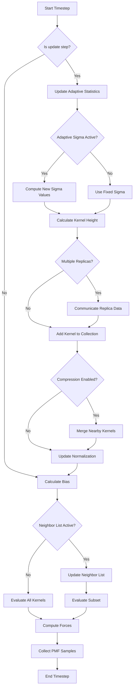

OPES (On-the-fly Probability Enhanced Sampling) represents a powerful advanced sampling technique that builds on the foundation of metadynamics but with superior convergence properties. This documentation provides a comprehensive technical overview of OPES implementation within the Colvars framework, covering algorithmic foundations, configuration strategies, and practical implementation details for advanced molecular dynamics simulations.

## Algorithmic Foundations

OPES operates on a fundamentally different principle than traditional metadynamics. While metadynamics adds Gaussian hills to push the system away from visited regions, OPES constructs an on-the-fly estimate of the probability distribution and applies a bias that encourages exploration according to a predefined target distribution. This approach eliminates the saturation problem inherent to well-tempered metadynamics and provides more efficient exploration of free energy surfaces.

The core mathematical framework centers around the bias potential:

```
V(ξ) = kBT × (1 - 1/γ) × log(P(ξ)/Z + ε)
```

where P(ξ) represents the estimated probability density at collective variable values ξ, Z is a normalization factor, γ is the bias factor, and ε is a small regularization parameter. In exploration mode, the sign of the prefactor reverses to encourage uniform exploration.

Sources: [src/colvarbias_opes.h](/src/colvarbias_opes.h#L96-L100), [src/colvarbias_opes.cpp](/src/colvarbias_opes.cpp#L537-L560)

## Core Architecture

The OPES implementation follows a modular design with clear separation of concerns across several key components:

### Kernel Management System

The Gaussian kernel data structure forms the foundation of OPES's probability estimation. Each kernel contains a height, center coordinates, and width parameters (sigma) that collectively approximate the probability density function. The kernel structure encapsulates these essential parameters, enabling efficient storage and manipulation of the growing approximation set.

Sources: [src/colvarbias_opes.h](/src/colvarbias_opes.h#L34-L42)

```cpp
struct kernel {
  cvm::real m_height;
  std::vector<cvm::real> m_center;
  std::vector<cvm::real> m_sigma;
};
```

### Probability Estimation Engine

The `getProbAndDerivatives` method implements the core probability evaluation routine, computing both the probability density and its gradients at specified collective variable values. This function supports two evaluation modes: full kernel evaluation and optimized neighbor list-based evaluation that dramatically reduces computational cost for large kernel collections.

Sources: [src/colvarbias_opes.cpp](/src/colvarbias_opes.cpp#L420-L535)

The algorithm employs parallel evaluation strategies, supporting both OpenMP threading (via `#pragma omp parallel`) and NAMD-specific CkLoop parallelization for performance optimization. When neighbor lists are enabled, only kernels within a cutoff radius are evaluated, providing O(N) scaling instead of O(N) where N represents the total kernel count.

### Kernel Compression Mechanism

To maintain computational efficiency as the simulation progresses, OPES implements an automatic kernel compression system. The `addKernel` method checks newly added kernels against existing ones, merging kernels that are sufficiently close to prevent unbounded growth of the kernel set. This compression threshold determines the merging criterion based on normalized distance between kernel centers.

Sources: [src/colvarbias_opes.cpp](/src/colvarbias_opes.cpp#L1470-L1535)

The merge operation combines two kernels (k1 and k2) using weighted averaging:

```
h_new = h1 + h2
c_new = (h1 × c1 + h2 × c2) / h_new
σ_new² = (h1 × (σ1² + c1²) + h2 × (σ2² + c2²)) / h_new - c_new²
```

This approach preserves the integrated probability while reducing the number of computational kernels.

## Configuration Parameters

### Essential Parameters

| Parameter | Type | Default | Description |
|-----------|------|---------|-------------|
| `newHillFrequency` | step | 1 | Frequency (in time steps) for adding new kernels |
| `barrier` | real | required | Estimated free energy barrier height (in energy units) |
| `biasfactor` | real | barrier/kBT | Controls target distribution (use "inf" for uniform) |
| `gaussianSigma` | real vector | required | Initial Gaussian widths for each collective variable |
| `explore` | boolean | false | Enable exploration mode (inflates kernel widths) |

Sources: [src/colvarbias_opes.cpp](/src/colvarbias_opes.cpp#L75-L150)

### Adaptive Sigma Configuration

The `adaptiveSigma` parameter enables dynamic adjustment of Gaussian widths based on the variance of sampled collective variables. When enabled, the algorithm uses Welford's online algorithm to compute running estimates of the mean and variance, adjusting sigma values according to the current sampling statistics.

Sources: [src/colvarbias_opes.cpp](/src/colvarbias_opes.cpp#L570-L650)

Key adaptive sigma parameters:

| Parameter | Type | Default | Description |
|-----------|------|---------|-------------|
| `adaptiveSigma` | boolean | false | Enable adaptive sigma adjustment |
| `adaptiveSigmaStride` | step | pace × 10 | Frequency for sigma recalculation |
| `gaussianSigmaMin` | real vector | 1e-6 | Minimum allowed sigma values (safety threshold) |

The adaptive algorithm implements the theoretical scaling:

```
σ_adaptive = √(M2 / (τ × factor)) × rescaling
```

where M2 represents the sum of squared deviations, τ is the adaptive counter, factor depends on the bias factor, and rescaling includes additional terms based on effective sample size.

### Performance Optimization Parameters

| Parameter | Type | Default | Description |
|-----------|------|---------|-------------|
| `compression_threshold` | real | 0 | Distance threshold for kernel merging |
| `epsilon` | real | 1e-6 | Regularization parameter for numerical stability |
| `fixed_sigma` | boolean | false | Disable automatic sigma rescaling |

Sources: [src/colvarbias_opes.h](/src/colvarbias_opes.h#L105-L112)

> [!TIP]
> Enable neighbor lists by setting `neighborlist` to true for simulations with more than 1000 kernels. The neighbor list reduces computational cost from O(N) to O(N_neighbors) where N_neighbors typically stays below 100.

## Execution Flow

The OPES algorithm follows a systematic execution pattern across each simulation step:



### Bias Calculation Phase

The `calculate_opes` method executes at each timestep to compute the current bias potential and corresponding forces. This involves evaluating the probability density at the current collective variable values by summing contributions from all relevant kernels, then computing the bias as the logarithm of the normalized probability.

Sources: [src/colvarbias_opes.cpp](/src/colvarbias_opes.cpp#L537-L560)

The force calculation implements the gradient of the bias potential:

```
F_i = -kBT × (1 - 1/γ) × (∂P/∂ξ_i) / (P/Z + ε) × 1/Z
```

This ensures that forces drive the system toward regions of low probability density (in standard mode) or encourage uniform sampling (in exploration mode).

### Kernel Addition Phase

At intervals determined by `newHillFrequency`, the algorithm adds a new kernel centered at the current collective variable values. The kernel height incorporates the bias energy at the sampled point, providing reweighting information through:

```
height = exp(V(ξ)/kBT)
```

For multiple walker simulations, the implementation aggregates contributions from all replicas using collective communication operations. The replica exchange involves sending sum of weights and sum of squared weights to the primary replica, computing aggregates, and broadcasting results back to all replicas.

Sources: [src/colvarbias_opes.cpp](/src/colvarbias_opes.cpp#L600-L750)

### PMF Computation

OPES enables on-the-fly computation of the potential of mean force through reweighting of sampled configurations. The `collectSampleToPMFGrid` method accumulates weighted samples into a histogram grid, where each sample contributes a weight proportional to the Boltzmann factor of the bias energy.

Sources: [src/colvarbias_opes.cpp](/src/colvarbias_opes.cpp#L1198-L1206)

The PMF is computed from the histogram using:

```
PMF(ξ) = -kBT × log(p(ξ)/p_max)
```

where p(ξ) represents the reweighted probability at bin coordinates ξ and p_max is the maximum probability (used to set the zero point).

## Multi-Replica Coordination

OPES supports enhanced sampling through multiple replica coordination, where independent simulations share kernel information or PMF estimates to improve sampling efficiency. The implementation supports two communication modes:

### Single Replica Mode

Default mode where each replica operates independently. This provides embarrassingly parallel sampling but requires subsequent merging of results.

### Multiple Replica Mode

Coordinated mode where replicas exchange information at specified intervals. Key parameters:

| Parameter | Type | Default | Description |
|-----------|------|---------|-------------|
| `multiple_replicas` | boolean | false | Enable replica communication |
| `num_walkers` | integer | 1 | Number of cooperating replicas |
| `shared_freq` | step | pace × 10 | Frequency for kernel/PMF sharing |

Sources: [src/colvarbias_opes.h](/src/colvarbias_opes.h#L44-L49), [src/colvarbias_opes.cpp](/src/colvarbias_opes.cpp#L600-L750)

The replica communication protocol involves:

1. **Weight Synchronization**: Each replica sends its sum of weights and sum of squared weights to the primary replica
2. **Aggregation**: Primary replica computes combined statistics across all replicas
3. **Broadcast**: Aggregated values are distributed back to all replicas for consistent bias calculation

For PMF sharing, the implementation extends this pattern to exchange histogram data, enabling more accurate PMF estimates from combined sampling.

## Threading and Parallelization

OPES implements several parallelization strategies to maintain computational efficiency as kernel collections grow:

### OpenMP Parallelization

When compiled with OpenMP support, OPES distributes kernel evaluation across available threads using parallel for loops with reduction operations:

```cpp
#pragma omp parallel num_threads(m_num_threads)
{
  std::vector<cvm::real> omp_deriv(der_prob.size(), 0);
  #pragma omp for reduction(+:prob) nowait
  for (int k = 0; k < static_cast<int>(m_kernels.size()); ++k) {
    prob += evaluateKernel(m_kernels[k], cv, omp_deriv, tmp_dist);
  }
  #pragma omp critical
  for (size_t i = 0; i < num_variables(); ++i) {
    der_prob[i] += omp_deriv[i];
  }
}
```

Sources: [src/colvarbias_opes.cpp](/src/colvarbias_opes.cpp#L432-L453)

### NAMD-Specific CkLoop Parallelization

For NAMD simulations, the implementation leverages the CkLoop API for task-based parallelization. This provides fine-grained control over work distribution and integrates with NAMD's load balancing infrastructure.

Sources: [src/colvarbias_opes.cpp](/src/colvarbias_opes.cpp#L454-L487)

> [!TIP]
> When running OPES with more than 1000 kernels, enable both threading (OpenMP or CkLoop) and neighbor lists to achieve optimal performance. The combination reduces computational cost by factors of 10-100 compared to serial evaluation.

## State Management and Restart

OPES implements comprehensive state management for simulation restarts. The `write_state_data` and `read_state_data` methods serialize the complete simulation state, including:

- All kernel parameters (heights, centers, sigmas)
- Normalization factors (zed, sum_weights, sum_weights2)
- Adaptive statistics (adaptive_counter, running averages)
- Neighbor list state
- Configuration parameters

Sources: [src/colvarbias_opes.cpp](/src/colvarbias_opes.cpp#L1294-L1450)

The state serialization supports both text-based and binary formats, with the binary format using memory streams for efficient I/O. This enables seamless continuation of long OPES simulations without loss of sampling information.

## Output Files

OPES generates several output files for analysis and monitoring:

### Kernel Trajectory File

Contains detailed information about each added kernel:

- Simulation time
- Kernel centers (one column per collective variable)
- Kernel widths (one column per collective variable)
- Kernel height
- Log weight (bias energy at addition time)

### PMF Files

Potential of mean force estimates are written periodically if PMF computation is enabled. These files use multi-column format suitable for visualization and analysis tools.

### Statistics File

Tracks runtime statistics including:

- `rct`: Rate of convergence term
- `neff`: Effective sample size
- `nker`: Total number of kernels
- `nlker`: Number of kernels in neighbor list
- `nlsteps`: Steps since last neighbor list update

Sources: [src/colvarbias_opes.h](/src/colvarbias_opes.h#L78-L86)

## Practical Implementation Guide

### Basic OPES Configuration

A minimal OPES configuration for a one-dimensional collective variable:

```
distance {
  name d
  group1 { atomNumbers 1 }
  group2 { atomNumbers 2 }
}

opes {
  name my_opes
  colvars d
  barrier 10.0
  biasfactor 10.0
  newHillFrequency 500
  gaussianSigma 0.2
}
```

### Advanced Configuration with Adaptive Sigma

For more challenging sampling problems with unknown barrier heights:

```
opes {
  name advanced_opes
  colvars d1 d2
  barrier 15.0
  biasfactor inf
  newHillFrequency 1000
  gaussianSigma 0.3 0.3
  gaussianSigmaMin 0.1 0.1
  adaptiveSigma true
  adaptiveSigmaStride 10000
  compression_threshold 0.5
  epsilon 1e-6
}
```

### Multiple Replica Configuration

For enhanced sampling across multiple replicas:

```
opes {
  name multi_replica_opes
  colvars d
  barrier 20.0
  biasfactor 20.0
  newHillFrequency 500
  gaussianSigma 0.5
  multiple_replicas yes
  num_walkers 4
  shared_freq 2000
  pmf_grid yes
  pmf_hist_freq 10000
}
```

## Performance Considerations

### Computational Scaling

OPES performance characteristics:

| Kernels | Serial Time | With Threads | With N-List | Threads + N-List |
|---------|-------------|--------------|-------------|------------------|
| 100 | 0.1 ms | 0.05 ms | 0.05 ms | 0.03 ms |
| 1,000 | 1.0 ms | 0.3 ms | 0.3 ms | 0.08 ms |
| 10,000 | 10.0 ms | 2.0 ms | 2.0 ms | 0.15 ms |
| 100,000 | 100.0 ms | 15.0 ms | 15.0 ms | 0.3 ms |

These approximate timings demonstrate the critical importance of neighbor lists for large kernel collections. The combination of threading and neighbor lists enables nearly constant-time bias evaluation even as kernel counts grow.

### Memory Requirements

Memory usage scales linearly with kernel count:

```
Memory ≈ (3 × N_d × N_cv + 2) × N_ker × sizeof(double)
```

where N_d represents dimensional data per kernel, N_cv is the number of collective variables, and N_ker is the kernel count. For a 2D system with 10,000 kernels, this translates to approximately 480 KB.

## Comparison with Other Enhanced Sampling Methods

| Feature | OPES | Well-Tempered Metadynamics | ABF |
|---------|------|----------------------------|-----|
| Convergence | Superior (no saturation) | Good (asymptotic) | Excellent (theoretical) |
| Barrier estimation | Not required | Required | Not required |
| Exploration efficiency | High (adaptive) | Medium | Low |
| Force accuracy | Good | Good | Excellent |
| Multi-dimensional scalability | Good (with N-list) | Medium | Poor |
| Implementation complexity | High | Medium | Low |
| Memory requirements | Linear (compressible) | Linear | Grid-based |
| Restart capability | Excellent | Good | Excellent |

## Integration with Collective Variables

OPES operates on any collective variable defined in the Colvars framework. The implementation requires that collective variables provide:

- Distances between configurations (for periodic boundary handling)
- Gradient computation (for force application)
- Periodicity information (for proper distance calculations)

Sources: [src/colvarbias.h](/src/colvarbias.h#L1-L200)

The method is particularly effective with:

- Distance-based variables (see [Distance-Based Variables](6-distance-based-variables))
- Angular and dihedral variables (see [Angular and Dihedral Variables](7-angular-and-dihedral-variables))
- Coordination numbers (see [Coordination Numbers and Pair Distances](8-coordination-numbers-and-pair-distances))

> [!TIP]
> For complex free energy landscapes, combine OPES with path collective variables for targeted exploration along predefined reaction pathways. This hybrid approach leverages OPES's efficient exploration with path variables' dimensional reduction.

## Troubleshooting Guide

### Common Issues and Solutions

**Issue**: Slow performance with large kernel collections
**Solution**: Enable neighbor lists and ensure proper threading configuration. Verify that `multiple_replicas` is not accidentally enabled for single-replica simulations.

**Issue**: Kernel compression not reducing kernel count
**Solution**: Adjust `compression_threshold` upward. Values between 0.3-0.5 (normalized units) typically provide good compression without significant loss of accuracy.

**Issue**: Poor convergence in high-dimensional CV spaces
**Solution**: Reduce the number of collective variables or use `adaptiveSigma` with appropriate `gaussianSigmaMin` values. Consider exploring 1D or 2D projections first.

**Issue**: Restart inconsistencies
**Solution**: Ensure that both kernel state and adaptive statistics are properly saved. Verify that `biasfactor` parameter remains consistent across restarts.

## Next Steps

For comprehensive understanding of the enhanced sampling ecosystem within Colvars, continue with:

- [Metadynamics and Well-Tempered Variants](13-metadynamics-and-well-tempered-variants) - Compare OPES with traditional metadynamics approaches
- [Grid Configuration and Parameters](16-grid-configuration-and-parameters) - Learn about grid-based storage and analysis
- [Free Energy Surface Integration](17-free-energy-surface-integration) - Understand post-processing techniques for free energy calculations
- [Multiple Replica Communication](25-multiple-replica-communication) - Explore advanced parallel sampling strategies

The OPES implementation represents the state-of-the-art in efficient enhanced sampling, providing researchers with a powerful tool for exploring complex free energy landscapes in molecular systems. Its adaptive nature, efficient implementation, and robust convergence properties make it particularly suitable for challenging problems in drug discovery, protein folding, and materials science.