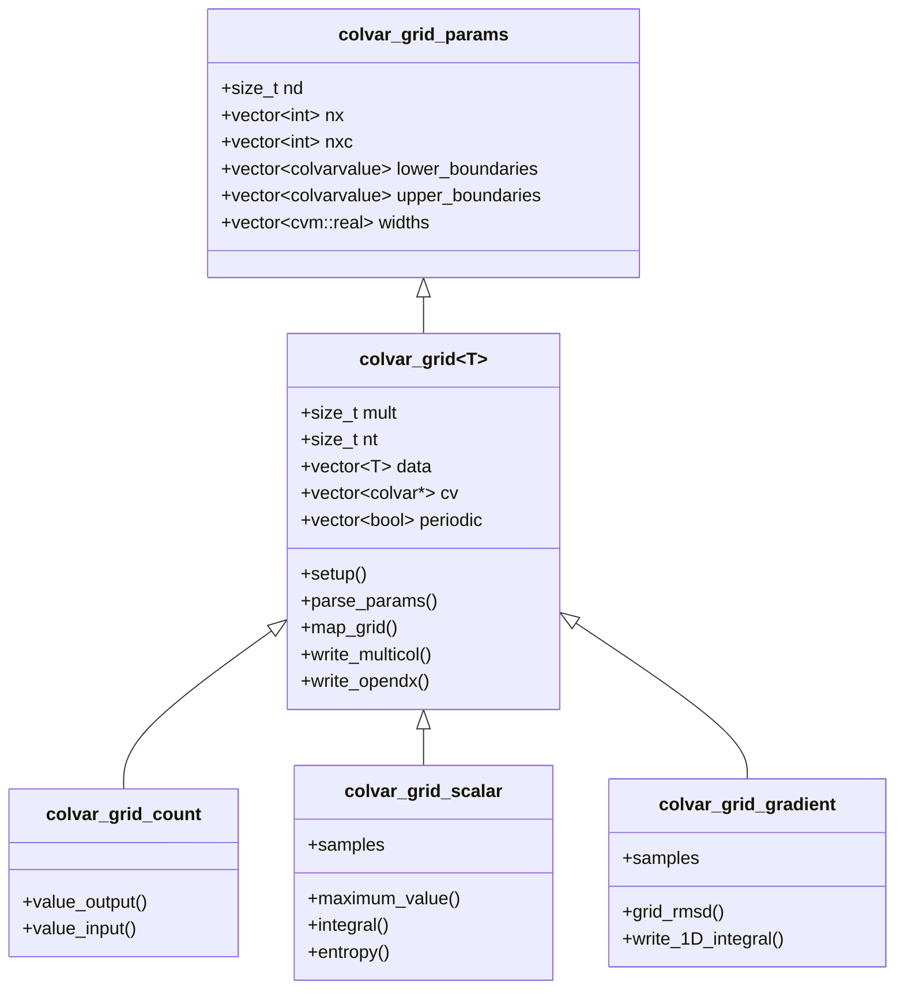

Grid configuration in Colvars provides a flexible framework for discretizing collective variable space into multidimensional arrays, enabling efficient free energy calculations, histogram analysis, and biasing force storage. Grids serve as the foundational data structure for enhanced sampling methods including ABF, metadynamics, and histogram biasing, supporting both automatic configuration from colvar definitions and manual specification of all spatial parameters.

## Core Grid Architecture

The grid system is built around the `colvar_grid<T>` template class, which parameterizes a multidimensional array over collective variable space. All grid implementations inherit from `colvar_grid_params`, which stores the fundamental grid configuration including dimensionality, bin counts, boundary values, and bin widths. The architecture supports three primary specialized types: `colvar_grid_count` for binning sample counts, `colvar_grid_scalar` for storing scalar fields such as PMF values, and `colvar_grid_gradient` for maintaining vector fields like free energy gradients [Sources: src/colvargrid.h#L24-L52].

## Grid Construction Methods

### Automatic Construction from Colvars

The most common approach initializes grids directly from a vector of colvar objects, automatically extracting boundary values and bin widths from the colvar definitions. This method validates that all variables are scalar types and that positive widths are specified, ensuring grid feasibility for standard enhanced sampling techniques. The constructor accepts an optional `add_extra_bin` flag, which extends non-periodic dimensions by one bin width to accommodate integration operations such as PMF calculation from gradient data [Sources: src/colvargrid.h#L256-L278].

The automatic construction process extracts width and boundary information from each colvar, with special handling for extended Lagrangian variables where consecutive colvar references trigger use of actual versus reported values. Periodicity is determined dynamically by checking if the lower and upper boundaries satisfy periodic boundary conditions for each variable type [Sources: src/colvargrid.h#L273-L343].

> [!TIP]
> When using extended Lagrangian dynamics with histograms or ABF, specify the same colvar twice in the grid definition to automatically configure one grid dimension for the extended coordinate and one for the actual coordinate, enabling proper sampling of both spaces.

### Custom Configuration

For advanced use cases, grids can be configured through a configuration string that overrides colvar-defined parameters. The `parse_params()` method accepts both camel-case keywords (`lowerBoundary`, `upperBoundary`, `width`) for configuration files and underscore-separated variants (`lower_boundaries`, `upper_boundaries`, `widths`, `sizes`) for state file compatibility. This dual naming convention ensures seamless integration with both runtime configuration and restart workflows [Sources: src/colvargrid_def.h#L232-L306].

Custom configuration triggers automatic grid reallocation when parameters differ from existing values, including recalculation of bin counts from the boundary and width specifications. The system validates commensurability between grid intervals and bin widths, automatically adjusting upper boundaries when necessary to maintain integer bin counts [Sources: src/colvargrid.h#L376-L415].

## Configuration Parameters

### Spatial Parameters

Grid spatial configuration requires specification of boundaries and resolution for each collective variable dimension. The `lowerBoundary` parameter defines the minimum coordinate value for each dimension, while `upperBoundary` specifies the maximum. The `width` parameter controls the bin resolution, with smaller values providing finer discretization at increased memory cost. Bin counts are automatically computed as the integer nearest to `(upperBoundary - lowerBoundary) / width`, ensuring complete coverage of the specified interval [Sources: src/colvargrid_def.h#L202-L229].

The relationship between these parameters determines the total number of grid points through the product of bin counts across all dimensions. For high-dimensional grids, memory usage grows exponentially with dimensionality, requiring careful consideration of resolution versus system resources. The system issues warnings when intervals are not precisely commensurate with bin widths, automatically adjusting boundaries to maintain integer bin counts [Sources: src/colvargrid.h#L376-L415].

### Periodicity and Boundaries

Grid configuration respects the periodic nature of collective variables, automatically detecting periodic dimensions through the colvar's boundary definitions. Periodic grids wrap indices around boundaries using modulo arithmetic, enabling seamless sampling across periodic coordinate ranges. Non-periodic dimensions enforce hard boundaries, with out-of-bounds values either triggering errors or being clamped to the nearest grid point depending on the operation context [Sources: src/colvargrid.h#L93-L100, #L416-L467].

The `add_extra_bin` parameter provides special handling for integration operations. When enabled, it shifts periodic grids by half a bin width while extending non-periodic grids by one additional bin, creating a grid that accommodates integral values at bin centers rather than bin edges. This is particularly useful when integrating gradient data to obtain free energy surfaces [Sources: src/colvargrid.h#L254-L261, #L330-L343].

| Parameter | Format | Default | Purpose |
|-----------|--------|---------|---------|
| `lowerBoundary` | Real value per dimension | From colvar | Minimum grid coordinate |
| `upperBoundary` | Real value per dimension | From colvar | Maximum grid coordinate |
| `width` | Positive real value | From colvar | Bin resolution |
| `sizes` | Integer per dimension | Computed | Number of bins (can override) |
| `add_extra_bin` | Boolean | false | Extend grid for integration |

## Grid Specializations

### Count Grids

The `colvar_grid_count` specialization stores integer sample counts per bin, forming the foundation for ABF sampling and histogram biasing. Count grids track the number of samples accumulated in each region of collective variable space, enabling statistical normalization and minimum sample threshold enforcement. The `value_output()` method converts stored counts to densities by dividing by total samples when configured appropriately, supporting both raw count and probability density representations [Sources: src/colvargrid.cpp#L21-L35].

### Scalar Grids

`colvar_grid_scalar` stores real-valued data per bin, supporting operations such as maximum/minimum value queries, integration, and entropy calculation. These grids are employed for free energy surfaces, probability distributions, and other continuous scalar fields. The class provides analytical methods for computing total grid integrals, maximum values, and minimum positive values, supporting quantitative analysis of free energy landscapes [Sources: src/colvargrid.cpp#L125-L313].

Scalar grids maintain optional association with count grids through the `samples` member, enabling normalization operations that convert raw histograms to probability densities. The `entropy()` method computes the Shannon entropy of the grid distribution, providing a measure of system exploration and convergence [Sources: src/colvargrid.cpp#L288-L305].

### Gradient Grids

The `colvar_grid_gradient` specialization stores vector quantities per bin, with multiplicity equal to the number of collective variable dimensions. Each bin contains a gradient vector of size `nd`, making these grids suitable for storing free energy gradients from ABF or similar methods. The class supports gradient RMSD calculations for comparing grids and one-dimensional integration for projecting gradient data onto coordinate axes [Sources: src/colvargrid.cpp#L335-L514].

Gradient grids are typically paired with count grids to track sampling statistics, enabling proper averaging and normalization of gradient estimates. The `write_1D_integral()` method performs analytical integration of gradient components along specified axes, producing free energy profiles for one-dimensional projections [Sources: src/colvargrid.cpp#L456-L512].

## Input/Output Operations

### Multicol Format

The multicol format provides a human-readable, gnuplot-compatible representation of grid data with a header containing dimensionality and parameter information for each collective variable. The header uses `#` prefixed lines to denote metadata, including the number of variables followed by lines specifying minimum coordinate, bin width, number of points, and periodic flag for each dimension. Data lines contain coordinate values followed by the corresponding grid value(s) [Sources: src/colvargrid_def.h#L428-L473].

The multicol reader supports automatic remapping when input file parameters differ from the current grid definition, interpolating data onto the target grid through nearest-neighbor assignment. The `add` parameter enables incremental reading, accumulating values from multiple files into a single grid for ensemble averaging [Sources: src/colvargrid_def.h#L309-L408].

### OpenDX Format

OpenDX format provides binary-compatible output compatible with visualization tools, storing grid positions, connections, and data arrays in a structured format. The `write_opendx()` method generates complete OpenDX files including grid origin, delta vectors defining cell orientation and spacing, and the data array. This format is particularly useful for generating three-dimensional free energy surfaces for visualization in scientific plotting software [Sources: src/colvargrid_def.h#L492-L531].

### State Files

Grid parameters and data can be written to and read from restart files using the `write_restart()` and `read_restart()` methods. These methods use a tagged block format with `grid_parameters` blocks containing spatial configuration followed by raw data arrays. The implementation supports both text streams and binary memory streams, enabling efficient checkpointing of grid state for long-running simulations [Sources: src/colvargrid_def.h#L81-L126].

> [!TIP]
> When sharing gradient data between replicas with different grid definitions, use the `map_grid()` method rather than `add_grid()`. The former performs automatic remapping with appropriate boundary handling, while the latter requires identical grid configurations.

## Advanced Grid Operations

### Grid Remapping

The grid system supports remapping data between grids with different definitions through the `map_grid()` method. This operation interpolates or projects data from a source grid onto a target grid with potentially different boundaries, widths, or periodicity settings. Remapping is essential for continuing simulations with modified grid parameters or combining data from simulations with different collective variable ranges [Sources: src/colvargrid.h#L755-L800].

### Grid Arithmetic

Vector operations on grids include `add_constant()`, `multiply_constant()`, and `delta_grid()` methods. These operations support post-processing of free energy surfaces, such as shifting basins, scaling gradients, or computing difference maps between grids. The `copy_grid()` method transfers data between grids with identical definitions, useful for backing up state or transferring results between different analysis contexts [Sources: src/colvargrid.h#L670-L631].

### Index Manipulation

Efficient grid traversal is supported through the `new_index()`, `index_ok()`, and `incr()` methods, which enable systematic iteration over all grid points without manual index management. The system supports multi-dimensional index translation to linear memory addresses through the `address()` method, enabling direct data access for performance-critical operations. Boundary-aware index wrapping is provided through the `wrap()` and related methods, handling both periodic and non-periodic dimensions appropriately [Sources: src/colvargrid.h#L852-L895].

## Integration with Biasing Methods

Grids are tightly integrated with the biasing framework, where methods like ABF, metadynamics, and histogram biasing create specialized grids for their specific needs. ABF maintains separate gradient and count grids for storing average forces and sample statistics, with optional PMF integration grid for free energy surface output. Metadynamics uses scalar grids for the potential energy surface when employing grid-based hill approximation, significantly improving performance over explicit hill representations. Histogram biasing uses scalar grids to accumulate sample counts across the collective variable space [Sources: src/colvarbias_abf.h#L70-L97, src/colvarbias_meta.h#L100-L120, src/colvarbias_histogram.h#L40-L52].

The biasing methods configure grids through their initialization routines, passing custom configuration strings when needed and managing grid output through dedicated file writing methods. Grid state is automatically included in checkpoint files, ensuring that enhanced sampling simulations can be restarted with complete preservation of accumulated statistics [Sources: src/colvarbias_abf.h#L70-L97].

For detailed information on free energy surface calculations from grid data, see [Free Energy Surface Integration](17-free-energy-surface-integration). For specialized grid applications in enhanced sampling, refer to the specific biasing method pages including [Adaptive Biasing Force (ABF)](12-adaptive-biasing-force-abf) and [Metadynamics and Well-Tempered Variants](13-metadynamics-and-well-tempered-variants).