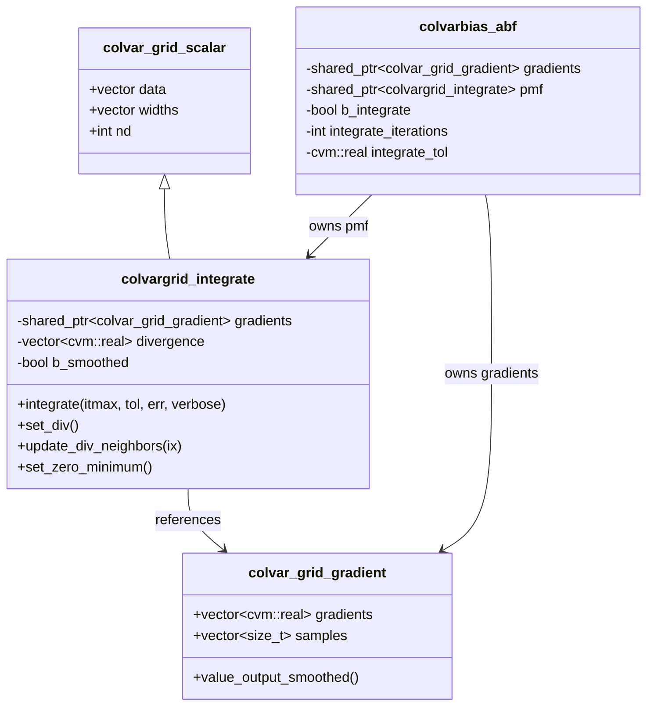
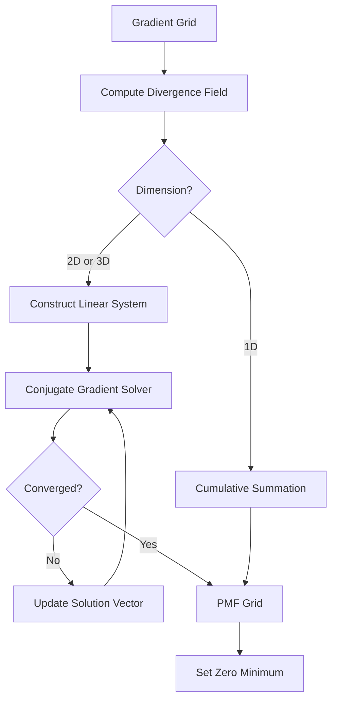

Free Energy Surface Integration in the Colvars framework transforms accumulated bias forces from enhanced sampling methods into continuous potential of mean force (PMF) profiles. This process numerically integrates gradient data stored on multidimensional grids to recover the free energy landscape that governs the system's behavior. The integration subsystem operates as a post-processing and real-time analysis layer that supports Adaptive Biasing Force (ABF), metadynamics, and other gradient-based sampling methods, enabling quantitative free energy calculations from collected force samples.

Sources: [colvargrid_integrate.h](src/colvargrid_integrate.h#L8-L9), [colvarbias_abf.h](src/colvarbias_abf.h#L52-L53)

## Mathematical Foundation

The free energy surface integration solves the inverse problem of the gradient relationship ∇F = -F, where F represents the free energy surface and F̂ represents the observed average forces on collective variables. Given a discrete grid of gradient values g(i,j,k) at each bin, the integration reconstructs the scalar potential field φ such that the discrete gradient of φ approximates the input gradients. In one dimension, this reduces to cumulative integration: φ(x) = -∫F̂(x)dx + C. For higher dimensions, the problem becomes a partial differential equation solved via Laplacian inversion: ∇²φ = -∇·F̂, where the right-hand side represents the divergence of the force field.

Sources: [colvargrid_integrate.cpp](src/colvargrid_integrate.cpp#L103-L112), [colvargrid_integrate.cpp](src/colvargrid_integrate.cpp#L166-L176)

## Integration Architecture

The `colvargrid_integrate` class extends `colvar_grid_scalar` to provide gradient-to-potential transformation capabilities. It maintains a reference to a gradient grid (`colvar_grid_gradient`) containing the accumulated force samples and stores the divergence field used in multi-dimensional integration. The class offers two primary construction patterns: runtime initialization with active colvar objects for on-the-fly integration during simulations, and standalone initialization with a gradient grid for post-processing of previously collected data. This dual-mode design supports both real-time PMF monitoring during simulations and offline analysis of completed trajectories.

Sources: [colvargrid_integrate.h](src/colvargrid_integrate.h#L8-L23), [colvargrid_integrate.h](src/colvargrid_integrate.h#L50-L56)



## 1D Integration Method

One-dimensional free energy integration employs direct cumulative summation of gradient values across the grid. For periodic systems, the method first computes the average gradient across all bins and subtracts this bias from each gradient value before integration, ensuring the resulting potential respects periodic boundary conditions. The integration proceeds bin-by-bin, accumulating the product of gradient values and bin widths: φ[i+1] = φ[i] - (g[i] - ḡ) × Δx. For non-periodic systems, the PMF grid contains one additional bin relative to the gradient grid to accommodate the final integrated value at the upper boundary. This straightforward approach provides exact integration for 1D collective variables with minimal computational overhead.

Sources: [colvargrid_integrate.cpp](src/colvargrid_integrate.cpp#L63-L85), [colvargrid_integrate.cpp](src/colvargrid_integrate.cpp#L150-L157)

> [!TIP]
> The 1D integration automatically enforces periodic boundary conditions by subtracting the mean gradient before accumulation, preventing artificial drift in the calculated PMF for cyclic coordinates like dihedral angles.

## Multi-Dimensional Integration (2D/3D)

For two- and three-dimensional collective variable spaces, the integration requires solving a linear system derived from the Laplacian operator. The method constructs a divergence field by computing finite-difference approximations of the gradient field's divergence at each grid point. In 2D, the divergence at point (i,j) combines the x-direction gradient differences and y-direction gradient differences from the four surrounding grid points: div[i,j] = 0.5 × [(∂g_x/∂x) + (∂g_y/∂y)]. The 3D case extends this pattern to eight neighboring points, averaging the directional derivatives across x, y, and z axes. This divergence field forms the right-hand side of the linear system ∇²φ = div, which yields the potential field when solved.

Sources: [colvargrid_integrate.cpp](src/colvargrid_integrate.cpp#L166-L216), [colvargrid_integrate.cpp](src/colvargrid_integrate.h#L27-L37)



## Conjugate Gradient Solver

The multi-dimensional integration employs a conjugate gradient algorithm (`nr_linbcg_sym`) to solve the symmetric linear system representing the Laplacian inversion. This iterative method minimizes the residual error between the computed Laplacian of the solution and the target divergence field. The solver performs sparse matrix-vector multiplications through the `atimes` method, which efficiently computes the action of the discrete Laplacian operator on a vector using a 5-point stencil in 2D or a 7-point stencil in 3D. The iteration proceeds until the residual norm falls below the specified tolerance or the maximum iteration count is reached. The algorithm reports the final iteration count and residual error, enabling users to monitor convergence quality.

Sources: [colvargrid_integrate.cpp](src/colvargrid_integrate.cpp#L634-L685), [colvargrid_integrate.cpp](src/colvargrid_integrate.cpp#L218-L310)

> [!TIP]
> The conjugate gradient solver automatically applies modified Neumann boundary conditions for non-periodic dimensions, halving the Laplacian stencil coefficients at grid edges to preserve matrix symmetry and ensure well-posed solutions.

## Configuration and Usage

The free energy integration subsystem is primarily configured through the ABF bias definition, though it operates independently for post-processing applications. Key configuration parameters control the integration behavior: `integrate` enables or disables PMF computation, `integrateMaxIterations` sets the solver iteration limit (default: 10000), and `integrateTol` specifies the convergence tolerance (default: 1e-6). For real-time PMF updates in projected ABF (pABF), additional parameters `pABFintegrateFreq`, `pABFintegrateMaxIterations`, and `pABFintegrateTol` control on-the-fly integration during simulation. The `b_smoothed` flag determines whether to use smoothed gradient values during integration, which can reduce noise in the resulting PMF at the cost of resolution.

Sources: [colvarbias_abf.cpp](src/colvarbias_abf.cpp#L204-L224), [colvargrid_integrate.h](src/colvargrid_integrate.h#L45-L46)

| Parameter | Type | Default | Description |
|-----------|------|---------|-------------|
| `integrate` | boolean | true for nd ≤ 3 | Enable free energy integration |
| `integrateMaxIterations` | integer | 10000 | Maximum CG solver iterations |
| `integrateTol` | real | 1.0e-6 | Convergence tolerance for residual error |
| `pABFintegrateFreq` | integer | 0 | Frequency for on-the-fly PMF updates |
| `pABFintegrateMaxIterations` | integer | 100 | CG iterations for pABF updates |
| `pABFintegrateTol` | real | 1.0e-4 | Tolerance for pABF updates |

## Integration with ABF and Enhanced Sampling

The ABF bias maintains gradient grids (`gradients`) and integrated PMF grids (`pmf`) as tightly coupled data structures. During initialization, ABF allocates a `colvargrid_integrate` instance linked to its gradient grid, enabling automatic PMF computation during output operations. The integration occurs automatically when writing output files, with the gradient data first accumulated from simulation samples, then transformed into a free energy surface. For extended ABF (eABF) with the CZAR estimator, a separate integration grid (`czar_pmf`) processes the CZAR-corrected gradients to provide improved free energy estimates for systems with extended Lagrangian dynamics. The integration system also supports shared ABF across multiple replicas, with dedicated grids for local, global, and replica-specific PMF calculations.

Sources: [colvarbias_abf.h](src/colvarbias_abf.h#L100-L113), [colvarbias_abf.cpp](src/colvarbias_abf.cpp#L204-L224)

## Performance and Computational Considerations

The computational cost of free energy integration scales primarily with grid size and dimensionality. One-dimensional integration is O(n) where n is the number of bins, requiring negligible overhead. Multi-dimensional integration requires solving a linear system with O(n) unknowns, where the conjugate gradient method typically converges in tens to hundreds of iterations depending on grid resolution and gradient field smoothness. Each iteration involves sparse matrix-vector multiplication with computational complexity O(n), yielding total complexity O(iterations × n). Memory requirements include storing the gradient grid, divergence vector, and solution vector, each containing n real values. The `update_div_neighbors` method enables efficient incremental updates when only local gradient values change, avoiding full recomputation of the divergence field during on-the-fly pABF updates.

Sources: [colvargrid_integrate.cpp](src/colvargrid_integrate.cpp#L103-L148), [colvargrid_integrate.cpp](src/colvargrid_integrate.cpp#L634-L685)

## Advanced Features

The integration system provides several advanced capabilities for specialized applications. The `set_zero_minimum()` method shifts the integrated potential so that its minimum value equals zero, standardizing PMF representations for comparison and analysis. Gradient smoothing can be enabled through the `b_smoothed` flag, which uses interpolated gradient values to reduce noise from undersampled regions. The `get_grad()` method handles periodic boundary conditions by wrapping indices and provides gradient values for grid edge locations, ensuring consistent divergence calculations. For post-processing applications, the standalone constructor allows integration of gradient grids without requiring a complete Colvars configuration, enabling analysis of previously collected data files.

Sources: [colvargrid_integrate.h](src/colvargrid_integrate.h#L39-L46), [colvargrid_integrate.h](src/colvargrid_integrate.h#L21-L22)

## Practical Usage Example

A typical configuration for ABF with integrated PMF output demonstrates the key parameters:

```
abf {
  colvars z
  
  fullSamples 200
  minSamples 100
  
  # Enable PMF integration (automatic for ≤ 3D)
  integrate yes
  
  # Integration solver parameters
  integrateMaxIterations 5000
  integrateTol 1.0e-6
  
  # Optional: on-the-fly PMF updates
  pABFintegrateFreq 1000
  pABFintegrateMaxIterations 100
  pABFintegrateTol 1.0e-4
}
```

This configuration enables gradient accumulation during the simulation, automatically integrates the collected data into a PMF during output, and optionally performs real-time PMF updates every 1000 steps with relaxed convergence criteria for interactive monitoring.

Sources: [colvarbias_abf.cpp](src/colvarbias_abf.cpp#L204-L224)

## Error Handling and Validation

The integration system performs several validation checks to ensure robust operation. It verifies that the grid dimension does not exceed three, as higher-dimensional integration is not supported due to computational complexity and numerical stability concerns. The conjugate gradient solver monitors the residual norm and terminates if it falls below a small epsilon value (1.0e-14) to prevent division by zero when computing relative errors. For non-periodic dimensions, the implementation automatically expands the grid to include boundary points, enabling proper application of Neumann boundary conditions. Error messages clearly communicate configuration issues such as excessive dimensionality or convergence failures, aiding users in diagnosing integration problems.

Sources: [colvargrid_integrate.cpp](src/colvargrid_integrate.cpp#L63-L101), [colvargrid_integrate.cpp](src/colvargrid_integrate.cpp#L634-L645)

## Next Steps

For deeper understanding of the free energy integration ecosystem:

- **[Grid Configuration and Parameters](16-grid-configuration-and-parameters)**: Learn how gradient and scalar grids are configured and managed
- **[Adaptive Biasing Force (ABF)](12-adaptive-biasing-force-abf)**: Understand the ABF method that generates gradient data for integration
- **[Custom Grids and PMF Calculations](18-custom-grids-and-pmf-calculations)**: Explore advanced grid manipulation and PMF analysis techniques
- **[Multi-Dimensional Grid Operations](19-multi-dimensional-grid-operations)**: Master operations on higher-dimensional collective variable spaces

The free energy integration subsystem provides the critical link between accumulated force samples and quantitative free energy landscapes, enabling researchers to extract thermodynamic insights from enhanced sampling simulations performed with the Colvars framework.
