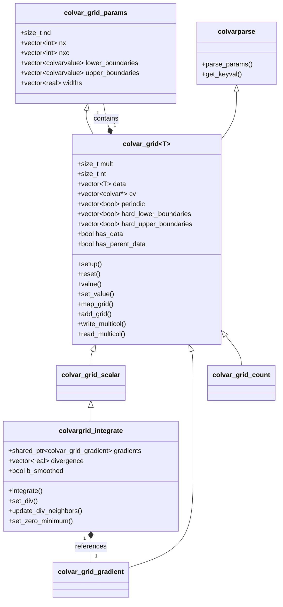
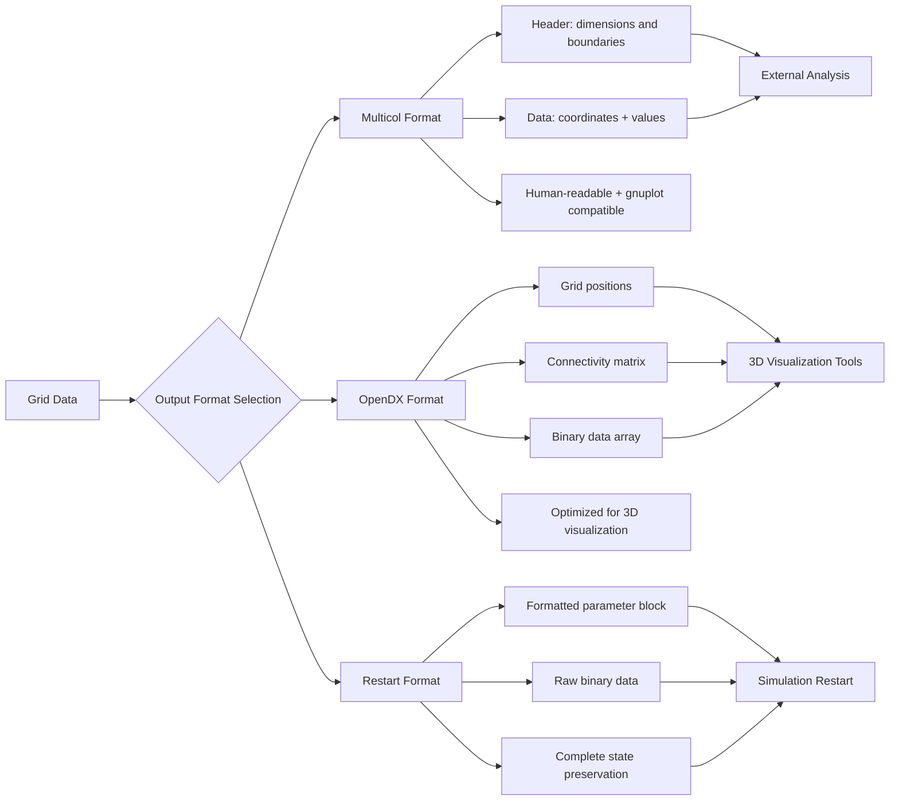
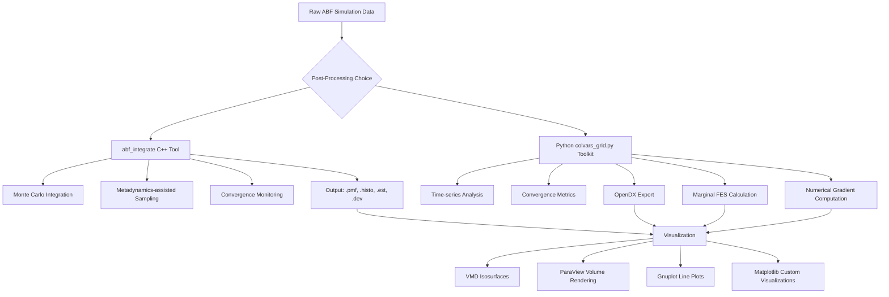

Custom grids and Potential of Mean Force (PMF) calculations represent the analytical cornerstone of the Colvars framework, enabling researchers to transform sampled collective variable data into interpretable free energy landscapes. This page explores the grid infrastructure, PMF integration algorithms, custom grid manipulation capabilities, and post-processing workflows that convert raw simulation data into thermodynamic insights. Building upon the foundation of [Grid Configuration and Parameters](16-grid-configuration-and-parameters) and [Free Energy Surface Integration](17-free-energy-surface-integration), this guide provides the advanced implementation details needed for custom analysis workflows.

## Grid Architecture and Data Structures

The grid infrastructure in Colvars centers around a template-based design that provides a unified interface for different data types while maintaining type-specific optimizations. The `colvar_grid<T>` template class forms the foundation, inheriting from `colvar_grid_params` for dimensional metadata and `colvarparse` for configuration parsing. This architecture supports scalar fields, count grids, and gradient fields through template specialization, enabling consistent operations across diverse data types while preserving memory efficiency and computational performance.

The grid parameter structure maintains critical dimensional information including the number of dimensions (`nd`), grid point counts per dimension (`nx`), cumulative indices (`nxc`), and boundary definitions for both lower and upper limits. The template instantiation determines the data multiplicity, with gradient grids automatically assigning multiplicity equal to the number of dimensions to store complete vector information at each bin location. This design enables efficient storage and access patterns where linear indexing maps multidimensional coordinates to contiguous memory locations through the `address()` method.

Grid boundaries support three distinct modes: periodic boundaries that wrap coordinates across edges, hard boundaries that reject out-of-range values, and soft boundaries that clamp values to the nearest valid bin. The `wrap()` method handles periodic boundary conditions by adjusting indices modulo the dimension size, while `wrap_detect_edge()` provides non-periodic boundary handling by detecting edge cases and returning status information. These methods are essential for maintaining grid consistency when mapping continuous colvar values onto discrete grid points.



The memory layout optimizes cache performance by storing data in row-major order, where the last dimension varies fastest. The `value()` and `set_value()` methods provide indexed access through multidimensional coordinate vectors, while low-level methods like `get_value(size_t i)` enable performance-critical linear access patterns. The `has_parent_data` flag distinguishes between independent grids and those derived from parent grids, such as count grids that track sampling statistics for associated data grids.

Sources: [src/colvargrid.h](src/colvargrid.h#L24-L186), [src/colvargrid.h](src/colvargrid.h#L51-L106)

## PMF Integration Methods

The integration of free energy gradients into potential of mean force surfaces represents a core mathematical challenge that Colvars addresses through multiple specialized algorithms. The `colvargrid_integrate` class provides the primary implementation, extending `colvar_grid_scalar` with gradient references and divergence computation capabilities. Two integration paths exist: a direct cumulative integration method optimized for one-dimensional systems, and a Poisson equation solver using conjugate gradient methods for multi-dimensional free energy surfaces.

For one-dimensional PMF integration, the algorithm implements a straightforward cumulative sum of gradient values, optionally corrected for periodic boundary conditions by subtracting the mean gradient to ensure continuity. The integration proceeds iteratively through the gradient grid, accumulating the product of gradient values and bin widths: `PMF[x] = Σᵢ (gradient[i] × width[i])`. When periodic boundaries are present, the algorithm computes the average gradient value across the entire domain and subtracts this constant to enforce `PMF[periodic] = PMF[0]`, ensuring physically meaningful potential surfaces.

Multi-dimensional integration requires solving the Poisson equation ∇²PMF = -∇·F, where F represents the free energy gradient field. The implementation computes the divergence of the gradient field using finite difference stencils adapted for each dimension, then solves the resulting linear system using the conjugate gradient algorithm. The `set_div()` method computes divergence values across the entire grid, while `update_div_neighbors()` provides efficient localized updates when gradient values change at specific grid points.

The divergence computation uses central finite differences with special handling at boundaries. For two-dimensional grids, the algorithm evaluates gradient values at the four corners surrounding each scalar grid point and computes the divergence as: `∇·F = 0.5 × [(Fₓ₁₀-Fₓ₀₀ + Fₓ₁₁-Fₓ₀₁)/Δx + (Fᵧ₀₁-Fᵧ₀₀ + Fᵧ₁₁-Fᵧ₁₀)/Δy]`. This formulation ensures conservation properties and handles mixed partial derivatives correctly. The three-dimensional case extends this pattern to evaluate gradients at eight corners of each cubic cell, with appropriate weighting factors.

The conjugate gradient solver (`nr_linbcg_sym`) iteratively minimizes the residual error until convergence criteria are met. The integration parameters include maximum iterations (`integrateMaxIterations`, default 10000), tolerance (`integrateTol`, default 1e-6), and verbose output control. For projected ABF (pABF) applications requiring on-the-fly integration, separate parameters (`pABFintegrateMaxIterations`, `pABFintegrateTol`) allow looser convergence criteria suitable for real-time updates.

> [!TIP]
> Integration convergence depends critically on gradient data quality. Sparse or noisy gradient data in certain regions can cause convergence issues or unrealistic PMF values. Consider smoothing gradients before integration or using the metadynamics-based post-processing tool (`abf_integrate`) which includes biasing terms to improve sampling during the integration process.

Sources: [src/colvargrid_integrate.h](src/colvargrid_integrate.h#L8-L76), [src/colvargrid_integrate.cpp](src/colvargrid_integrate.cpp#L1-L79), [src/colvargrid_integrate.cpp](src/colvargrid_integrate.cpp#L101-L167)

## Grid File Formats and I/O Operations

Colvars supports multiple file formats for grid data exchange, enabling interoperability with external analysis tools and long-term data archiving. The `write_multicol()` method produces a human-readable multi-column format that includes coordinate information alongside grid values, making it suitable for both manual inspection and automated parsing. The format begins with a header specifying the number of colvars followed by per-dimension metadata including lower boundaries, bin widths, point counts, and periodic flags.

The multicol format structure consists of a header section with dimension information, followed by data rows where each line contains coordinate values (one per colvar) and the associated grid value(s). This format supports multiple multiplicity values through additional columns, enabling storage of vector fields such as gradients where each bin contains multiple values (e.g., x, y, z components). The format is gnuplot-compatible, facilitating direct visualization without additional processing.

The `read_multicol()` method provides automatic grid remapping when the file's grid definition differs from the current grid parameters. When boundary values, bin widths, or point counts differ, the algorithm uses interpolation to map data from the source grid onto the target grid. The `wrap_detect_edge()` method handles boundary conditions during this remapping process, ensuring proper treatment of periodic and non-periodic dimensions. This flexibility enables combining data from simulations with different grid resolutions or analyzing historical data after adjusting grid parameters.

The OpenDX format (`write_opendx()`) provides an alternative optimized for three-dimensional visualization applications. This format stores grid data in a binary-efficient structure with explicit coordinate system definitions, making it suitable for large datasets where file size and loading speed are critical. The format includes grid positions, connectivity information, and the data array in a single file that external tools like VMD or ParaView can render directly as isosurfaces or volume renderings.

Restart file formats maintain complete grid state including both parameters and raw data, enabling exact reconstruction of grid structures for continuation simulations. The `write_restart()` and `read_restart()` methods use a combination of formatted parameter blocks and raw binary data sections, balancing human-readability of configuration information with efficient storage of large data arrays. The memory stream variants (`write_restart(cvm::memory_stream &)`) provide in-memory serialization for inter-process communication and checkpoint/restart systems.



Sources: [src/colvargrid_def.h](src/colvargrid_def.h#L310-L473), [src/colvargrid_def.h](src/colvargrid_def.h#L493-L531), [src/colvargrid_def.h](src/colvargrid_def.h#L202-L306)

## Custom Grid Operations and Transformations

The grid framework provides a rich set of operations for manipulating and transforming grid data beyond basic I/O. The `map_grid()` method enables projection of one grid onto another with potentially different dimensions or resolutions, performing bilinear interpolation during the mapping process. This operation is essential when comparing results from simulations with different grid definitions or when upsampling/downsampling grids for analysis purposes. The method automatically handles coordinate transformations and boundary conditions, ensuring that the mapping respects periodic dimensions and edge effects in non-periodic dimensions.

The `add_grid()` method provides efficient combination of grids with identical definitions, supporting both simple addition and scaled addition through the `scale_factor` parameter. This operation enables accumulation of data from multiple simulation runs, weighted averaging, and ensemble combination strategies. The implementation checks grid compatibility before addition, verifying that boundaries, widths, and dimensions match to prevent invalid operations.

Grid arithmetic operations include element-wise constants addition (`add_constant`), multiplication (`multiply_constant`), and thresholding (`remove_small_values`) that apply scalar operations across all grid points. These methods use optimized loops for performance, making them suitable for large grids. The `delta_grid()` method computes differences between grids of identical size, storing the result in the calling grid object with the operation: `this_grid := other_grid - this_grid`. This operation is useful for monitoring convergence by computing differences between successive PMF estimates.

Advanced analysis capabilities include numerical gradient computation from PMF surfaces (`numerical_gradient()` in Python tools), marginal free energy surface calculation (`marginal_fes()`), and entropy computation from distribution data. The `marginal_fes()` method integrates out specified degrees of freedom to produce lower-dimensional projections, enabling detailed analysis of complex multi-dimensional surfaces. The computation sums Boltzmann-weighted contributions across marginalized dimensions: `F₁D(x) = -kT × ln[∫ exp(-FₙD(x,y)/kT) dy]`, where the integral becomes a discrete sum over grid points.

> [!TIP]
> When performing marginal FES calculations, consider the choice of reference state carefully. The computation assumes uniform prior probabilities and may produce biased results if sampling is highly non-uniform. Use histogram-based marginalization with explicit sample counts when dealing with sparse sampling in regions of interest.

Grid operations support both in-place modifications and creation of new grid objects, enabling both memory-efficient transformations and preservation of original data. The `copy_grid()` method creates a deep copy of both data and configuration parameters, while the "almost copy-constructor" copies only configuration parameters, enabling efficient setup of multiple grids with identical dimensions but different initial data.

Sources: [src/colvargrid.h](src/colvargrid.h#L759-L821), [colvartools/colvars_grid.py](colvartools/colvars_grid.py#L378-L428), [colvartools/colvars_grid.py](colvartools/colvars_grid.py#L480-L541)

## ABF Bias Integration with Custom Grids

The Adaptive Biasing Force (ABF) method leverages custom grid infrastructure for both real-time biasing force application and post-processing free energy calculations. The `colvarbias_abf` class manages multiple grid types: gradient grids storing accumulated free energy derivatives, count grids tracking sampling statistics, and PMF grids for integrated free energy surfaces. This architecture supports both on-the-fly integration during simulation runs and post-processing analysis of accumulated gradient data.

ABF initialization creates grids based on the collective variables defined in the configuration, with optional grid expansion for PMF storage. The `add_extra_bin` parameter in the PMF grid constructor adds one additional bin in non-periodic dimensions, accommodating the fact that PMF values exist at bin centers while gradients exist at bin edges. This ensures proper alignment between gradient sampling locations and integrated potential values.

The `integrate` configuration parameter controls whether PMF integration occurs, defaulting to enabled for dimensions ≤ 3. Integration parameters control both initial/final output quality (`integrateMaxIterations`, `integrateTol`) and on-the-fly updates for projected ABF (`pABFintegrateMaxIterations`, `pABFintegrateTol`). The `hideJacobian` parameter determines whether geometric forces from distance-based colvars are included in the gradient calculations, affecting both biasing forces and computed PMF values.

Input gradient files can be loaded using the `inputPrefix` parameter, enabling continuation from previous simulations or combination of data from multiple runs. The `read_gradients_samples()` method reads gradient and count data from files, automatically updating the PMF divergence matrix through `pmf->set_div()` to ensure consistent integration results. This capability supports incremental data accumulation where new data is combined with existing results without requiring re-integration from scratch.

Multiple-walker ABF implementations use additional grid pairs to distinguish between local replica data and globally shared data. The `shared` parameter enables this mode, with `sharedFreq` controlling communication frequency between replicas. Separate grids (`local_gradients`, `local_samples`, `local_pmf`) track replica-specific contributions, while regular grids accumulate shared data. This architecture enables detailed analysis of individual replica contributions while maintaining the collective biasing force computation required for proper sampling.

Sources: [src/colvarbias_abf.h](src/colvarbias_abf.h#L88-L154), [src/colvarbias_abf.cpp](src/colvarbias_abf.cpp#L1-L100), [src/colvarbias_abf.cpp](src/colvarbias_abf.cpp#L200-L300)

## Post-Processing Workflows

The Colvars distribution includes specialized tools for post-processing grid data beyond the capabilities of the main simulation framework. The `abf_integrate` tool implements a Monte Carlo-based integration algorithm that combines gradient data with optional metadynamics-style biasing to improve sampling convergence during PMF calculation. This approach addresses limitations in pure conjugate gradient integration when gradient data is sparse or contains noise.

The Monte Carlo integration procedure performs a random walk through the gradient field, accepting or rejecting moves based on the local free energy gradient and optional bias potential. The algorithm tracks sampling through a histogram, enabling convergence assessment via root-mean-square deviation of the estimated gradient field. Command-line parameters control integration steps (`-n`), temperature (`-t` for the MC temperature parameter), gradient scaling (`-s`), and metadynamics hill height (`-h`) and decay factor (`-f`). The tool outputs four files: the integrated PMF (`.pmf`), sampling histogram (`.histo`), estimated gradient field (`.est`), and deviation from input gradients (`.dev`).

The Python analysis toolkit (`colvars_grid.py`) provides comprehensive grid manipulation capabilities through an object-oriented interface. The `colvars_grid` class reads multicol files, provides time-series tracking for history files, and implements analysis methods including convergence metrics, marginal distributions, numerical gradients, and partial averages. The `ABF_dataset` class provides specialized ABF-specific analysis, loading gradient, count, and PMF files and computing convergence metrics between different simulation segments.

Python analysis workflows typically begin with `colvars_grid(filename)` to load grid data, followed by method calls for analysis operations. The `convergence()` method computes RMSD between grid states, enabling quantitative assessment of sampling convergence. The `partial_average(begin, end)` method computes statistics over specific time ranges, useful for analyzing how free energy estimates evolve during simulation. For multi-dimensional surfaces, `marginal_fes(dofs)` produces projections that highlight specific reaction coordinates.

Integration with external visualization tools enables comprehensive analysis workflows. The `write_dx()` method produces OpenDX format files suitable for isosurface visualization in VMD or ParaView. The `interp_on_gradient_grid()` method aligns PMF data with gradient grid coordinates for consistent multi-field visualization. These capabilities support publication-quality figure generation and detailed analysis of complex free energy landscapes.



Sources: [colvartools/abf_integrate.cpp](colvartools/abf_integrate.cpp#L29-L120), [colvartools/abf_data.h](colvartools/abf_data.h#L16-L71), [colvartools/colvars_grid.py](colvartools/colvars_grid.py#L33-L112), [colvartools/colvars_grid.py](colvartools/colvars_grid.py#L675-L733)

## Configuration Examples and Practical Considerations

Configuring custom grids and PMF calculations requires understanding both the Colvars configuration syntax and the physical constraints of the system under study. The following example demonstrates ABF configuration with custom grid integration:

```
abf {
    colvars distance angle dihedral
    
    # Grid configuration
    lowerBoundary 2.0 0.0 0.0
    upperBoundary 10.0 180.0 360.0
    width 0.1 5.0 10.0
    
    # Integration parameters
    integrate yes
    integrateMaxIterations 10000
    integrateTol 1e-6
    
    # Sample accumulation
    fullSamples 200
    minSamples 100
    
    # Output options
    outputFreq 1000
    historyFreq 5000
    
    # Optional: load previous gradients
    inputPrefix prev_run
    
    # Optional: enable pABF with frequent updates
    pABFintegrateFreq 100
    pABFintegrateMaxIterations 100
    pABFintegrateTol 1e-4
}
```

Grid resolution selection represents a critical trade-off between statistical accuracy and computational efficiency. Finer grids provide higher spatial resolution but require more samples per bin for reliable gradient estimates. The `fullSamples` parameter controls when bins receive full biasing force, with `minSamples` providing a threshold for partial force application. Practical guidance suggests selecting bin widths approximately 10-20 times the standard deviation of the collective variable fluctuations, ensuring adequate sampling while maintaining sufficient resolution to capture free energy barriers.

Memory considerations become significant for multi-dimensional grids, where total point count scales as the product of points per dimension. A 3D system with 100 points per dimension requires one million grid points, with memory usage depending on data type (scalar: ~8 MB, gradient: ~24 MB). The `has_parent_data` flag optimizes memory for count grids that are always associated with data grids, avoiding redundant storage of dimensional parameters.

Boundary condition selection impacts both sampling and PMF calculation accuracy. Periodic boundaries are appropriate for angular variables (0-360°) and periodic distances, while hard boundaries should be used when sampling is naturally constrained (e.g., coordination numbers cannot be negative). Soft boundaries clamp values at edges but may produce artificial forces near boundaries. The choice affects both the biasing force application and the integration boundary conditions for PMF calculation.

For extended Lagrangian systems where colvars are coupled to fictitious particles via harmonic springs, the `request_actual_value()` method determines whether grids track the extended coordinate (default) or the actual colvar value. This distinction affects eABF implementations where CZAR estimators require separate grids for both coordinate types. The `z_gradients` and `z_samples` grids track extended system data, while `czar_gradients` and `czar_pmf` provide free energy estimates for the real coordinate system.

Restart file management ensures reproducibility and enables continuation of long simulations. The `write_output_files()` method in ABF bias generates both current state files and gradient/count data for post-processing. The `read_gradients_samples()` method can load this data for continuation runs, automatically updating the PMF divergence matrix. For maximum reproducibility, store both the complete restart file (containing all grid states) and the gradient/count files (enabling alternative integration parameters in post-processing).
