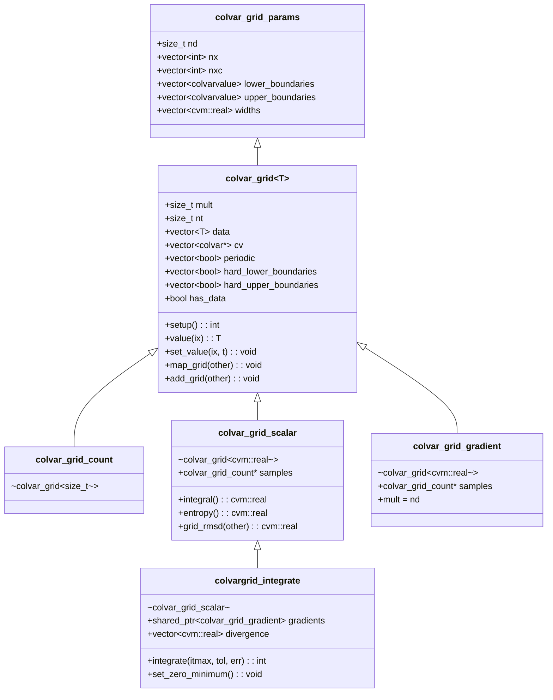
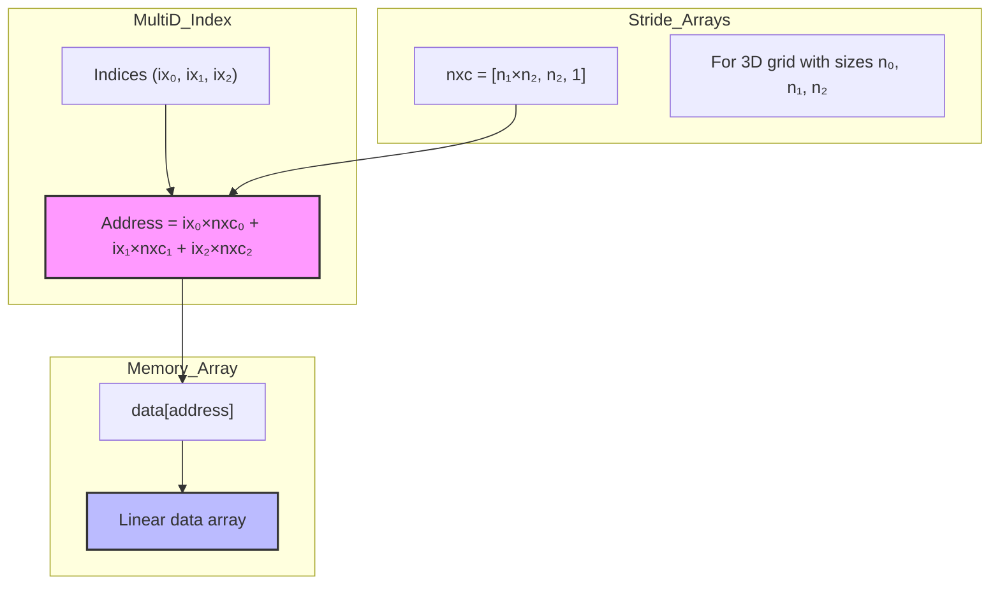

The multi-dimensional grid system in Colvars provides the computational foundation for enhanced sampling methods that operate across collective variable spaces. These grids enable efficient storage, manipulation, and analysis of free energy surfaces, probability distributions, and bias forces across arbitrary dimensional configurations. The architecture supports both periodic and non-periodic boundaries, dynamic grid resizing, and sophisticated interpolation schemes for robust numerical operations.

Sources: [colvargrid.h](src/colvargrid.h#L51-L95), [colvargrid.cpp](src/colvargrid.cpp#L125-L145)

## Core Grid Architecture

The grid system employs a **template-based design** that generalizes across data types while maintaining specialized implementations for common use cases. The foundational `colvar_grid<T>` template provides multi-dimensional array functionality with collective variable awareness, supporting arbitrary dimensions determined by the number of collective variables in the simulation.

The grid parameter structure `colvar_grid_params` defines the **dimensional topology** including boundaries, bin widths, and point counts. The cumulative stride array `nxc` enables efficient linear addressing by storing the cumulative number of points along each dimension, allowing conversion from multi-dimensional indices to flat memory addresses in constant time per dimension. This design choice optimizes cache locality for sequential iteration patterns common in grid-based algorithms.

Sources: [colvargrid.h](src/colvargrid.h#L24-L50), [colvargrid.h](src/colvargrid.h#L76-L90)

## Specialized Grid Types

Three specialized grid types address distinct computational requirements in enhanced sampling. The **count grid** (`colvar_grid_count`) stores sample frequencies for each bin, essential for statistical reliability in methods like ABF and metadynamics. The **scalar grid** (`colvar_grid_scalar`) represents continuous quantities such as free energy values or bias forces, optionally linked to a count grid for weighted statistics. The **gradient grid** (`colvar_grid_gradient`) stores vector quantities with multiplicity equal to the number of dimensions, naturally representing gradient fields where each grid point contains a vector of partial derivatives along each collective variable.

| Grid Type | Data Type | Multiplicity | Primary Use Case | Sample Grid |
|-----------|-----------|--------------|------------------|-------------|
| `colvar_grid_count` | `size_t` | 1 | Sample counting, histograms | No |
| `colvar_grid_scalar` | `cvm::real` | 1 | Free energy, bias forces, PMF | Optional |
| `colvar_grid_gradient` | `cvm::real` | nd (dimensions) | Forces, gradient fields | Required |

The scalar grid provides **analytical methods** including integration over bin volumes for total probability, entropy computation for information-theoretic analysis, and RMSD comparison between grids for convergence monitoring. The integral operation multiplies the sum of all grid values by the bin volume product across all dimensions, correctly accounting for the differential volume element in multi-dimensional space.

Sources: [colvargrid.cpp](src/colvargrid.cpp#L21-L35), [colvargrid.cpp](src/colvargrid.cpp#L125-L145), [colvargrid.cpp](src/colvargrid.cpp#L352-L367), [colvargrid.cpp](src/colvargrid.cpp#L274-L301)

## Memory Layout and Indexing

The grid employs a **row-major ordering** where the last dimension index varies fastest. The address calculation implements a dot product between the index vector and the cumulative stride array: `addr = Σ(ix[i] × nxc[i])`. This scheme maps multi-dimensional coordinates to a contiguous memory array, enabling direct pointer arithmetic and cache-friendly sequential access patterns. The total number of grid points `nt` represents the product of bin counts across all dimensions, determining memory allocation size.

The index iteration pattern uses `new_index()` to initialize a zero vector, `incr()` to advance indices with proper carry propagation between dimensions, and `index_ok()` to validate boundary conditions. This pattern enables efficient loops over all grid points without manual index management, with the increment operation handling dimension overflow by resetting inner dimensions and carrying to outer dimensions, terminating when the first dimension exceeds its bounds.

Sources: [colvargrid.h](src/colvargrid.h#L76-L90), [colvargrid.h](src/colvargrid.h#L854-L894)

## Value-to-Bin Mapping and Interpolation

The conversion between continuous collective variable values and discrete bin indices uses **floor-based binning** with the formula `bin_index = floor((value - lower_bound) / width)`. This mapping determines which grid point corresponds to a given configuration, with additional fraction calculations enabling linear interpolation between grid points for higher accuracy. The bin center is computed as `center = lower_bound + width × (0.5 + bin_index)`, placing values at the geometric center of each bin.

For **extended Lagrangian** collective variables, grids can request actual values rather than extended coordinates through the `use_actual_value` flag, allowing grids to track either the extended variable or the actual physical coordinate. This flexibility supports both implicit and explicit integration schemes where the extended coordinate may diverge from the true value during constrained dynamics.

Sources: [colvargrid.h](src/colvargrid.h#L504-L557), [colvargrid.h](src/colvargrid.h#L73-L74)

> [!TIP]
> When using extended Lagrangian collective variables with grids, set the `use_actual_value` flag to `true` for free energy calculations that depend on physical coordinates rather than extended variables, as this ensures the grid samples the true configurational space rather than the extended variable space.

## Boundary Condition Handling

The grid system supports both **periodic and non-periodic** boundaries through separate handling paths. For periodic dimensions, indices wrap using modulo arithmetic: `ix[i] = (ix[i] + nx[i]) % nx[i]`, where adding `nx[i]` before modulo ensures correct handling of negative indices. This implementation avoids undefined behavior with negative operands in the modulo operation by ensuring the dividend is always positive.

Non-periodic dimensions employ **hard boundary checking** with error detection or edge clamping depending on the operation type. The `wrap()` function enforces strict boundaries and errors on invalid indices, while `wrap_detect_edge()` returns a boolean flag indicating edge conditions without modification, and `wrap_to_edge()` clamps indices to the nearest valid bin for operations that must remain within grid bounds. This tiered approach enables appropriate behavior for different computational contexts—strict validation for configuration parsing, detection for conditional operations, and clamping for interpolation.

Sources: [colvargrid.h](src/colvargrid.h#L416-L467)

## Grid Transformation Operations

### Mapping Between Grid Definitions

The `map_grid()` operation enables **remapping data** between grids with different definitions (boundaries, widths, or resolution). For each bin in the target grid, the function computes the corresponding coordinates, maps these coordinates back to bin indices in the source grid, and copies values when indices are valid. This operation supports merging results from simulations with different collective variable ranges or grid resolutions without requiring preprocessing of input data.

The mapping algorithm iterates over all target grid points, converts each bin index to coordinate space using the target's boundaries and widths, then converts those coordinates back to bin indices in the source coordinate space. This allows seamless integration of data from heterogeneous sources, such as combining multiple ABF runs with different CV ranges into a unified free energy surface.

Sources: [colvargrid.h](src/colvargrid.h#L755-L798)

### Grid Arithmetic and Combination

The `add_grid()` operation performs **element-wise addition** between grids with identical definitions, supporting an optional scale factor for weighted averaging. This operation efficiently merges sample counts or free energy values from multiple simulations or simulation replicas, with the scale factor enabling normalization by simulation length or replica count. The implementation provides optimized paths for both scaled and unscaled addition to minimize computational overhead.

The `delta_grid()` operation computes the difference between grids, storing `other_grid - this_grid` in place. This enables convergence analysis by comparing grids at different time points or between replicas, with applications in free energy convergence monitoring and gradient analysis. Both arithmetic operations require matching multiplicity between grids to ensure dimensional consistency.

Sources: [colvargrid.h](src/colvargrid.h#L800-L820), [colvargrid.h](src/colvargrid.h#L581-L604)

### Poisson Integration for Free Energy Surfaces

The `colvargrid_integrate` class implements **Poisson equation solving** to reconstruct free energy surfaces from gradient fields, a critical operation for methods like ABF that compute forces rather than energies directly. For one-dimensional grids, integration uses cumulative summation with boundary condition handling—subtracting the average gradient for periodic dimensions to enforce consistency, or setting the boundary value directly for non-periodic cases.

For **two and three dimensions**, the integration solves the discrete Poisson equation ∇²PMF = -∇·F using the conjugate gradient method. The divergence array stores the negative divergence of the gradient field plus Neumann boundary condition corrections, forming the right-hand side of the linear system. The solver constructs a sparse matrix representing the Laplacian operator (or its transpose for the transpose-free conjugate gradient method) and iteratively converges to the potential energy surface that produces the observed gradients.

The integration constructor optionally expands non-periodic dimensions by one bin to accommodate the potential at boundaries that are not defined in the gradient grid (gradients at edges require values outside the domain). This ensures the PMF grid covers the full domain while the gradient grid may omit edge points where finite differences are undefined.

Sources: [colvargrid_integrate.h](src/colvargrid_integrate.h#L8-L47), [colvargrid_integrate.cpp](src/colvargrid_integrate.cpp#L7-L100)

> [!TIP]
> The Poisson integration algorithm supports up to three dimensions due to computational complexity scaling—free energy surfaces in higher dimensions require alternative approaches such as thermodynamic integration or string methods rather than direct gradient integration.

## I/O Operations and File Formats

The grid system supports **multiple file formats** optimized for different use cases. The multicol format provides human-readable ASCII files suitable for visualization tools like Gnuplot, with headers containing grid parameters (number of variables, boundaries, widths, bin counts, periodic flags) followed by coordinate-value tuples. This format includes blank lines to separate records along the last dimension, facilitating 3D surface plotting.

The OpenDX format writes grid data in a binary-like format suitable for specialized visualization packages, with explicit object definitions for grid positions, connections, and data arrays. This format includes coordinate transformations for proper spatial representation in visualization tools. The restart format stores both grid parameters and data in a structured text format used for state persistence, enabling exact reconstruction of grid state between simulation runs.

| Format | Type | Structure | Primary Use |
|--------|------|-----------|-------------|
| Multicol | ASCII | Header + coordinate-value tuples | Visualization, external analysis |
| OpenDX | Mixed | Grid objects + data arrays | Scientific visualization |
| Restart | ASCII | Parameters block + raw data | State persistence, checkpointing |

The read operations support **automatic remapping** when input files have different grid definitions than the current configuration. The file parser detects mismatches in boundaries, widths, or bin counts and activates the remapping path that converts coordinates from the file's definition to the current grid's definition, enabling seamless loading of data from varied sources without manual preprocessing.

Sources: [colvargrid_def.h](src/colvargrid_def.h#L310-L473), [colvargrid_def.h](src/colvargrid_def.h#L493-L531)

## Performance Considerations

The grid system optimizes **cache locality** through linear memory layout and sequential access patterns enabled by the `incr()` iterator. The stride-based addressing enables direct pointer arithmetic without intermediate index calculations when iterating sequentially. For large grids, the system supports raw data access through `raw_data_out()` and `raw_data_in()` functions that expose the underlying vector for bulk operations without the overhead of index conversion.

Memory allocation is deferred until grid parameters are fully specified, with the `setup()` method handling allocation based on finalized dimensions. This allows parameter validation before committing memory resources, particularly important for high-dimensional grids where memory scales exponentially with dimension count. The system tracks whether grids contain data through the `has_data` flag, preventing operations on empty grids and enabling lazy initialization patterns.

For **parallel execution**, grid operations assume thread-safe access patterns where different processes or threads operate on non-overlapping regions of the grid. The `map_grid()` and `add_grid()` operations enable merging results from multiple processes after distributed sampling, supporting shared ABF implementations where different replicas sample different regions of configuration space.

Sources: [colvargrid.h](src/colvargrid.h#L631-L653), [colvargrid.h](src/colvargrid.h#L158-L209)

## Integration with Enhanced Sampling Methods

The grid operations form the computational backbone for multiple enhanced sampling methods. ABF uses count grids to track sample frequency and gradient grids to accumulate forces, with the integration system reconstructing free energy surfaces from the accumulated gradients. Metadynamics employs scalar grids for bias potential storage and gradient grids for force computation, with grid density controlling the resolution of the deposited bias.

The grid's **periodic boundary handling** enables natural treatment of angular collective variables and periodic reaction coordinates, while the hard boundary enforcement prevents numerical instability at configuration space edges. The ability to remap between grid definitions supports adaptive methods where grid resolution may change during the simulation or where multiple windows with different ranges are combined in umbrella integration.

For complex free energy landscapes requiring analysis beyond one-dimensional projections, the multi-dimensional grid operations enable **complete reconstruction** of free energy surfaces up to three dimensions, providing insight into coupling between collective variables and identifying pathways between metastable states. The RMSD comparison between grids at different simulation times provides quantitative convergence metrics for determining simulation length.

The grid system integrates with the [Proxy Interface and Engine Integration](20-proxy-interface-and-engine-integration) for file I/O operations and with [State Management and Restart Files](23-state-management-and-restart-files) for persistence. Advanced users should consult [Grid Configuration and Parameters](16-grid-configuration-and-parameters) for configuration options and [Free Energy Surface Integration](17-free-energy-surface-integration) for specific integration algorithms and their applications.
