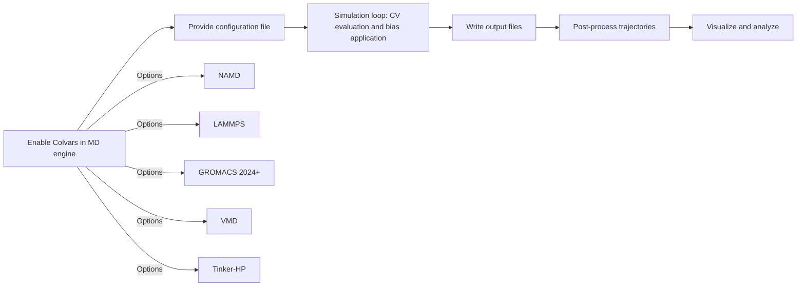

Welcome to the Colvars quick-start guide. This page helps you run your first collective variable simulation in minutes, with minimal configuration. You will learn how to enable Colvars in your MD engine, define a simple distance collective variable, apply a harmonic restraint, and understand the basic user-facing workflow. For deeper concepts, see the subsequent pages such as [Installation and Integration](3-installation-and-integration) and [Basic Configuration Syntax](4-basic-configuration-syntax).
Sources: [README.md](/README.md#L1-L148)

## User-facing architecture and workflow
The workflow you will follow involves enabling Colvars in your engine, providing a configuration file, and analyzing the output. Colvars does not require you to build its library yourself if you use supported, pre-compiled engines. During the simulation, Colvars periodically evaluates collective variables and applies biases according to your configuration, then writes output files.


Sources: [README.md](/README.md#L26-L58)

## Project structure overview
Key directories and files in the Colvars repository that you will encounter or use.

- examples/ — Standalone example configurations illustrating common use cases.
- tests/ — Functional test configurations used for validation and reference snippets.
- doc/ — Reference manuals and documentation resources.
- colvartools/ — Post-processing scripts to work with Colvars output (e.g., histograms, free energy surfaces).

Sources: [README.md](/README.md#L1-L10), [colvartools/README.md](/colvartools/README.md#L1-L17)

## Step 1: Choose and enable an engine
If you already have a supported engine installed (GROMACS 2024+, LAMMPS, NAMD, Tinker-HP, or VMD), enable Colvars in the engine’s configuration and provide the Colvars configuration file.

- NAMD: set colvars on and use cv configfile <file>.
- LAMMPS: use fix Colvars all colvars configfile <file>.
- GROMACS 2024+: in the .mdp file set colvars-active = yes and colvars-configfile = <file>.
- VMD: use cv molid top and cv configfile <file> (or the Colvars Dashboard plugin).
- Tinker-HP: use a configuration file with the same prefix as the .key file and extension .colvars.

Sources: [README.md](/README.md#L26-L58)

## Step 2: Write a minimal configuration
Create a Colvars configuration file that defines a collective variable and a bias. The following example defines a distance between two groups of atoms and applies a harmonic restraint.

### Minimal configuration example (works across engines)

```colvars
colvar {
  name d
  width 0.2
  distance {
    group1 { atomNumbers 1 2 3 }
    group2 { atomNumbers 4 5 6 }
  }
}

harmonic {
  colvars d
  centers 5.0
  forceConstant 10.0
}
```
Sources: [README.md](/README.md#L63-L82)

## Step 3: Run and inspect output
After running your simulation with the Colvars configuration, check for the generated output files. Common outputs include trajectory files and state files written according to Colvars settings. These can be plotted or processed with the post-processing tools in colvartools/.
Sources: [colvartools/README.md](/colvartools/README.md#L1-L17), [README.md](/README.md#L26-L58)

## Learning from examples
The examples/ directory contains ready-to-use configurations that demonstrate various features. Below are two simplified examples you can adapt to your system. For complete, ready-to-run input decks, see the Colvars examples repository.

### Restrain NOE distances (protein-ligand example)
This example defines two distance-based variables and applies harmonic walls.

```colvars
colvar {
  name NOE_1
  distanceInv {
    exponent 6
    group1 {
      psfSegID PRA
      atomNameResidueRange HB1 2-2
      atomNameResidueRange HB2 2-2
      atomNameResidueRange HB3 2-2
    }
    group2 {
      psfSegID PRA
      atomNameResidueRange HE 11-11
    }
  }
}

colvar {
  name NOE_2
  distanceInv {
    exponent 6
    group1 {
      psfSegID PRA PRB PRC PRD
      atomNameResidueRange HE 11-11
      atomNameResidueRange HE 11-11
      atomNameResidueRange HE 11-11
      atomNameResidueRange HE 11-11
    }
    group2 {
      psfSegID DRUG
      atomNameResidueRange H102 1-1
    }
  }
}

harmonicWalls {
  name walls_NOE
  colvars NOE_1 NOE_2
  lowerWalls 3.5 4.2
  lowerWallConstant 30.0
  upperWalls 4.5 4.9
  upperWallConstant 20.0
}
```
Sources: [examples/01_NOE_restraints.colvars.in](/examples/01_NOE_restraints.colvars.in#L1-L58)

### Restrain protein backbone orientation (simple example)
This example restrains the orientation of a protein backbone segment using a reference structure.

```colvars
colvarsTrajFrequency 100

colvar {
  name Orient
  orientation {
    atoms {
      psfSegID P
      atomNameResidueRange CA 20-350
    }
    refPositionsFile ref.pdb
  }
}

harmonic {
  colvars Orient
  centers (1.0, 0.0, 0.0, 0.0)
  forceConstant 500.
}
```
Sources: [examples/03_orientation.colvars.in](/examples/03_orientation.colvars.in#L1-L24)

> [!TIP]
> Always ensure your atom selections match the structure you are simulating. Use PDB/index files or explicit segment/residue naming to avoid selection errors.

## What’s next
- [Installation and Integration](3-installation-and-integration) — Integration details and building with your MD engine.
- [Basic Configuration Syntax](4-basic-configuration-syntax) — Syntax reference and options for configurations.
- [Core Architecture and Design Patterns](5-core-architecture-and-design-patterns) — Colvars internals and design principles.
- Collective Variables deep-dive: [Distance-Based Variables](6-distance-based-variables), [Angular and Dihedral Variables](7-angular-and-dihedral-variables), [Protein-Specific Variables (RMSD, Gyration)](9-protein-specific-variables-rmsd-gyration), and other CV topics.