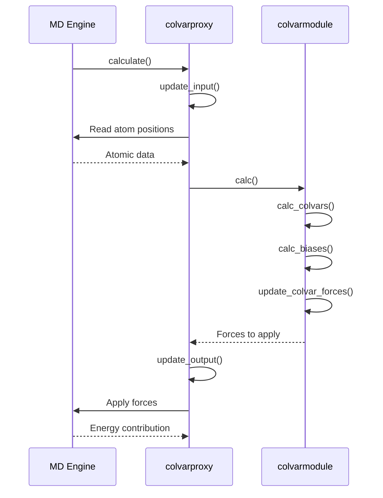

The proxy interface is the core architectural component that enables the Colvars library to integrate seamlessly with multiple molecular dynamics simulation engines. It provides a clean abstraction layer that isolates engine-specific implementations from the library's collective variable algorithms, allowing Colvars to maintain a single codebase while supporting NAMD, LAMMPS, VMD, GROMACS, and other MD packages through a unified interface.

## Proxy Architecture Overview

The proxy system is implemented through a multi-inheritance design where the base `colvarproxy` class aggregates functionality from several specialized proxy components. This modular approach allows each interface concern to be isolated and developed independently while presenting a coherent API to the Colvars core library.


The primary proxy class declaration at `src/colvarproxy.h#L549-L718` shows the inheritance hierarchy:

```cpp
class colvarproxy
  : public colvarproxy_system,
    public colvarproxy_atoms,
    public colvarproxy_atom_groups,
    public colvarproxy_volmaps,
    public colvarproxy_smp,
    public colvarproxy_replicas,
    public colvarproxy_script,
    public colvarproxy_tcl,
    public colvarproxy_io
```

This design enables the proxy system to address distinct integration requirements across dimensions of atomic data management, system-level parameters, parallelization strategies, and engine-specific features.

Sources: [src/colvarproxy.h](src/colvarproxy.h#L549-L718)

## Core Proxy Components

### System Interface (colvarproxy_system)

The system proxy component defined in `src/colvarproxy_system.h#L16-L205` manages fundamental simulation parameters and physical constants required by Colvars algorithms. It handles unit system conversions, boundary conditions, and thermodynamic state information.

Key responsibilities include:
- **Unit system management** with support for `real` (Å, kcal/mol), `metal` (Å, eV), `electron` (Bohr, Hartree), and `gromacs` (nm, kJ/mol) unit systems
- **Periodic boundary condition** handling through Bravais lattice vectors and reciprocal lattice computation
- **Temperature and timestep** synchronization with the hosting engine
- **Alchemical parameter** (lambda) communication for free energy calculations
- **Force bookkeeping** including restraint energy contribution to the MD engine

The system proxy provides unit conversion functions that ensure consistent internal representation regardless of the engine's native units. For example, the `angstrom_to_internal()` method at `src/colvarproxy_system.h#L37-L44` converts length values from Angstroms to the internal Colvars unit system.

Sources: [src/colvarproxy_system.h](src/colvarproxy_system.h#L16-L205), [src/colvarproxy_system.h](src/colvarproxy_system.h#L37-L44)

### Atom Management (colvarproxy_atoms)

The atoms proxy component defined in `src/colvarproxy.h#L43-L303` manages individual atom data required for collective variable calculations. It maintains efficient internal buffers for atomic properties and provides a reference counting system to track atom usage across multiple colvar components.

The atom management system includes:
- **Position buffers** for current atomic coordinates (`atoms_positions`)
- **Force buffers** for total forces (`atoms_total_forces`) and applied colvar forces (`atoms_new_colvar_forces`)
- **Property buffers** for atomic masses and charges
- **Reference counting** via `atoms_refcount` to prevent duplicate atom initialization
- **Modified tracking** through `modified_atom_list_` flag for optimized updates

The proxy supports both numeric atom ID selection and residue/atom name-based selection where available, providing flexibility for different user preferences and engine capabilities. The `init_atom()` methods at `src/colvarproxy.h#L65-L79` handle atom initialization by index or by residue and atom name.

Sources: [src/colvarproxy.h](src/colvarproxy.h#L43-L303), [src/colvarproxy.h](src/colvarproxy.h#L65-L79)

### Atom Group Management (colvarproxy_atom_groups)

For collective variables that operate on groups of atoms, the atom groups proxy at `src/colvarproxy.h#L304-L449` provides optimized management of center-of-mass computations and aggregate properties. This component is essential for distance, angle, and other collective variables defined between atom groups.

Key features include:
- **Center-of-mass position tracking** for each registered group
- **Aggregate property computation** including total mass and charge
- **Scalable group COMs** support through the `scalable_group_coms()` virtual method for engines that can efficiently compute group centers of mass
- **Force application** at the group level that is distributed to constituent atoms

The atom groups system maintains parallel data structures similar to individual atoms but operates at the group level, enabling efficient computation of collective variables defined between molecular subunits.

Sources: [src/colvarproxy.h](src/colvarproxy.h#L304-L449)

## Data Flow and Integration Cycle

The proxy interface orchestrates a precise data exchange cycle between the MD engine and the Colvars library. This cycle is implemented through key methods defined in `src/colvarproxy.h`:



The **input update** phase reads atomic coordinates, velocities, and forces from the engine. The `update_input()` virtual method at `src/colvarproxy.h#L627-L630` is implemented by each engine-specific proxy to extract the necessary data. Following input collection, the Colvars library executes the main calculation through the `calc()` method chain defined in `src/colvarmodule.h#L623-L636`.

The **output update** phase returns biasing forces to the engine through the `update_output()` method at `src/colvarproxy.h#L632-L633`. Energy contributions from collective variable restraints are communicated via the `add_energy()` method at `src/colvarproxy_system.h#L85-L86`, which adds the restraint energy to the MD engine's energy accounting.

Sources: [src/colvarproxy.h](src/colvarproxy.h#L627-L633), [src/colvarmodule.h](src/colvarmodule.h#L623-L636), [src/colvarproxy_system.h](src/colvarproxy_system.h#L85-L86)

## Engine-Specific Proxy Implementations

### NAMD Integration

The NAMD proxy (`colvarproxy_namd`) at `namd/src/colvarproxy_namd.h#L38-L284` inherits from both `colvarproxy` and NAMD's `GlobalMaster` class, integrating Colvars as a compute object in NAMD's distributed parallel framework.

Key implementation characteristics:
- **Charm++ parallel execution** leverages NAMD's object-based parallelism
- **Atomic data synchronization** through the `update_atoms_map()` method at `namd/src/colvarproxy_namd.h#L87-L88` which maps NAMD atom IDs to Colvars internal indices
- **CKLoop support** for symmetric multiprocessing via the SMP methods at `namd/src/colvarproxy_namd.h#L124-L173`
- **GlobalMaster integration** with the `calculate()` method invoked by NAMD each timestep

The NAMD proxy demonstrates advanced features including volumetric map integration (GridForce) at `namd/src/colvarproxy_namd.h#L220-L257` for collective variables defined on spatial grids, and accelerated MD reweighting factor support through `update_accelMD_info()`.

Sources: [namd/src/colvarproxy_namd.h](namd/src/colvarproxy_namd.h#L38-L284)

### LAMMPS Integration

The LAMMPS proxy (`colvarproxy_lammps`) at `lammps/src/COLVARS/colvarproxy_lammps.h#L26-L91` integrates Colvars through the LAMMPS fix interface, providing access to LAMMPS atomic data and force application mechanisms.

Implementation highlights:
- **LAMMPS pointer storage** through the `_lmp` member variable for direct access to LAMMPS simulation state
- **Total force handling** with a one-step delay pattern as indicated by `total_forces_same_step()` at `lammps/src/COLVARS/colvarproxy_lammps.h#L61-L61`
- **Fix-based execution** through the `compute()` method that returns biasing energy to LAMMPS
- **Script argument conversion** utilities at `lammps/src/COLVARS/colvarproxy_lammps.h#L70-L74` for Tcl-style parameter passing

The LAMMPS proxy maintains a first timestep flag and previous step counter to handle initialization and continuous simulation scenarios.

Sources: [lammps/src/COLVARS/colvarproxy_lammps.h](lammps/src/COLVARS/colvarproxy_lammps.h#L26-L91)

### VMD Integration

The VMD proxy (`colvarproxy_vmd`) at `vmd/src/colvarproxy_vmd.h#L30-L162` is designed for interactive analysis and visualization rather than MD simulation, enabling Colvars calculations on trajectory data.

Distinctive features:
- **Frame-based execution** with `get_frame()` and `set_frame()` methods at `vmd/src/colvarproxy_vmd.h#L55-L57` for navigation through trajectory frames
- **Molecule ID specification** through the constructor at `vmd/src/colvarproxy_vmd.h#L38-L38` for targeting specific loaded molecules
- **Deletion request support** via `request_deletion()` at `vmd/src/colvarproxy_vmd.h#L45-L45` for dynamic plugin management
- **VMDApp integration** for access to VMD's molecule and rendering systems

VMD's proxy enables the Colvars Dashboard plugin for real-time visualization and interactive manipulation of collective variable biases.

Sources: [vmd/src/colvarproxy_vmd.h](vmd/src/colvarproxy_vmd.h#L30-L162)

## Parallelization and SMP Support

The symmetric multiprocessing (SMP) component at `src/colvarproxy.h#L459-L509` provides a framework for parallelizing collective variable calculations across multiple threads. The design supports different parallelization strategies optimized for various computational patterns.

The SMP system operates through three modes defined by the `smp_mode_t` enum at `src/colvarproxy.h#L463-L463`:
- **cvcs** mode - Parallelizes collective variable component calculations
- **inner_loop** mode - Parallelizes inner computational loops within CVCs
- **none** mode - Sequential execution without threading

Key SMP methods include:
- `smp_loop()` at `src/colvarproxy.h#L478-L478` for distributing computational work items across threads
- `smp_biases_loop()` at `src/colvarproxy.h#L481-L481` for parallel bias calculation
- Locking primitives (`smp_lock()`, `smp_unlock()`) at `src/colvarproxy.h#L493-L499` for thread-safe access to shared proxy data

> [!TIP]
> Engine-specific SMP implementations may override default OpenMP behavior. NAMD's proxy uses Charm++ parallelization primitives through CKLoop for optimized performance on distributed memory systems, while other engines may use pthreads or OpenMP depending on architecture. This flexibility allows each integration to leverage the most appropriate parallel programming model for its environment.

Sources: [src/colvarproxy.h](src/colvarproxy.h#L459-L509)

## Scripting and Runtime Control

The scripting proxy component at `src/colvarproxy.h#L513-L548` provides interfaces for executing user-defined scripts and callbacks that can extend Colvars functionality at runtime. This enables dynamic bias modification, custom force functions, and integration with simulation automation frameworks.

Scripting capabilities include:
- **Force callbacks** through `run_force_callback()` at `src/colvarproxy.h#L531-L531` for applying user-defined forces
- **Colvar value callbacks** via `run_colvar_callback()` at `src/colvarproxy.h#L533-L536` for computing custom collective variable values
- **Gradient callbacks** through `run_colvar_gradient_callback()` at `src/colvarproxy.h#L538-L541` for providing custom gradient implementations

The scripting system integrates with Tcl through the `colvarproxy_tcl` component, providing access to Tcl interpreters in engines like NAMD and VMD where Tcl is the native scripting language.

Sources: [src/colvarproxy.h](src/colvarproxy.h#L513-L548)

## State Management and Lifecycle

The proxy interface manages the complete lifecycle of the Colvars integration through a sequence of initialization, execution, and cleanup phases. The key lifecycle methods defined in `src/colvarproxy.h` are:

| Method | Purpose | Implementation Point |
|--------|---------|---------------------|
| `setup()` | Initialize proxy and validate engine readiness | `src/colvarproxy.h#L616-L616` |
| `reset()` | Clear atom lists and reset proxy state | `src/colvarproxy.h#L589-L589` |
| `update_input()` | Read atomic data from engine | `src/colvarproxy.h#L627-L630` |
| `update_output()` | Write forces to engine | `src/colvarproxy.h#L632-L633` |
| `end_of_step()` | Perform end-of-step operations | `src/colvarproxy.h#L635-L636` |
| `post_run()` | Cleanup after simulation segment | `src/colvarproxy.h#L668-L668` |

The `engine_ready()` method at `src/colvarproxy.h#L619-L622` tracks whether the hosting engine has completed sufficient initialization for Colvars to proceed with configuration. Engines that delay Colvars initialization (such as those that load topology after reading input files) set this flag to false until their initialization is complete.

Sources: [src/colvarproxy.h](src/colvarproxy.h#L616-L668)

## Configuration Parsing and Error Handling

The proxy system interfaces with Colvars' configuration parser through the `parse_module_config()` method at `src/colvarproxy.h#L592-L592`. Configuration commands can be queued via `add_config()` at `src/colvarproxy.h#L625-L625` for deferred processing when the engine is ready.

Error handling is centralized through the proxy's logging system:
- `log()` method at `src/colvarproxy.h#L639-L639` for informational messages
- `error()` method at `src/colvarproxy.h#L642-L642` for fatal errors
- Error message accumulation through `add_error_msg()` and retrieval via `get_error_msgs()` at `src/colvarproxy.h#L645-L648`

The proxy tracks the simulation running state through `simulation_running()` and `simulation_continuing()` flags at `src/colvarproxy.h#L654-L665`, which influence error severity determination and initialization behavior when loading restart files.

Sources: [src/colvarproxy.h](src/colvarproxy.h#L592-L665)

## Summary Table: Engine-Specific Proxy Features

| Feature | NAMD | LAMMPS | VMD | GROMACS |
|---------|------|--------|-----|---------|
| SMP/Parallelization | Charm++ CKLoop | OpenMP/pthreads | None | OpenMP |
| Total Force Availability | Same-step | One-step delay | Post-process | Engine-dependent |
| Atom Name Selection | ✓ | ✓ | ✓ | ✓ |
| Volmap Support | ✓ | Limited | ✓ | In development |
| Tcl Scripting | Native | Optional | Native | No |
| Dynamic Deletion | No | No | ✓ | No |
| Lambda Parameter | ✓ | ✓ | Stub | ✓ |

Sources: [namd/src/colvarproxy_namd.h](namd/src/colvarproxy_namd.h#L38-L284), [lammps/src/COLVARS/colvarproxy_lammps.h](lammps/src/COLVARS/colvarproxy_lammps.h#L26-L91), [vmd/src/colvarproxy_vmd.h](vmd/src/colvarproxy_vmd.h#L30-L162)

## Integration Best Practices

When implementing a new engine integration or extending an existing proxy, follow these architectural principles:

1. **Minimize data copying** - Use direct memory access where possible, referencing engine atomic data rather than creating deep copies
2. **Leverage reference counting** - Implement atom group reference counting to avoid redundant computations of the same group properties
3. **Preserve unit consistency** - Always convert between engine units and Colvars internal units using the provided conversion functions
4. **Handle boundary conditions correctly** - Use the `position_distance()` method at `src/colvarproxy_system.h#L89-L90` for minimum-image distance computations
5. **Defer initialization** - Set `engine_ready_` to false until engine topology and parameters are fully loaded
6. **Thread safely** - Use the SMP locking primitives when accessing shared proxy data from multiple threads

> [!TIP]
> The proxy interface is deliberately designed as a pure virtual interface for many operations, forcing engine implementations to provide concrete implementations. This prevents silent fallback to default behaviors that may be incorrect for specific engines, ensuring that each integration explicitly handles critical operations like force application and energy reporting.

Sources: [src/colvarproxy_system.h](src/colvarproxy_system.h#L89-L90), [src/colvarproxy.cpp](src/colvarproxy.cpp#L450-L464)

## Next Steps

- For detailed information on individual atom and atom group management within the proxy system, see **[Atom and Atom Group Management](21-atom-and-atom-group-management)**
- To understand how collective variable calculations utilize the proxy interface, refer to **[Core Architecture and Design Patterns](5-core-architecture-and-design-patterns)**
- For implementation details of parallel execution strategies, explore **[Parallel Computing and SMP Support](24-parallel-computing-and-smp-support)**
- To learn about state persistence and restart functionality, see **[State Management and Restart Files](23-state-management-and-restart-files)**