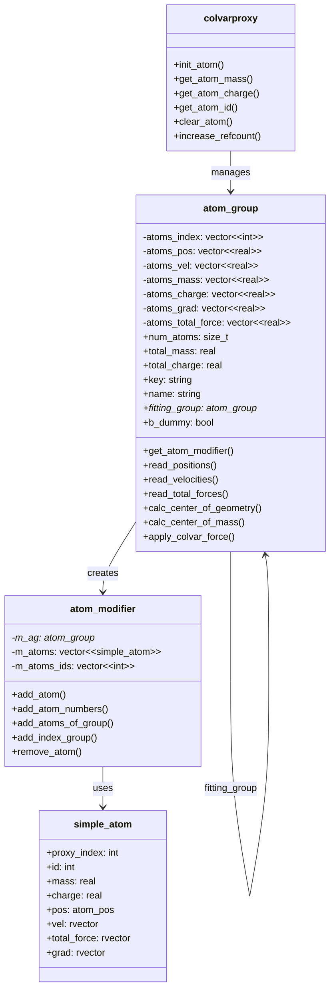
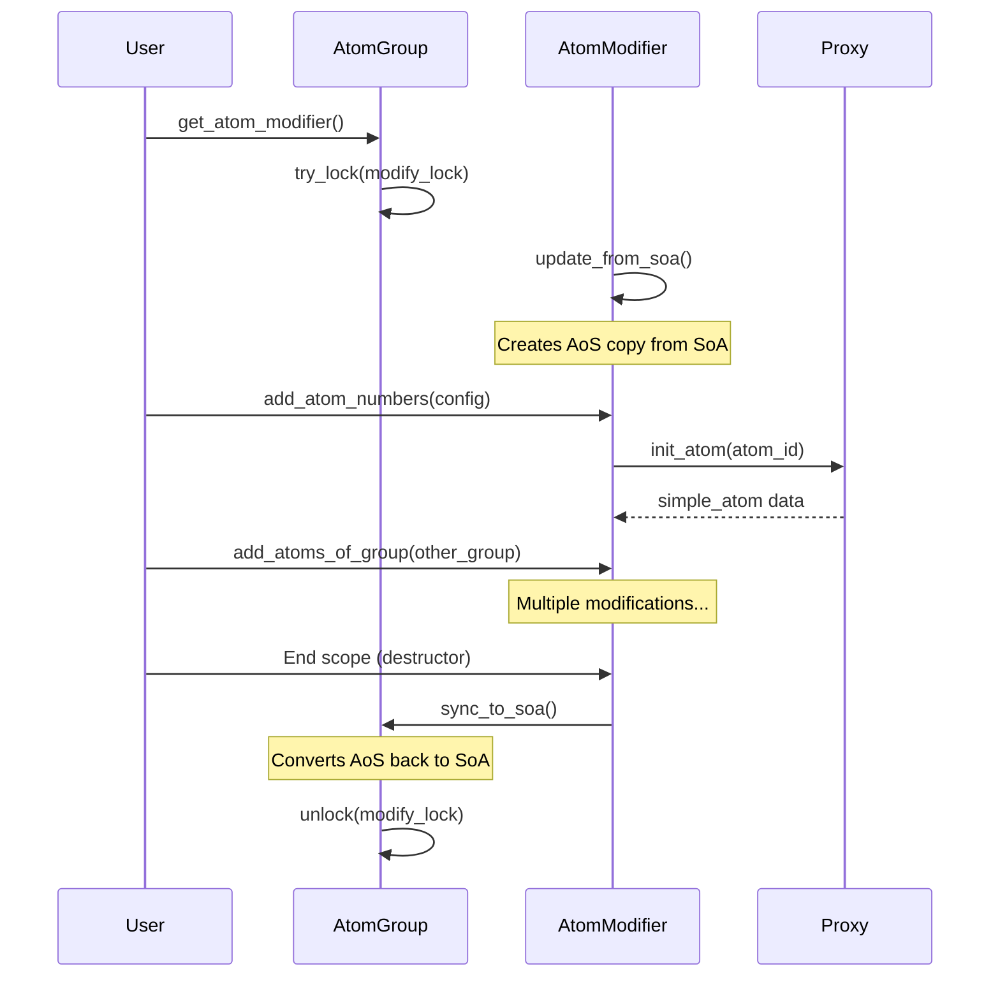
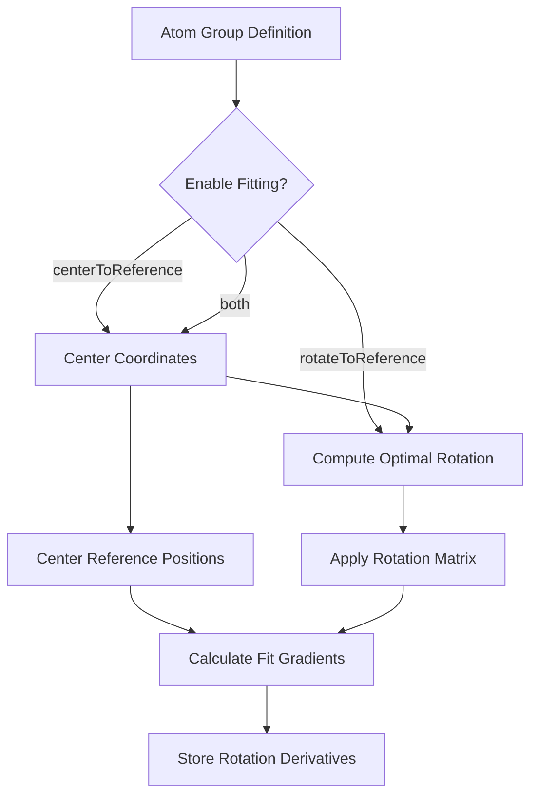
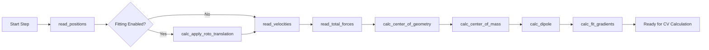

The atom and atom group management system forms the foundational layer for all collective variable calculations in Colvars. This system provides a sophisticated framework for selecting, organizing, and manipulating atomic coordinates while maintaining efficient memory layouts and integration with MD simulation engines.

## Architecture Overview

Colvars employs a **Structure-of-Arrays (SoA)** memory layout for atom groups, which differs from traditional Array-of-Structures (AoS) approaches. This design choice optimizes performance for vectorized operations and modern CPU architectures by grouping each atomic property (positions, velocities, forces, etc.) into separate contiguous arrays.

Sources: [colvaratoms.h](src/colvaratoms.h#L1-L50), [colvaratoms.cpp](src/colvaratoms.cpp#L1-L15)

The core architecture demonstrates a hierarchical relationship between atom groups, modifiers, and proxy interfaces:

## Core Data Structures

### The Atom Group Class

The `cvm::atom_group` class serves as the central abstraction for managing collections of atoms. Each instance maintains comprehensive atom information through SoA data structures:

- **Index management**: Internal proxy indices (`atoms_index`) and system atom IDs (`atoms_ids`) provide bidirectional mapping between Colvars and MD engine representations
- **Coordinate data**: Separate arrays for positions, velocities, and forces enable efficient vectorized operations
- **Physical properties**: Mass and charge arrays stored per-atom with computed aggregates (`total_mass`, `total_charge`)
- **Gradient storage**: Atomic gradients support derivative calculations for collective variables
- **Reference positions**: Additional arrays store reference coordinates for fitting operations

Sources: [colvaratoms.h](src/colvaratoms.h#L768-L805)

> [!TIP]
> The SoA layout enables significant performance improvements through cache-friendly memory access patterns, particularly beneficial for collective variables requiring iteration over large atom groups. However, atom insertion and deletion operations are less convenient than AoS layouts, necessitating the `atom_modifier` pattern for structural modifications.

### Simple Atom Structure

The `simple_atom` nested structure provides a lightweight AoS representation for temporary atom manipulation:

Sources: [colvaratoms.h](src/colvaratoms.h#L106-L115)

| Property | Type | Description |
|----------|------|-------------|
| `proxy_index` | int | Index in colvarproxy arrays for efficient access |
| `id` | int | System-wide atom identifier |
| `mass` | real | Atomic mass |
| `charge` | real | Atomic charge |
| `pos` | atom_pos | Current position (x, y, z) |
| `vel` | rvector | Current velocity |
| `total_force` | rvector | Total force from MD engine |
| `grad` | rvector | Gradient for CV derivatives |

## Atom Group Initialization and Configuration

### Configuration Parameters

Atom groups support multiple methods for atom selection, specified through configuration keywords:

Sources: [colvaratoms.cpp](src/colvaratoms.cpp#L600-L700)

| Configuration Keyword | Purpose | Example Usage |
|---------------------|---------|---------------|
| `atomNumbers` | Select atoms by specific indices | `atomNumbers 1 5 10` |
| `atomNumbersRange` | Select consecutive atom range | `atomNumbersRange 100-200` |
| `indexGroup` | Use pre-defined index groups | `indexGroup protein_backbone` |
| `psfSegID` + `atomNameResidueRange` | PSF topology-based selection | `psfSegID PROT` + `atomNameResidueRange CA 1-100` |
| `atomsFile` | Load atoms from PDB file | `atomsFile reference.pdb` + `atomsCol O` |
| `atomsOfGroup` | Copy atoms from existing group | `atomsOfGroup protein_atoms` |
| `name` | Assign reusable group name | `name main_chain` |

> [!TIP]
> When `atomsFile` is specified with `atomsCol`, Colvars filters atoms based on a specific PDB column value (typically occupancy or B-factor), enabling flexible atom selection from reference structures.

### Atom Modifier Pattern

The `atom_modifier` class provides a temporary AoS interface for modifying SoA atom groups safely:

Sources: [colvaratoms.h](src/colvaratoms.h#L155-L233)

This pattern ensures thread-safe modifications through mutex locking while providing intuitive STL-style iterators and accessors for atom manipulation.

## Advanced Features

### Scalable Computation Mode

Atom groups can operate in **scalable mode** when enabled, delegating mass and charge calculations to the MD engine:

Sources: [colvaratoms.cpp](src/colvaratoms.cpp#L280-L310)

- Automatic activation for center-of-mass based variables without fitting transformations
- Computed aggregates (`total_mass`, `total_charge`) retrieved from proxy interface
- Requires engine-specific implementation through `colvarproxy` methods
- Disabled when centering or rotation features are active

### Dummy Atom Groups

Special **dummy atom groups** provide fixed coordinate references without physical atoms:

Sources: [colvaratoms.cpp](src/colvaratoms.cpp#L900-L925)

| Feature | Behavior |
|---------|----------|
| Mass | Fixed at 1.0 |
| Charge | Fixed at 0.0 |
| Position | User-defined via `dummyAtom` keyword |
| Forces | Never receives forces (`noforce` always true) |
| Scalability | Disabled by default |

Dummy groups enable collective variables to reference fixed spatial points or virtual coordinates without requiring corresponding atoms in the simulation system.

## Coordinate Transformations

### Fitting Transformations

Colvars supports coordinate alignment through **centering** and **rotation** operations:

Sources: [colvaratoms.cpp](src/colvaratoms.cpp#L800-L860)

### Fitting Groups

When `fittingGroup` is specified, coordinate transformations use a separate group to compute the optimal alignment:

Sources: [colvaratoms.cpp](src/colvaratoms.cpp#L820-L860)

| Parameter | Purpose |
|-----------|---------|
| `fittingGroup` | Alternative group for transformation calculation |
| `refPositions` | Reference coordinates for alignment |
| `refPositionsFile` | Load reference positions from PDB file |
| `refPositionsCol` | Column selection from PDB file |
| `refPositionsColValue` | Filter value for PDB column |
| `enableFitGradients` | Enable derivative calculations (default: true) |

This separation allows one group to define the transformation while another applies it, essential for complex molecular systems where different regions require distinct alignment strategies.

## Force Application and Gradients

### Force Distribution Mechanisms

Atom groups support multiple force application strategies:

Sources: [colvaratoms.h](src/colvaratoms.h#L511-L530)

| Method | Purpose | Use Case |
|--------|---------|----------|
| `apply_colvar_force()` | Multiply force by per-atom gradients | Scalar CVs (most common) |
| `apply_force()` | Distribute force by mass | Center-of-mass forces |
| `group_force_object` | Fitting-aware force application | Non-scalar CVs with transformations |

The `group_force_object` class handles complex scenarios involving rotational fittings, automatically projecting forces back to the original reference frame when necessary.

Sources: [colvaratoms.h](src/colvaratoms.h#L688-L735)

### Gradient Storage

Per-atom gradients support derivative calculations:

Sources: [colvaratoms.h](src/colvaratoms.h#L574-L595)

- SoA storage: `atoms_grad` array (3 × num_atoms)
- Accessors: `grad_x(i)`, `grad_y(i)`, `grad_z(i)`
- Additional fit gradients: `fit_gradients` for transformation derivatives
- Scalar COM gradients: `scalar_com_gradient` for mass-weighted centers

## Data Update Workflow

The atom group follows a structured update sequence each simulation step:

Sources: [colvaratoms.h](src/colvaratoms.h#L316-L367)

> [!TIP]
> The `calc_required_properties()` method orchestrates this workflow, computing only the quantities needed by currently enabled collective variables, optimizing computational efficiency.

## Memory Management and Lifecycle

### Initialization Sequence

Atom groups follow a three-phase initialization:

Sources: [colvaratoms.cpp](src/colvaratoms.cpp#L120-L180)

1. **Init**: Reset data structures and dependency features
2. **Parse**: Read configuration and build atom selection
3. **Setup**: Retrieve atomic properties and compute aggregates

### Cleanup and Deallocation

Proper cleanup ensures resource release:

Sources: [colvaratoms.cpp](src/colvaratoms.cpp#L510-L540)

- Clear atom references from proxy: `clear_soa()`
- Deallocate scalable groups in proxy: `clear_atom_group(index)`
- Delete fitting group if allocated
- Delete rotation derivative object

## Performance Considerations

### SoA Performance Advantages

The Structure-of-Arrays layout delivers performance benefits:

Sources: [colvaratoms.cpp](src/colvaratoms.cpp#L160-L200)

| Aspect | SoA Advantage | Example Operation |
|--------|---------------|-------------------|
| Cache efficiency | Contiguous property access | Summing masses of all atoms |
| Vectorization | SIMD-friendly operations | Calculating centers of mass |
| Memory bandwidth | Reduced stride access | Copying position arrays |
| Prefetching | Predictable access patterns | Sequential force application |

### Scalability Strategies

Large-scale systems benefit from scalable computation:

- Proxy-computed aggregates avoid data transfer overhead
- Reduced memory footprint for large atom groups
- Engine-specific optimizations become accessible

## Integration with MD Engines

### Proxy Interface

The `colvarproxy` abstract layer enables engine integration:

Sources: [colvaratoms.cpp](src/colvaratoms.cpp#L20-L80)

| Proxy Method | Purpose | Called By |
|--------------|---------|-----------|
| `init_atom()` | Register atom with proxy | Atom initialization |
| `get_atom_mass()` | Retrieve atomic mass | Setup, property queries |
| `get_atom_charge()` | Retrieve atomic charge | Setup, dipole calculation |
| `get_atom_id()` | Get system atom ID | Atom initialization |
| `clear_atom()` | Dereference atom | Group cleanup |
| `increase_refcount()` | Track atom usage | Atom copying |

This abstraction allows Colvars to integrate with NAMD, LAMMPS, GROMACS, VMD, and other MD engines through consistent interfaces.

## Next Steps

Understanding atom and atom group management provides the foundation for exploring collective variable components. For practical applications of atomic groups:

- Learn how atom groups are used in **[Distance-Based Variables](6-distance-based-variables)** for coordinate calculations
- Explore **[Protein-Specific Variables](9-protein-specific-variables-rmsd-gyration)** which heavily utilize fitting transformations
- Understand force application in **[Harmonic Restraints and Walls](11-harmonic-restraints-and-walls)**
- Review the **[Proxy Interface and Engine Integration](20-proxy-interface-and-engine-integration)** for deeper engine-specific details

For developers extending Colvars with custom collective variables, the atom group API provides robust tools for atomic coordinate manipulation and derivative calculations.