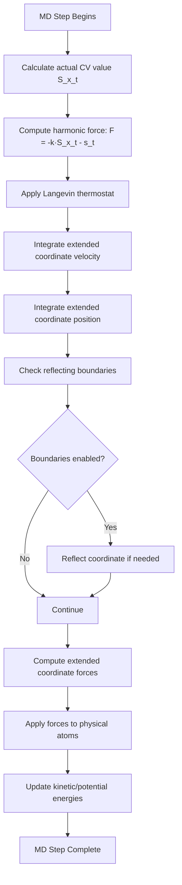

Extended Lagrangian Dynamics in the Colvars framework provides a powerful method for enhancing sampling of collective variables (CVs) by treating them as fictitious dynamical variables coupled to the physical system. This approach decouples the timescale of CV evolution from atomic motion, enabling smoother exploration of free energy landscapes.

## Mathematical Foundation

The extended Lagrangian formalism introduces a set of fictitious degrees of freedom `{s_i}` coupled to the actual collective variables `{S_i(x(t))}` through a harmonic restraint. The extended Hamiltonian takes the form:

**H = H₀ + Σ_i [½k(S_i(x(t)) - s_i(t))² + ½mᵢ(dsᵢ/dt)²]**

Where:
- `H₀` is the physical system Hamiltonian
- `S_i(x(t))` are the instantaneous collective variable values
- `s_i(t)` are the extended (fictitious) coordinates
- `k` is the harmonic force constant (`ext_force_k`)
- `mᵢ` are the fictitious masses (`ext_mass`)
- The coupling term enforces `s_i(t) ≈ S_i(x(t))` with configurable strength

Sources: [colvar.h](src/colvar.h#L126-L138)

## Core Architecture

The implementation centers around the `colvar` class, which maintains extended state variables and integrates their equations of motion independently from the MD engine:

### Extended State Variables

```cpp
colvarvalue x_ext;              // Restraint center (extended coordinate)
colvarvalue prev_x_ext;         // Previous extended coordinate
colvarvalue v_ext;              // Extended coordinate velocity  
colvarvalue prev_v_ext;         // Previous velocity
cvm::real ext_mass = 0.0;       // Fictitious mass
cvm::real ext_force_k = 0.0;    // Harmonic force constant
cvm::real ext_gamma = 0.0;      // Langevin friction coefficient
cvm::real ext_sigma = 0.0;      // Langevin noise amplitude
```

Sources: [colvar.h](src/colvar.h#L176-L192)

### Energy Tracking

The framework computes both kinetic and potential energies of the extended degrees:

```cpp
cvm::real kinetic_energy = 0.0;   // Extended coordinate kinetic energy
cvm::real potential_energy = 0.0; // Harmonic restraint potential
```

Sources: [colvar.h](src/colvar.h#L585-L588)

## Configuration Parameters

Extended Lagrangian dynamics is configured per-colvar through the following parameters:

| Parameter | Type | Default | Description |
|-----------|------|---------|-------------|
| `extendedFluctuation` | real | width | RMS fluctuation amplitude of extended coordinate |
| `extendedTemp` | real | 300 K | Temperature for fictitious dynamics |
| `extendedMass` | real | auto | Fictitious mass (calculated if not specified) |
| `extendedLangevinDamping` | real | 1.0 ps⁻¹ | Friction coefficient for Langevin dynamics |
| `outputEnergy` | bool | false | Enable energy output for extended DOF |
| `reflectingLowerBoundary` | bool | false | Enable reflecting boundary at lower bound |
| `reflectingUpperBoundary` | bool | false | Enable reflecting boundary at upper bound |

Sources: [colvar.cpp](src/colvar.cpp#L750-L900)

### Mass Calculation

When `extendedMass` is not specified, the framework automatically computes an appropriate value based on target fluctuations:

```
ext_mass = (4π² · width²) / (τ² · k_B · T)
```

where `τ` is the target oscillation period. This ensures the extended coordinate exhibits natural motion on timescales compatible with collective variable fluctuations.

Sources: [colvar.cpp](src/colvar.cpp#L760-L770)

## Langevin Dynamics Integration

The extended coordinates evolve according to Langevin dynamics, incorporating both deterministic forces and stochastic thermal noise. The integration scheme implements the BAOA (B-velocity, A-position, O-force, A-position) algorithm for numerical stability:

### Temperature Scaling

The noise amplitude `ext_sigma` is computed as:

```
ext_sigma = √[(1 - exp(-2·γ·Δt·n)) · m · k_B · T]
```

where:
- `γ` = `ext_gamma` (friction coefficient)
- `Δt` = timestep
- `n` = `time_step_factor` (multiple timesteps support)
- `m` = `ext_mass`
- `T` = `extendedTemp`

The damping coefficient is converted from ps⁻¹ to fs⁻¹ internally to match simulation units.

Sources: [colvar.cpp](src/colvar.cpp#L780-L792)

> [!TIP]
> The BAOA integrator provides superior stability for multiple-timestep schemes when using `timeStepFactor > 1`, as referenced in the implementation citation from the BAOA integrator paper.

## Integration Workflow

The extended coordinate integration follows this sequence within each simulation step:



### Force Communication

When extended Lagrangian is active, forces are communicated to the physical system through the harmonic coupling:

1. **Extended coordinate force**: `F_ext = -∂H/∂s = -k·(S(x) - s)`
2. **Physical atom force**: Applied via chain rule through CV gradients
3. **Energy return**: `update_forces_energy()` returns the total extended energy for output

Sources: [colvar.h](src/colvar.h#L354-L361)

## Boundary Conditions

The framework supports reflective boundaries for extended coordinates, preventing them from diverging when coupled CVs are bounded:

- **Lower boundary**: Reflects if `s < lower_boundary`
- **Upper boundary**: Reflects if `s > upper_boundary`

Reflection inverts the velocity component perpendicular to the boundary, conserving energy while constraining the extended coordinate within physically meaningful ranges.

Sources: [colvar.cpp](src/colvar.cpp#L795-L800)

## Feature System Integration

Extended Lagrangian dynamics integrates with Colvars' dependency system through the feature framework:

- **`f_cv_extended_Lagrangian`**: Main activation feature
- **Alternative to** `f_cv_total_force_calc`: Provides system force through harmonic coupling
- **Mutually exclusive with** `f_cv_hide_Jacobian`: Jacobian forces are explicit in extended dynamics

The feature system ensures proper initialization and dependency resolution between extended dynamics and other Colvars functionality.

Sources: [colvar.cpp](src/colvar.cpp#L1100-L1200)

## Output Configuration

Extended Lagrangian dynamics generates specialized output fields when enabled:

| Output Field | Description |
|--------------|-------------|
| `xi` | Extended coordinate value `s(t)` |
| `v_ext` | Extended coordinate velocity |
| `KE_extended` | Kinetic energy of extended DOF |
| `PE_extended` | Harmonic potential energy |

These outputs are available in trajectory files when `outputEnergy` is enabled and provide insight into the fictitious dynamics behavior.

Sources: [colvar.cpp](src/colvar.cpp#L750-L755)

## Implementation Details

### Initialization Sequence

The `init_extended_Lagrangian()` method handles parameter parsing and setup:

1. Read `extendedFluctuation` parameter (defaults to colvar `width`)
2. Read `extendedTemp` parameter
3. Read or calculate `extendedMass`
4. Configure Langevin dynamics (`extendedLangevinDamping`)
5. Compute noise amplitude `ext_sigma` based on temperature
6. Configure reflecting boundaries if specified
7. Enable `f_cv_Langevin` feature when damping > 0

Sources: [colvar.cpp](src/colvar.cpp#L730-L805)

### Integration Method

The `update_extended_Lagrangian()` method performs the actual time integration using a velocity-Verlet variant with Langevin thermostat. This method is called after bias forces have been applied but before forces are communicated to atoms.

> [!TIP]
> Multiple timestep support allows extended coordinates to evolve on longer timesteps (`timeStepFactor > 1`) while maintaining numerical stability through proper scaling of Langevin parameters.

## Usage Considerations

### Choosing Parameters

- **Mass ratio**: Should balance timescale separation with responsiveness to system changes
- **Force constant**: Determines coupling strength; too weak leads to decoupling, too stiff eliminates timescale benefits
- **Temperature**: Typically matches physical temperature but can be higher for enhanced sampling
- **Damping**: Controls effective diffusion; higher damping reduces correlation times

### Compatibility

Extended Lagrangian dynamics is compatible with most biasing methods but requires careful consideration:

- **ABF/Metadynamics**: Biases can be applied to extended coordinates for smoother convergence
- **Umbrella sampling**: Extended coordinates provide natural reaction coordinates
- **Multiple replicas**: Can be combined with replica exchange on extended coordinate space

## Next Steps

For deeper understanding of related concepts:

- Learn about [Collective Variable Components](6-distance-based-variables) that define the physical CVs coupled to extended coordinates
- Explore [Harmonic Restraints and Walls](11-harmonic-restraints-and-walls) for comparison with the harmonic coupling term
- Study [State Management and Restart Files](23-state-management-and-restart-files) for persistent extended coordinate state
- Review [Multiple Replica Communication](25-multiple-replica-communication) for advanced sampling schemes
