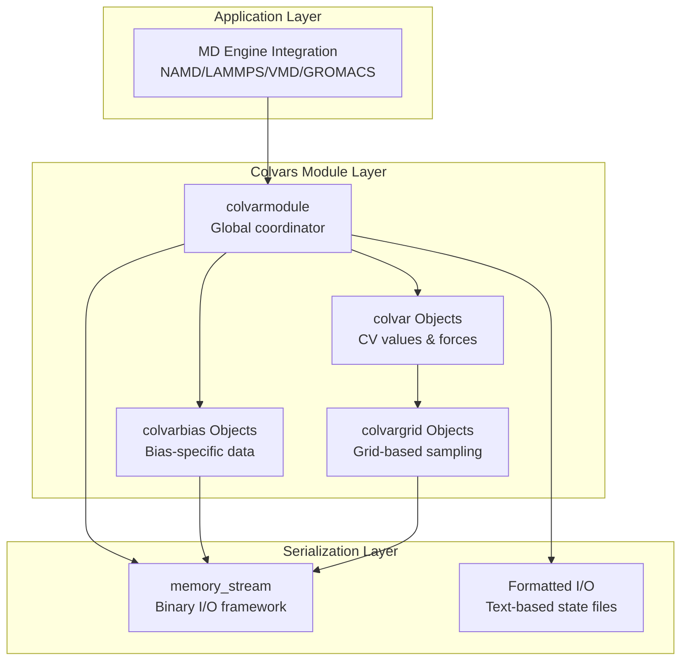
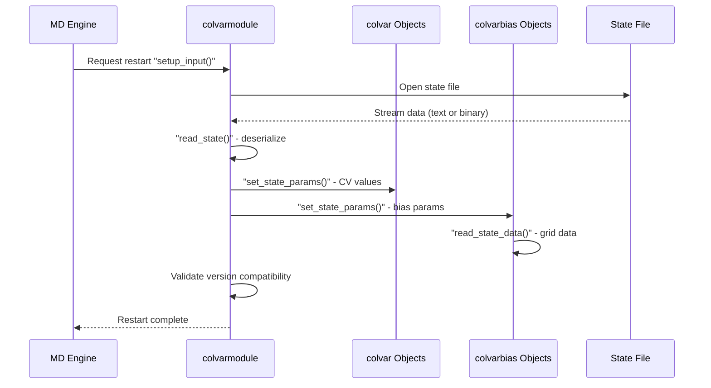

State management in Colvars enables simulation continuity by preserving the complete computational state across restarts. This includes collective variable values, bias force data, grid-based free energy surfaces, and sampling statistics. The architecture supports both text and binary formats for flexibility across different use cases and engine integrations.

## Architecture Overview

The state management system is built on a three-layer architecture with specialized serialization primitives at each level:

The **memory_stream** class serves as the core binary serialization framework, providing type-safe read/write operations through template methods. It supports both internal buffers and external buffer management, enabling efficient memory-to-memory transfers for state serialization.

Sources: [colvars_memstream.h](src/colvars_memstream.h#L30-L293), [colvarmodule.h](src/colvarmodule.h#L544-L578)

## State File Formats

Colvars supports dual serialization strategies to accommodate different requirements:

| Format | Characteristics | Use Cases | File Extension |
|--------|----------------|-----------|----------------|
| **Text (Formatted)** | Human-readable ASCII, platform-independent | Debugging, manual inspection, cross-platform transfers | `.colvars.state` |
| **Binary (Unformatted)** | Compact, faster I/O, exact precision | Production runs, large grids, frequent checkpoints | `.colvars.state` (configurable) |

The binary format is selected via the `binary_restart` configuration parameter. When enabled, all state serialization uses the `memory_stream` framework which performs direct memory copying for trivially copyable types while providing specializations for complex types like strings and `colvarvalue` objects.

> [!TIP]
> Binary restart files use little-endian byte order regardless of host architecture, ensuring cross-platform compatibility while maintaining I/O performance benefits.

Sources: [colvars_memstream.h](src/colvars_memstream.h#L172-L248), [colvarmodule.h](src/colvarmodule.h#L316)

## Module-Level State Management

The `colvarmodule` class orchestrates global state operations through a unified interface supporting both text and binary streams:

- **State Reading**: `read_state(std::istream &is)` and `read_state(memory_stream &is)` methods process formatted and unformatted input respectively
- **State Writing**: `write_state(std::ostream &os)` and `write_state(memory_stream &os)` generate formatted and unformatted output
- **Buffer Management**: `set_input_state_buffer()` enables state data to be provided directly from memory buffers, supporting engine-specific checkpoint integration
- **File Operations**: `write_restart_file()` handles file I/O with automatic backup of existing state files

The module tracks restart version information (`restart_version_str`, `restart_version_int`) to enable compatibility checks when loading state files from different Colvars versions.

Sources: [colvarmodule.h](src/colvarmodule.h#L527-L578), [colvarmodule.h](src/colvarmodule.h#L883-L886)

## Collective Variable State Persistence

Each `colvar` object maintains its own state through a standardized serialization interface:

- **State Parameters**: `get_state_params()` and `set_state_params()` handle mutable properties like current values, velocities, and extended Lagrangian coordinates
- **State Data Streams**: `write_state_data()` and `read_state_data()` manage additional data streams for both formatted and unformatted I/O
- **Restart Tracking**: The `x_restart` member stores the value read from the most recent state file, while the `after_restart` flag indicates whether a restart just occurred

This separation allows the parameter interface to handle simple scalar values while the data stream interface manages complex structures like time series data for autocorrelation functions or running averages.

Sources: [colvar.h](src/colvarmodule.h#L467-L486), [colvar.h](src/colvar.h#L499-L503)

## Bias State Management

Bias objects implement virtual methods for state persistence, with each bias type (ABF, metadynamics, harmonic, etc.) overriding these to save their specific data:

- **Base Interface**: `colvarbias` defines `write_state_data()`, `read_state_data()`, `write_state()`, and `read_state()` methods that derived classes override
- **Bias-Specific Data**: Each bias type serializes its grid data, accumulated samples, bias energies, and time-dependent parameters
- **Matching State Logic**: The `check_matching_state()` method uses the `matching_state` flag to ensure state data is applied to the correct bias object during restoration

For example, ABF biases serialize their average force grids and sample count grids, while metadynamics biases serialize the deposited Gaussian hills and related statistics.

Sources: [colvarbias.h](src/colvarbias.h#L144-L226), [colvarbias.h](src/colvarbias.h#L322-L323)

## Grid Serialization

The `colvargrid` classes provide specialized serialization for multi-dimensional data structures:

- **Grid Configuration**: Bin counts, dimensions, and periodic boundaries are serialized as state parameters
- **Grid Data**: Multi-dimensional arrays of sample counts, free energy values, and gradients are serialized through the data stream interface
- **Binary Efficiency**: Large grids benefit significantly from binary format due to direct memory copying of contiguous data arrays

Grid serialization is particularly important for history-dependent biases that accumulate sampling statistics over time, as these grids can contain millions of data points.

Sources: [colvarmodule.h](src/colvarmodule.h#L556-L561), [colvarbias.h](src/colvarbias.h#L367-L371)

## Restart Workflow

The typical restart operation follows this sequence:

The `setup_input()` method initiates this process, reading the state file and distributing the data to all registered objects. Each object's `set_state_params()` method receives its configuration block, while `read_state_data()` handles any additional data streams.

Sources: [colvarmodule.h](src/colvarmodule.h#L527-L528), [colvarbias.h](src/colvarbias.h#L164-L171)

## Configuration Parameters

Restart behavior is controlled through these key configuration parameters:

| Parameter | Type | Default | Description |
|-----------|------|---------|-------------|
| `restartFrequency` | integer | 100000 | Number of steps between automatic restart file writes |
| `restartOutputName` | string | output prefix | Base name for restart files |
| `binaryRestart` | boolean | false | Use binary format for restart files |

Restart files are automatically backed up before being overwritten, preventing data loss if writing is interrupted. The backup mechanism preserves the previous state file with a timestamp suffix.

> [!TIP]
> For production simulations with large grids or frequent restarts, enable `binaryRestart` to reduce I/O time by 3-10x compared to text format, while maintaining full precision.

Sources: [colvarmodule.h](src/colvarmodule.h#L864-L866), [colvarmodule.h](src/colvarmodule.h#L594-L598)

## Engine-Specific Integration

Each MD engine proxy (`colvarproxy`) provides engine-specific state file handling:

- **NAMD**: Integrates with NAMD's checkpoint/restart system via the proxy's input/output stream methods
- **LAMMPS**: Uses LAMMPS restart file mechanisms through the `colvarproxy_lammps` subclass
- **VMD**: Provides independent state file management for analysis runs
- **GROMACS**: Interfaces with GROMACS checkpointing through the proxy layer

The proxy abstraction allows Colvars to delegate file I/O operations to the hosting engine, ensuring that state files are written to appropriate locations and synchronized with the engine's own checkpointing.

Sources: [colvarproxy.h](src/colvarproxy.h#L1-L50), [colvarmodule.h](src/colvarmodule.h#L955-L956)

## Version Compatibility

State files include version information to handle compatibility across Colvars releases:

- **Version String**: Human-readable date format (YYYY-MM-DD) stored as `restart_version_str`
- **Version Number**: Integer representation for comparison stored as `restart_version_int`
- **Patch Version**: Additional patch information for finer-grained compatibility tracking

When loading a state file, the module checks the version information and can apply compatibility transformations for older formats or reject incompatible files with appropriate error messages.

Sources: [colvarmodule.h](src/colvarmodule.h#L883-L886), [colvarmodule.h](src/L907-L914)

## Memory Buffer State Transfer

For engine-specific checkpointing where file I/O is managed externally, Colvars supports direct memory buffer transfers:

- **Buffer Setting**: `set_input_state_buffer()` provides state data from pre-allocated memory buffers
- **Buffer Writing**: `write_state_buffer()` serializes the complete state to a memory buffer
- **Move Semantics**: The buffer interface supports `std::move` for efficient buffer ownership transfer

This enables tight integration with checkpoint/restart systems that manage their own file I/O, such as high-performance computing environments with parallel file systems.

Sources: [colvarmodule.h](src/colvarmodule.h#L551-L577), [colvarmodule.h](src/colvarmodule.h#L539-L540)

## Error Handling and Recovery

State management includes comprehensive error handling:

- **Stream Validation**: Both formatted and unformatted readers validate stream state before deserialization
- **Keyword Matching**: State blocks are validated against expected keywords using `read_state_data_key()`
- **Partial Recovery**: If one object fails to restore, the module attempts to continue with remaining objects
- **Error Reporting**: Detailed error messages identify which object and parameter caused restoration failures

The `matching_state` mechanism ensures that state data is only applied to objects with matching names, preventing cross-contamination between different bias instances.

Sources: [colvarbias.h](src/colvarbias.h#L196-L206), [colvarbias.h](src/colvarbias.h#L146-L147)

## Next Steps

Understanding state management is essential for running long simulations and implementing checkpoint strategies. For related topics:

- Learn about **biasing methods** that generate complex state data: [Adaptive Biasing Force (ABF)](12-adaptive-biasing-force-abf), [Metadynamics](13-metadynamics-and-well-tempered-variants)
- Explore **grid-based analysis** that produces substantial state files: [Grid Configuration](16-grid-configuration-and-parameters), [Free Energy Surface Integration](17-free-energy-surface-integration)
- Understand **parallel computing** considerations for state management in distributed environments: [Parallel Computing and SMP Support](24-parallel-computing-and-smp-support)
