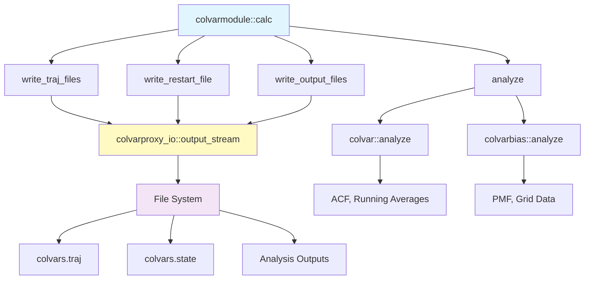
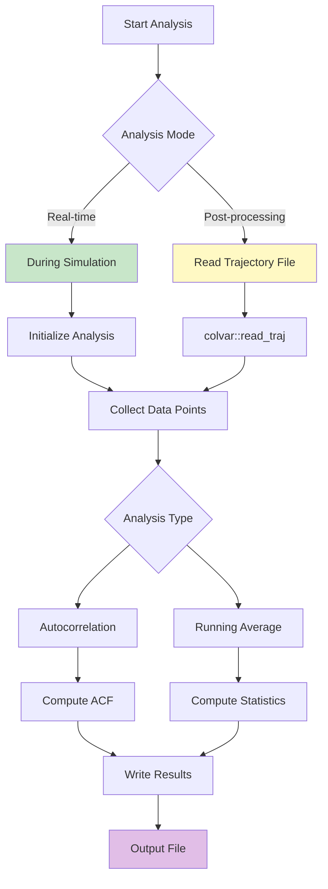

The Colvars module provides a comprehensive output system for monitoring collective variables, saving simulation states, and performing trajectory analysis during and after simulations. This system integrates seamlessly with MD engines through the proxy interface while maintaining independent control over output frequency, format, and content.

## Output Architecture Overview

The output system follows a layered architecture that separates I/O operations from simulation logic, enabling flexible configuration and cross-platform compatibility. The `colvarproxy_io` class serves as the interface between Colvars and the hosting MD engine, managing file streams, prefixes, and backup operations through a unified API [Sources: src/colvarproxy_io.h#L20-L191].

This architecture ensures that output operations are decoupled from the main calculation loop, allowing different output frequencies for different data types while maintaining synchronization with the simulation timestep.

## Trajectory Files

Trajectory files (typically named with `.colvars.traj` extension) provide time-series data of collective variable values, velocities, and forces throughout the simulation. The system writes these files at configurable intervals defined by the `colvarmodule::cv_traj_freq` parameter [Sources: src/colvarmodule.h#L860-L880, src/colvarmodule.cpp#L1223-L1260].

### Trajectory File Structure

Each trajectory file begins with comment lines containing column labels that identify each collective variable's properties. The labels are written at the start of the simulation and every 1000 trajectory frames thereafter to ensure proper identification during analysis [Sources: src/colvarmodule.cpp#L1238-L1244].

The trajectory writing process involves:

1. **Opening the trajectory file** through the proxy's output stream interface
2. **Writing labels** when appropriate (step 0, explicit request, or periodic refresh)
3. **Writing data** at the configured trajectory frequency
4. **Flushing buffers** at restart frequency to prevent data loss

The actual data writing is delegated to individual `colvar` objects through their `write_traj()` methods, which format values, velocities, forces, and applied forces according to each variable's type and dimensionality [Sources: src/colvar.h#L462-L466].

### Trajectory Output Configuration

Trajectory output behavior is controlled through module-level parameters:

| Parameter | Type | Default | Description |
|-----------|------|---------|-------------|
| `cv_traj_freq` | size_t | 1 | Frequency (in steps) for trajectory output |
| `cv_traj_name` | string | `${output_prefix}.colvars.traj` | Trajectory file name |
| `cv_traj_write_labels` | bool | true | Whether to write column labels |

The trajectory file name is automatically constructed using the output prefix set through the proxy interface, enabling organized file naming conventions across different simulation runs [Sources: src/colvarmodule.cpp#L1558-L1562].

## State and Restart Files

State files (with `.colvars.state` extension) contain complete snapshots of the Colvars module, including all collective variables, biases, and their internal state variables. These files enable simulation continuation after interruption and are essential for long-running production simulations [Sources: src/colvarmodule.h#L570-L577].

### State File Formats

Colvars supports both text and binary state file formats, with the format controlled by the `colvarmodule::binary_restart` flag. Binary files offer faster I/O and smaller file sizes, while text files provide human-readable debugging capability [Sources: src/colvarmodule.cpp#L1203-L1217].

The state file writing process:

1. **Creates or opens** the state file through the proxy interface
2. **Serializes module state** including step number, version information, and unit system
3. **Serializes colvars** including their values, velocities, extended Lagrangian coordinates, and analysis histories
4. **Serializes biases** including their grids, accumulated data, and method-specific parameters
5. **Closes and flushes** the file ensuring data integrity

State files are written at the frequency specified by `colvarmodule::restart_out_freq`, with a default name constructed from the restart output prefix or the general output prefix [Sources: src/colvarmodule.cpp#L898-L918, src/colvarmodule.cpp#L1169-L1196].

### State File Reading

State file reading supports multiple input sources:

1. **File-based input** - Reads from `.colvars.state` file at the specified input prefix
2. **String-based input** - Reads from a formatted string buffer (useful for MPI communication)
3. **Memory buffer input** - Reads from binary memory buffer for efficient replica communication

The system automatically detects binary vs. text format by checking for a magic number at the beginning of the file, ensuring backward compatibility with older text-based state files [Sources: src/colvarmodule.cpp#L1401-L1434].

## Trajectory Analysis Tools

The Colvars module provides built-in analysis capabilities that can be performed during simulation (analysis mode) or on existing trajectory files through post-processing. These tools operate on the time-series data stored in trajectory files or maintained in memory during runtime [Sources: src/colvar.h#L453-L490, src/colvarmodule.cpp#L1257-L1283].

### Autocorrelation Functions

Autocorrelation analysis quantifies the temporal correlations in collective variable behavior, providing insights into dynamical timescales and memory effects. The system supports three types of autocorrelation functions [Sources: src/colvar.h#L537-L566]:

- **Velocity ACF** (`acf_vel`) - Correlation of velocities: `⟨v(0)·v(t)⟩`
- **Coordinate ACF** (`acf_coor`) - Correlation of positions: `⟨x(0)·x(t)⟩`
- **P2 Coordinate ACF** (`acf_p2coor`) - Second-order Legendre polynomial for vector variables: `⟨P₂(x(0)·x(t))⟩`

Autocorrelation configuration parameters:

| Parameter | Type | Description |
|-----------|------|-------------|
| `acf_length` | size_t | Number of correlation lag points to compute |
| `acf_offset` | size_t | Number of initial steps to skip before starting ACF |
| `acf_stride` | size_t | Timesteps between consecutive ACF samples |
| `acf_nframes` | size_t | Number of frames to average for each ACF point |
| `acf_normalize` | bool | Whether to normalize ACF to maximum value of 1 |
| `acf_colvar_name` | string | Name of colvar for correlation (default: itself) |

The analysis maintains sliding windows of historical values (`acf_x_history` and `acf_v_history`) to compute correlations incrementally, minimizing memory overhead for long simulations [Sources: src/colvar.h#L505-L534].

### Running Averages

Running average analysis computes time-averaged values and their statistical fluctuations, providing smoothed representations of collective variable behavior and estimates of convergence. The system maintains a configurable-length window of historical values for this calculation [Sources: src/colvar.h#L571-L580, src/colvar.cpp#L572-L584].

Running average parameters:

| Parameter | Type | Description |
|-----------|------|-------------|
| `runave_length` | size_t | Number of frames in the running average window |
| `runave_stride` | size_t | Timesteps between samples in the average |
| `runave_outfile` | string | Filename for running average output |

The analysis computes both the mean value and the variance from the running average, providing measures of both central tendency and fluctuations over the specified time window [Sources: src/colvar.h#L577-L580].

### Post-Processing Trajectory Analysis

For post-processing analysis, the module provides the `read_traj()` function that reads trajectory files without requiring a running simulation. This enables efficient analysis of completed simulations using the same analysis algorithms as real-time analysis [Sources: src/colvar.h#L459-L466, src/colvarmodule.h#L641-L645].

## Output File Management

The `colvarproxy_io` class provides a unified interface for file operations, handling platform-specific details such as path separators, file locking, and backup strategies. This abstraction enables the Colvars library to work consistently across different MD engines and operating systems [Sources: src/colvarproxy_io.h#L145-L165].

### File Stream Management

The proxy maintains maps of open input and output streams, enabling multiple simultaneous file operations and efficient resource management:

- **Output streams** are created on-demand through `output_stream()` and remain open until explicitly closed or the module is destroyed
- **Input streams** support both file-based and string-based inputs, with automatic cleanup after reading
- **Flush operations** ensure data is written to disk at critical points (restart frequency, explicit requests, module destruction)

The system provides backup functionality through `backup_file()` which renames existing files before overwriting, preventing accidental data loss during long simulations [Sources: src/colvarproxy_io.h#L47-L73].

### Output Prefix System

Three types of output prefixes organize file naming:

1. **`input_prefix`** - Prefix for input state files (cleared after reading)
2. **`output_prefix`** - Default prefix for all output files (final configuration)
3. **`restart_output_prefix`** - Prefix for restart/checkpoint files

This multi-tier system enables different naming conventions for intermediate checkpoints versus final output files, supporting complex workflow organization [Sources: src/colvarproxy_io.h#L75-L100].

## Configuration Parameters

Output behavior is controlled through module-level and individual colvar/bias parameters. Key global parameters include [Sources: src/colvarmodule.h#L860-L867]:

| Parameter | Type | Default | Purpose |
|-----------|------|---------|---------|
| `cv_traj_freq` | size_t | 1 | Trajectory output frequency (steps) |
| `restart_out_freq` | size_t | engine default | Restart file output frequency |
| `binary_restart` | bool | false | Use binary format for state files |
| `output_prefix` | string | "colvars" | Base name for output files |

Individual biases may define their own `output_freq` parameters to control when they write specific output files (e.g., PMF files, gradient histograms, metadynamics hill files) [Sources: src/colvarmodule.cpp#L930-L944].

> [!TIP]
> The trajectory flush operation at restart frequency (controlled by `restart_out_freq`) ensures that trajectory data is written to disk before a restart checkpoint, preventing data loss in case of simulation failure between trajectory writes and restart saves.

## Integration with Simulation Workflow

Output operations are tightly integrated with the main simulation cycle through the `colvarmodule::calc()` function, which orchestrates the sequence of calculations and outputs [Sources: src/colvarmodule.cpp#L828-L944]:

1. Calculate collective variables
2. Calculate biases
3. Update colvar forces
4. Perform analysis
5. Write trajectory files (if step matches `cv_traj_freq`)
6. Write restart files (if step matches `restart_out_freq`)
7. Write bias-specific output files

This ordered sequence ensures that all calculations are complete before output operations, guaranteeing data consistency in all output files.

> [!TIP]
> Analysis operations are performed every step regardless of output frequency, ensuring that statistical accumulations (ACF, running averages) capture the full simulation dynamics even when trajectory output is sparse.

## Next Steps

For detailed information about specific collective variable types that generate trajectory data, see [Distance-Based Variables](6-distance-based-variables) and [Angular and Dihedral Variables](7-angular-and-dihedral-variables). To understand how bias methods write their own output files, refer to [Adaptive Biasing Force (ABF)](12-adaptive-biasing-force-abf) and [Metadynamics and Well-Tempered Variants](13-metadynamics-and-well-tempered-variants). For managing simulation state beyond output files, see [State Management and Restart Files](23-state-management-and-restart-files).