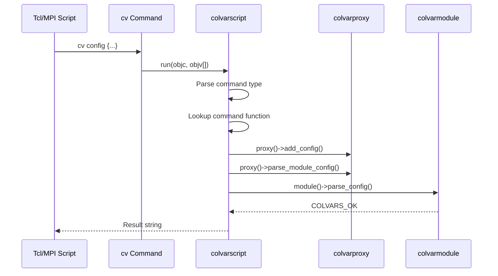

This page documents the comprehensive scripting interface that enables runtime interaction with Colvars through Tcl and other scripting languages. The architecture provides a unified API across all supported MD engines (NAMD, LAMMPS, VMD, GROMACS), allowing dynamic configuration, monitoring, and control of collective variables and biasing methods during simulations.

Sources: [colvarscript.h](src/colvarscript.h), [colvarproxy_tcl.h](src/colvarproxy_tcl.h)

## Architecture Overview

The scripting interface follows a layered design that separates command definition from language-specific implementation. At the core lies the `colvarscript` class, which serves as the command registry and dispatcher, while language-specific concerns are handled through proxy classes.

The command routing flow illustrates how user commands are processed through the interface:



The architecture distinguishes three primary object types for command execution, each with a distinct prefix:

| Object Type | Prefix | Target | Command Count Shift |
|-------------|--------|--------|-------------------|
| Module-level | `cv_` | Global Colvars module | 2 |
| Colvar-level | `colvar_` | Individual collective variables | 4 |
| Bias-level | `bias_` | Individual bias methods | 4 |

The shift parameter accounts for positional arguments in the command structure, enabling uniform argument parsing across all command types.

Sources: [colvarscript.h](src/colvarscript.h#L89-L94), [colvarscript.cpp](src/colvarscript.cpp#L348-L366)

## Command Registration System

Commands are defined using a macro-based registration system that generates both metadata and implementation code. The `CVSCRIPT` macro serves as the single source of truth for each scripting command, automatically generating help strings, argument validation, and function prototypes through conditional compilation.

The macro takes six parameters that fully characterize each command:

```cpp
CVSCRIPT(COMM, HELP, N_ARGS_MIN, N_ARGS_MAX, ARGS, FN_BODY)
```

Where:
- **COMM**: Command identifier (enum member)
- **HELP**: Description string with optional return value on second line
- **N_ARGS_MIN/N_ARGS_MAX**: Minimum and maximum argument counts
- **ARGS**: Multi-line string describing parameters (format: "name : type - description")
- **FN_BODY**: Implementation as a thin wrapper over existing C++ functions

This macro expansion occurs in four contexts: generating function prototypes, populating the `colvarscript::command` enum, initializing command metadata, and implementing the function body. This design ensures consistency between documentation and implementation while eliminating boilerplate code.

Sources: [colvarscript_commands.h](src/colvarscript_commands.h#L14-L49), [colvarscript.cpp](src/colvarscript.cpp#L52-L98)

## Module-Level Commands

Module-level commands operate on the global Colvars instance and are invoked with the `cv` prefix. These commands provide configuration management, system queries, and simulation control capabilities.

### Configuration Commands

Configuration loading occurs through two primary commands supporting both string-based and file-based input:

| Command | Syntax | Purpose | Engine Requirements |
|---------|--------|---------|---------------------|
| `cv_config` | `cv config <conf>` | Load configuration from string | Supports immediate init |
| `cv_configfile` | `cv configfile <path>` | Load configuration from file | Supports immediate init |

Both commands automatically initialize the Colvars module when the host engine is ready, deferring initialization until `proxy()->setup()` is called otherwise. The configuration string is stored and processed through the proxy's parsing pipeline.

Sources: [colvarscript_commands.h](src/colvarscript_commands.h#L88-L121)

### System Information Queries

Module-level commands expose comprehensive system state information through the following query interfaces:

```tcl
# Get atomic information used by Colvars
cv getatomids           ;# Returns: {1 2 3 4 ...}
cv getatomcharges       ;# Returns: {0.0 -0.8 0.4 ...}
cv getatommasses        ;# Returns: {12.01 14.01 1.008 ...}
cv getatompositions     ;# Returns: {{x y z} {x y z} ...}

# Get simulation state
cv getstepabsolute      ;# Returns: total step count (including restarts)
cv getsteprelative      ;# Returns: step count from current job start

# Get force statistics
cv getatomappliedforces     ;# Forces applied by Colvars to atoms
cv getatomappliedforcesmax  ;# Maximum applied force magnitude
cv getatomappliedforcesrms  ;# RMS of applied forces
```

These queries enable real-time monitoring of simulation state without requiring direct access to internal data structures, supporting interactive analysis and debugging workflows.

Sources: [colvarscript_commands.h](src/colvarscript_commands.h#L208-L326)

### Energy Management

The energy contributed by Colvars to the simulation can be queried and modified through dedicated commands:

```tcl
# Get current Colvars energy (internal units)
cv getenergy    ;# Returns: E (float)

# Add energy directly to MD engine (VMD only)
cv addenergy E  ;# Adds energy value to total
```

The `cv_addenergy` command has no effect in engines that don't support external energy modification, illustrating the engine-specific capabilities exposed through the unified interface.

Sources: [colvarscript_commands.h](src/colvarscript_commands.h#L74-L80), [colvarscript_commands.h](src/colvarscript_commands.h#L327-L336)

## Colvar-Specific Commands

Commands operating on individual collective variables use the `cv colvar <name> <subcommand>` syntax. These commands enable runtime inspection, modification, and control of specific collective variables without requiring simulation restart.

### Value and Gradient Queries

The fundamental operations retrieve current colvar state:

| Command | Syntax | Returns | Dimensionality |
|---------|--------|---------|----------------|
| `colvar_value` | `cv colvar <name> value` | Current CV value | Matches CV type |
| `colvar_update` | `cv colvar <name> update` | Recomputed CV value | Matches CV type |
| `colvar_run_ave` | `cv colvar <name> run_ave` | Running average | Matches CV type |
| `colvar_getgradients` | `cv colvar <name> getgradients` | Atomic gradients | {N × 3} array |

The `colvar_update` command is particularly useful for ensuring colvar values are current after atomic coordinates have changed, as it forces immediate recalculation rather than returning cached values.

Sources: [colvarscript_commands_colvar.h](src/colvarscript_commands_colvar.h#L167-L197)

### Force Application and Retrieval

Custom forces can be applied to colvars dynamically, enabling interactive control or implementation of custom biasing schemes:

```tcl
# Apply force to colvar
cv colvar xi addforce {5.0 0.0}  ;# For 2D colvar
cv colvar dist addforce 10.0     ;# For 1D colvar

# Retrieve force information
cv colvar xi getappliedforce    ;# Total bias force applied
cv colvar xi gettotalforce      ;# Internal + external forces
cv colvar xi resetbiasforce     ;# Clear accumulated bias forces
```

The `addforce` command automatically enables the `f_cv_apply_force` feature, ensuring the force is properly integrated into the simulation. Force dimensionality must match the colvar's native dimensionality to prevent errors.

Sources: [colvarscript_commands_colvar.h](src/colvarscript_commands_colvar.h#L8-L26), [colvarscript_commands_colvar.h](src/colvarscript_commands_colvar.h#L34-L45)

### Component Management

Colvars composed of multiple components (CVCs) support individual component control:

```tcl
# Enable/disable specific components
cv colvar mycv cvcflags {1 0 1}  ;# Disable middle component

# Modify component configurations
cv colvar mycv modifycvcs {"distance 1" "" "distance 2"}
```

The `cvcflags` command accepts a binary array matching the number of components, where zero disables a component and non-zero values enable it. This enables runtime modification of complex colvar behavior without reconfiguration.

Sources: [colvarscript_commands_colvar.h](src/colvarscript_commands_colvar.h#L31-L52), [colvarscript_commands_colvar.h](src/colvarscript_commands_colvar.h#L107-L119)

## Bias-Specific Commands

Bias-specific commands follow the pattern `cv bias <name> <subcommand>` and provide fine-grained control over biasing methods including ABF, metadynamics, harmonic restraints, and others.

### State Management

Bias state can be saved and loaded for analysis, restart, or sharing across replicas:

| Command | Syntax | Purpose |
|---------|--------|---------|
| `bias_save` | `cv bias <name> save <prefix>` | Write state to file(s) |
| `bias_load` | `cv bias <name> load <prefix>` | Read state from file(s) |
| `bias_savetostring` | `cv bias <name> savetostring` | Serialize state to string |
| `bias_loadfromstring` | `cv bias <name> loadfromstring <buffer>` | Deserialize from string |

The string-based commands facilitate inter-process communication and enable bias state transfer without temporary files. For grid-based biases like ABF and metadynamics, the save/load operations handle multiple files with appropriate suffixes.

Sources: [colvarscript_commands_bias.h](src/colvarscript_commands_bias.h#L77-L105)

### Grid Query Operations

Biases maintaining probability distributions or free energy grids expose sampling statistics:

```tcl
# Query grid information
cv bias myabf bin          ;# Current flattened bin index
cv bias myabf binnum       ;# Total number of grid points
cv bias myabf bincount 5   ;# Sample count at bin 5

# Local sampling statistics
cv bias myabf local_sample_count 2  ;# Samples within radius 2 bins
```

The `bincount` command is particularly useful for analyzing sampling coverage in ABF simulations, with `local_sample_count` providing regional statistics that help identify undersampled regions.

Sources: [colvarscript_commands_bias.h](src/colvarscript_commands_bias.h#L6-L40)

### Energy and Force Information

Current bias contributions to the system energy and forces are available for analysis:

```tcl
# Get current bias energy
cv bias mymeta energy      ;# Returns: E (float)

# Retrieve bias configuration
cv bias mymeta getconfig   ;# Returns: full configuration string

# Print feature state
cv bias mymeta state       ;# Output to log
```

The `getconfig` command enables runtime inspection of bias parameters, facilitating debugging and analysis of active bias configurations.

Sources: [colvarscript_commands_bias.h](src/colvarscript_commands_bias.h#L55-L75)

### Replica Communication

For multiple-walker and distributed sampling schemes, biases support explicit communication:

```tcl
# Share bias state with replicas
cv bias myabf share
```

This command triggers the `replica_share()` method, which exchanges data with other replicas through the proxy's communication layer. The exact behavior depends on the bias type and the multiple replica communication configuration.

Sources: [colvarscript_commands_bias.h](src/colvarscript_commands_bias.h#L127-L136)

## Tcl Integration

Tcl integration is implemented through the `colvarproxy_tcl` class, which bridges the generic scripting interface with Tcl interpreter capabilities. The integration is conditional on the `COLVARS_TCL` compile flag, enabling builds without Tcl support for environments where it's not required.

### Interpreter Management

The Tcl interpreter is initialized during proxy construction:

```cpp
void colvarproxy_tcl::init_tcl_pointers() {
  if (tcl_interp_ == NULL) {
    // Allocate a dedicated Tcl interpreter for Colvars
    set_tcl_interp(Tcl_CreateInterp());
  }
}
```

Engine-specific proxies (NAMD, VMD) override this method to use the host engine's existing interpreter rather than allocating a new one. This design allows Colvars to share the interpreter context with other Tcl-based functionalities in the host program.

Sources: [colvarproxy_tcl.cpp](src/colvarproxy_tcl.cpp#L21-L35)

### Command Registration

The `cv` command is registered with the Tcl interpreter during `colvarscript` construction:

```cpp
Tcl_DeleteCommand(interp, "cv");
Tcl_CreateObjCommand(interp, "cv", tcl_run_colvarscript_command,
                     (ClientData) this, (Tcl_CmdDeleteProc *) NULL);
```

The existing `cv` command (if present) is deleted and replaced with the new implementation. The external C function `tcl_run_colvarscript_command` serves as the bridge between Tcl's C API and the C++ colvarscript infrastructure, handling type conversions and error propagation.

Sources: [colvarscript.cpp](src/colvarscript.cpp#L37-L52)

### Script Execution

Arbitrary Tcl scripts can be executed through the proxy interface:

```cpp
int colvarproxy_tcl::tcl_run_script(std::string const &script) {
  Tcl_Interp *const interp = get_tcl_interp();
  int err = Tcl_Eval(interp, script.c_str());
  if (err != TCL_OK) {
    cvm::error(Tcl_GetStringResult(interp));
    return COLVARS_ERROR;
  }
  return cvm::get_error();
}
```

Similarly, Tcl files can be loaded using `tcl_run_file()`, which internally uses `Tcl_EvalFile()`. Error handling captures Tcl's result string and reports it through Colvars' error system.

Sources: [colvarproxy_tcl.cpp](src/colvarproxy_tcl.cpp#L44-L59)

## Custom Callbacks

The Tcl integration supports user-defined callback procedures for extending Colvars functionality at runtime. Three types of callbacks are currently supported: force calculation, colvar value calculation, and colvar gradient calculation.

### Force Callback

The `calc_colvar_forces` procedure, if defined in the Tcl interpreter, is called each timestep to apply custom forces:

```tcl
proc calc_colvar_forces {step} {
    # Access Colvars API
    set force [expr {$step * 0.01}]
    cv colvar xi addforce $force
}
```

The callback receives the absolute step number as its sole argument and can invoke any `cv` commands. This enables implementation of custom biasing schemes or adaptive algorithms without C++ modifications.

Sources: [colvarproxy_tcl.cpp](src/colvarproxy_tcl.cpp#L62-L78)

### Colvar Value Callback

For implementing custom collective variables entirely in Tcl, the `calc_<name>` callback is invoked:

```tcl
proc calc_myCustomCV {cvc1_value cvc2_value} {
    # Compute custom CV value from component values
    return [expr {$cvc1_value + 2.0 * $cvc2_value}]
}
```

The callback receives the values of all CVCs as separate arguments and must return a scalar value matching the expected type. The colvar configuration must reference this callback name.

Sources: [colvarproxy_tcl.cpp](src/colvarproxy_tcl.cpp#L80-L113)

### Gradient Callback

The corresponding gradient callback `calc_<name>_gradient` computes atomic gradients:

```tcl
proc calc_myCustomCV_gradient {cvc1_value cvc2_value} {
    # Return gradient w.r.t. each CVC
    return {1.0 2.0}
}
```

The callback returns a list of gradient values with one entry per CVC. This is necessary for proper force back-propagation to atoms.

Sources: [colvarproxy_tcl.cpp](src/colvarproxy_tcl.cpp#L115-L159)

## Help System and Documentation

A comprehensive help system is integrated into the scripting interface, providing runtime access to command documentation:

```tcl
# Get global command list
cv help

# Get specific command help
cv help getatomids

# Get colvar-specific commands
cv help colvar

# Get bias-specific commands  
cv help bias

# Get specific subcommand help
cv colvar xi help value
```

Each command stores help strings that include description, parameters, return values, and usage examples. This documentation is automatically generated from the `CVSCRIPT` macro definitions, ensuring consistency between implementation and documentation.

Sources: [colvarscript.cpp](src/colvarscript.cpp#L302-L326)

## Error Handling and Return Values

Script commands return integer status codes indicating success or failure:

| Code | Symbol | Meaning |
|------|--------|---------|
| 0 | `COLVARS_OK` | Success |
| -1 | `COLVARSCRIPT_ERROR` | Scripting error (syntax, missing args) |
| -2 | `COLVARS_ERROR` | Colvars internal error |
| -3 | `COLVARS_INPUT_ERROR` | Invalid input configuration |

Results from successful commands are stored in a string buffer accessible via `script->str_result()`. For Tcl, this string is set as the interpreter's result, making it available to subsequent Tcl commands.

Sources: [colvarscript.h](src/colvarscript.h#L46-L68)

## Language Abstraction

While Tcl is the primary scripting language supported, the interface is designed to accommodate other languages. The `colvarscript` class uses generic `unsigned char*` object pointers for arguments, with language-specific conversion handled through virtual methods:

```cpp
char *obj_to_str(unsigned char *obj);  // Base implementation: simple cast
std::vector<std::string> obj_to_str_vector(unsigned char *obj);  // Base: parse string
```

Tcl-specific implementations can override these methods to use `Tcl_GetString()` and `Tcl_ListObjGetElements()` for proper type conversion. The proxy pattern allows LAMMPS, Python, or other language integrations to provide their own conversions without modifying core Colvars code.

Sources: [colvarscript.h](src/colvarscript.h#L203-L209)

> [!TIP]
> When implementing custom callbacks in Tcl, avoid expensive operations inside time-critical paths like `calc_colvar_forces`. Precompute values where possible and cache results to minimize performance impact on MD simulation speed.

> [!TIP]
> The string serialization used by `bias_savetostring` and `bias_loadfromstring` provides a language-agnostic mechanism for state transfer. Use these for inter-process communication rather than relying on Tcl-specific data structures when working across different MD engines.

## Further Reading

The scripting interface builds upon several core architectural components. For deeper understanding, explore:

- **[Core Architecture and Design Patterns](5-core-architecture-and-design-patterns)** - Understanding the proxy pattern and module organization
- **[Proxy Interface and Engine Integration](20-proxy-interface-and-engine-integration)** - How different MD engines integrate with Colvars
- **[State Management and Restart Files](23-state-management-and-restart-files)** - The serialization mechanisms underlying save/load operations
- **[Output Files and Trajectory Analysis](26-output-files-and-trajectory-analysis)** - Using scripting to automate analysis workflows

For practical examples, consult the test suite in the `tests/` directory and the example configurations in `examples/`, particularly those demonstrating interactive usage with NAMD and VMD.
