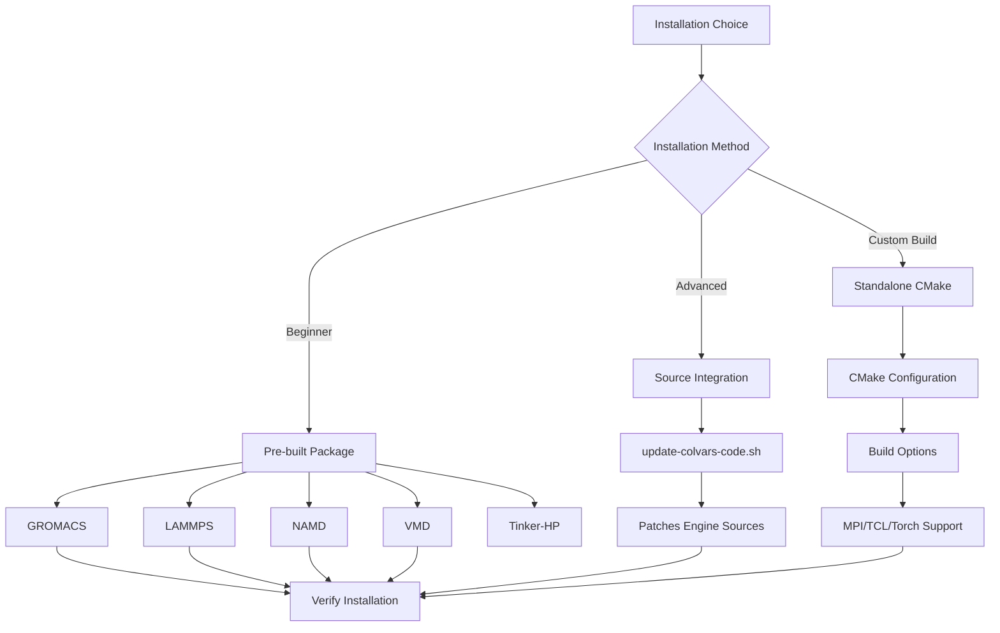

This page provides a comprehensive guide for installing and integrating the Colvars module with various molecular dynamics engines. Whether you prefer pre-built packages or custom compilation, this guide covers all installation methods and system requirements for beginner-level developers.


## Installation Overview

The Colvars module offers multiple installation pathways depending on your needs and technical expertise. You can either use pre-compiled versions distributed with supported MD packages or integrate the latest source code directly into your build environment. The module uses a proxy interface pattern to abstract engine-specific implementations while maintaining a unified API for collective variable calculations across different simulation backends.

Sources: [README.md](README.md#L1-L50)

### Installation Methods



## Pre-Built Package Installation

The simplest approach for beginners is to use the pre-compiled versions of Colvars included with major simulation packages. This requires no additional compilation and provides immediate access to Colvars functionality through each engine's standard build process.

### Supported Simulation Engines

| Engine | Installation Method | Colvars Version Detection | Documentation Link |
|--------|---------------------|---------------------------|-------------------|
| **GROMACS** | Standard package installation | Version table on wiki | [GROMACS Manual](https://manual.gromacs.org/) |
| **LAMMPS** | Standard package installation | Version table on wiki | [LAMMPS Download](https://lammps.sandia.gov/download.html) |
| **NAMD** | Standard package installation | Version table on wiki | [NAMD Website](https://www.ks.uiuc.edu/Research/namd/) |
| **VMD** | Standard package installation | Version table on wiki | [VMD Website](https://www.ks.uiuc.edu/Research/vmd/) |
| **Tinker-HP** | Standard package installation | Version table on wiki | [Tinker-HP Website](https://tinker-hp.org/) |

Sources: [README.md](README.md#L14-L25)

### Pre-Built Configuration Example

After installing any supported package, you can immediately use Colvars with minimal configuration. For example, in LAMMPS:

```bash
# Create a simple Colvars configuration file
cat > colvars.inp << EOF
colvar {
  name d
  width 0.2
  distance {
    group1 { atomNumbers 1 2 3 }
    group2 { atomNumbers 4 5 6 }
  }
}

harmonic {
  colvars d
  centers 5.0
  forceConstant 10.0
}
EOF

# Run LAMMPS with Colvars
lmp -in input.lammps -var style colvars -var configfile colvars.inp
```

> [!TIP]
> The configuration syntax is identical across all supported engines, making it easy to transfer simulations between packages. Only the activation commands differ slightly between engines.

Sources: [README.md](README.md#L38-L62)

## Source Code Integration Using update-colvars-code.sh

For developers needing the latest features or custom builds, the `update-colvars-code.sh` script provides automated integration with any supported MD engine source tree. This script handles file copying, patching, and dependency management through a unified interface.

### Obtaining the Source Code

```bash
# Clone the repository
git clone https://github.com/Colvars/colvars.git
cd colvars

# Or download the master branch
wget https://github.com/Colvars/colvars/archive/master.zip
unzip master.zip
cd colvars-master
```

Sources: [README.md](README.md#L70-L77)

### Script Usage and Options

The update script supports multiple engines with automatic detection and error handling:

```bash
#!/bin/bash
# Basic usage syntax
./update-colvars-code.sh [-f] <target source tree>

# Update LAMMPS source tree
./update-colvars-code.sh /path/to/lammps

# Update NAMD source tree (force mode)
./update-colvars-code.sh -f /path/to/NAMD_X.YY_Source

# Update VMD source tree
./update-colvars-code.sh /path/to/vmd-X.Y.Z

# Update GROMACS source tree (2024+ only)
./update-colvars-code.sh /path/to/gromacs
```

**Options:**
- `-f`: Force update mode - overwrites conflicting files like Makefiles
- `-R`: Reverse mode - updates git tree from downstream (undocumented)
- `--diff`: Comparison-only mode without modifications

Sources: [update-colvars-code.sh](update-colvars-code.sh#L8-L30)

### Engine Detection Logic

The script automatically identifies the target engine using specific signature files:

```bash
# Detection hierarchy
if [ -f "${target}/src/lammps.h" ]; then
  code="LAMMPS"
elif [ -f "${target}/src/NamdTypes.h" ]; then
  code="NAMD"
elif [ -f "${target}/src/VMDApp.h" ]; then
  code="VMD"
elif [ -f "${target}/include/molfile_plugin.h" ]; then
  code="VMD-PLUGINS"
elif [ -f "${target}/src/gromacs/version.h.cmakein" ]; then
  code="GROMACS"
fi
```

Sources: [update-colvars-code.sh](update-colvars-code.sh#L42-L60)

### GROMACS-Specific Integration

GROMACS 2024 and later use an MDModules interface requiring special handling:

```bash
# The script automatically checks for GROMACS version support
if [ ${code} == "GROMACS" ] ; then
  if [ ! -f ${target}/src/gromacs/applied_forces/colvars/colvarsMDModule.cpp ] ; then
    echo "ERROR: Versions of GROMACS prior to 2024 are no longer supported."
    exit 1
  fi
fi

# Copies files to: src/external/colvars/
# Applies patches to CMakeLists.txt
# Copies MDModules to: src/gromacs/applied_forces/colvars/
```

Sources: [update-colvars-code.sh](update-colvars-code.sh#L63-L70)

> [!TIP]
> For GROMACS 2024+, the update script automatically downloads and integrates the Lepton library (used for custom function parsing) unless you set `UPDATE_LEPTON=no` before running the script.

Sources: [update-colvars-code.sh](update-colvars-code.sh#L495-L520)

## Standalone CMake Build

For maximum flexibility or developing custom integrations, you can build Colvars as a standalone library using CMake. This approach allows fine-grained control over compilation options and dependency management.

### Basic Build Process

```bash
# Navigate to CMake directory
cd cmake

# Configure with default options (C++11 standard)
cmake ..

# Build the library
make

# Install (optional)
sudo make install
```

Sources: [cmake/CMakeLists.txt](cmake/CMakeLists.txt#L1-L15)

### CMake Configuration Options

| Option | Default | Description |
|--------|---------|-------------|
| `CMAKE_CXX_STANDARD` | `11` | C++ language standard (11, 14, 17) |
| `BUILD_SHARED_LIBS` | `OFF` | Build shared libraries instead of static |
| `WARNINGS_ARE_ERRORS` | `OFF` | Treat compiler warnings as errors |
| `COLVARS_DEBUG` | `OFF` | Build with debugging symbols and no optimization |
| `ADDRESS_SANITIZER` | `OFF` | Enable address sanitizer for memory debugging |
| `COLVARS_LEPTON` | Auto | Build and link Lepton library for custom functions |
| `COLVARS_OPENMP` | `ON` | Enable (limited) OpenMP support |
| `COLVARS_MPI` | `OFF` | Link against MPI library |
| `COLVARS_TCL` | `OFF` | Link against Tcl library for scripting |
| `COLVARS_TORCH` | `OFF` | Link against PyTorch for neural network variables |
| `BUILD_TESTS` | `ON` | Build test suite |
| `ENABLE_COVERAGE` | `OFF` | Enable code coverage reporting |

Sources: [cmake/CMakeLists.txt](cmake/CMakeLists.txt#L20-L100)

### Advanced Configuration Examples

```bash
# Build with MPI and Torch support (requires C++17)
cmake -DCOLVARS_MPI=ON \
      -DCOLVARS_TORCH=ON \
      -DCMAKE_CXX_STANDARD=17 \
      -DLIBTORCH_PREFIX=/path/to/libtorch \
      ..

# Build with address sanitizer for debugging
cmake -DADDRESS_SANITIZER=ON \
      -DCOLVARS_DEBUG=ON \
      ..

# Build with custom Tcl installation
cmake -DCOLVARS_TCL=ON \
      -DTCL_DIR=/usr/local/tcl8.6 \
      ..
```

Sources: [cmake/CMakeLists.txt](cmake/CMakeLists.txt#L102-L170)

### Compiler-Specific Options

The CMake configuration includes compiler-specific optimizations and warnings:

```cmake
# GNU/Clang/Intel compilers
target_compile_options(colvars PRIVATE -Wall -pedantic)

# MSVC (Visual Studio)
target_compile_options(colvars PRIVATE /Zc:__cplusplus /W3 /wd4244 /wd4267)

# Clang version-specific features
if(CMAKE_CXX_COMPILER_ID STREQUAL "Clang")
  if(CMAKE_CXX_COMPILER_VERSION GREATER 6)
    target_compile_options(colvars PRIVATE -Wshadow-field)
  endif()
endif()
```

Sources: [cmake/CMakeLists.txt](cmake/CMakeLists.txt#L52-L68)

## Engine-Specific Integration Details

Each MD engine integrates Colvars through a proxy class that implements the interface defined in `colvarproxy.h`. The following sections provide detailed integration patterns for each supported engine.

### LAMMPS Integration

LAMMPS uses a `fix` style interface to embed Colvars functionality:

```cpp
// LAMMPS fix command syntax
fix ID group-ID colvars configfile keyword value ...

// Example usage
fix Colvars all colvars colvars.inp output myjob
fix_modify Colvars tstat NPT
fix_modify Colvars seed 12345
```

**Key Features:**
- Accelerator variant: `colvars/kk` for KOKKOS support
- Supports restart files for continuing simulations
- Provides temperature coupling with LAMMPS thermostats
- Optional coordinate unwrapping

Sources: [lammps/doc/src/fix_colvars.rst](lammps/doc/src/fix_colvars.rst#L6-L50)

### NAMD Integration

NAMD uses the GlobalMaster mechanism to apply Colvars forces:

```cpp
// NAMD configuration
colvars on
cv configfile my_config.colvars
```

**Build Integration:**
- Apply `Makefile.patch` to NAMD's Makefile
- Add Lepton library dependency
- Includes custom CUDA integration through `cudaglobalmaster` proxy

Sources: [namd/Makefile.patch](namd/Makefile.patch#L1-L14), [namd/src/colvarproxy_namd.h](namd/src/colvarproxy_namd.h#L37-L84)

### GROMACS Integration

GROMACS 2024+ uses the MDModules framework:

```bash
# GROMACS 2024+ configuration (in .mdp file)
colvars-active = yes
colvars-configfile = my_config.colvars
```

**Build Integration:**
- Copies library to `src/external/colvars/`
- Applies CMake patches for build system integration
- Integrates with MDModule interface in `src/gromacs/applied_forces/colvars/`
- Automatically includes Lepton library for custom function support

Sources: [update-colvars-code.sh](update-colvars-code.sh#L495-L588)

### VMD Integration

VMD provides both a Tcl scripting interface and a graphical dashboard:

```tcl
# VMD Tcl interface
cv molid top
cv configfile my_config.colvars

# Or use the Colvars Dashboard plugin
package require cv_dashboard
```

**Build Integration:**
- Requires C++11 patch for modern architectures
- Includes the Colvars Dashboard plugin for visual configuration
- Provides additional analysis scripts in `vmd/scripts/`

Sources: [README-c++11.md](README-c++11.md#L18-L29)

## C++ Language Requirements

Colvars requires **C++11** as the minimum language standard across all supported platforms. This ensures compatibility with modern compilers while maintaining broad support for existing installations.

### Engine-Specific Standards

| Engine | C++ Standard | Notes |
|--------|--------------|-------|
| **GROMACS** | C++17 | Follows GROMACS requirements |
| **LAMMPS** | C++11 | Standard LAMMPS requirement |
| **NAMD** | C++11 | Standard NAMD requirement |
| **VMD** | C++11 (with patch) | Requires external patch for C++11 support |

Sources: [README-c++11.md](README-c++11.md#L18-L29)

### Compiler Compatibility

The following compilers and versions are supported:

- **GCC**: 4.8+ (C++11 support), 7+ recommended
- **Clang**: 3.3+ (C++11 support), 6.0+ recommended
- **Intel C++**: 15.0+ (C++11 support)
- **MSVC**: 2015+ (partial support, some features disabled)

> [!TIP]
> Very old compilers (e.g., GCC 4.4 on CentOS 6) are no longer supported as they are past end-of-life. Upgrade your compiler if you encounter build errors related to C++11 features.

Sources: [README-c++11.md](README-c++11.md#L10-L16)

## Project Structure Overview

Understanding the repository structure helps with navigation and customization:

```
colvars/
├── cmake/              # CMake build configuration
│   ├── CMakeLists.txt              # Main build file
│   ├── buildColvarsLepton.cmake    # Lepton integration
│   └── buildColvarsTests.cmake     # Test suite configuration
├── src/                # Core library source code
│   ├── colvar*.h/cpp             # Collective variable definitions
│   ├── colvarbias*.h/cpp         # Biasing methods (ABF, metadynamics, etc.)
│   ├── colvarcomp*.h/cpp         # Component types (distance, angles, etc.)
│   ├── colvarproxy*.h/cpp        # Proxy interface and implementations
│   └── colvartypes.h/cpp         # Type definitions and utilities
├── gromacs/            # GROMACS-specific integration files
├── lammps/             # LAMMPS-specific integration files
├── namd/               # NAMD-specific integration files
├── vmd/                # VMD-specific integration files
├── examples/           # Example configuration files
├── tests/              # Comprehensive test suite
└── update-colvars-code.sh  # Integration script
```

Sources: [get_repo_structure](get_repo_structure), [src/](src/)

## Testing Your Installation

After installation, verify your setup using the provided test suites:

```bash
# Navigate to test directory
cd tests

# Run LAMMPS-specific tests
cd lammps/tests/library
./run_tests.sh

# Run GROMACS-specific tests
cd ../../gromacs/tests/library
./run_tests.sh

# Run NAMD-specific tests
cd ../../namd/tests/library
./run_tests.sh
```

The test suite includes hundreds of test cases covering:
- Distance-based variables
- Angular and dihedral variables
- Coordination numbers
- Harmonic restraints and walls
- Metadynamics and ABF methods
- Grid-based analysis
- Neural network variables

Sources: [lammps/tests/](lammps/tests/), [gromacs/tests/](gromacs/tests/), [namd/tests/](namd/tests/)

## Next Steps

After successfully installing Colvars, you can proceed to learn the configuration syntax and begin defining collective variables:

- **[Basic Configuration Syntax](4-basic-configuration-syntax)**: Learn the fundamental syntax for defining collective variables and biases
- **[Quick Start](2-quick-start)**: Work through a complete example from setup to analysis
- **[Overview](1-overview)**: Understand the core concepts and design philosophy

For developers interested in the internal architecture:

- **[Core Architecture and Design Patterns](5-core-architecture-and-design-patterns)**: Explore the proxy interface pattern and component architecture
- **[Proxy Interface and Engine Integration](20-proxy-interface-and-engine-integration)**: Deep dive into how engines communicate with the Colvars library