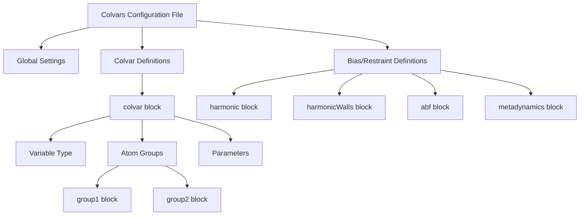

This page provides a comprehensive guide to the fundamental configuration syntax used by the Colvars module. Understanding these syntax fundamentals is essential before diving into specific collective variable types or biasing methods. The Colvars configuration system uses a keyword-based, block-structured format that is consistent across all supported molecular simulation engines (NAMD, LAMMPS, VMD, GROMACS, Tinker-HP).

Sources: [README.md](README.md#L1-L100), [colvarparse.h](src/colvarparse.h#L1-L100)

## Configuration File Structure Overview


The Colvars configuration system is built on a hierarchical block structure where each logical component is defined within its own named block. The parser operates by reading keyword-value pairs and matching braces to delineate configuration blocks. At the highest level, configuration files contain definitions for collective variables (`colvar` blocks), biases or restraints (e.g., `harmonic`, `harmonicWalls`), and global settings that control overall behavior.



The configuration parser recognizes keywords based on their isolation by whitespace or block delimiters, ensuring that keywords appearing as substrings within other values are not incorrectly interpreted. This robust parsing system supports multiple data types including scalars, vectors, strings, and boolean values, with automatic type conversion and validation.

Sources: [colvarparse.h](src/colvarparse.h#L30-L100), [colvarparse.cpp](src/colvarparse.cpp#L650-L750)

## Keyword-Value Pair Syntax

The fundamental building block of Colvars configuration is the keyword-value pair. Keywords are case-insensitive strings that identify specific configuration parameters, followed by one or more whitespace characters and then the corresponding value. Values can be scalar numbers, strings, booleans, or collections enclosed in braces for multi-line definitions.

**Scalar Values**: Simple numeric or string assignments follow the format `keyword value`. For example: `forceConstant 10.0` or `name myVariable`. The parser automatically converts string representations to appropriate numeric types (integers, real numbers) based on the expected parameter type. Boolean values accept multiple representations including `on/off`, `yes/no`, and `true/false`.

**Vector Values**: Multiple values for the same keyword can be provided space-separated. For example: `lowerWalls 3.5 4.2` defines two lower wall values corresponding to two collective variables. The parser reads all values until the end of the line or the start of a new keyword.

**String Values**: String values containing spaces should be enclosed in quotes, though this is rarely needed in practice as most string parameters (like atom selections) use their own internal parsing mechanisms.

> [!TIP]
> The parser performs strict validation of keyword names and will generate errors if unknown keywords are encountered within a configuration block. This helps catch typos and misconfigurations early.

Sources: [colvarparse.cpp](src/colvarparse.cpp#L150-L300), [colvarparse.cpp](src/colvarparse.cpp#L450-L550)

## Block Structure and Nesting

Configuration blocks are delimited by curly braces (`{` and `}`) and provide a hierarchical organization for related parameters. Each block begins with a block type identifier (like `colvar`, `harmonic`, `group1`) followed by an opening brace. The block contents contain keyword-value pairs defining properties specific to that block, and the block ends with a matching closing brace.

**Block Nesting**: Blocks can be nested to arbitrary depth. For example, a `colvar` block contains a variable type block (like `distance`), which in turn contains two `group1` and `group2` blocks for defining atom groups. The parser correctly handles nested braces by tracking brace counts and ensuring proper matching.

**Whitespace Insensitivity**: The parser is largely insensitive to whitespace formatting. Newlines, tabs, and spaces can be used interchangeably for indentation and readability. However, keywords and their values must be separated by at least one whitespace character.

Here's a complete example showing nested block structure:

```
colvar {
  name distance_AB
  distance {
    group1 {
      atomNumbers 1 2 3
    }
    group2 {
      atomNumbers 4 5 6
    }
  }
  width 0.2
}
```

The block type identifier (`colvar`, `distance`, `group1`) is itself a keyword that the parser uses to determine what parameters are valid within that block.

Sources: [colvarparse.cpp](src/colvarparse.cpp#L700-L850), [examples/01_NOE_restraints.colvars.in](examples/01_NOE_restraints.colvars.in#L1-L30)

## Comments in Configuration Files

Comments are essential for documenting configuration files and are supported through two primary mechanisms. Line comments begin with the `#` character and continue to the end of the line. Everything following the `#` on that line is ignored by the parser.

```
# This is a comment explaining the purpose of this block
colvar {
  name myVariable  # Inline comments are also supported
  width 0.2
}
```

Comments can appear anywhere in the configuration file and are particularly useful for documenting complex atom selections, parameter choices, or the scientific rationale behind specific configurations. The parser strips comments during the keyword validation process, so commented-out keywords do not trigger unknown keyword warnings.

> [!TIP]
> Use descriptive comments in your configuration files, especially when defining atom groups or setting specific force constants. This documentation becomes invaluable when revisiting simulations months later or sharing configurations with collaborators.

Sources: [colvarparse.cpp](src/colvarparse.cpp#L600-L650), [examples/02_aggregation.colvars.in](examples/02_aggregation.colvars.in#L1-L10)

## Global Configuration Options

Global options appear at the top level of the configuration file (outside any block) and control overall behavior of the Colvars module. These settings affect things like output frequency, analysis options, and restart file handling.

**Common Global Keywords**:

| Keyword | Description | Example |
|---------|-------------|---------|
| `colvarsTrajFrequency` | How often to write colvar values to trajectory file | `colvarsTrajFrequency 100` |
| `colvarsRestartFrequency` | How often to write restart files | `colvarsRestartFrequency 1000` |
| `analysis` | Enable analysis tasks (correlation functions, running averages) | `analysis on` |

Global options are typically placed at the beginning of the configuration file for clarity, though their position does not affect functionality. These options are parsed first and establish the framework within which individual colvars and biases operate.

```
colvarsTrajFrequency 100
colvarsRestartFrequency 1000
analysis on

colvar {
  # ... colvar definition
}
```

Sources: [examples/02_aggregation.colvars.in](examples/02_aggregation.colvars.in#L1-L2), [colvar.h](src/colvar.h#L450-L470)

## Collective Variable Block Syntax

The `colvar` block defines a single collective variable and is the most fundamental configuration block in Colvars. Every colvar must have a unique `name` parameter that identifies it within the simulation and allows biases to reference it.

**Required Parameters**: Every `colvar` block must specify a variable type (the specific collective variable function) and the necessary atom groups or reference data for that type. The `name` and `width` parameters are also essential.

```
colvar {
  name myDistance        # Unique identifier for this variable
  width 0.2             # Characteristic scale for this variable
  distance {             # Variable type
    group1 {
      atomNumbers 1 2 3
    }
    group2 {
      atomNumbers 4 5 6
    }
  }
}
```

**Optional Parameters**: Colvars support many optional parameters that modify behavior including:
- `lowerBoundary` and `upperBoundary`: Define valid range
- `period` and `wrapCenter`: For periodic variables
- `extendedLagrangian`: Enable extended dynamics
- `outputValue`, `outputVelocity`, `outputSystemForce`: Control what gets written to output

The `width` parameter is particularly important as it defines the characteristic fluctuation scale of the variable. This value is used internally by metadynamics (for Gaussian widths) and ABF (for grid spacing), making it a critical parameter for enhanced sampling methods.

Sources: [colvar.h](src/colvar.h#L55-L95), [README.md](README.md#L60-L80), [examples/03_orientation.colvars.in](examples/03_orientation.colvars.in#L1-L15)

## Atom Group Definition Syntax

Atom groups are defined within blocks named `group1`, `group2`, or simply `group` depending on the variable type. These blocks specify which atoms participate in the collective variable calculation using flexible atom selection methods.

**Atom Selection Methods**: Multiple methods can be combined within a single group block:

| Selection Method | Syntax | Example |
|------------------|--------|---------|
| By atom number | `atomNumbers` | `atomNumbers 1 2 3` |
| By residue range | `atomNameResidueRange` | `atomNameResidueRange CA 20-350` |
| By PDB file | `atomsfile` + `atomsCol` | `atomsfile atoms.pdb; atomsCol B` |
| By segment | `psfSegID` | `psfSegID PRA` |
| Multiple selections | Repeat keywords | Multiple `atomNameResidueRange` lines |

```
group1 {
  # Select alpha carbons from residues 20-350
  psfSegID P
  atomNameResidueRange CA 20-350
}

group2 {
  # Select from PDB file based on beta column
  atomsfile atoms.pdb
  atomsCol B
  atomsColValue 1
}
```

**Ambiguous Atom Definitions**: When multiple atoms satisfy selection criteria, they are all included in the group. This is useful for handling ambiguous assignments like methyl group hydrogen atoms. For example, the NOE restraint example demonstrates handling ambiguous proton assignments:

```
group1 {
  # ambiguous definition of the three HB* hydrogens
  psfSegID PRA PRA PRA
  atomNameResidueRange HB1 2-2
  atomNameResidueRange HB2 2-2
  atomNameResidueRange HB3 2-2
}
```

This flexibility allows precise control over which atoms contribute to each collective variable.

Sources: [examples/01_NOE_restraints.colvars.in](examples/01_NOE_restraints.colvars.in#L5-L25), [examples/03_orientation.colvars.in](examples/03_orientation.colvars.in#L5-L10)

## Bias and Restraint Block Syntax

Bias and restraint blocks define potentials applied to collective variables to steer simulations or calculate free energies. The most common are `harmonic` (standard harmonic restraint), `harmonicWalls` (one-sided harmonic walls), and advanced methods like `abf` (adaptive biasing force) and `metadynamics`.

**Harmonic Restraints**: The simplest bias, applying a quadratic potential ½K(ξ - ξ₀)² where ξ is the colvar value, ξ₀ is the center, and K is the force constant.

```
harmonic {
  colvars myDistance      # Apply to this colvar
  centers 5.0            # Restraint center ξ₀
  forceConstant 10.0     # Force constant K
}
```

**Harmonic Walls**: One-sided restraints that penalize values beyond specified thresholds. Each colvar can have upper walls, lower walls, or both.

```
harmonicWalls {
  colvars NOE_1 NOE_2    # Apply to multiple colvars
  lowerWalls 3.5 4.2     # Lower thresholds
  lowerWallConstant 30.0 # Force constant for lower walls
  upperWalls 4.5 4.9     # Upper thresholds
  upperWallConstant 20.0 # Force constant for upper walls
}
```

**Bias Block Common Elements**: All bias blocks require:
- A `name` parameter (optional but recommended)
- A `colvars` parameter listing which collective variables to bias
- Bias-specific parameters (force constants, centers, etc.)

Multiple biases can be applied to the same collective variable, with forces summing appropriately. This enables complex protocols like umbrella sampling combined with metadynamics.

Sources: [examples/01_NOE_restraints.colvars.in](examples/01_NOE_restraints.colvars.in#L32-L58), [examples/03_orientation.colvars.in](examples/03_orientation.colvars.in#L17-L24)

## Data Types and Units

Colvars configuration supports several data types with appropriate unit conventions that must be understood for correct usage.

**Numeric Types**: 
- Integers for atom numbers, residue numbers, counts
- Real numbers (double precision) for distances, angles, force constants

**Distance Units**: All distances are specified in Ångströms (Å). This applies to collective variable values, boundaries, and widths.

**Angle Units**: All angles are specified in radians unless otherwise noted. Degrees must be converted (π radians = 180°).

**Energy Units**: Force constants are typically specified in kcal/mol/Ų for distance variables, but the effective units depend on the collective variable type. The `width` parameter provides implicit unit scaling.

**Special Data Types**:
- Quaternions (four-dimensional vectors) for orientation variables
- Quaternion format: `(w, x, y, z)` or space-separated values
- No explicit units (dimensionless)

```
# Orientation restraint using quaternion
harmonic {
  colvars Orient
  centers (1.0, 0.0, 0.0, 0.0)  # Unit quaternion (no rotation)
  forceConstant 500.             # kcal/mol (quaternions dimensionless)
}
```

Sources: [examples/03_orientation.colvars.in](examples/03_orientation.colvars.in#L17-L24), [colvar.h](src/colvar.h#L85-L95)

## Configuration File Organization

Effective configuration file organization improves readability and maintainability. While the parser is flexible, following conventions helps avoid errors.

**Recommended Order**:
1. Global settings (output frequencies, analysis flags)
2. Collective variable definitions (colvar blocks)
3. Bias and restraint definitions (harmonic, ABF, metadynamics blocks)
4. Advanced analysis or output specifications

**Naming Conventions**:
- Use descriptive names for colvars: `distance_AB`, `angle_alpha`, `coord_num_water`
- Group related colvars with prefixes: `distance_ligand_core`, `distance_ligand_site`
- Name biases to reflect their purpose: `restraint_umbrella`, `bias_metad`

**Modular Configuration**: For complex simulations, consider splitting configuration into multiple files and using the MD engine's include mechanism to combine them. This is particularly useful when the same colvar definitions are used across different biasing protocols.

> [!TIP]
> Always validate your configuration file by running a short test simulation before starting production runs. The parser will catch syntax errors and unknown keyword issues early, saving computational resources.

Sources: [README.md](README.md#L40-L60), [examples/README.md](examples/README.md#L1-L8)

## Error Handling and Troubleshooting

The Colvars parser provides detailed error messages to help diagnose configuration problems. Understanding these messages is crucial for efficient debugging.

**Common Errors**:
- **"Error: keyword XXX is required"**: A required parameter is missing from a block
- **"Error: found more than one instance of XXX"**: Duplicate keyword definitions
- **"Parse error: reached the end while looking for closing brace"**: Unbalanced braces
- **"Error: improper or missing value for XXX"**: Value format is incorrect

**Validation Approach**:
1. Check that all braces are balanced (each `{` has a matching `}`)
2. Verify keyword spelling (case-insensitive but spelling matters)
3. Ensure required parameters are present for each block type
4. Validate that values have appropriate types (numbers, strings, etc.)
5. Confirm that colvar names referenced in biases are defined

**Debugging Tips**:
- Start with a minimal configuration and add complexity incrementally
- Use the output log to see which parameters were actually read
- Check that atom selections are returning the expected number of atoms
- Verify units and scales (particularly for force constants and widths)

Sources: [colvarparse.cpp](src/colvarparse.cpp#L150-L200), [colvarparse.cpp](src/colvarparse.cpp#L750-L850)

## Complete Example: NOE Restraints Configuration

The following example combines all syntax elements into a realistic configuration for applying NMR-derived NOE restraints:

```
# Global settings
colvarsTrajFrequency 100
colvarsRestartFrequency 1000

# First NOE distance (intramolecular)
colvar {
    name NOE_1
    
    distanceInv {
        exponent 6
        
        group1 {
            # Three ambiguous hydrogens on residue 2
            psfSegID PRA PRA PRA
            atomNameResidueRange HB1 2-2
            atomNameResidueRange HB2 2-2
            atomNameResidueRange HB3 2-2
        }
        group2 {
            psfSegID PRA
            atomNameResidueRange HE 11-11
        }
    }
    
    width 0.2  # Characteristic fluctuation
}

# Second NOE distance (intermolecular)
colvar {
    name NOE_2
    
    distanceInv {
        exponent 6
        
        group1 {
            # Four protein chains, same residue
            psfSegID PRA PRB PRC PRD
            atomNameResidueRange HE 11-11
            atomNameResidueRange HE 11-11
            atomNameResidueRange HE 11-11
            atomNameResidueRange HE 11-11
        }
        group2 {
            # Drug molecule hydrogen
            psfSegID DRUG
            atomNameResidueRange H102 1-1
        }
    }
    
    width 0.2
}

# Restraint using harmonic walls
harmonicWalls {
    name walls_NOE
    colvars NOE_1 NOE_2
    
    # Experimental bounds
    lowerWalls 3.5 4.2
    lowerWallConstant 30.0   # kcal/mol/Ų
    upperWalls 4.5 4.9
    upperWallConstant 20.0   # kcal/mol/Ų
}
```

This configuration demonstrates:
- Global output frequency settings
- Two colvar definitions with atom group selections
- Ambiguous atom handling
- Multi-colvar bias application
- Comment usage for documentation

Sources: [examples/01_NOE_restraints.colvars.in](examples/01_NOE_restraints.colvars.in#L1-L58)

## Next Steps

Now that you understand the basic configuration syntax, you're ready to explore more advanced topics:

- **[Core Architecture and Design Patterns](5-core-architecture-and-design-patterns)**: Understand how Colvars implements these configurations internally
- **[Distance-Based Variables](6-distance-based-variables)**: Learn about the various distance-based collective variable components
- **[Harmonic Restraints and Walls](11-harmonic-restraints-and-walls)**: Dive deeper into restraint methodologies and applications

The configuration syntax covered here forms the foundation for all Colvars usage. Practice with simple configurations using the provided examples in the `examples/` directory, then gradually add complexity as you become comfortable with the syntax and behavior.
