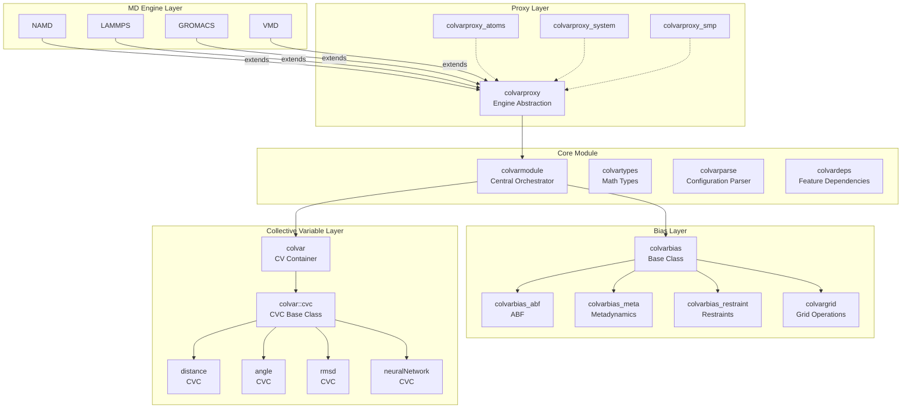
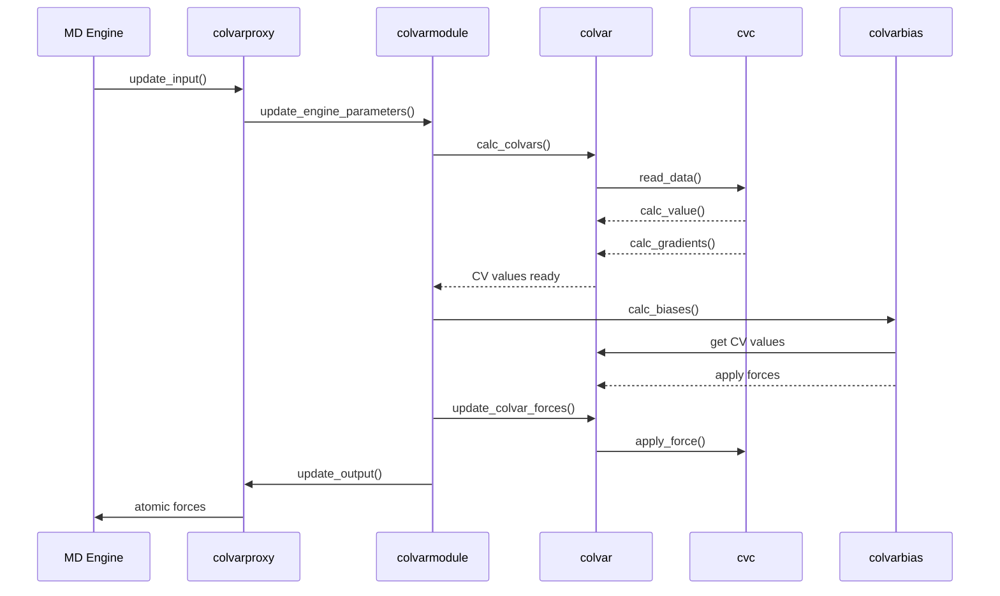
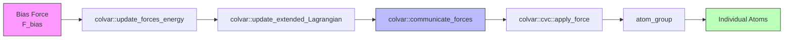
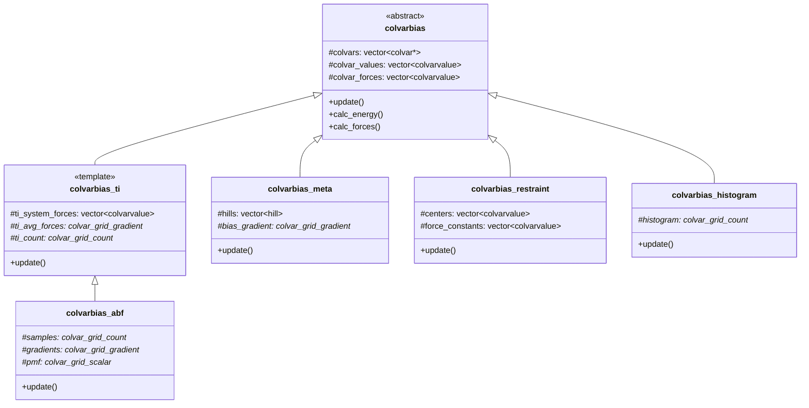
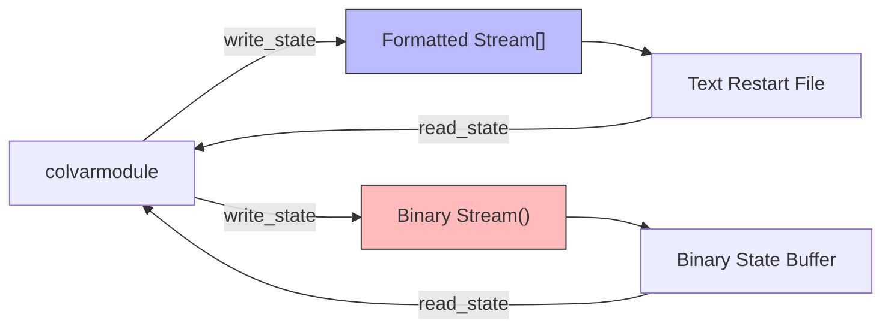

This page documents the fundamental architecture and design patterns that underpin the Colvars library, providing a structural understanding essential for extending or deeply integrating the codebase. The architecture follows a **layered design** with clear separation of concerns, enabling the library to be integrated into multiple MD engines while maintaining core functionality independent of implementation details.

## Architectural Overview

The Colvars library is organized into four primary architectural layers: the **Core Module** that orchestrates all operations, the **Collective Variable Layer** that defines and computes CVs, the **Bias Layer** that implements enhanced sampling methods, and the **Proxy Layer** that abstracts MD engine interfaces. This separation allows the core computational logic to remain engine-agnostic while providing standardized integration points for NAMD, LAMMPS, GROMACS, VMD, and other simulation packages.



Sources: [colvarmodule.h](src/colvarmodule.h#L76-L722), [colvar.h](src/colvar.h#L53-L722), [colvarbias.h](src/colvarbias.h#L22-L379), [colvarproxy.h](src/colvarproxy.h#L549-L722)

## Core Module Architecture

The `colvarmodule` class serves as the **central orchestrator** of the entire library, managing the lifecycle of all objects and coordinating the main computational loop. It maintains collections of collective variables and biases, handles configuration parsing, and manages state I/O operations. The module follows a **singleton pattern** conceptually, with a single main instance accessible through the static `main()` method [colvarmodule.h#L957-L960](src/colvarmodule.h#L957-L960). This design ensures centralized control over the simulation state and provides a single point of access for configuration and queries.

### Computational Workflow

The module implements a well-defined computational workflow executed each simulation step:



The workflow begins with the proxy updating input data from the MD engine, followed by collective variable computation. Biases are then calculated and forces are applied, with the final step communicating forces back to the MD engine through the proxy [colvarmodule.h#L624-L640](src/colvarmodule.h#L624-L640).

Sources: [colvarmodule.h](src/colvarmodule.h#L624-L640), [colvar.h](src/colvar.h#L299-L335)

### Type System and Mathematical Foundation

The module defines a **template-based type system** that provides compile-time control over numerical precision. The fundamental types include `cvm::real` for floating-point numbers (defaulting to `double`), `cvm::rvector` for 3D vectors, `cvm::matrix2d` for 2D matrices, and `cvm::quaternion` for rotations [colvarmodule.h#L136-L271](src/colvarmodule.h#L136-L271). The `colvarvalue` class provides a **polymorphic container** for different value types (scalars, vectors, quaternions) with automatic type conversions, enabling collective variables to have different dimensionalities while maintaining a unified interface.

Sources: [colvartypes.h](src/colvartypes.h), [colvarvalue.h](src/colvarvalue.h)

## Collective Variable Layer

The collective variable layer implements the **Strategy Pattern**, where the base `colvar` class defines the interface and `colvar::cvc` (collective variable component) classes implement specific computational strategies. This design allows new types of collective variables to be added without modifying existing code, simply by creating a new CVC subclass.

### Component Architecture

Each `colvar` object can contain **multiple CVCs**, which are combined according to polynomial combinations with configurable coefficients and exponents [colvarcomp.h#L84-L88](src/colvarcomp.h#L84-L88). This enables complex collective variables to be constructed from simpler building blocks. For example, a dihedral angle CV might be implemented using distance CVCs combined with trigonometric functions, or a coordination number might be expressed in terms of multiple distance components.

The `colvar::cvc` base class defines the interface that all components must implement:
- `calc_value()` - Compute the component's scalar or vector value
- `calc_gradients()` - Compute derivatives with respect to atomic coordinates
- `apply_force()` - Apply a collective variable force to atoms
- `calc_force_invgrads()` - Calculate total force from system atomic forces
- `calc_Jacobian_derivative()` - Compute Jacobian for phase space corrections

Sources: [colvarcomp.h](src/colvarcomp.h#L69-L303), [colvar.h](src/colvar.h#L592-L663)

### Available CVC Implementations

The library provides a comprehensive set of pre-implemented CVCs covering common collective variable types:

| Category | CVC Classes | Description |
|----------|-------------|-------------|
| **Distance-based** | `distance`, `distance_vec`, `distance_dir`, `distance_inv`, `distance_z`, `distance_xy` | Interatomic distances, projections, and inverse powers |
| **Angular** | `angle`, `dihedral`, `polar_theta`, `polar_phi`, `euler_theta`, `euler_psi`, `euler_phi` | Bond angles, torsions, and spherical coordinates |
| **Coordination** | `coordnum`, `selfcoordnum`, `groupcoordnum`, `h_bond` | Coordination numbers and hydrogen bonding |
| **Structural** | `rmsd`, `gyration`, `inertia`, `inertia_z`, `eigenvector` | RMSD, radius of gyration, moment of inertia |
| **Orientation** | `orientation`, `orientation_angle`, `orientation_proj` | Rotational alignment and projection |
| **Advanced** | `neuralNetwork`, `torchANN`, `customColvar`, `linearCombination` | Neural networks, custom functions, combinations |
| **Path-based** | `CartesianBasedPath`, `CVBasedPath`, arithmetic/geometric path variants | Path collective variables and string methods |

Sources: [colvar.h](src/colvar.h#L597-L653), [colvarcomp_distances.cpp](src/colvarcomp_distances.cpp), [colvarcomp_angles.cpp](src/colvarcomp_angles.cpp)

### Force Computation Chain

Force computation follows a **reverse-mode automatic differentiation** pattern, where forces propagate from biases through collective variables down to individual atoms:



The `colvar` class manages the force application through its `update_forces_energy()` method, which handles extended Lagrangian dynamics when enabled and ultimately calls `communicate_forces()` to distribute forces to atoms [colvar.h#L358-L365](src/colvar.h#L358-L365). Each CVC's `apply_force()` method then transforms the collective variable force into atomic forces based on the computed gradients.

Sources: [colvar.h](src/colvar.h#L358-L365), [colvarcomp.h](src/colvarcomp.h#L172-L181)

## Bias Layer Architecture

The bias layer implements the **Template Method Pattern** combined with the **Strategy Pattern**. The base `colvarbias` class defines the workflow for bias computation, while derived classes implement specific biasing algorithms (ABF, metadynamics, harmonic restraints, etc.).

### Base Class Template

The `colvarbias` class establishes the computation template through virtual methods that derived classes override:

- `update()` - Main entry point called each step
- `calc_energy()` - Compute the bias potential energy
- `calc_forces()` - Compute forces on collective variables
- `communicate_forces()` - Send forces to the colvar objects

The base class maintains pointers to the collective variables it biases and caches their values and forces [colvarbias.h#L295-L307](src/colvarbias.h#L295-L307).

Sources: [colvarbias.h](src/colvarbias.h#L22-L330)

### Grid-Based Biases

Many biases (ABF, metadynamics, histogram reweighting) use multidimensional grids for storing probability distributions, free energy estimates, or bias potentials. The `colvargrid` class hierarchy provides **templated grid containers** with support for different data types (scalar values, gradients, counts) and automatic handling of periodic boundary conditions:

- `colvar_grid_scalar<T>` - Grids of scalar values
- `colvar_grid_gradient<T>` - Grids storing gradients  
- `colvar_grid_count<T>` - Grids for histogram counts

Grids are associated with collective variables and automatically handle binning operations based on CV values and widths [colvarbias.h#L19-L33](src/colvarbias.h#L19-L33).

Sources: [colvargrid.h](src/colvargrid.h), [colvarbias_ti.h](src/colvarbias_ti.h#L361-L375)

### Bias Hierarchy

The bias classes form an inheritance hierarchy that reuses common functionality:



The `colvarbias_ti` class provides common functionality for thermodynamic integration-based biases (like ABF) with grid-based force averaging [colvarbias_ti.h#L336-L379](src/colvarbias_ti.h#L336-L379). Specialized biases like ABF and metadynamics extend this with their specific algorithms.

Sources: [colvarbias.h](src/colvarbias.h#L336-L379), [colvarbias_abf.h](src/colvarbias_abf.h), [colvarbias_meta.h](src/colvarbias_meta.h)

## Proxy Interface Pattern

The **Proxy Pattern** is central to Colvars' ability to integrate with multiple MD engines. The `colvarproxy` class defines a virtual interface that abstracts all engine-specific operations, allowing the core Colvars code to remain completely independent of the hosting program.

### Proxy Composition

The proxy interface is composed through multiple inheritance, with each base class handling a specific aspect of engine interaction:

| Proxy Component | Responsibility | Key Methods |
|----------------|----------------|-------------|
| `colvarproxy_system` | System parameters (timestep, PBC) | `dt()`, `request_total_force()`, `position_distance()` |
| `colvarproxy_atoms` | Individual atom data | `init_atom()`, `get_atom_position()`, `apply_atom_force()` |
| `colvarproxy_atom_groups` | Atom group operations | `init_atom_group()`, `get_atom_group_com()`, `apply_atom_group_force()` |
| `colvarproxy_volmaps` | Volumetric maps | Access to grid-based potential maps |
| `colvarproxy_smp` | Parallel computing | `smp_loop()`, `smp_thread_id()`, `smp_lock()` |
| `colvarproxy_replicas` | Multi-replica communication | `replica_comm()`, `replica_index()` |
| `colvarproxy_script` | Scripting interface | `run_force_callback()`, `run_colvar_callback()` |
| `colvarproxy_io` | I/O operations | `log()`, `error()`, file I/O methods |

The main `colvarproxy` class inherits from all these components using **multiple inheritance**, creating a unified interface [colvarproxy.h#L549-L560](src/colvarproxy.h#L549-L560).

Sources: [colvarproxy.h](src/colvarproxy.h#L44-L722)

### Engine-Specific Implementations

Each MD engine implements a concrete proxy class that inherits from `colvarproxy` and overrides virtual methods with engine-specific code:

- `colvarproxy_namd` - NAMD integration
- `colvarproxy_lammps` - LAMMPS integration  
- `colvarproxy_gromacs` - GROMACS integration
- `colvarproxy_vmd` - VMD integration

These implementations are located in the engine-specific directories (`namd/`, `lammps/`, `gromacs/`, `vmd/`) and handle details like accessing NAMD's `AtomID` objects, LAMMPS atom arrays, or GROMACS coordinate arrays.

Sources: [README.md](README.md), [namd/colvarproxy_namd.h](namd/colvarproxy_namd.h)

### Data Flow Through Proxy

The proxy manages two-way data flow between the MD engine and Colvars:

**Input Flow** (Engine → Colvars):
1. `update_input()` called at each MD step
2. Atom positions read from engine into proxy buffers
3. `colvarmodule::calc_colvars()` computes CV values
4. CV values used by biases to compute forces

**Output Flow** (Colvars → Engine):
1. Biases compute forces on CVs
2. `colvar::communicate_forces()` distributes to atoms
3. Forces accumulated in proxy's `atoms_new_colvar_forces` buffer
4. `update_output()` sends forces back to MD engine

The proxy maintains atom data in structured arrays (`atoms_positions`, `atoms_total_forces`, `atoms_new_colvar_forces`) that can be efficiently accessed by both the proxy and Colvars code [colvarproxy.h#L264-L278](src/colvarproxy.h#L264-L278).

Sources: [colvarproxy.h](src/colvarproxy.h#L627-L633)

## Feature Dependency System

Colvars implements a sophisticated **feature-based dependency system** through the `colvardeps` class. This system allows components to declare capabilities (features) and automatically enable/disable dependencies, ensuring that required computations are performed without manual coordination.

### Feature Declaration

Each class (colvar, cvc, bias) maintains a static vector of `feature` objects that describe available functionality. Features are identified by integer IDs and have names, descriptions, and dependency relationships:

```cpp
static std::vector<feature *> cvc_features;
static std::vector<feature *> cv_features;  
static std::vector<feature *> cvb_features;
```

For example, enabling the `f_cv_total_force` feature automatically enables dependencies like `f_cv_gradient` and `f_cv_collect_gradients` [colvardeps.h](src/colvardeps.h).

### Dependency Resolution

When a feature is enabled through `enable()`, the system traverses the dependency graph and recursively enables all required features. This **topological dependency resolution** ensures that all necessary computations are prepared. Features also define **side effects** through `do_feature_side_effects()`, which perform initialization when a feature is first enabled.

Sources: [colvardeps.h](src/colvardeps.h), [colvar.h](src/colvar.h#L95-L117)

### Feature Categories

Features are organized into several categories:

- **Computation features** - Control what is calculated (values, gradients, total forces)
- **I/O features** - Control output (trajectory, energy, restart files)
- **System features** - Require system capabilities (total forces, periodic boundaries)
- **Optimization features** - Enable performance optimizations (parallelization, scaling)

This system provides **fine-grained control** over computation costs while ensuring correctness through automatic dependency management.

Sources: [colvardeps.h](src/colvardeps.h)

## Configuration and Parsing Architecture

Configuration parsing follows a **declarative approach** where objects are constructed from configuration strings. The `colvarparse` class provides the foundation for keyword-based configuration parsing.

### Parsing Workflow

Configuration proceeds through multiple stages:

1. **Read Configuration** - `colvarmodule::read_config_file()` or `read_config_string()` loads the configuration
2. **Global Parameters** - `parse_global_params()` extracts module-wide settings
3. **Collective Variables** - `parse_colvars()` creates and initializes colvar objects
4. **Biases** - `parse_biases()` creates bias objects

The parsing system uses **keyword-value pairs** with support for nested blocks and comments. Each class implements its own parsing logic by calling helper methods like `get_keyval()` to extract typed values [colvarparse.h](src/colvarparse.h).

Sources: [colvarmodule.h](src/colvarmodule.h#L431-L470), [colvarparse.h](src/colvarparse.h)

### Backward Compatibility

The configuration system includes mechanisms for maintaining **backward compatibility** with older configuration files. The `append_new_config()` method allows new configuration to be generated during parsing to implement compatibility transformations [colvarmodule.h#L463-L466](src/colvarmodule.h#L463-L466).

## State Management and Serialization

The state management system enables **checkpointing and restart** capability through a comprehensive serialization framework. Each major class implements methods for reading and writing its state:



The system supports both **formatted (text)** and **unformatted (binary)** serialization through overloaded methods [colvarmodule.h#L544-L577](src/colvarmodule.h#L544-L577). The text format is human-readable for debugging, while binary format provides efficiency for frequent checkpointing.

State data is organized hierarchically, with the module coordinating serialization of all colvars and biases. Each object contributes a block of labeled data that can be independently parsed [colvarbias.h#L143-L237](src/colvarbias.h#L143-L237).

Sources: [colvarmodule.h](src/colvarmodule.h#L544-L577), [colvarbias.h](src/colvarbias.h#L143-L237)

## Parallel Computing Architecture

Colvars supports multiple forms of parallel computing through the `colvarproxy_smp` interface:

### SMP Parallelization

Symmetric multiprocessing parallelization uses **OpenMP** or engine-specific threading to parallelize independent computations:

- **CVC-level parallelization** - Different CVCs within a colvar can be computed in parallel
- **Bias-level parallelization** - Different biases can be evaluated simultaneously
- **Inner loop parallelization** - Repetitive operations (e.g., distance calculations) can be parallelized

The proxy provides `smp_loop()` which distributes iterations across threads [colvarproxy.h#L478-L478](src/colvarproxy.h#L478-L478).

Sources: [colvarproxy.h](src/colvarproxy.h#L459-L509)

### Multi-Replica Communication

The `colvarproxy_replicas` interface enables communication between multiple simulation replicas for methods like **multiple-walker metadynamics** or **replica exchange**. Each replica has an index and can send/receive data to other replicas [colvarproxy_replicas.h](src/colvarproxy_replicas.h).

## Memory Management and Optimization

### Smart Pointer Usage

Modern CVC implementations use `std::shared_ptr<colvar::cvc>` for component storage, enabling **automatic memory management** and safe sharing of component references [colvar.h](src/colvar.h#L666-L666). This represents an evolution from earlier raw pointer usage.

### Reference Counting for Atoms

The proxy implements **reference counting** for atoms and atom groups to avoid redundant data storage. An atom used by multiple colvars is stored once with a reference count incremented each time it's requested [colvarproxy.h#L264-L268](src/colvarproxy.h#L264-L268). This optimization reduces memory overhead and data transfer costs.

### CUDA/HIP Support

When compiled with CUDA or HIP support, the proxy uses **custom allocators** (`CudaHostAllocator`) for atom arrays that allocate pinned (page-locked) memory, improving data transfer performance between host and GPU [colvarmodule.h#L90-L123](src/colvarmodule.h#L90-L123).

Sources: [colvar.h](src/colvar.h#L666-L666), [colvarproxy.h](src/colvarproxy.h#L264-L268)

## Extension Points for Developers

The architecture provides several well-defined extension points:

### Adding New Collective Variable Components

To add a new CVC type:

1. Create a class inheriting from `colvar::cvc`
2. Implement required virtual methods (`calc_value()`, `calc_gradients()`)
3. Register in the component type map using `add_component_type()`
4. Add configuration parsing in the constructor

See existing implementations in `colvarcomp_*.cpp` files for examples.

### Adding New Bias Types

To add a new bias:

1. Create a class inheriting from `colvarbias` or an intermediate base
2. Implement `calc_energy()`, `calc_forces()`, `update()`
3. Add state serialization if needed
4. Register in `colvarbias::get_global_bias_map()` pattern

See `colvarbias_abf.cpp` or `colvarbias_meta.cpp` for examples.

### Creating Engine Integrations

To integrate with a new MD engine:

1. Create a class inheriting from `colvarproxy`
2. Implement all virtual methods for engine interaction
3. Create engine-specific code for initialization and callback handling
4. Test all CVCs and biases with the new integration

> [!TIP]
> The proxy interface is the key to engine integration - focus on implementing efficient methods for accessing atom positions and applying forces, as these are called every step and dominate performance.

## Design Pattern Summary

| Pattern | Location | Purpose |
|---------|----------|---------|
| **Singleton** | `colvarmodule` | Single coordinator instance |
| **Strategy** | `colvar::cvc` hierarchy | Interchangeable CV computation algorithms |
| **Template Method** | `colvarbias` base class | Fixed bias computation workflow |
| **Proxy** | `colvarproxy` interface | Engine abstraction layer |
| **Factory** | Component type maps | Dynamic object creation from config |
| **Observer** | Feature dependency system | Reactive computation enabling |
| **Composite** | `colvar` with multiple CVCs | Building complex CVs from simple ones |
| **State** | State serialization | Checkpointing and restart |

Sources: [colvarmodule.h](src/colvarmodule.h#L76-L960), [colvar.h](src/colvar.h#L53-L722), [colvarbias.h](src/colvarbias.h#L22-L379), [colvarproxy.h](src/colvarproxy.h#L549-L722)

## Further Reading

For deeper understanding of specific aspects:
- Learn about distance-based variables in [Distance-Based Variables](6-distance-based-variables)
- Understand angular and dihedral variables in [Angular and Dihedral Variables](7-angular-and-dihedral-variables)
- Explore the proxy interface details in [Proxy Interface and Engine Integration](20-proxy-interface-and-engine-integration)
- Study parallel computing support in [Parallel Computing and SMP Support](24-parallel-computing-and-smp-support)