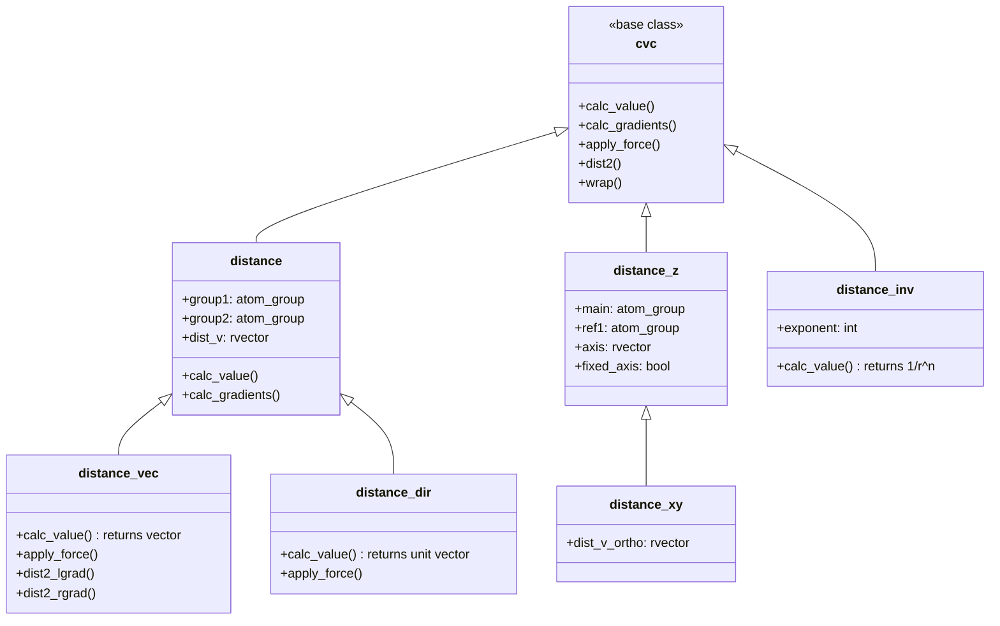

Distance-based variables represent one of the most fundamental categories of collective variables in Colvars, enabling the measurement and control of spatial relationships between atoms, groups of atoms, or molecular centers. These variables form the building blocks for complex enhanced sampling simulations, allowing researchers to monitor ligand-receptor binding distances, protein-ligand proximity, inter-domain separations, and many other distance-dependent phenomena. For beginners, mastering distance-based variables provides essential groundwork for understanding more complex collective variable types and building sophisticated free energy calculations.

Sources: [colvarcomp.h](src/colvarcomp.h#L328-L346), [colvarcomp_distances.cpp](src/colvarcomp_distances.cpp#L20-L90)

## Architecture Overview

The distance-based variable architecture follows an object-oriented design where each specific distance type inherits from a common base class. This hierarchical structure enables code reuse, consistent interfaces, and extensibility. At the foundation lies the `cvc` (collective variable component) base class, which provides core functionality like value calculation, gradient computation, and force application. All distance-based variables extend this foundation, implementing their specific geometric calculations while maintaining a unified API for the simulation engine.



This inheritance hierarchy demonstrates how specialized distance types build upon the fundamental `distance` class, which itself extends the base `cvc` class. The modular design allows each distance type to implement only the aspects that differ from the base behavior, such as how values are calculated or how forces are applied.

Sources: [colvarcomp.h](src/colvarcomp.h#L69-L346), [colvarcomp_distances.cpp](src/colvarcomp_distances.cpp#L20-L90)

## Core Distance Variable

The `distance` variable represents the most straightforward distance measurement: the Euclidean distance between the centers of mass of two atom groups. This fundamental variable calculates the magnitude of the vector separating group1 and group2, making it ideal for monitoring binding distances, inter-molecular separations, or any scenario requiring a simple distance measurement.

The implementation initializes the variable by parsing two required atom groups from the configuration file, setting up the necessary dependencies for total force calculations and Jacobian derivatives. During each simulation step, the value is computed by subtracting the center of mass of group1 from group2, then calculating the Euclidean norm of the resulting vector. If periodic boundary conditions are enabled, the calculation uses `position_distance()` to find the minimum image distance.

The gradient computation follows directly from the distance definition: the unit vector pointing from group1 to group2. Group1 receives a force in the opposite direction (-1 × unit vector), while group2 receives the force in the forward direction (+1 × unit vector). This ensures conservation of momentum and proper force distribution across the system.

Sources: [colvarcomp_distances.cpp](src/colvarcomp_distances.cpp#L31-L80), [colvarcomp.h](src/colvarcomp.h#L328-L346)

### Distance Configuration Example

A basic distance configuration requires specifying the two atom groups and can include optional parameters for periodic boundary conditions:

```colvars
colvar {
    name ligand_binding_distance
    distance {
        group1 {
            atomsFile ligand.pdb
            atomsCol B
            atomsColValue 1
        }
        group2 {
            atomsFile receptor.pdb
            atomsCol B
            atomsColValue 2
        }
        # Optional: minimum image convention
        # usePBC on
    }
}

harmonic {
    name ligand_restraint
    colvars ligand_binding_distance
    centers 4.5
    forceConstant 10.0
}
```

This configuration defines a collective variable measuring the distance between a ligand (atoms marked with beta value 1) and a receptor (atoms marked with beta value 2), with a harmonic restraint centered at 4.5 Å.

Sources: [examples/01_NOE_restraints.colvars.in](examples/01_NOE_restraints.colvars.in#L1-L58)

> [!TIP]
> When working with periodic systems, always verify that the `usePBC` option is enabled if you expect the minimum image distance. Without this flag, Colvars calculates the raw vector difference, which may give distances larger than half the box size in periodic directions.

## Distance Vector (distanceVec)

The `distanceVec` variable extends the basic distance concept by returning the complete three-dimensional vector between atom groups rather than just its magnitude. This enables directional analysis and more complex collective variable definitions that require vector components.

Unlike scalar distance, `distanceVec` returns a 3D vector value (x, y, z components), making it useful for monitoring directional changes, implementing anisotropic restraints, or combining with other vector-based collective variables. The implementation overrides several virtual methods to handle multi-dimensional metrics, including custom `dist2()`, `dist2_lgrad()`, and `dist2_rgrad()` functions that properly compute distances and gradients in the vector space.

The force application method is particularly important for vector variables. When forces are applied, they must be distributed across the three components appropriately. The `apply_force()` method handles this by projecting the collective variable force vector onto the gradient directions for each atom group, ensuring that forces are applied in the correct spatial directions.

Sources: [colvarcomp_distances.cpp](src/colvarcomp_distances.cpp#L87-L147), [colvarcomp.h](src/colvarcomp.h#L353-L369)

## Distance Direction (distanceDir)

The `distanceDir` variable computes the unit vector pointing from group1 to group2, providing purely directional information independent of distance magnitude. This variable always returns a vector of length 1.0, making it ideal for monitoring orientation, implementing directional restraints, or analyzing anisotropic motions.

The calculation normalizes the distance vector by dividing by its magnitude, yielding a unit vector (u) where u · u = 1. This property makes `distanceDir` particularly useful in scenarios where only the relative orientation matters, not the actual separation distance. For example, you might monitor the direction of approach for a ligand to its binding site, regardless of how far away it is.

Gradient calculations for `distanceDir` differ from simple distance because the derivative of a normalized vector involves both the direction change and the magnitude normalization. The implementation handles these subtleties correctly, ensuring that forces applied through this variable properly account for the directional nature of the constraint.

Sources: [colvarcomp_distances.cpp](src/colvarcomp_distances.cpp#L342-L406), [colvarcomp.h](src/colvarcomp.h#L376-L392)

### Vector Distance Configuration

Vector-based distance variables follow a similar configuration pattern to scalar distance but return multi-dimensional values:

```colvars
colvar {
    name approach_direction
    distanceDir {
        group1 {
            atomsFile ligand.pdb
            atomsCol B
            atomsColValue 1
        }
        group2 {
            atomsFile binding_site.pdb
            atomsCol B
            atomsColValue 1
        }
    }
}
```

This configuration monitors the unit vector from the ligand to the binding site, which could be used in combination with other variables to enforce specific approach geometries.

Sources: [colvarcomp_distances.cpp](src/colvarcomp_distances.cpp#L342-L406)

## Projected Distance Z (distanceZ)

The `distanceZ` variable calculates the distance between atom groups projected onto a specified axis. This enables monitoring of one-dimensional motion along a preferred direction while ignoring perpendicular motions, which is particularly useful for studying translocation events, pore penetration, or directional transport.

The axis can be defined in two ways: (1) a fixed axis vector specified in the configuration, or (2) a dynamic axis defined by the vector between two reference atom groups. When using a fixed axis, the axis remains constant throughout the simulation, while the dynamic axis approach recalculates the axis direction each step based on the current positions of the reference groups.

The calculation involves computing the dot product of the inter-group distance vector with the normalized axis vector, effectively projecting the full 3D distance onto the 1D axis. This provides a scalar value representing the component of distance along the specified direction, with positive and negative values indicating positions on opposite sides of the origin along the axis.

Sources: [colvarcomp_distances.cpp](src/colvarcomp_distances.cpp#L150-L260), [colvarcomp.h](src/colvarcomp.h#L399-L425)

## Projected Distance XY (distanceXY)

Building upon `distanceZ`, the `distanceXY` variable computes the magnitude of the distance vector perpendicular to a specified axis. This captures the radial distance from the axis, effectively measuring how far the groups are displaced sideways from the axis direction.

This variable is particularly valuable in membrane transport studies where you might monitor how far a molecule has penetrated into a pore (Z direction) while also tracking its lateral position within the pore (XY distance). It's also useful for analyzing channel selectivity, where radial positioning matters more than axial displacement.

The implementation computes the distance vector, subtracts its projection onto the axis (the component along the axis), and returns the magnitude of the remaining orthogonal component. Mathematically, this represents the Euclidean distance in the plane perpendicular to the specified axis.

Sources: [colvarcomp_distances.cpp](src/colvarcomp_distances.cpp#L261-L341), [colvarcomp.h](src/colvarcomp.h#L431-L446)

### Projected Distance Configuration

Project distance calculations require specifying the axis definition along with the atom groups:

```colvars
colvar {
    name pore_penetration
    distanceZ {
        # Main groups whose distance is measured
        main {
            atomsFile substrate.pdb
            atomsCol B
            atomsColValue 1
        }
        ref1 {
            atomsFile pore_entrance.pdb
            atomsCol B
            atomsColValue 1
        }
        # Dynamic axis defined by reference groups
        ref2 {
            atomsFile pore_exit.pdb
            atomsCol B
            atomsColValue 1
        }
    }
}

colvar {
    name lateral_position
    distanceXY {
        main {
            atomsFile substrate.pdb
            atomsCol B
            atomsColValue 1
        }
        ref1 {
            atomsFile pore_entrance.pdb
            atomsCol B
            atomsColValue 1
        }
        ref2 {
            atomsFile pore_exit.pdb
            atomsCol B
            atomsColValue 1
        }
    }
}
```

This configuration monitors both the axial penetration depth (`pore_penetration`) and radial position (`lateral_position`) of a substrate within a pore, using the pore axis defined by entrance and exit reference points.

Sources: [colvarcomp_distances.cpp](src/colvarcomp_distances.cpp#L150-L341)

## Inverse Distance (distanceInv)

The `distanceInv` variable calculates the inverse of the distance raised to a specified power: 1/r^n, where r is the inter-group distance and n is an exponent typically set to 6 for NOE restraint applications or other values for different interaction types. This variable emphasizes short distances over long distances, making it sensitive to proximity when groups are close together but relatively insensitive when they are far apart.

The most common application of `distanceInv` is Nuclear Overhauser Effect (NOE) restraints in NMR structure calculations, where the intensity of NOE signals depends on r⁻⁶. By setting the exponent to 6, the collective variable directly relates to the NOE observable, enabling accurate incorporation of experimental distance restraints into simulations.

Other applications include modeling electrostatic interactions (which scale with r⁻¹), van der Waals interactions (which scale approximately with r⁻⁶), and designing custom potentials that emphasize short-range proximity. The implementation handles edge cases such as when the distance approaches zero, using numerical stability techniques to avoid division by zero.

Sources: [colvarcomp_distances.cpp](src/colvarcomp_distances.cpp#L410-L513), [colvarcomp.h](src/colvarcomp.h#L487-L503)

### NOE Restraint Example

The following example demonstrates `distanceInv` used for NMR NOE restraints, which is a canonical application:

```colvars
colvar {
    name NOE_signal
    distanceInv {
        exponent 6  # Standard for NOE
        
        group1 {
            # Multiple hydrogen atoms (ambiguous assignment)
            psfSegID PRA PRA PRA
            atomNameResidueRange HB1 2-2
            atomNameResidueRange HB2 2-2
            atomNameResidueRange HB3 2-2
        }
        group2 {
            psfSegID PRA
            atomNameResidueRange HE 11-11
        }
    }
}

harmonicWalls {
    name noe_restraint
    colvars NOE_signal
    # Experimental bounds in 1/r^6 units
    lowerWalls 0.003
    upperWalls 0.007
    lowerWallConstant 30.0
    upperWallConstant 20.0
}
```

This configuration restrains the NOE signal to experimental bounds, allowing the molecule to explore conformations consistent with NMR data. The use of multiple atoms in `group1` demonstrates how Colvars handles ambiguous atom assignments, effectively taking the minimum inverse distance across all specified atoms.

Sources: [examples/01_NOE_restraints.colvars.in](examples/01_NOE_restraints.colvars.in#L1-L58)

## Distance Pairs (distancePairs)

The `distancePairs` variable computes all pairwise distances between atoms in two groups, returning a multi-dimensional vector containing each pair's distance. This is particularly useful for monitoring interaction interfaces, analyzing cluster properties, or tracking multiple contact points between molecular surfaces.

Unlike simple group-to-group distance which only considers center-of-mass separation, `distancePairs` provides detailed information about individual atom-atom contacts. This enables more nuanced analysis of binding interfaces, where specific residue-residue contacts matter more than the overall separation. The resulting multi-dimensional collective variable can be analyzed as a set of distances or combined into scalar measures such as minimum distance, average distance, or coordination number.

The implementation scales as O(n×m) where n and m are the numbers of atoms in the two groups, making it computationally more intensive than center-of-mass distance for large groups. However, for moderate group sizes (tens to hundreds of atoms), it provides valuable structural insight that cannot be obtained from bulk distance measurements.

Sources: [colvarcomp_distances.cpp](src/colvarcomp_distances.cpp#L513-L630), [colvarcomp.h](src/colvarcomp.h#L509-L532)

## Dipole Magnitude

The `dipole_magnitude` variable calculates the magnitude of the dipole moment of a group of atoms, providing a measure of molecular polarity. This is particularly useful for studying solvation effects, membrane interactions, or any scenario where molecular dipole orientation or strength influences the physical properties.

The dipole moment is computed as the sum of atomic charges multiplied by their positions relative to the center of mass: μ = Σ(qi × ri). The magnitude |μ| is returned as a scalar collective variable that can be restrained or biased to influence molecular orientation in response to external fields, polar environments, or charge-based interactions.

Applications include aligning molecules with electric fields, optimizing dipole moments for specific solvation environments, and studying charge distribution effects on molecular recognition. The gradient calculation properly accounts for both charge redistribution and positional changes, ensuring accurate force application.

Sources: [colvarcomp_distances.cpp](src/colvarcomp_distances.cpp#L634-L672), [colvarcomp.h](src/colvarcomp.h#L536-L548)

## Radius of Gyration (gyration)

The `gyration` variable calculates the radius of gyration of an atom group, measuring the distribution of atoms around their center of mass. This collective variable is particularly important for protein folding studies, polymer physics, and analyzing molecular compactness.

The radius of gyration (Rg) is computed as Rg = √(Σmi × ri² / Σmi), where mi are atomic masses and ri are distances from the center of mass. This provides a single scalar value that captures overall molecular size and compactness: compact conformations have smaller Rg values, while extended conformations have larger Rg values.

For proteins, Rg is a classic order parameter distinguishing folded (compact) from unfolded (extended) states. During folding simulations, Rg typically decreases as the protein collapses from a random coil to its native structure. In polymer studies, Rg provides insight into chain dimensions and solvent quality.

Sources: [colvarcomp_distances.cpp](src/colvarcomp_distances.cpp#L673-L742), [colvarcomp.h](src/colvarcomp.h#L555-L568)

## Inertia and Inertia_Z

The `inertia` variable calculates the moment of inertia of an atom group, providing a measure of mass distribution relative to the center of mass. Building on this, `inertia_z` projects the inertia tensor onto a specified axis, computing the moment of inertia for rotation around that axis.

The moment of inertia I = Σmi × ri² quantifies resistance to rotational acceleration, where mi are masses and ri are distances from the rotation axis. For proteins, inertia measures provide information about overall shape and mass distribution: spherical proteins have more isotropic inertia values, while elongated proteins show axis-dependent differences.

The `inertia_z` variant is particularly useful for studying orientational constraints, rotational diffusion, or aligning molecules along preferred axes. By specifying the axis (either as a fixed vector or dynamically between reference points), you can monitor how mass redistributes around that axis during conformational changes or binding events.

Sources: [colvarcomp_distances.cpp](src/colvarcomp_distances.cpp#L743-L819), [colvarcomp.h](src/colvarcomp.h#L575-L601)

## Distance-Based Variables Comparison

The following table summarizes the key characteristics of each distance-based variable to help you select the appropriate type for your application:

| Variable Type | Returns | Use Cases | Key Parameters | Computational Cost |
|--------------|---------|-----------|----------------|-------------------|
| `distance` | Scalar (Å) | Binding distances, inter-molecular separations | Two atom groups, PBC option | Low |
| `distanceVec` | Vector (x,y,z) | Directional analysis, anisotropic restraints | Two atom groups | Low |
| `distanceDir` | Unit vector | Orientation monitoring, directional constraints | Two atom groups | Low |
| `distanceZ` | Scalar (Å) | Axial penetration, translocation | Main group + 1-2 reference groups | Low |
| `distanceXY` | Scalar (Å) | Radial position, pore localization | Main group + 2 reference groups | Low |
| `distanceInv` | Scalar (Å⁻ⁿ) | NOE restraints, short-range emphasis | Exponent (typically 6) | Low |
| `distancePairs` | Multi-dimensional | Interface contacts, cluster analysis | Two atom groups | Medium-High |
| `dipole_magnitude` | Scalar (D) | Polarity, field interactions | Atom group with charges | Low |
| `gyration` | Scalar (Å) | Compactness, folding studies | Atom group | Low |
| `inertia` | Scalar (amu·Å²) | Mass distribution | Atom group | Low |
| `inertia_z` | Scalar (amu·Å²) | Rotational properties | Atom group + axis definition | Low |

Sources: [colvarcomp.h](src/colvarcomp.h#L328-L601), [colvarcomp_distances.cpp](src/colvarcomp_distances.cpp#L20-L819)

> [!TIP]
> When selecting a distance-based variable, consider both the physical property you want to monitor and the computational cost. For most simple applications, `distance` provides the most straightforward metric. Use specialized variants like `distanceZ` or `distanceInv` only when the specific geometric transformation aligns with your scientific question.

## Implementation Details and Best Practices

Understanding the underlying implementation helps you use distance-based variables more effectively and troubleshoot potential issues. All distance-based variables share a common computational pattern: they first calculate inter-group vectors or positions, then transform these according to the specific variable type, and finally compute gradients for force application.

The gradient calculation is particularly important for accurate simulations. For distance-based variables, gradients describe how the collective variable value changes with small displacements of each atom. These gradients are used to apply forces that drive the system toward or away from target values. The implementation ensures that forces are properly distributed across all atoms in each group, conserving momentum and providing physically realistic dynamics.

When working with distance-based variables in production simulations, consider these practical aspects:

1. **Group Selection**: Choose atom groups that accurately represent the physical process you're studying. For ligand binding, consider including all ligand atoms rather than just the center of mass to capture orientation effects.

2. **Periodic Boundary Conditions**: Enable `usePBC` if your groups can cross periodic boundaries. This ensures correct minimum-image distance calculations.

3. **Force Constants**: Start with smaller force constants and gradually increase them. Overly strong restraints can cause numerical instability or unphysical distortions.

4. **Output Frequency**: Adjust trajectory output frequency based on your analysis needs. High-frequency output provides better temporal resolution but increases disk usage.

5. **Multiple Variables**: You can combine multiple distance-based variables in a single simulation to study complex processes. For example, monitor both center-of-mass distance and orientation simultaneously for ligand binding.

Sources: [colvarcomp_distances.cpp](src/colvarcomp_distances.cpp#L20-L90), [colvarcomp.h](src/colvarcomp.h#L69-L303)

## Summary and Next Steps

Distance-based variables provide a versatile toolkit for monitoring and controlling spatial relationships in molecular simulations. From simple inter-group distances to complex directional and projected measurements, these variables form the foundation for most collective variable applications. By understanding their mathematical definitions, implementation details, and appropriate use cases, you can design effective enhanced sampling simulations for a wide range of scientific problems.

To deepen your understanding and expand your capabilities:

- Explore **[Angular and Dihedral Variables](7-angular-and-dihedral-variables)** to learn about orientation-based collective variables that complement distance measurements
- Study **[Coordination Numbers and Pair Distances](8-coordination-numbers-and-pair-distances)** for more complex interaction analysis beyond simple distance
- Review **[Basic Configuration Syntax](4-basic-configuration-syntax)** for more advanced configuration options
- Examine **[Harmonic Restraints and Walls](11-harmonic-restraints-and-walls)** to learn how to apply biases using distance-based variables

The examples directory, particularly `examples/01_NOE_restraints.colvars.in`, provides working configurations demonstrating many distance-based variable applications. Study these examples and experiment with modifications to gain practical experience.
