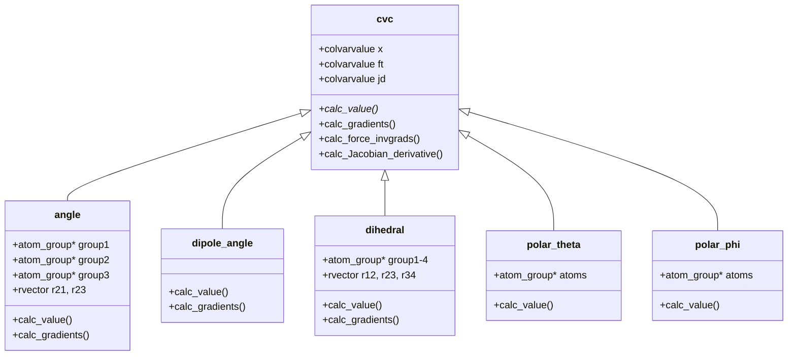

This page provides comprehensive documentation for angular collective variables in Colvars, covering angle, dipole angle, dihedral, and polar angle implementations. These variables are essential for studying molecular conformations, reaction pathways, and torsional dynamics in biomolecular simulations.

## Mathematical Foundations

Angular variables in Colvars are built on vector algebra and geometric relationships between atomic coordinates. The core implementations handle periodic boundary conditions correctly and compute analytical gradients for force propagation. The angle calculations use standard arccosine formulations while dihedral angles employ atan2-based approaches to maintain proper periodicity in the range [-π, π] degrees.

The angle class computes the angle between three atom groups (or single atoms) using the dot product of vectors formed by the central atom with the two terminal atoms. The dihedral class extends this to four atoms/groups, computing the torsional angle through cross products of consecutive bond vectors. Polar angles provide spherical coordinate representations for molecular orientation analysis.

Sources: [colvarcomp_angles.cpp](src/colvarcomp_angles.cpp#L60-L80), [colvarcomp_angles.cpp](src/colvarcomp_angles.cpp#L264-L290)

## Architecture Overview

Angular variables are implemented as specialized CVC (collective variable component) classes inheriting from the base `cvc` class. Each angular type follows a consistent pattern: initialization, value calculation, gradient computation, and force inversion methods. The architecture supports both individual atoms and atom groups, with automatic center-of-mass handling for multi-atom groups.



The inheritance hierarchy enables code reuse through virtual methods while allowing type-specific implementations for geometric calculations. All angular variables provide `f_cvc_inv_gradient` and `f_cvc_Jacobian` features for proper force measurements in enhanced sampling methods.

Sources: [colvarcomp.h](src/colvarcomp.h#L639-L708), [colvarcomp.h](src/colvarcomp.h#L709-L760)

## Angle Variables

The angle collective variable computes the angle θ between three atom groups using the arccosine of the dot product: θ = arccos(r̂₁·r̂₂). The implementation handles both individual atoms and atom groups, with automatic center-of-mass calculation for the latter. The angle range is [0°, 180°] with appropriate Jacobian corrections for biasing methods.

### Core Implementation

The `calc_value()` method computes vector differences r21 = r₁ - r₂ and r23 = r₃ - r₂, applying periodic boundary conditions when enabled. The cosine of the angle is computed as the normalized dot product, then converted to degrees using the factor 180/π. Gradient calculations employ chain rule differentiation through the arccosine function.

> [!TIP]
> When using atom groups for angle calculations, ensure that the central group (group2) contains atoms that physically represent the vertex of the angle to avoid artifacts from artificial center-of-mass motion.

### Configuration Parameters

| Parameter | Type | Required | Default | Description |
|-----------|------|----------|---------|-------------|
| `group1` | atom group | Yes | - | First atom/atom group (terminal) |
| `group2` | atom group | Yes | - | Second atom/atom group (vertex) |
| `group3` | atom group | Yes | - | Third atom/atom group (terminal) |
| `oneSiteTotalForce` | boolean | No | false | Measure force only on group1 |
| `period` | real | No | 0.0 | Periodicity (0 = non-periodic) |

### Example Configuration

```
colvar {
    name phi_angle
    
    angle {
        group1 {
            atomNameResidueRange CA 5
        }
        group2 {
            atomNameResidueRange CA 6
        }
        group3 {
            atomNameResidueRange CA 7
        }
        oneSiteTotalForce on
    }
}
```

Sources: [colvarcomp_angles.cpp](src/colvarcomp_angles.cpp#L26-L80), [colvarcomp_angles.cpp](src/colvarcomp_angles.cpp#L81-L97)

## Dihedral Variables

The dihedral collective variable computes the torsional angle φ between four atom groups, representing rotation around the central bond defined by groups 2 and 3. The implementation uses a robust atan2 formulation that correctly handles the full [-180°, 180°] range and maintains continuity across periodic boundaries.

### Mathematical Formulation

The dihedral angle calculation follows standard conventions: r₁₂ = r₂ - r₁, r₂₃ = r₃ - r₂, r₃₄ = r₄ - r₃. Normal vectors n₁ = r₁₂ × r₂₃ and n₂ = r₂₃ × r₃₄ define the two planes. The angle is computed as φ = atan2(n₁·r₃₄‖r₂₃‖, n₁·n₂), providing proper quadrant resolution.

### Gradient Computation

Gradients for dihedrals follow the formulation by Bakken and Helgaker (1996), with corrections for periodic boundary conditions. The implementation computes force contributions f₁ through f₄ using cross products and normalization factors, ensuring energy conservation and proper force distribution among all four atom groups.

> [!TIP]
> Dihedral gradients can become numerically unstable when the central bond angle approaches 0° or 180° (linear geometry). Colvars handles this by default through internal safeguards, but users should verify system geometry for extreme conformations.

### Configuration Parameters

| Parameter | Type | Required | Default | Description |
|-----------|------|----------|---------|-------------|
| `group1` | atom group | Yes | - | First atom/atom group |
| `group2` | atom group | Yes | - | Second atom/atom group (bond start) |
| `group3` | atom group | Yes | - | Third atom/atom group (bond end) |
| `group4` | atom group | Yes | - | Fourth atom/atom group |
| `oneSiteTotalForce` | boolean | No | false | Measure force only on group1 |
| `period` | real | No | 360.0 | Periodicity (degrees) |

### Example Configuration

```
colvar {
    name backbone_psi
    
    dihedral {
        group1 {
            atomNameResidueRange N 10
        }
        group2 {
            atomNameResidueRange CA 10
        }
        group3 {
            atomNameResidueRange C 10
        }
        group4 {
            atomNameResidueRange N 11
        }
        period 360.0
    }
}
```

Sources: [colvarcomp_angles.cpp](src/colvarcomp_angles.cpp#L223-L290), [colvarcomp_angles.cpp](src/colvarcomp_angles.cpp#L293-L313)

## Dipole Angle Variables

The dipole angle collective variable extends the standard angle calculation to measure the angle between a molecular dipole moment (group1) and a vector defined by two atom groups (group2 to group3). This is particularly useful for studying solvation effects, hydrogen bonding networks, and orientational polarization.

### Implementation Details

The implementation computes the dipole moment of group1 by summing charge-weighted atomic positions relative to the group center of mass. The angle calculation then proceeds identically to standard angles, with the dipole vector replacing the first inter-site vector. Gradient calculations account for the charge-dependent dipole derivatives.

> [!TIP]
> Dipole angles require properly assigned atomic charges in the simulation. The accuracy of dipole calculations depends on the charge model used in your molecular force field.

### Configuration Parameters

| Parameter | Type | Required | Default | Description |
|-----------|------|----------|---------|-------------|
| `group1` | atom group | Yes | - | Atom group defining dipole (requires charges) |
| `group2` | atom group | Yes | - | First group for reference vector |
| `group3` | atom group | Yes | - | Second group for reference vector |

### Example Configuration

```
colvar {
    name water_orientation
    
    dipoleAngle {
        group1 {
            atomNameResidueRange O 1
            atomNameResidueRange H1 1
            atomNameResidueRange H2 1
        }
        group2 {
            atomNameResidueRange O 2
        }
        group3 {
            atomNameResidueRange O 3
        }
    }
}
```

Sources: [colvarcomp_angles.cpp](src/colvarcomp_angles.cpp#L131-L212)

## Polar Angle Variables

Polar angle variables provide spherical coordinate representations for analyzing molecular orientation relative to a reference frame. The `polar_theta` variable computes the polar angle θ from the positive z-axis, while `polar_phi` computes the azimuthal angle φ in the xy-plane.

### Coordinate System

Both polar variables use the center-of-mass of the specified atom group as the reference point. The polar angle θ ranges from 0° to 180°, measuring the elevation angle, while the azimuthal angle φ ranges from -180° to 180°, measuring rotation in the xy-plane. These variables are particularly useful for tracking membrane protein orientation or ligand binding poses.

### Gradient Calculations

Polar angle gradients follow standard spherical coordinate transformations, with proper handling of singularity at the poles for polar_theta and branch cuts for polar_phi. The implementations ensure smooth behavior across coordinate singularities.

### Configuration Parameters

| Parameter | Type | Required | Default | Description |
|-----------|------|----------|---------|-------------|
| `atoms` | atom group | Yes | - | Atom group for orientation analysis |

### Example Configuration

```
colvar {
    name membrane_tilt
    
    polarTheta {
        atoms {
            psfSegID PROTEIN
            atomNameResidueRange CA 1-200
        }
    }
}

colvar {
    name membrane_rotation
    
    polarPhi {
        atoms {
            psfSegID PROTEIN
            atomNameResidueRange CA 1-200
        }
    }
}
```

Sources: [colvarcomp_angles.cpp](src/colvarcomp_angles.cpp#L354-L426), [colvarcomp.h](src/colvarcomp.h#L451-L482)

## Force Measurements and Jacobian Corrections

Angular variables support total force measurements and Jacobian derivative calculations required for advanced sampling methods like ABF and metadynamics. The `calc_force_invgrads()` methods compute the component of total system forces along the collective variable direction, while `calc_Jacobian_derivative()` calculates the divergence of the inverse gradients for phase space volume corrections.

### One-Site Force Approximation

Both angle and dihedral variables support the `oneSiteTotalForce` option, which measures forces only on the first atom group. This approximation avoids unwanted coupling between colvars and is particularly useful with dummy atoms or when studying local conformational changes. The option is enabled through the `f_cvc_one_site_total_force` feature flag.

### Jacobian Terms

For angles, the Jacobian correction accounts for the non-Cartesian coordinate transformation. The implementation uses polar coordinates centered on group2, fixing this group during the variable change. For dihedrals, the Jacobian correction is zero with the chosen internal coordinate formulation, simplifying calculations for advanced sampling methods.

Sources: [colvarcomp_angles.cpp](src/colvarcomp_angles.cpp#L98-L120), [colvarcomp_angles.cpp](src/colvarcomp_angles.cpp#L315-L350)

## Integration with Atom Groups

Angular variables support flexible atom group definitions through the `atom_group` infrastructure. Groups can contain single atoms or multiple atoms with automatic center-of-mass calculation. Weighting schemes support both mass-weighted and uniform averaging, enabling studies of collective motions ranging from bond angles to protein backbone torsions.

### Periodic Boundary Conditions

All angular calculations respect periodic boundary conditions when enabled through the `f_cvc_pbc_minimum_image` feature. The `position_distance()` function ensures that interatomic vectors are computed using minimum image conventions, critical for systems with periodic boundary conditions.

Sources: [colvarcomp_angles.cpp](src/colvarcomp_angles.cpp#L60-L80), [colvaratoms.h](src/colvaratoms.h)

## Common Use Cases and Best Practices

Angular variables are extensively used in studies of protein secondary structure, reaction coordinates in chemical reactions, and conformational transitions. When defining angular variables, consider the following best practices:

1. **Atom Selection**: Choose atoms that clearly define the geometric feature of interest without excessive constraints from other degrees of freedom
2. **Periodicity**: Explicitly set the `period` parameter for periodic variables like dihedrals to ensure proper wrapping in free energy calculations
3. **Force Measurement**: Use `oneSiteTotalForce` when studying local conformational changes to avoid artifacts from coupling to distant parts of the system
4. **Group Definition**: For multi-atom groups, verify that the center-of-mass motion represents the intended physical quantity

> [!TIP]
> When combining multiple angular variables (e.g., for Ramachandran plots), ensure consistent periodicity definitions and coordinate conventions to avoid discontinuities in collective variable space.

Sources: [colvarcomp.h](src/colvarcomp.h#L69-L303)

## Next Steps

To effectively use angular variables in enhanced sampling calculations, continue to:

- [Harmonic Restraints and Walls](11-harmonic-restraints-and-walls) - Learn how to apply potentials to angular variables
- [Adaptive Biasing Force (ABF)](12-adaptive-biasing-force-abf) - Understand force measurement requirements for angular coordinates
- [Metadynamics and Well-Tempered Variants](13-metadynamics-and-well-tempered-variants) - Explore biasing strategies for periodic angular variables
- [Atom and Atom Group Management](21-atom-and-atom-group-management) - Advanced atom group configuration options
- [Distance-Based Variables](6-distance-based-variables) - Complementary geometric variables for defining reaction coordinates

For practical examples, examine the configuration files in the [examples directory](examples/03_orientation.colvars.in) which demonstrate orientation-based collective variables.