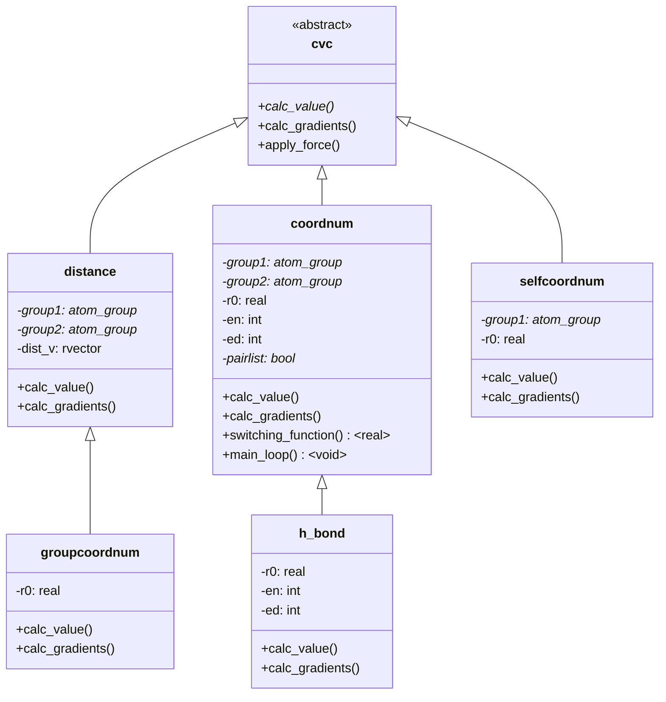

Coordination numbers and pair distances represent fundamental collective variables in molecular simulations, enabling quantitative analysis of molecular structure, binding interactions, and solvation phenomena. These metrics form the foundation for studying protein-ligand binding, ion coordination, hydrogen bonding networks, and solvation shell dynamics. By converting complex atomic arrangements into scalar or vector quantities, they provide the bridge between microscopic configurations and thermodynamic observables.

## Architectural Foundation

The coordination number and distance variable framework in Colvars follows a hierarchical design pattern where distance calculations serve as atomic operations, and coordination numbers extend these concepts through switching function transformations. This architecture enables efficient computation across multiple scales—from single atom pairs to large molecular assemblies—while maintaining analytical gradient accuracy essential for biasing forces.

The class hierarchy demonstrates this design philosophy:



## Distance-Based Collective Variables

### Core Distance Metrics

The fundamental distance variable computes the Euclidean separation between two atom group centers of mass, forming the basis for all subsequent distance-derived collective variables. The implementation handles both periodic and non-periodic boundary conditions through the `f_cvc_pbc_minimum_image` feature flag, ensuring correct minimum-image convention calculations [colvarcomp_distances.cpp](src/colvarcomp_distances.cpp#L48-L52).

The calculation follows a straightforward pattern: compute the separation vector, apply periodic boundary corrections if enabled, then calculate the norm. The gradient computation derives directly from this expression, yielding unit vectors pointing from each center toward the other [colvarcomp_distances.cpp](src/colvarcomp_distances.cpp#L60-L65).

### Distance Variants and Their Applications

Colvars provides several specialized distance metrics tailored to specific scientific applications:

| Variable Type | Mathematical Form | Primary Use Cases | Dimensionality |
|--------------|-------------------|------------------|----------------|
| `distance` | \|r₁₂\| | General separation metrics | Scalar |
| `distance_vec` | r₁₂ | Directional analysis, dipole moments | 3D vector |
| `distance_z` | r₁₂ · â | Axial coordination, pore dimensions | Scalar |
| `distance_xy` | \|r₁₂ - (r₁₂·â)â\| | Radial confinement, cylindrical pores | Scalar |
| `distance_dir` | r₁₂/\|r₁₂\| | Orientation tracking | 3D vector |
| `distance_inv` | 1/\|r₁₂\|ⁿ | Electrostatic interactions | Scalar |

The `distance_z` variant deserves special attention for its utility in studying confined systems such as ion channels or nanotubes. It projects the separation vector onto a user-defined axis, which can be either fixed or defined dynamically by two reference atom groups [colvarcomp_distances.cpp](src/colvarcomp_distances.cpp#L150-L193). Similarly, `distance_xy` computes the radial component orthogonal to the specified axis, making it ideal for studying transverse motions in confined geometries [colvarcomp_distances.cpp](src/colvarcomp_distances.cpp#L261-L294).

> [!TIP]
> When studying ion permeation through membrane channels, combine `distance_z` (axial position) with `distance_xy` (radial position) to fully characterize ion trajectory and identify binding sites along the pore lumen.

### Distance Pairs for Multi-Body Analysis

The `distance_pairs` variable extends the concept to compute all pairwise distances between two atom groups, generating a vector of length N₁×N₂ where N₁ and N₂ are the group sizes. This is particularly useful for studying solvation shells, protein-ligand interfaces, and complex formation where multiple interaction points matter simultaneously [colvarcomp_distances.cpp](src/colvarcomp_distances.cpp#L513-L537).

## Coordination Number Fundamentals

### Switching Function Mathematics

The coordination number transforms continuous distances into discrete-like counts through a smooth switching function. The mathematical foundation employs the rational function:

S(r) = (1 - xⁿ)/(1 - xᵐ), where x = r/r₀

This function transitions smoothly from 1.0 (at r = 0) to 0.0 (as r → r₀), with the sharpness controlled by the exponents n and m. The standard parameters use n=6 (numerator) and m=12 (denominator), creating a function that approximates a step function while remaining differentiable—essential for force calculations [colvarcomp_coordnums.cpp](src/colvarcomp_coordnums.cpp#L30-L65).

The implementation uses several optimizations to maintain numerical stability:
- Avoids explicit square roots by working with squared distances (l2 = (r/r₀)²)
- Uses integer power functions for efficiency
- Implements pair list optimization for large systems
- Provides anisotropic cutoffs through vector r₀ specification [colvarcomp_coordnums.cpp](src/colvarcomp_coordnums.cpp#L46-L60)

### Template-Based Optimization Strategy

The codebase employs compile-time template parameters to eliminate conditional branching in inner loops, achieving significant performance gains. The template flags control:

```mermaid
flowchart TD
    A[coordnum::calc_value] --> B{f_cvc_gradient enabled?}
    B -->|Yes| C[compute_coordnum~ef_gradients~]
    B -->|No| D[compute_coordnum~ef_null~]
    
    C --> E{anisotropic?}
    D --> E
    
    E -->|Yes| F{pairlist exists?}
    E -->|No| G{pairlist exists?}
    
    F -->|Yes| H{rebuild pairlist?}
    F -->|No| I[ef_anisotropic \| ef_use_pairlist]
    
    G -->|Yes| J{rebuild pairlist?}
    G -->|No| K[ef_use_pairlist]
    
    H -->|Yes| L[ef_anisotropic \| ef_use_pairlist \| ef_rebuild_pairlist]
    H -->|No| I
    
    J -->|Yes| M[ef_use_pairlist \| ef_rebuild_pairlist]
    J -->|No| K
    
    I --> N[main_loop~flags~]
    K --> N
    L --> N
    M --> N
    N --> O[switching_function~flags~]
```

This design ensures that the hot inner loop contains no runtime conditionals—all decisions are resolved at compilation time, enabling maximum optimization by the compiler [colvarcomp_coordnums.cpp](src/colvarcomp_coordnums.cpp#L210-L290).

## Coordination Number Variants

### Standard Coordination Number (coordnum)

The `coordnum` variable calculates coordination between two atom groups, summing switching function values across all atom pairs. Key configuration options include:

- `cutoff`: Isotropic cutoff distance (scalar, default 4.0 Å)
- `cutoff3`: Anisotropic cutoff vector (for directional interactions)
- `expNumer`: Numerator exponent n (default 6)
- `expDenom`: Denominator exponent m (default 12)
- `group2CenterOnly`: Treat group2 as single point at center of mass
- `tolerance`: Threshold for pair list optimization
- `pairListFrequency`: Rebuild frequency for pair lists [colvarcomp_coordnums.cpp](src/colvarcomp_coordnums.cpp#L122-L206)

The initialization performs several critical validation steps: ensuring groups don't share atoms, verifying exponents are positive even integers, and allocating pair list memory when tolerance is specified [colvarcomp_coordnums.cpp](src/colvarcomp_coordnums.cpp#L122-L206).

### Hydrogen Bond Coordination (h_bond)

The `h_bond` class specializes coordination number calculations for hydrogen bonding, implementing geometric criteria typical of H-bond analysis. While inheriting the switching function framework, it often uses modified default parameters tuned for hydrogen bond distances and angles [colvarcomp_coordnums.cpp](src/colvarcomp_coordnums.cpp#L343-L414).

> [!TIP]
> For studying proton transfer reactions or water wire formation, combine h_bond variables with angle variables to capture both distance and angular dependencies of hydrogen bond networks.

### Self-Coordination Number (selfcoordnum)

The `selfcoordnum` variable computes coordination within a single atom group, typically for analyzing solvation shells, clustering, or local structure. It counts pairwise interactions where both atoms belong to the same group, yielding a maximum value of N×(N-1)/2 for N atoms [colvarcomp_coordnums.cpp](src/colvarcomp_coordnums.cpp#L482-L539).

The implementation reuses the coordination number core algorithms but modifies the loop structure to iterate over unique pairs within the single group rather than between two separate groups [colvarcomp_coordnums.cpp](src/colvarcomp_coordnums.cpp#L607-L621).

### Group Coordination Number (groupcoordnum)

This variant extends the distance class to compute coordination between groups, inheriting both distance calculation infrastructure and switching function methodology. It's particularly useful for studying ligand-receptor interactions where multiple binding sites contribute to overall coordination [colvarcomp_coordnums.cpp](src/colvarcomp_coordnums.cpp#L625-L716).

## Performance Optimization Techniques

### Pair List Algorithm

Large systems with hundreds or thousands of atoms require optimization to avoid O(N²) scaling. The pair list implementation addresses this by:
- Maintaining a boolean array tracking which pairs exceed the tolerance threshold
- Rebuilding the list only at specified intervals (controlled by `pairListFrequency`)
- Skipping computation for excluded pairs during intermediate steps
- Using a tolerance margin to capture pairs approaching the cutoff [colvarcomp_coordnums.cpp](src/colvarcomp_coordnums.cpp#L7-L21)

The switching function includes special handling for pair list mode, adjusting the function range to exclude pairs with coordination below the tolerance threshold [colvarcomp_coordnums.cpp](src/colvarcomp_coordnums.cpp#L58-L65).

### Memory and Computational Efficiency

Several implementation details contribute to performance:
- In-place gradient accumulation in atom group structures
- Avoiding temporary allocations in inner loops
- Using squared distances to eliminate sqrt operations
- Template-based specialization removing runtime checks [colvarcomp_coordnums.cpp](src/colvarcomp_coordnums.cpp#L90-L108)

## Configuration Examples and Best Practices

### Basic Ion Coordination Setup

```colvar
# First coordination shell of Na+ in water
coordNum {
    name na_first_shell
    group1 {
        atomNameRange Na NA
    }
    group2 {
        atomNameRange O O
    }
    cutoff 3.5
    expNumer 6
    expDenom 12
    tolerance 0.001
    pairListFrequency 50
}
```

### Anisotropic Coordination for Membrane Systems

```colvar
# Coordination in direction perpendicular to membrane
coordNum {
    name lipid_headgroup_coord
    group1 {
        # Protein atoms near membrane
        atomNameResidueRange CA 1 100
    }
    group2 {
        # Lipid phosphate atoms
        atomNameResidueRange P 1 200
    }
    cutoff3 4.0 4.0 8.0  # Larger cutoff in z-direction
    expNumer 8
    expDenom 16
}
```

### Hydrogen Bond Network Analysis

```colvar
# H-bond between backbone carbonyl and amide
h_bond {
    name backbone_hbond
    group1 {
        atomNameResidueRange O 10 10
    }
    group2 {
        atomNameResidueRange N 15 15
    }
    cutoff 3.5
    expNumer 6
    expDenom 12
}
```

> [!TIP]
> When studying systems with widely varying interaction strengths, consider using different exponent pairs (n, m) for different coordination variables. Sharper functions (higher exponents) better capture short-range specific interactions, while gentler functions provide smoother collective variables for broader sampling.

## Integration with Biasing Methods

Coordination numbers and distance variables serve as ideal collective variables for several enhanced sampling techniques:

- **ABF (Adaptive Biasing Force)**: Coordination numbers provide natural reaction coordinates for binding/unbinding events, allowing free energy calculations along the coordination pathway
- **Metadynamics**: Well-tempered metadynamics on coordination variables can efficiently explore multiple binding states and overcome high barriers
- **Harmonic Restraints**: Distance restraints maintain specific geometries while allowing fluctuations around equilibrium positions

The analytical gradients computed by these variables ensure accurate force application, which is critical for maintaining proper thermodynamics in biasing simulations [colvarcomp_coordnums.cpp](src/colvarcomp_coordnums.cpp#L334-L342).

## Next Steps

To deepen your understanding of Colvars capabilities:

- Explore [Angular and Dihedral Variables](7-angular-and-dihedral-variables) for orientational metrics complementary to distance-based variables
- Review [Atom and Atom Group Management](21-atom-and-atom-group-management) for detailed configuration of atom groups
- Study [Harmonic Restraints and Walls](11-harmonic-restraints-and-walls) to apply biases using these collective variables
- Examine [Distance-Based Variables](6-distance-based-variables) for additional distance-derived collective variables

The combination of distance metrics and coordination numbers provides a powerful toolkit for analyzing and controlling molecular structure in simulations. Understanding their implementation details enables informed selection of appropriate variables for specific scientific questions and optimization strategies for challenging systems.