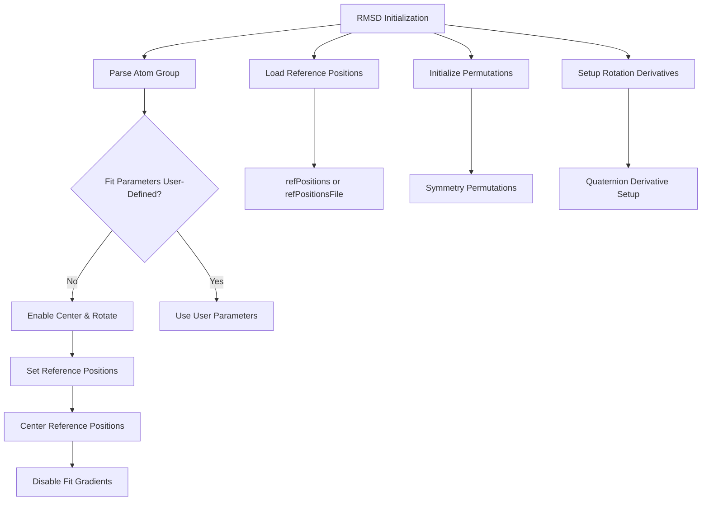
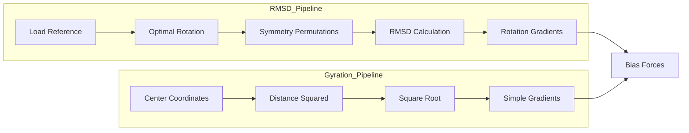

This page provides an architectural deep dive into protein-specific collective variables in Colvars, focusing on Root Mean Square Deviation (RMSD) and Radius of Gyration calculations. These variables are essential for monitoring protein conformational changes, structural transitions, and folding pathways in enhanced sampling simulations.

## RMSD: Root Mean Square Deviation

The RMSD collective variable quantifies the structural difference between the instantaneous atomic positions and a reference structure, making it the gold standard for monitoring conformational changes in proteins. The implementation leverages optimal superposition algorithms to achieve rotationally-invariant measurements.


### Mathematical Foundation

RMSD is calculated as the square root of the mean squared deviation between aligned atom positions:

$$\text{RMSD} = \sqrt{\frac{1}{N}\sum_{i=1}^{N} ||\mathbf{r}_i - \mathbf{r}_i^{ref}||^2}$$

where optimal rotation and translation are applied to minimize the deviation before calculation.

### Implementation Architecture

The RMSD CVC (`colvar::rmsd`) extends the base `cvc` class and implements the complete calculation pipeline:

```cpp
colvar::rmsd::rmsd()
{
  set_function_type("rmsd");
  init_as_distance();
  provide(f_cvc_inv_gradient);
}
```

The initialization process configures three critical components: reference position loading, symmetry permutation handling, and optimal rotation setup [colvarcomp_distances.cpp](src/colvarcomp_distances.cpp#L820-L880).



### Reference Position Configuration

RMSD requires reference atomic coordinates for comparison. Two configuration methods are supported:

- **Direct specification**: `refPositions` keyword accepts inline coordinates
- **File-based loading**: `refPositionsFile` enables PDB-based coordinate loading with optional column filtering

The validation ensures reference position count matches atom group size, preventing dimension mismatches that would corrupt calculations [colvarcomp_distances.cpp](src/colvarcomp_distances.cpp#L840-L880).

> [!TIP]
> When using `refPositionsFile` with PDB files, the `refPositionsCol` and `refPositionsColValue` parameters enable selective coordinate extraction. This allows loading multiple conformational states from a single PDB file by selecting specific occupancy or B-factor columns.

### Symmetry and Permutation Handling

Proteins often contain symmetric regions (e.g., side-chain rotamers, symmetric domains) where atom identity should be disregarded. The implementation supports atomic permutations through `init_permutation()` which generates valid symmetry operations and evaluates the minimum RMSD across all permutations [colvarcomp_distances.cpp](src/colvarcomp_distances.cpp#L924-L970).

The calculation loop in `calc_value()` iterates through all permutations to find the optimal atom mapping:

```cpp
for (size_t ip = 1; ip < n_permutations; ip++) {
  cvm::real value = 0.0;
  for (size_t ia = 0; ia < atoms->size(); ia++) {
    const cvm::atom_pos pos_ia(
      atoms->pos_x(ia), atoms->pos_y(ia), atoms->pos_z(ia));
    value += (pos_ia - ref_pos[ref_pos_index++]).norm2();
  }
  if (value < x.real_value) {
    x.real_value = value;
    best_perm_index = ip;
  }
}
```

This ensures RMSD reports the structural deviation insensitive to symmetric re-labeling [colvarcomp_distances.cpp](src/colvarcomp_distances.cpp#L982-L994).

### Gradient Calculation

RMSD gradients are computed analytically using the chain rule, accounting for the optimal rotation:

$$\frac{\partial \text{RMSD}}{\partial \mathbf{r}_i} = \frac{1}{N \cdot \text{RMSD}}(\mathbf{r}_i - \mathbf{r}_i^{ref})$$

The implementation stores gradients in the atom group for force application:

```cpp
cvm::real const drmsddx2 = (x.real_value > 0.0) ?
  0.5 / (x.real_value * cvm::real(atoms->size())) :
  0.0;

size_t const start = atoms->size() * best_perm_index;
for (size_t ia = 0; ia < atoms->size(); ia++) {
  const cvm::atom_pos pos_ia(
    atoms->pos_x(ia), atoms->pos_y(ia), atoms->pos_z(ia));
  const cvm::rvector grad = (drmsddx2 * 2.0 * (pos_ia - ref_pos[start + ia]));
  atoms->grad_x(ia) = grad.x;
  atoms->grad_y(ia) = grad.y;
  atoms->grad_z(ia) = grad.z;
}
```

Note that gradients use the optimal permutation determined during value calculation [colvarcomp_distances.cpp](src/colvarcomp_distances.cpp#L997-L1009).

### Jacobian Derivative

RMSD provides Jacobian derivatives for entropic corrections in free energy calculations. The implementation separates contributions from rotation and translation terms:

$$J_{\text{RMSD}} = \frac{3N - 1 - T_{\text{trans}} - T_{\text{rot}}}{\text{RMSD}}$$

where $T_{\text{trans}} = 3$ (if centering) and $T_{\text{rot}}$ involves rotation matrix derivatives [colvarcomp_distances.cpp](src/colvarcomp_distances.cpp#L1035-L1095).

The rotation term requires quaternion derivative calculations via the `rotation_derivative` infrastructure, enabling accurate phase space corrections for biased simulations.

### Configuration Parameters

| Parameter | Type | Default | Description |
|-----------|------|---------|-------------|
| `atoms` | atom group | required | Atoms for RMSD calculation |
| `refPositions` | vector | - | Inline reference coordinates |
| `refPositionsFile` | string | - | PDB file containing references |
| `refPositionsCol` | string | - | PDB column for coordinate selection |
| `refPositionsColValue` | real | - | Column value filter (must be non-zero) |
| `fittingGroup` | atom group | atoms | Alternative group for optimal fitting |

## Radius of Gyration

The radius of gyration quantifies the compactness of a protein by measuring the root-mean-square distance of atoms from their center of mass. This variable is particularly useful for monitoring folding/unfolding transitions and aggregate formation.

### Mathematical Definition

$$R_g = \sqrt{\frac{1}{N}\sum_{i=1}^{N} ||\mathbf{r}_i - \mathbf{r}_{\text{cm}}||^2}$$

where $\mathbf{r}_{\text{cm}}$ is the center of mass of the atom group.

### Implementation Details

The gyration CVC (`colvar::gyration`) implements a streamlined calculation pipeline that automatically centers coordinates [colvarcomp_distances.cpp](src/colvarcomp_distances.cpp#L673-L690):

```cpp
colvar::gyration::gyration()
{
  set_function_type("gyration");
  provide(f_cvc_inv_gradient);
  provide(f_cvc_Jacobian);
  init_as_distance();
}
```

Unlike RMSD, gyration requires only centering (not rotation), making it computationally efficient for large systems.

### Value Calculation

The implementation leverages the fact that centered coordinates are already available from the atom group fitting infrastructure:

```cpp
void colvar::gyration::calc_value()
{
  x.real_value = 0.0;
  const size_t num_pos_xyz = 3 * atoms->size();
  for (size_t i = 0; i < num_pos_xyz; ++i) {
    x.real_value += atoms->pos_x(i) * atoms->pos_x(i);
  }
  x.real_value = cvm::sqrt(x.real_value / cvm::real(atoms->size()));
}
```

This accumulates squared centered coordinates and normalizes by atom count [colvarcomp_distances.cpp](src/colvarcomp_distances.cpp#L692-L700).

### Gradient Computation

The gradient follows directly from the centered position formulation:

$$\frac{\partial R_g}{\partial \mathbf{r}_i} = \frac{1}{N \cdot R_g}(\mathbf{r}_i - \mathbf{r}_{\text{cm}})$$

The implementation computes this efficiently using pre-centered coordinates:

```cpp
void colvar::gyration::calc_gradients()
{
  cvm::real const drdx = 1.0/(cvm::real(atoms->size()) * x.real_value);
  const size_t num_pos_xyz = 3 * atoms->size();
  for (size_t i = 0; i < num_pos_xyz; ++i) {
    atoms->grad_x(i) = drdx * atoms->pos_x(i);
  }
}
```

This provides accurate forces for maintaining or modulating protein compactness [colvarcomp_distances.cpp](src/colvarcomp_distances.cpp#L702-L710).

### Jacobian Derivative

Gyration's Jacobian derivative has a closed-form solution accounting for centering constraints:

$$J_{R_g} = \frac{3N - 4}{R_g}$$

The implementation directly encodes this analytical result:

```cpp
void colvar::gyration::calc_Jacobian_derivative()
{
  jd = x.real_value ? (3.0 * cvm::real(atoms->size()) - 4.0) / x.real_value : 0.0;
}
```

This accounts for the three translational degrees of freedom removed by centering [colvarcomp_distances.cpp](src/colvarcomp_distances.cpp#L728-L731).

> [!TIP]
> The Jacobian derivative for gyration is exact and significantly simpler than RMSD because no rotation is involved. This makes it ideal for free energy calculations where entropic corrections are critical.

## Inertia and Inertia-Z Variants

Building on the gyration foundation, Colvars provides moment-of-inceertia variables that quantify mass distribution along specific directions.

### Moment of Inertia

The `inertia` CVC calculates the scalar moment of inertia, which is proportional to the gyration squared:

$$I = \sum_{i=1}^{N} ||\mathbf{r}_i - \mathbf{r}_{\text{cm}}||^2 = N \cdot R_g^2$$

The implementation accumulates squared distances without the square root operation:

```cpp
void colvar::inertia::calc_value()
{
  x.real_value = 0.0;
  const size_t num_pos_xyz = 3 * atoms->size();
  for (size_t i = 0; i < num_pos_xyz; ++i) {
    x.real_value += atoms->pos_x(i) * atoms->pos_x(i);
  }
}
```

This provides linear scaling with size for large systems [colvarcomp_distances.cpp](src/colvarcomp_distances.cpp#L743-L750).

### Projected Inertia (Inertia-Z)

The `inertia_z` variant projects the moment of inertia onto a user-defined axis, enabling directional compactness analysis:

$$I_z = \sum_{i=1}^{N} [(\mathbf{r}_i - \mathbf{r}_{\text{cm}}) \cdot \hat{\mathbf{n}}]^2$$

where $\hat{\mathbf{n}}$ is the projection axis. This is useful for monitoring cylindrical proteins or membrane penetration events [colvarcomp_distances.cpp](src/colvarcomp_distances.cpp#L769-L805).

## Architecture Comparison: RMSD vs. Gyration



| Feature | RMSD | Gyration | Inertia |
|---------|------|----------|---------|
| Reference Structure | Required | None | None |
| Rotation Fitting | Yes | No | No |
| Symmetry Handling | Yes | No | No |
| Computational Cost | O(N) with rotation | O(N) | O(N) |
| Jacobian Complexity | High (rotation term) | Low | Medium |
| Typical Use Cases | Folding, conformational changes | Compactness, aggregation | Mass distribution analysis |

## Advanced Protein Conformation Variables

Beyond RMSD and gyration, Colvars provides specialized variables for protein secondary structure analysis.

### Alpha Helix Angles

The `alpha_angles` CVC (implemented in [colvarcomp_protein.cpp](src/colvarcomp_protein.cpp#L18-L176)) monitors alpha-helical content by measuring Cα-Cα distances. It uses a reference distance of 3.3 Å and integrates residue range specification for segment-specific analysis:

```cpp
colvar::alpha_angles::alpha_angles()
{
  set_function_type("alpha");
  enable(f_cvc_explicit_gradient);
  x.type(colvarvalue::type_scalar);
  colvarproxy *proxy = cvm::main()->proxy;
  r0 = proxy->angstrom_to_internal(3.3);
}
```

The initialization parses residue ranges using the `residueRange` keyword, enabling monitoring of specific helical segments within larger proteins [colvarcomp_protein.cpp](src/colvarcomp_protein.cpp#L28-L175).

### Dihedral Principal Components

The `dihedPC` CVC (implemented in [colvarcomp_protein.cpp](src/colvarcomp_protein.cpp#L341-L528)) performs principal component analysis on backbone dihedral angles, providing a low-dimensional representation of protein conformational space. This is particularly valuable for analyzing complex folding pathways and identifying intermediate states.

> [!TIP]
> The dihedPC variable requires careful selection of dihedral angles to ensure meaningful PCA. Use backbone φ and ψ angles for global conformational changes or include side-chain χ angles for local structural transitions.

## Integration with Biasing Methods

Protein-specific variables integrate seamlessly with Colvars' biasing framework. RMSD is commonly used with:

- **Umbrella Sampling**: Define reaction coordinates for folding/unfolding
- **Metadynamics**: Explore conformational space using RMSD as collective variable
- **ABF (Adaptive Biasing Force)**: Compute free energy surfaces along RMSD pathways

For enhanced sampling with RMSD, see [Metadynamics and Well-Tempered Variants](13-metadynamics-and-well-tempered-variants). For free energy integration, refer to [Free Energy Surface Integration](17-free-energy-surface-integration).

### Recommended Biasing Configurations

**RMSD-based Folding**:
```colvars
colvar {
  name folding_rmsd
  rmsd {
    atoms {
      atomNumbersResidueRange 1 100
      centerToReference on
      rotateToReference on
    }
    refPositionsFile reference.pdb
  }
  upperBound 10.0
  lowerBound 0.0
}
```

**Gyration-based Compaction**:
```colvars
colvar {
  name rg_compaction
  gyration {
    atoms {
      atomNumbersResidueRange 1 100
      centerToReference on
    }
  }
  lowerBound 5.0
  upperBound 25.0
}
```

## Performance Considerations

### Computational Scaling

- **RMSD**: O(N) with rotation matrix computation overhead. Optimal rotation uses quaternion-based minimization (Kabsch algorithm).
- **Gyration**: Pure O(N) without rotation, making it ideal for large proteins.
- **Permutations**: Symmetry handling scales as O(N × P) where P is the number of permutations.

### Memory Requirements

Both RMSD and gyration require storing reference coordinates (O(N)) and atomic gradients (O(N)). Permutation handling multiplies memory by the number of symmetric configurations.

### Parallelization

The CVC architecture enables parallel computation of atomic gradients. RMSD rotation fitting requires synchronization for collective operations (quaternion minimization), while gyration allows embarrassingly parallel gradient computation.

See [Parallel Computing and SMP Support](24-parallel-computing-and-smp-support) for detailed implementation strategies.

## Troubleshooting Common Issues

### RMSD Divergence

**Problem**: RMSD values unexpectedly large or increasing without bound.

**Diagnosis**: Reference structure mismatch or incorrect atom ordering.

**Solution**: Verify reference structure matches simulation topology using [Atom and Atom Group Management](21-atom-and-atom-group-management) tools. Check atom indices in reference file match selected atoms.

### Gyration Fluctuations

**Problem**: Gyration values oscillate excessively.

**Diagnosis**: Incorrect centering or including mobile solvent atoms.

**Solution**: Ensure `centerToReference` is enabled and exclude solvent/ions from atom group.

### Permutation Performance

**Problem**: Simulation slows down with many permutations.

**Diagnosis**: Excessive symmetry operations.

**Solution**: Limit permutations to chemically relevant symmetric groups or disable if not required.

## Next Steps

For practical implementation details, explore:
- [Basic Configuration Syntax](4-basic-configuration-syntax) for parameter specification
- [Atom and Atom Group Management](21-atom-and-atom-group-management) for atom selection strategies
- [Output Files and Trajectory Analysis](26-output-files-and-trajectory-analysis) for analyzing protein conformational changes

For advanced applications combining multiple protein variables, refer to:
- [Custom Functions and Neural Network Variables](10-custom-functions-and-neural-network-variables)
- [Extended Lagrangian Dynamics](22-extended-lagrangian-dynamics) for enhanced conformational sampling