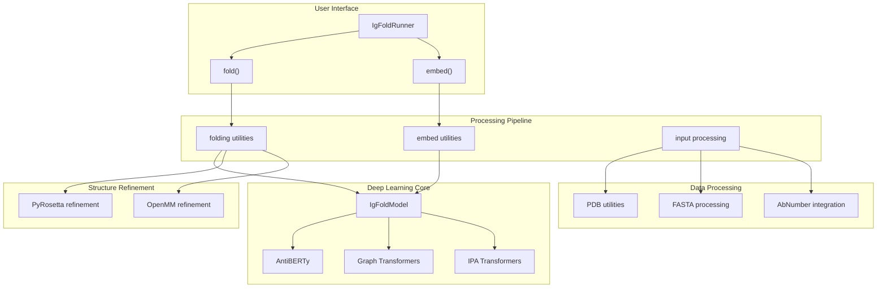
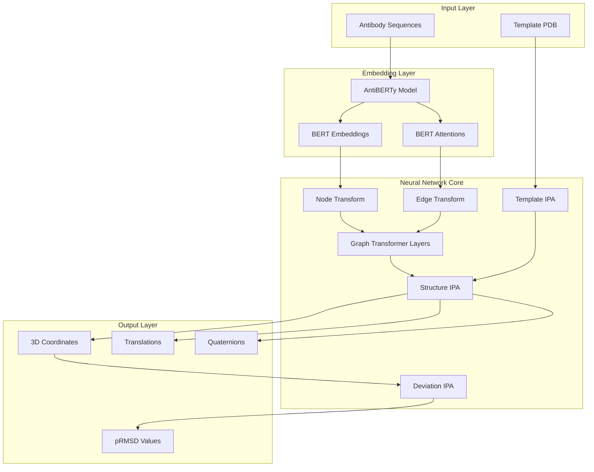

# Overview

Relevant source files

The following files were used as context for generating this wiki page:

- [README.md](README.md)
- [setup.cfg](setup.cfg)

This document provides a high-level introduction to IgFold, explaining its purpose, key capabilities, and system architecture. This overview is intended for users and developers who want to understand what IgFold does and how its major components fit together.

For detailed installation instructions, see [Installation and Setup](#2). For hands-on usage examples, see [Quick Start Guide](#3). For comprehensive API documentation, see [IgFoldRunner API](#4.1).

## What is IgFold

IgFold is a deep learning system for fast and accurate antibody structure prediction from amino acid sequences. It addresses the challenge of predicting three-dimensional antibody structures, which is critical for drug discovery, vaccine design, and understanding immune responses.

The system uses transformer-based neural networks trained on a large dataset of natural antibody structures to predict:
- 3D atomic coordinates for antibody heavy and light chains
- Per-residue confidence estimates (pRMSD values)
- Structural embeddings for downstream machine learning tasks

IgFold supports both paired antibodies (heavy + light chains) and single chains like nanobodies, making it applicable to a wide range of antibody engineering scenarios.

*Sources: [README.md:1-227]()*

## Key Capabilities

IgFold provides several core capabilities through its main interface:

| Capability | Description | Primary Method |
|------------|-------------|----------------|
| Structure Prediction | Generate 3D coordinates from sequences | `IgFoldRunner.fold()` |
| Confidence Estimation | Per-residue predicted RMSD values | Included in fold output |
| Sequence Embedding | Extract learned representations | `IgFoldRunner.embed()` |
| Structure Refinement | Post-prediction optimization | PyRosetta or OpenMM integration |
| Antibody Renumbering | Standardize numbering schemes | AbNumber integration |

The system handles various input formats including paired sequences, single chains, and can work with or without template structures. Output includes standard PDB files with confidence scores encoded in B-factor columns.

*Sources: [README.md:47-186]()*

## System Architecture

The following diagram shows IgFold's high-level architecture and how the major components interact:

### Core System Architecture

*Sources: [README.md:54-186](), [setup.cfg:1-15]()*

## Core Components

The system consists of several key components that work together to transform antibody sequences into 3D structures:

### Component Architecture

*Sources: [README.md:54-162]()*

## Key Workflows

IgFold supports two primary workflows:

### Structure Prediction Workflow
1. Input sequences provided to `IgFoldRunner.fold()`
2. Sequences processed through AntiBERTy for embeddings
3. Neural network generates coordinates and confidence estimates
4. Optional refinement with PyRosetta or OpenMM
5. Optional renumbering with AbNumber
6. Output PDB file with pRMSD values in B-factors

### Embedding Extraction Workflow
1. Input sequences provided to `IgFoldRunner.embed()`
2. Forward pass through model layers
3. Extract intermediate representations at different stages
4. Return embeddings for downstream use

Both workflows use the same underlying `IgFoldModel` but expose different outputs depending on the intended use case.

*Sources: [README.md:49-162]()*

## Input and Output Overview

### Input Formats
- **Sequences**: Dictionary with chain IDs as keys (`"H"`, `"L"`) and amino acid sequences as values
- **Templates**: Optional PDB files for template-based prediction
- **Parameters**: Various options for refinement, renumbering, and model behavior

### Output Formats
- **PDB Files**: Standard protein structure format with predicted coordinates
- **pRMSD Values**: Per-residue confidence estimates (stored in B-factor column)
- **Embeddings**: Various learned representations for different model layers
- **Return Objects**: Structured data containing coordinates, confidence scores, and metadata

The system is designed to be flexible while maintaining compatibility with standard bioinformatics tools and file formats.

*Sources: [README.md:51-162]()*

---