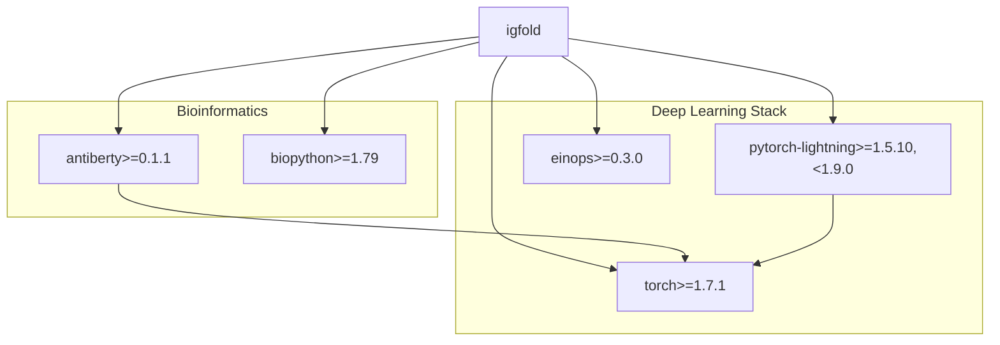
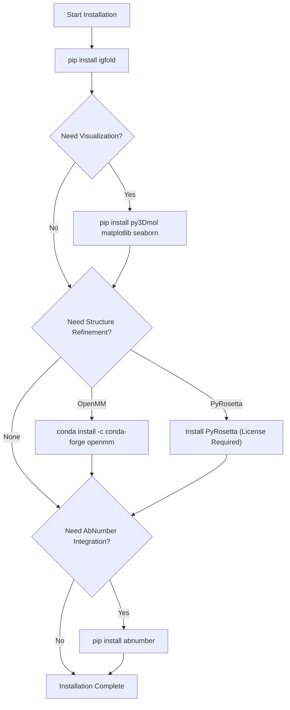
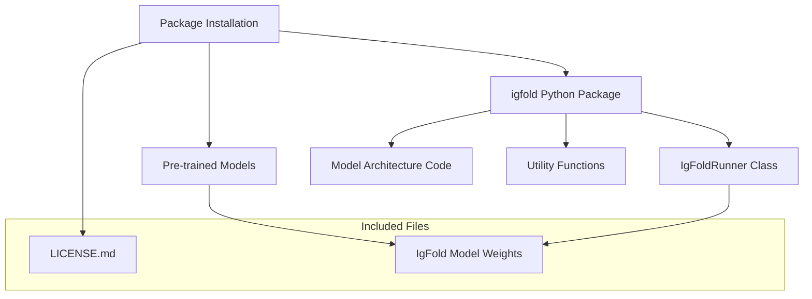

# Installation and Setup

<details>
<summary>Relevant source files</summary>

The following files were used as context for generating this wiki page:

- [MANIFEST.in](MANIFEST.in)
- [requirements.txt](requirements.txt)
- [setup.cfg](setup.cfg)

</details>


This page provides comprehensive instructions for installing IgFold and configuring its dependencies. It covers core installation requirements, optional components for structure refinement, and various installation methods to get IgFold running in different environments.

For information about using IgFold after installation, see [Quick Start Guide](#3). For details about specific dependencies and their roles in the architecture, see [Core Architecture](#5).

## Prerequisites and System Requirements

IgFold requires Python 3.7 or higher and is built on the PyTorch deep learning framework. The system has been tested on Linux, macOS, and Windows environments.

### Core Dependencies

The following diagram shows the essential dependencies installed with IgFold:

**Core Dependency Structure**


Sources: [setup.cfg:9-14]()

### System Requirements

| Component | Minimum | Recommended |
|-----------|---------|-------------|
| Python | 3.7+ | 3.8+ |
| RAM | 8GB | 16GB+ |
| Storage | 2GB | 5GB+ |
| GPU | None (CPU works) | CUDA-compatible GPU |

## Core Installation

### Method 1: pip Installation (Recommended)

Install IgFold and its core dependencies using pip:

```bash
pip install igfold
```

This installs the packages specified in [setup.cfg:9-14](), including:
- `torch` for deep learning computations
- `pytorch-lightning` for model training infrastructure  
- `antiberty` for antibody sequence embeddings
- `biopython` for biological sequence and structure processing
- `einops` for tensor operations

### Method 2: Installation from Source

For development or latest features:

```bash
git clone https://github.com/Graylab/IgFold.git
cd IgFold
pip install -e .
```

### Method 3: Conda Environment

Create an isolated environment:

```bash
conda create -n igfold python=3.8
conda activate igfold
pip install igfold
```

Sources: [setup.cfg:1-15]()

## Optional Dependencies

IgFold supports additional components for enhanced functionality. The installation workflow depends on your intended use case:

**Installation Decision Tree**


### Visualization Dependencies

For Jupyter notebook visualization and plotting capabilities:

```bash
pip install py3Dmol matplotlib seaborn
```

These dependencies enable:
- `py3Dmol`: 3D structure visualization in notebooks
- `matplotlib` and `seaborn`: Plotting and analysis charts

### Structure Refinement Options

#### OpenMM Integration

For molecular dynamics-based structure refinement:

```bash
conda install -c conda-forge openmm
```

OpenMM enables post-prediction structure optimization through the refinement pipeline.

#### PyRosetta Integration  

PyRosetta requires a license and separate installation:

1. Obtain license from [https://www.pyrosetta.org/](https://www.pyrosetta.org/)
2. Install following PyRosetta documentation
3. Verify installation with: `python -c "import pyrosetta; pyrosetta.init()"`

### AbNumber Integration

For antibody numbering and CDR identification:

```bash
pip install abnumber
```

Sources: [requirements.txt:1-13]()

## Package Structure and Trained Models

The IgFold installation includes pre-trained model weights automatically:

**Package Installation Components**


The trained models are automatically included via [MANIFEST.in:1]() which specifies `igfold/trained_models/IgFold/*` files.

Sources: [MANIFEST.in:1-2]()

## Installation Verification

Verify your installation by running basic functionality tests:

```python
# Test core installation
from igfold import IgFoldRunner
igfold = IgFoldRunner()
print("IgFold successfully installed")

# Test dependencies
import torch
import antiberty
import Bio
print(f"PyTorch version: {torch.__version__}")
print(f"AntiBERTy available: {antiberty is not None}")
print(f"BioPython available: {Bio is not None}")
```

### GPU Verification

Check CUDA availability for GPU acceleration:

```python
import torch
print(f"CUDA available: {torch.cuda.is_available()}")
if torch.cuda.is_available():
    print(f"GPU device: {torch.cuda.get_device_name(0)}")
```

## Troubleshooting Common Issues

### PyTorch Installation Issues

If PyTorch installation fails, install manually with appropriate CUDA version:

```bash
# CPU only
pip install torch --index-url https://download.pytorch.org/whl/cpu

# CUDA 11.8
pip install torch --index-url https://download.pytorch.org/whl/cu118
```

### Version Conflicts

IgFold requires specific PyTorch Lightning versions [setup.cfg:13](). If conflicts arise:

```bash
pip install "pytorch-lightning>=1.5.10,<1.9.0"
```

### Memory Issues

For systems with limited RAM, consider:
- Using CPU-only inference
- Processing smaller batches
- Increasing system swap space

### Import Errors

If `import igfold` fails, verify installation:

```bash
pip list | grep igfold
python -c "import sys; print(sys.path)"
```

Sources: [setup.cfg:9-14](), [requirements.txt:1-13]()

---