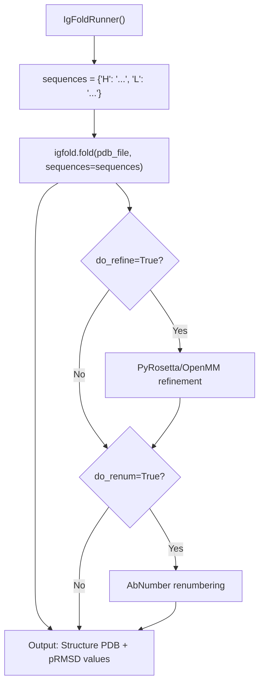
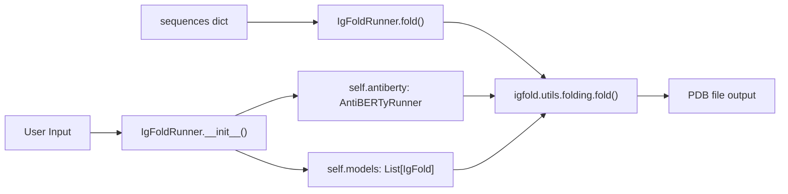
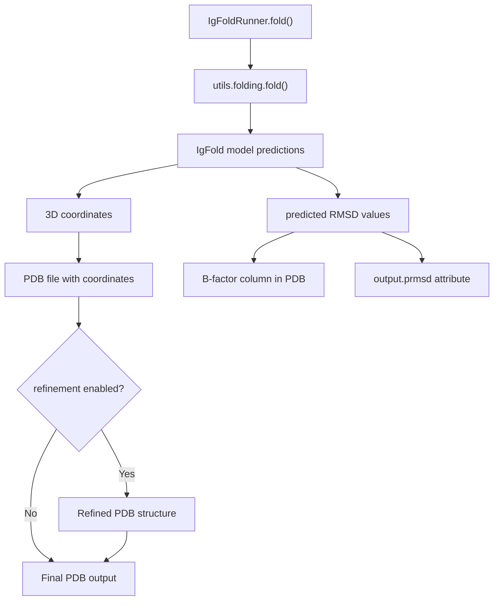
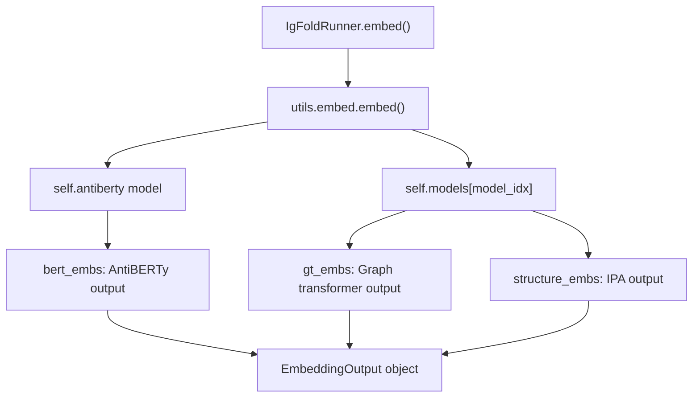

# Quick Start Guide

<details>
<summary>Relevant source files</summary>

The following files were used as context for generating this wiki page:

- [README.md](README.md)
- [igfold/IgFoldRunner.py](igfold/IgFoldRunner.py)

</details>


This guide provides the fastest path to making your first antibody structure predictions with IgFold. It covers the essential workflows using the `IgFoldRunner` API with minimal configuration. For detailed installation instructions, see [Installation and Setup](#2). For comprehensive API documentation, see [IgFoldRunner API](#4.1).

## Essential Workflow

The core IgFold workflow involves three main steps: initialization, sequence input, and structure prediction. The `IgFoldRunner` class serves as the primary interface for all prediction tasks.

**Basic IgFold Prediction Workflow**


Sources: [README.md:49-94](), [igfold/IgFoldRunner.py:77-124]()

## Quick Start: Paired Antibody Prediction

The most common use case is predicting structures from paired heavy and light chain sequences:

```python
from igfold import IgFoldRunner

# Initialize the runner (loads pre-trained models)
igfold = IgFoldRunner()

# Define your antibody sequences
sequences = {
    "H": "EVQLVQSGPEVKKPGTSVKVSCKASGFTFMSSAVQWVRQARGQRLEWIGWIVIGSGNTNYAQKFQERVTITRDMSTSTAYMELSSLRSEDTAVYYCAAPYCSSISCNDGFDIWGQGTMVTVS",
    "L": "DVVMTQTPFSLPVSLGDQASISCRSSQSLVHSNGNTYLHWYLQKPGQSPKLLIYKVSNRFSGVPDRFSGSGSGTDFTLKISRVEAEDLGVYFCSQSTHVPYTFGGGTKLEIK"
}

# Predict structure
igfold.fold(
    "my_antibody.pdb",        # Output filename
    sequences=sequences,       # Input sequences
    do_refine=False,          # Skip refinement for speed
    do_renum=False            # Skip renumbering for speed
)
```

**Key Components in Code**


Sources: [igfold/IgFoldRunner.py:26-76](), [igfold/IgFoldRunner.py:77-104](), [README.md:53-72]()

## Single Chain Prediction (Nanobodies)

For single heavy chain antibodies (nanobodies) or individual chains:

```python
from igfold import IgFoldRunner

igfold = IgFoldRunner()

sequences = {
    "H": "QVQLQESGGGLVQAGGSLTLSCAVSGLTFSNYAMGWFRQAPGKEREFVAAITWDGGNTYYTDSVKGRFTISRDNAKNTVFLQMNSLKPEDTAVYYCAAKLLGSSRYELALAGYDYWGQGTQVTVS"
}

igfold.fold(
    "my_nanobody.pdb",
    sequences=sequences,
    do_refine=False,
    do_renum=False
)
```

Sources: [README.md:74-94]()

## Understanding Prediction Outputs

The `fold()` method returns an output object containing structure coordinates and confidence estimates:

```python
# Capture the output for analysis
out = igfold.fold(
    "my_antibody.pdb",
    sequences=sequences,
    do_refine=False,
    do_renum=False
)

# Access predicted RMSD values (stored in B-factor column of PDB)
predicted_rmsd = out.prmsd  # Shape: (1, sequence_length, 4)
```

**Output Data Flow**


Sources: [README.md:115-140](), [igfold/IgFoldRunner.py:105-124]()

## Quick Sequence Embedding

For machine learning applications, extract embeddings without full structure prediction:

```python
from igfold import IgFoldRunner

igfold = IgFoldRunner()

sequences = {
    "H": "EVQLVQSGPEVKKPGTSVKVSCKASGFTFMSSAVQWVRQARGQRLEWIGWIVIGSGNTNYAQKFQERVTITRDMSTSTAYMELSSLRSEDTAVYYCAAPYCSSISCNDGFDIWGQGTMVTVS",
    "L": "DVVMTQTPFSLPVSLGDQASISCRSSQSLVHSNGNTYLHWYLQKPGQSPKLLIYKVSNRFSGVPDRFSGSGSGTDFT"
}

emb = igfold.embed(sequences=sequences)

# Access different representation layers
bert_embeddings = emb.bert_embs        # AntiBERTy embeddings (1, L, 512)
graph_embeddings = emb.gt_embs         # Graph transformer embeddings (1, L, 64)  
structure_embeddings = emb.structure_embs  # Structure-aware embeddings (1, L, 64)
```

**Embedding Pipeline Components**


Sources: [igfold/IgFoldRunner.py:126-158](), [README.md:142-162]()

## Common Parameters Quick Reference

| Parameter | Default | Purpose |
|-----------|---------|---------|
| `do_refine` | `True` | Enable PyRosetta/OpenMM structure refinement |
| `use_openmm` | `False` | Prefer OpenMM over PyRosetta for refinement |
| `do_renum` | `True` | Renumber output using AbNumber (Chothia scheme) |
| `num_models` | `4` | Number of ensemble models to use (1-4) |
| `model_idx` | `0` | Specific model index for embedding |

Sources: [igfold/IgFoldRunner.py:30-44](), [igfold/IgFoldRunner.py:77-104]()

## Next Steps

- For refinement setup with PyRosetta or OpenMM, see [Installation and Setup](#2)
- For detailed parameter descriptions and advanced options, see [IgFoldRunner API](#4.1)
- For visualization and analysis of results, see [Output Analysis and Visualization](#4.4)
- For Jupyter notebook examples with interactive visualization, see [Jupyter Notebook Interface](#4.2)

---