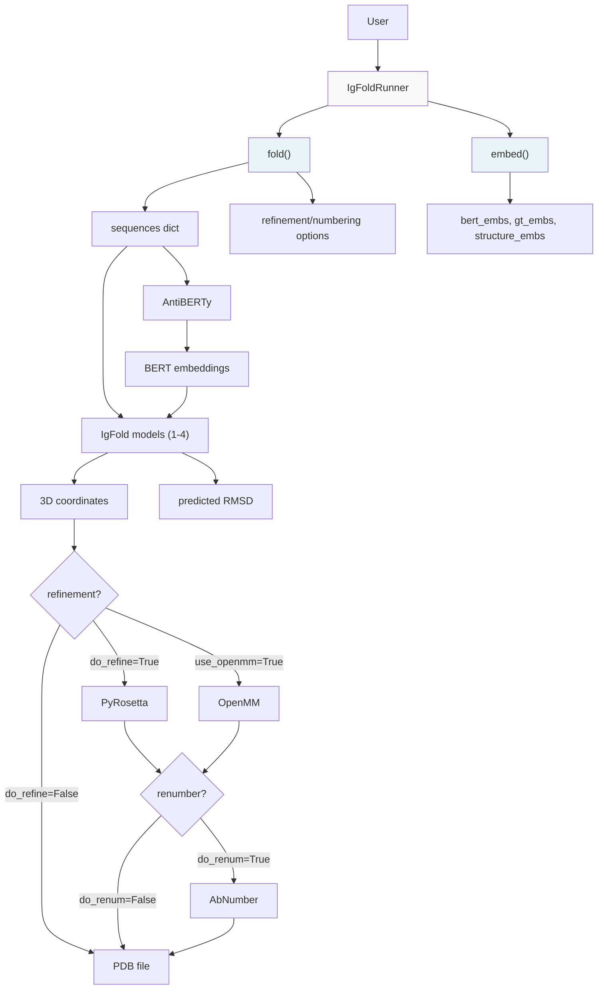
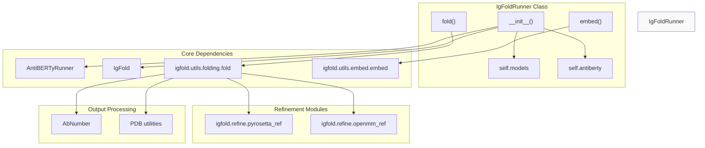
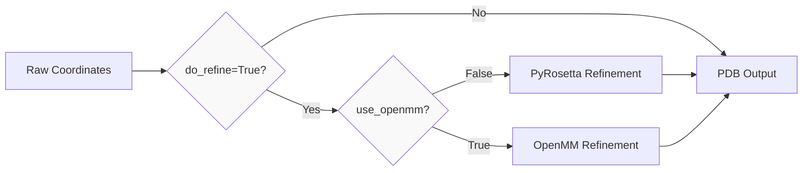

# User Guide

<details>
<summary>Relevant source files</summary>

The following files were used as context for generating this wiki page:

- [README.md](README.md)
- [igfold/IgFoldRunner.py](igfold/IgFoldRunner.py)

</details>


This guide provides comprehensive documentation for using IgFold's main interfaces and features for antibody structure prediction and analysis. It covers the core workflows, configuration options, and usage patterns for both programmatic and interactive use.

For detailed API documentation, see [IgFoldRunner API](#4.1). For interactive usage, see [Jupyter Notebook Interface](#4.2). For input format specifications, see [Input Formats and Data Preparation](#4.3). For output analysis, see [Output Analysis and Visualization](#4.4).

## Core System Overview

IgFold provides two primary interfaces for antibody structure prediction and analysis through the `IgFoldRunner` class. The system processes antibody sequences through deep learning models to generate 3D structures and molecular embeddings.

### Main IgFold Workflow



Sources: [README.md:48-185](), [igfold/IgFoldRunner.py:26-158]()

### Code Entity Mapping



Sources: [igfold/IgFoldRunner.py:26-75](), [igfold/IgFoldRunner.py:77-124](), [igfold/IgFoldRunner.py:126-158]()

## Primary Usage Patterns

### Structure Prediction with fold()

The `fold()` method is the primary interface for antibody structure prediction. It accepts sequence dictionaries and produces PDB files with optional refinement and renumbering.

| Parameter | Type | Description | Default |
|-----------|------|-------------|---------|
| `pdb_file` | str | Output PDB file path | Required |
| `sequences` | dict | Chain name to sequence mapping | None |
| `fasta_file` | str | Alternative input via FASTA | None |
| `template_pdb` | str | Template structure for guidance | None |
| `do_refine` | bool | Enable structure refinement | True |
| `use_openmm` | bool | Use OpenMM over PyRosetta | False |
| `do_renum` | bool | Renumber with AbNumber (Chothia) | True |
| `truncate_sequences` | bool | Truncate sequences with AbNumber | False |

### Embedding Generation with embed()

The `embed()` method generates molecular representations without full structure prediction, useful for machine learning features.

| Parameter | Type | Description | Default |
|-----------|------|-------------|---------|
| `model_idx` | int | Which model to use (0-3) | 0 |
| `sequences` | dict | Chain name to sequence mapping | None |
| `fasta_file` | str | Alternative input via FASTA | None |
| `template_pdb` | str | Template structure for guidance | None |

Sources: [igfold/IgFoldRunner.py:77-124](), [igfold/IgFoldRunner.py:126-158]()

## Sequence Input Specifications

### Sequence Dictionary Format

Antibody sequences are provided as Python dictionaries where keys represent chain identifiers and values contain amino acid sequences:

```python
# Paired antibody (Fab)
sequences = {
    "H": "EVQLVQSGPEVKKPGTSVKVSCKASGFTF...",  # Heavy chain
    "L": "DVVMTQTPFSLPVSLGDQASISCRSSQSL..."   # Light chain
}

# Single chain (nanobody)
sequences = {
    "H": "QVQLQESGGGLVQAGGSLTLSCAVSGLTF..."   # Heavy chain only
}
```

### Chain Naming Conventions

| Chain Type | Identifier | Description |
|------------|------------|-------------|
| Heavy chain | "H" | Antibody heavy chain or nanobody |
| Light chain | "L" | Antibody light chain (kappa or lambda) |
| Custom | Any string | User-defined chain identifier |

Sources: [README.md:51-94]()

## Model Configuration

### Multi-Model Ensemble

`IgFoldRunner` supports ensemble prediction using 1-4 pre-trained models for improved accuracy:

```python
# Use all 4 pre-trained models (default)
igfold = IgFoldRunner(num_models=4)

# Use single model for faster prediction
igfold = IgFoldRunner(num_models=1)

# Use custom model checkpoints
igfold = IgFoldRunner(model_ckpts=["path/to/model1.ckpt", "path/to/model2.ckpt"])
```

### Device Selection

The system automatically detects and uses CUDA GPUs when available, with CPU fallback:

```python
# Enable GPU usage (default)
igfold = IgFoldRunner(try_gpu=True)

# Force CPU usage
igfold = IgFoldRunner(try_gpu=False)
```

Sources: [igfold/IgFoldRunner.py:30-75]()

## Processing Options

### Structure Refinement

IgFold supports two refinement methods for improving structural quality:



### Renumbering Options

Antibody renumbering standardizes residue numbering schemes using AbNumber:

| Scheme | Description | Usage |
|--------|-------------|--------|
| Chothia | Default renumbering scheme | `do_renum=True` |
| Original | Keep original numbering | `do_renum=False` |

Sources: [README.md:31-44](), [README.md:166-185]()

## Output Data Types

### Structure Prediction Output

The `fold()` method returns an object containing:

- **Coordinates**: 3D atomic positions
- **pRMSD values**: Per-residue predicted RMSD stored in B-factor column
- **PDB file**: Written to specified output path

### Embedding Output  

The `embed()` method returns representations at multiple levels:

| Embedding Type | Attribute | Shape | Description |
|----------------|-----------|-------|-------------|
| BERT embeddings | `bert_embs` | (1, L, 512) | AntiBERTy final hidden layer |
| Graph embeddings | `gt_embs` | (1, L, 64) | After graph transformer layers |
| Structure embeddings | `structure_embs` | (1, L, 64) | After template incorporation |

Sources: [README.md:115-141](), [README.md:144-162]()

## Common Use Cases

### Single Chain Prediction
For nanobodies or individual heavy/light chains, provide one sequence in the dictionary.

### Paired Chain Prediction  
For traditional antibodies (Fab), provide both heavy ("H") and light ("L") chain sequences.

### Template-Guided Prediction
When experimental structures are available, use `template_pdb` parameter for improved accuracy.

### High-Throughput Processing
Use `num_models=1` and `do_refine=False` for faster batch processing of many sequences.

### Feature Extraction
Use `embed()` method to generate molecular representations for downstream machine learning tasks.

Sources: [README.md:48-113](), [README.md:144-162]()

---